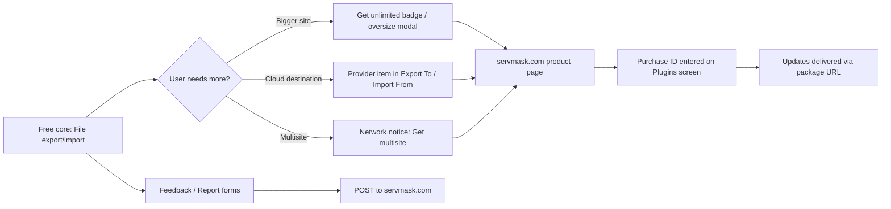

# 01 – Business Requirements Document (BRD)

Purpose: state why SnapBak exists, who it serves, what the MVP covers, and how the original plugin (All-in-One WP Migration v6.77 by ServMask, called "the original plugin" or "AI1WM") makes money, so that the remaining documents (02-SRS.md to 06-Development-Plan.md) have a business baseline.

All `path:line` citations are relative to the original plugin root (`all-in-one-wp-migration/`). Behaviour is described in prose and no code is copied. Items marked **Unclear:** could not be confirmed from the source.

## Table of contents

1. [Purpose and background](#1-purpose-and-background)
2. [Problem statement](#2-problem-statement)
3. [Target users and personas](#3-target-users-and-personas)
4. [Business goals and value propositions](#4-business-goals-and-value-propositions)
5. [Scope: MVP vs later](#5-scope-mvp-vs-later)
6. [Assumptions and constraints](#6-assumptions-and-constraints)
7. [Monetization model of the original plugin](#7-monetization-model-of-the-original-plugin)
8. [Monetization options for SnapBak](#8-monetization-options-for-snapbak)
9. [Competitive positioning notes](#9-competitive-positioning-notes)
10. [Success metrics and KPIs](#10-success-metrics-and-kpis)
11. [Risks](#11-risks)

---

## 1. Purpose and background

The original plugin packages a whole WordPress site (database, media, plugins, themes, must-use plugins) into one archive file and restores that archive on another WordPress install. During the restore it rewrites URLs, paths and table prefixes. Its own description is "Migration tool for all your blog data. Import or Export your blog content with a single click." (Source: `all-in-one-wp-migration.php:3-11`), and the readme summary is "Move, transfer, copy, migrate, and backup a site with 1-click" (Source: `readme.txt:10`).

### 1.1 Product identity

| Item | Value |
|---|---|
| Product | **SnapBak**, a WordPress plugin to back up, move and restore a whole site |
| Author | **Riyadh Mobin** |
| Slug / text domain | `snapbak` |
| Archive extension | `.snapbak` |
| Licence | GPLv2 or later |

The full list of identifiers (namespace, prefixes, REST namespace, CLI command, folders, archive signature, plugin header) is in `02-SRS.md` §1.6. Before launch, check that the name "SnapBak" is free to use as a trademark and on WordPress.org (§6.3).

Background facts that shape this BRD:

| Fact | Source |
|---|---|
| Version 6.77. Requires WP 3.3+ and PHP 5.2.17+, tested up to WP 4.9. | `readme.txt:4-7` |
| Licence: the file headers say GPLv3-or-later, but `readme.txt` says "GPLv2 or later". The two are inconsistent. | `all-in-one-wp-migration.php` header; `readme.txt:8` |
| The archive format (later called `.wpress`) was introduced in 3.0.0 together with the Backups page, restore from Backups, and time-sliced export/import. | `changelog.txt:191-201` |
| The free core offers export to "File" and import from "File" only. Every other destination is an upsell link to a paid extension. | `lib/controller/class-ai1wm-export-controller.php:120-137`; `lib/controller/class-ai1wm-import-controller.php:124-142` |
| There are no CPTs, taxonomies, shortcodes, blocks, widgets, REST routes or custom DB tables. Everything is stored in options, files in `storage/<job>/`, and `wp-content/ai1wm-backups/`. | A-core note §8; `lib/controller/class-ai1wm-main-controller.php:900-921` |
| SnapBak is a clean-room reimplementation. Engineers work from these documents, not from the original code. | This document set |

## 2. Problem statement

Moving or cloning a WordPress site between hosts or domains is hard for non-experts. The original plugin targets four obstacles:

| Obstacle | Why it breaks naive migrations | How the original addresses it | Source |
|---|---|---|---|
| **Upload size limits.** Hosts cap `upload_max_filesize` and `post_max_size`, and the readme says "most providers" use 2 MB. | A full-site archive is usually far larger than the cap. | The browser slices the file into chunks of at most min(post_max_size, upload_max_filesize, 5 MB) and the server appends each chunk. | `readme.txt:23-25`; `lib/controller/class-ai1wm-import-controller.php:154-160`; `constants.php:289`; `lib/model/import/class-ai1wm-import-upload.php:54-62` |
| **Request timeouts** (`max_execution_time`, proxies, LiteSpeed aborting requests). | A single request cannot copy gigabytes or dump large databases. | Each step yields after about 10 s (filter `ai1wm_completed_timeout`) and resumes from byte and row offsets kept in the request parameters. Requests are chained from the browser or by a server loopback. A LiteSpeed `noabort` block is added to the root `.htaccess`. | `lib/model/export/class-ai1wm-export-content.php:118`; `lib/controller/class-ai1wm-export-controller.php:62-117`; `lib/vendor/servmask/filesystem/class-ai1wm-file-htaccess.php:54-60` |
| **Serialized URLs.** PHP-serialized strings store their byte length, so a plain text replace of the domain corrupts them. | Options, widgets and page-builder data break after a domain change. | Replacement is serialization-aware: the value is unserialized, replaced, then re-serialized. There are special cases for Visual Composer and BeTheme base64 blobs, and http/https, www, URL-encoded and JSON-escaped variants are generated automatically. | `lib/vendor/servmask/database/class-ai1wm-database-utility.php:56-95`; `lib/vendor/servmask/database/class-ai1wm-database.php:1050-1121`; `lib/model/import/class-ai1wm-import-database.php:424-690` |
| **Environment differences** (table prefix, collations, storage engines, host mu-plugins, SSL and login-hiding plugins). | The restored site fails to load or locks the admin out. | Tables are exported under a placeholder prefix (`SERVMASK_PREFIX_`) that is remapped on import. Collations are downgraded when unsupported. MyISAM is retried as InnoDB on error 1030. Host-specific mu-plugins are skipped. SSL and login-hiding plugins are deactivated. | `constants.php:119`; `lib/vendor/servmask/database/class-ai1wm-database.php:1129-1147,1302-1314`; `constants.php:164-184`; `lib/model/import/class-ai1wm-import-done.php:28-207` |

The original plugin solves these with a design that has serious security and reliability defects (see 05-Improvement-Notes.md). The business case for SnapBak is to keep the "one-click, no technical knowledge" promise while fixing those defects.

## 3. Target users and personas

Who it is for, based on the readme and the features: site owners with "no technical knowledge" (`readme.txt:13`), users of many shared hosts (`readme.txt:64-80`), and developers who use WP-CLI (`readme.txt:36-37`).

### 3.1 Persona summary

| # | Persona | Technical level | Primary goal | Key features used in the original |
|---|---|---|---|---|
| P1 | Non-technical site owner changing host | Low | Move a site to a new host without FTP or phpMyAdmin | Export to File, drag-and-drop import, chunked upload, confirm dialog, automatic URL replacement |
| P2 | Freelancer or agency developer (staging to production, domain change) | Medium-high | Clone sites between dev, staging and live with domain and path rewrites | Find/Replace rows, advanced exclusions, Backups page restore, HTTP Basic auth support for staging |
| P3 | DevOps or power user scripting backups | High | Automate backups and restores from a shell | `wp ai1wm backup` / `restore` / `--list` |
| P4 | Hosting-provider support or migration staff | Medium-high | Move customer sites onto their platform reliably | Host mu-plugin exclusions, LiteSpeed noabort, collation and engine fallbacks, HyperDB support |
| P5 | Multisite network administrator | High | Export one subsite or a whole network | Only possible with the paid Multisite extension. Core shows an upsell notice and no menu. |

### 3.2 Persona details

**P1: Non-technical site owner**
- **Goals:** move the site to a new host or domain in one sitting, and keep a downloadable copy.
- **Pains:** host upload limits, timeouts, broken images and links after a domain change, and fear of overwriting the live site.
- **How the original serves them:**
  - "Export To > File" produces a single archive with a pulsing Download button (`lib/model/export/class-ai1wm-export-download.php:52-70`).
  - Import is a drag-and-drop zone, with chunked upload and a progress bar (`lib/view/import/import-buttons.php:27-87`; `lib/view/assets/javascript/import.min.js:1820-2025`).
  - A confirmation modal warns that the import overwrites the database, media, plugins and themes (`lib/model/import/class-ai1wm-import-confirm.php:28-63`).
  - URL replacement needs no input from the user (`lib/model/import/class-ai1wm-import-database.php:424-626`).
- **Gaps SnapBak should close:**
  - Backups are publicly downloadable.
  - The user is logged out after import and must log in with the source site's credentials (`lib/model/import/class-ai1wm-import-database.php:692-705,810-829`).
  - The user must save permalinks twice by hand (`lib/model/import/class-ai1wm-import-done.php:190-203`).
  - Once processing starts after the upload, there is no Stop button (D-ui note §2.5).

**P2: Freelancer or agency developer**
- **Goals:** repeatable clones between environments, custom string rewrites, and smaller archives (excluding media, cache or inactive plugins).
- **Pains:** serialized data, staging behind Basic auth, large media libraries, and multiple domains or www variants.
- **How the original serves them:**
  - Unlimited Find/Replace rows (`lib/view/export/find-replace.php:27-49`).
  - Eleven "Do not export …" options (`lib/view/export/advanced-settings.php:27-117`). Three of them (inactive themes, inactive plugins, cache) appear only when the size limit filter returns 0, i.e. with Unlimited (`lib/view/export/advanced-settings.php:60,84`).
  - Restore from the Backups list (`lib/view/backups/index.php`).
  - HTTP Basic credentials are captured automatically for loopbacks (`lib/controller/class-ai1wm-main-controller.php:875-885`).
- **Gaps:**
  - Find/replace rows cannot be removed.
  - Replacing a string with an empty string is impossible (`lib/model/export/class-ai1wm-export-config.php:63-70`).
  - The CLI `--replace` with several pairs is broken (`lib/vendor/servmask/command/class-ai1wm-wp-cli-command.php:177-183`).

**P3: DevOps or power user**
- **Goals:** scripted, unattended backups and restores, for example from cron or CI.
- **Pains:** browser-only tools, no progress output, and multisite.
- **How the original serves them:**
  - `wp ai1wm backup` maps eleven `--exclude-*` flags to the export options and supports `--list` (`lib/vendor/servmask/command/class-ai1wm-wp-cli-command.php:85-208`).
  - `wp ai1wm restore <file>` restores from `ai1wm-backups/` (`:210-273`).
  - Neither command is gated by a licence in v6.77 (B-export note §9).
- **Gaps:**
  - Multisite is refused.
  - There is no progress output.
  - Restore has no confirmation prompt.
  - Storage is not cleaned up after an error.
  - There is no built-in scheduling in core (see §5.3).

**P4: Hosting-provider support staff**
- **Goals:** a high migration success rate across varied source hosts.
- **Pains:** host-specific mu-plugins, LiteSpeed killing long requests, Azure MySQL rejecting MyISAM, utf8mb4_520 collations on older MySQL, 32-bit PHP with files over 2 GB.
- **How the original serves them:**
  - Skips Endurance and GoDaddy mu-plugins (`constants.php:164-184`; `lib/model/import/class-ai1wm-import-mu-plugins.php:28-53`).
  - Writes the LiteSpeed `noabort` block (`lib/controller/class-ai1wm-main-controller.php:46-56`).
  - Retries with the engine rewritten (`lib/vendor/servmask/database/class-ai1wm-database.php:1302-1314`).
  - Applies collation fallbacks (`:1129-1147`).
  - Shows a 32-bit error message (`lib/model/import/class-ai1wm-import-validate.php:31-39`).
  - The readme lists supported hosts (`readme.txt:64-80`).
- **Gaps:**
  - MySQL 8 `utf8mb4_0900_ai_ci` is not handled.
  - Oversized statements and SQL errors are dropped silently (`lib/vendor/servmask/database/class-ai1wm-database.php:760-845`).

**P5: Multisite network administrator**
- **Goals:** export a network or a subsite, and import a subsite into a single site.
- **How the original serves them:**
  - Without the Multisite extension, core registers no menu on a network and only shows the notice "Multisite is supported via our … Multisite Extension" (`lib/controller/class-ai1wm-main-controller.php:177-188`; `lib/view/main/multisite-notice.php`).
  - Core import can map a one-subsite network archive into a single site (`lib/model/import/class-ai1wm-import-blogs.php:28-127`).
- **Unclear:** the Multisite extension's blog-mapping fields are not in this codebase (D-ui note §2.5).

## 4. Business goals and value propositions

### 4.1 Business goals for SnapBak

| ID | Goal | Rationale (tied to original behaviour) |
|---|---|---|
| BG-1 | Match the original's core job: full-site export, upload and import, with serialization-safe URL rewriting, on constrained shared hosting. | This is what users value in the original (§2). |
| BG-2 | Be secure by default: no unauthenticated endpoints, no public backups, no archive path traversal. | The original fails all three (05-Improvement-Notes.md SEC-01 to SEC-05). |
| BG-3 | Make migrations verifiably correct (checksums, manifest, explicit errors). | The original has no checksums, and it skips files and SQL statements silently (B-export note §6.1; C-import note §8). |
| BG-4 | Need fewer manual post-steps (session survives, rewrite rules flushed). | The original logs the user out and asks for "save permalinks twice" (`lib/model/import/class-ai1wm-import-done.php:190-203`). |
| BG-5 | Leave room for a sustainable revenue model without crippling the core (§8). | The original's freemium funnel is described in §7. |

### 4.2 Value propositions

| VP | Proposition | Features that deliver it | Source (original behaviour being matched or improved) |
|---|---|---|---|
| VP-1 | "Works on any host": no PHP extensions or shell needed | Pure-PHP archiver, chunked upload, time-sliced steps, browser-driven fallback when loopbacks are blocked | `readme.txt:21-28`; `lib/controller/class-ai1wm-export-controller.php:99-111` |
| VP-2 | "Bypass upload limits" | Chunk size derived from PHP ini limits; resumable upload | `lib/controller/class-ai1wm-import-controller.php:154-160`; `readme.txt:23-25` |
| VP-3 | "Domain change without broken data" | Serialization-aware find/replace, automatic site/home URL and content-path rewriting, email-domain option | `lib/vendor/servmask/database/class-ai1wm-database-utility.php:56-95`; `lib/model/import/class-ai1wm-import-database.php:424-690` |
| VP-4 | "Smaller archives" | Exclusions for spam, revisions, media, themes, inactive themes and plugins, mu-plugins, cache, and the database | `lib/view/export/advanced-settings.php:27-117`; `lib/model/export/class-ai1wm-export-enumerate.php:51-103` |
| VP-5 | "One place for your backups" | Backups list with download, restore and delete | `lib/view/backups/index.php`; `lib/model/class-ai1wm-backups.php:33-104` |
| VP-6 | "Scriptable" | WP-CLI backup, restore and list | `lib/vendor/servmask/command/class-ai1wm-wp-cli-command.php:85-273` |
| VP-7 (new) | "Safe by design" | Authenticated REST, private storage, signed job tokens, archive validation | Absent in the original; see 05-Improvement-Notes.md |
| VP-8 (new) | "Set and forget" | Settings tab: scheduled backups with retention, a safety backup before every import or restore, optional backups before automatic updates, failure emails on by default (02-SRS.md FR-113 to FR-124) | Absent from the original's free core: only an unused cron API and notification filters that default to off (`lib/vendor/servmask/cron/class-ai1wm-cron.php:37-71`; `lib/model/class-ai1wm-notification.php:28-80`). Scheduling is sold through extensions (§7). |

## 5. Scope: MVP vs later

### 5.1 In scope for the MVP

| Area | MVP requirement (detailed in 02-SRS.md) | Original reference |
|---|---|---|
| Export to file | Full-site export with all 11 exclusion options available unconditionally, plus find/replace pairs (with row removal and empty replacement allowed) | `lib/view/export/advanced-settings.php`; `lib/view/export/find-replace.php` |
| Download | Authenticated, streamed download of a finished archive (no public static URL) | Original uses a public static URL: `lib/model/export/class-ai1wm-export-download.php:40-70` |
| Import from file | Chunked, resumable (offset-based) upload; archive validation; confirmation step; serialization-safe rewrite; plugin and theme reactivation; deactivation of SSL and login-hiding plugins | `lib/model/import/*` |
| Backups list | List, download, restore and delete, limited to archives the plugin created | `lib/view/backups/index.php`; `lib/controller/class-ai1wm-backups-controller.php:41-79` |
| Job runner | Background continuation (queue or loopback) with a browser-driven fallback, and status polling | `lib/controller/class-ai1wm-export-controller.php:62-117` |
| WP-CLI | `backup`, `restore` (with a confirmation flag) and `list`, with progress output | `lib/vendor/servmask/command/class-ai1wm-wp-cli-command.php` |
| Single-site | Single-site WordPress only | Core behaviour without the Multisite extension |
| i18n and a11y | Translatable strings, keyboard and screen-reader support | D-ui note §8-9 |

### 5.2 Later (post-MVP), roughly in priority order

1. **Settings tab and automatic backups** (02-SRS.md FR-113 to FR-124; screens in 04-UI-UX-Spec.md §15; clickable mock-up in `preview/index.html#settings`):
   - scheduled backups to this server (every 12 hours, daily, weekly or monthly, at a chosen time), with contents presets, retention ("keep the latest N"), "Run now", and next/last-run status;
   - a safety backup of the current site before every import or restore (on by default), plus optional backups before automatic WordPress updates;
   - email notifications (failure on by default), a storage-usage warning, log retention and background-runner settings.

   This is the first priority after the MVP. The safety backup before import could move into the MVP if R-1 is treated as a launch blocker.
2. Optional archive encryption (password-derived key).
3. Optional compression.
4. Remote destinations: SFTP/FTP and S3-compatible first, then others (Dropbox, Google Drive, OneDrive, Box, Mega, B2, GCS, Azure, Glacier, pCloud, DigitalOcean Spaces). The original sells these individually (§7.2).
5. Import from URL.
6. Multisite: network export, subsite to single site, single site to subsite.
7. Incremental or differential backups, which the manifest with per-file checksums makes possible.
8. Import of legacy `.wpress` archives (business decision, §6.4).

### 5.3 What exists in the original core (for scoping comparisons)

| Capability | In the original free core? | Evidence |
|---|---|---|
| Scheduling | **No scheduled jobs.** Core ships only an API: `Ai1wm_Cron::add`/`clear` are never called, plus 'weekly' and 'monthly' schedules registered on `cron_schedules`, plus an `ai1wm_is_scheduled_backup()` check and notification-email filters that default to off. **Unclear:** which paid extension does the scheduling. B-export note §8 assumes Unlimited, but the extension code is not available. | `lib/vendor/servmask/cron/class-ai1wm-cron.php:37-71`; `lib/controller/class-ai1wm-main-controller.php:123,929-940`; `functions.php:1390-1404`; `lib/model/class-ai1wm-notification.php:28-80` |
| Encryption or password | **No.** The export options are only the 11 `no_*` flags plus `replace`. | B-export note §0; `lib/view/export/advanced-settings.php` |
| Compression | **No.** The "Compressor" class only writes. Entries are raw bytes. | `lib/vendor/servmask/archiver/class-ai1wm-compressor.php`; B-export note §6.1 |
| Incremental backups | **No.** Every export is a full copy, with no manifest or checksums. | B-export note §6 |
| Integrity check | Minimal. Only the trailing 4377-byte EOF block is checked. | `lib/vendor/servmask/archiver/class-ai1wm-archiver.php:193-205` |
| Notification emails | Present but off by default (toggle filters). Only the error path is called from core. | `lib/model/class-ai1wm-notification.php:28-80` |
| WP-CLI | Yes, with no licence gate in this version. | `loader.php:38-46` |

### 5.4 Out of scope (all phases unless re-decided)

- Reusing ServMask branding, product names, the font or the icons (§6.3).
- Re-implementing the ServMask updater or purchase-ID flow (`lib/model/class-ai1wm-updater.php`). If paid add-ons are sold, a new licensing service is needed (§8).
- Social share widgets in the admin (`lib/view/common/share-buttons.php`).
- Forwarding support forms to a third-party endpoint by default (`lib/model/class-ai1wm-feedback.php:51`; `lib/model/class-ai1wm-report.php:48`).
- The `X-Forwarded-Proto` override (`all-in-one-wp-migration.php:37-39`).
- Support for PHP 5.x, 32-bit big-file emulation (`lib/vendor/math/BigInteger.php`), and the ext/mysql driver.

## 6. Assumptions and constraints

### 6.1 Assumptions

| ID | Assumption |
|---|---|
| A-1 | The target users run shared hosting with low PHP limits, the same audience the original's readme addresses (`readme.txt:20-28,64-80`). |
| A-2 | Users have an administrator account on both source and target WordPress installs. The original's menus need the `export` and `import` capabilities (`lib/controller/class-ai1wm-main-controller.php:456-497`). |
| A-3 | Disk space on the server is at least 2× the archive size during import. The original extracts `database.sql` out of the archive (`lib/model/import/class-ai1wm-import-validate.php:105-115`), and uploads are stored before extraction. |
| A-4 | Loopback HTTP requests may be blocked, so the browser-driven mode must remain a fallback. The original's manual mode exists for this reason (`lib/controller/class-ai1wm-export-controller.php:99-102`). |
| A-5 | The MySQL user may lack privileges such as REPAIR or FILE. The original ignores most SQL errors; SnapBak will surface them. |

### 6.2 Technical constraints

| Constraint | Impact on requirements | Source / evidence |
|---|---|---|
| `upload_max_filesize` and `post_max_size` | The chunk size must be derived from both, using binary units, and must guard against "0". | `lib/controller/class-ai1wm-import-controller.php:154-160`; `functions.php:299-313` |
| `max_execution_time`, proxy timeouts, LiteSpeed abort | Every long step must be time-sliced and resumable. | `ai1wm_completed_timeout` uses; `lib/vendor/servmask/filesystem/class-ai1wm-file-htaccess.php:54-60` |
| `max_allowed_packet` on the target DB | INSERT batches must stay below the target limit. Oversized rows must be split or reported, never skipped silently. | `lib/vendor/servmask/database/class-ai1wm-database.php:762,792` |
| Nginx ignores `.htaccess` and `web.config` | Backup privacy cannot depend on server config files. | `lib/vendor/servmask/filesystem/class-ai1wm-file-htaccess.php:33-45` |
| PHP and WordPress versions | The original supports PHP 5.2.17+ and WP 3.3+ (`readme.txt:4-6`). For SnapBak we propose PHP 7.4 minimum, tested up to 8.3, and a modern WP minimum. The exact versions are a decision for 02-SRS.md and 06-Development-Plan.md. | 05-Improvement-Notes.md §6 |
| MySQL / MariaDB variance | Collation and engine mapping is required (utf8mb4_520, utf8mb4_0900, Aria, MyISAM on managed DBs). | `lib/vendor/servmask/database/class-ai1wm-database.php:1129-1147,1262-1314` |
| Multisite | The original core is unusable on a network without its paid extension. The MVP is single-site only. | `lib/controller/class-ai1wm-main-controller.php:177-188` |

### 6.3 Legal constraints: licensing, clean-room, trademarks

- **GPL status of the original.** The source is GPL: the file headers say GPLv3-or-later and `readme.txt:8` says GPLv2 or later. Copying GPL code would be lawful only if SnapBak is distributed under a compatible GPL licence. The project has chosen **clean-room** anyway, which means:
  - Specification writers read the original. Implementers work only from 01–06 and never see the original code.
  - These documents describe behaviour in prose and tables. They reproduce no code (STYLE rule 4).
  - Short identifiers (hook names, option names, archive field sizes) appear only where interoperability needs them.
  - SnapBak still has to be GPL-compatible if it is distributed through WordPress.org or links against WordPress APIs. Choosing its licence (likely GPLv2-or-later) is a separate decision.
- **Trademarks and branding.** Do not use "All-in-One WP Migration", "ServMask", the ServMask logo, the IcoMoon "servmask" icon font (`lib/view/assets/font/servmask.*`), or the `.wpress` name in the product name, UI copy, file extension or marketing without legal advice. Also avoid internal tokens that carry the brand, such as `SERVMASK_PREFIX_` (`constants.php:119`) and the `ai1wm_` prefixes, in SnapBak's own format and APIs.
- **Not legal advice.** This section records business constraints. Counsel should review the trademark position and any compatibility claims before release.

### 6.4 Business decision: keep `.wpress` compatibility?

| Option | Benefits | Costs and risks |
|---|---|---|
| A. No compatibility; new format only | Clean design (manifest, checksums, long names, compression, encryption). No trademark entanglement. | Users cannot bring existing archives, which slows switching. |
| B. Read-only import of legacy archives, as a "legacy archive importer" with neutral naming | A conversion funnel for users of the original. Reading is simpler than writing. | The legacy format has no checksums, truncates names silently at 255 bytes and paths at 4096 bytes (`lib/vendor/servmask/archiver/class-ai1wm-archiver.php:43-58`), and has no path-traversal guard in the reference extractor. The new reader must harden all of this. The SQL inside uses the `SERVMASK_PREFIX_` placeholder, which the reader must understand. Naming the feature needs legal review. |
| C. Read and write `.wpress` | Two-way interoperability. | Inherits every format weakness. A higher trademark risk. Blocks format improvements. |

Recommendation for the business owner: **Option A for the MVP, Option B as a later add-on**, after legal review of the naming. This is a business call, not a technical requirement.

## 7. Monetization model of the original plugin

### 7.1 Free core vs premium

The free plugin is fully usable for file-based single-site migrations. Revenue comes from 16 separately sold extensions that hook into the same pipeline (filters `ai1wm_export` and `ai1wm_import` at other priorities, the button filters, and `ai1wm_max_file_size`). (Source: `lib/controller/class-ai1wm-main-controller.php:131-170`; `readme.txt:44-62`.)

The readme says: "All of the Cloud Storage and Multisite extensions include premium support and the Unlimited extension free of charge" (`readme.txt:44-45`).

### 7.2 The 16 premium extensions

The extension code is not in this repository. "What it unlocks" is inferred from how core exposes each hook. Core defines a default folder name, an about URL, a purchase-ID option and a minimum required version for each extension.

| Extension | Purchase-ID option | Minimum version required by core 6.77 | What it unlocks, as visible from core | Source |
|---|---|---|---|---|
| Unlimited | `ai1wmue_plugin_key` | 2.18 | Removes the import size cap: the "Get unlimited" badge is replaced by "Unlimited", and the Validate and JS size checks are skipped when `ai1wm_max_file_size` returns 0. Also shows the 3 extra export options (inactive themes, inactive plugins, cache). **Unclear:** whether it adds scheduling or restore features beyond this. | `constants.php:878-910`; `lib/model/class-ai1wm-extensions.php:226`; `lib/view/import/import-buttons.php:61-72`; `lib/view/export/advanced-settings.php:60,84`; `lib/model/import/class-ai1wm-import-validate.php:85-100` |
| Multisite | `ai1wmme_plugin_key` | 3.59 | The plugin menu on a network (`network_admin_menu`), network export (`multisite.json`) and the blog-mapping UI (`blogs` status) | `lib/controller/class-ai1wm-main-controller.php:177-188`; `constants.php:730-762`; `lib/model/class-ai1wm-extensions.php:174` |
| URL | `ai1wmle_plugin_key` | 2.27 | Import from a URL (import button `ai1wm_import_url`; there is no export counterpart) | `lib/controller/class-ai1wm-import-controller.php:124-142`; `constants.php:915-947` |
| FTP | `ai1wmfe_plugin_key` | 2.37 | Export to and import from FTP (`ai1wm_export_ftp` / `ai1wm_import_ftp`) | `constants.php:545-577`; `lib/model/class-ai1wm-extensions.php:109` |
| Dropbox | `ai1wmde_plugin_key` | 3.32 | Export to and import from Dropbox | `constants.php:508-540`; `:96` |
| Google Drive | `ai1wmge_plugin_key` | 2.36 | Export to and import from Google Drive | `constants.php:619-651`; `:135` |
| Amazon S3 | `ai1wmse_plugin_key` | 3.27 | Export to and import from S3 | `constants.php:841-873`; `:213` |
| OneDrive | `ai1wmoe_plugin_key` | 1.23 | Export to and import from OneDrive | `constants.php:767-799`; `:187` |
| Box | `ai1wmbe_plugin_key` | 1.13 | Export to and import from Box | `constants.php:434-466`; `:70` |
| Mega | `ai1wmee_plugin_key` | 1.10 | Export to and import from Mega | `constants.php:693-725`; `:161` |
| DigitalOcean Spaces | `ai1wmie_plugin_key` | 1.6 | Export to and import from Spaces | `constants.php:471-503`; `:83` |
| Backblaze B2 | `ai1wmae_plugin_key` | 1.3 | Export to and import from B2 | `constants.php:397-429`; `:57` |
| Google Cloud Storage | `ai1wmce_plugin_key` | 1.0 | Export to and import from GCS | `constants.php:582-614`; `:122` |
| Microsoft Azure Storage | `ai1wmze_plugin_key` | 1.1 | Export to and import from Azure | `constants.php:360-392`; `:44` |
| Amazon Glacier | `ai1wmre_plugin_key` | 1.0 | Export to and import from Glacier | `constants.php:656-688`; `:148` |
| pCloud | `ai1wmpe_plugin_key` | 1.0 | Export to and import from pCloud | `constants.php:804-836`; `:200` |

The "Minimum version" column comes from `lib/model/class-ai1wm-extensions.php` at the line shown in the Source column (the second reference for most rows). Core blocks export and import with an error when an installed extension is older than this minimum, and the error links to the updater (`lib/model/class-ai1wm-compatibility.php:28-71`). This forces customers to keep paid extensions current.

### 7.3 The size cap and the MAX_FILE_SIZE bug

- The free tier is meant to cap import size. The cap is `AI1WM_MAX_FILE_SIZE`, which can be changed through the filter `ai1wm_max_file_size`. It is shown on the Import page as "Maximum upload file size: X" with a "Get unlimited" link, and it is enforced in JS and in the Validate step (Source: `constants.php:284`; `lib/view/import/import-buttons.php:61-72`; `lib/controller/class-ai1wm-main-controller.php:671,710-718`; `lib/model/import/class-ai1wm-import-validate.php:85-100`).
- **Unclear/likely bug.** The constant is defined as `2 << 28 * 4`. Multiplication binds tighter than the shift, so this is `2 << 112`. On PHP 7+ that evaluates to 0, and the plugin treats 0 as "unlimited". The intended limit was probably 512 MB (changelog 1.2.0: "Increased upload limit of files from 128MB to 512MB", `changelog.txt:300-301`). On PHP 7+ the effects in this copy are:
  - there is no size cap at all;
  - the "Get unlimited" upsell never shows;
  - the three Unlimited-only export options are visible to everyone (`lib/view/export/advanced-settings.php:60,84`).
- **Requirement for SnapBak:** if a size limit exists at all, it must be an explicit, documented and filterable number. A value of 0 means unlimited, and that must be explicit too.

### 7.4 Upsell placements in the UI

| Placement | Behaviour | Source |
|---|---|---|
| "Export To" dropdown | 13 of 14 items (FTP, Dropbox, Google Drive, S3, B2, OneDrive, Box, Mega, DigitalOcean, Google Cloud, Azure, Glacier, pCloud) are plain links to product pages that open in a new tab. | `lib/controller/class-ai1wm-export-controller.php:120-137`; `lib/view/export/button-*.php` |
| "Import From" dropdown | 14 of 15 items, the same list plus URL. | `lib/controller/class-ai1wm-import-controller.php:124-142`; `lib/view/import/button-*.php` |
| "Get unlimited" badge under the drop zone | Shown when the limit is non-zero. | `lib/view/import/import-buttons.php:61-72` |
| Oversize error modal | "…You can remove this restriction by purchasing our Unlimited Extension." | `lib/controller/class-ai1wm-main-controller.php:710-718`; `lib/model/import/class-ai1wm-import-validate.php:85-100` |
| Hidden export options | Three "new" options appear only when Unlimited is active. | `lib/view/export/advanced-settings.php:60,84` |
| Multisite network notice | Error notice with a "Get multisite" link; there is no menu at all. | `lib/view/main/multisite-notice.php`; `lib/controller/class-ai1wm-main-controller.php:177-188` |
| Plugins screen, extension rows | "There is an update available. To update, you must enter your Purchase ID". This shows whenever no purchase ID is stored, **even if no update exists**. | `lib/model/class-ai1wm-updater.php:156-190`; `lib/view/updater/modal.php` |
| Compatibility error | "X is not the latest version. You must update the plugin…" blocks the run. | `lib/model/class-ai1wm-compatibility.php:28-61` |
| Plugin row "Get Support" | Link to servmask.com/help. | `lib/controller/class-ai1wm-main-controller.php:443-449`; `lib/view/main/get-support.php` |
| Sidebar and import-done prompts | "Leave Feedback" with a review link; the done modal asks for a wordpress.org review; Twitter and Facebook share buttons. | `lib/view/common/leave-feedback.php`; `lib/model/import/class-ai1wm-import-done.php:190-203`; `lib/view/common/share-buttons.php` |

### 7.5 Licensing: purchase ID and updater

| Step | Behaviour | Source |
|---|---|---|
| 1. Purchase-ID entry | On plugins.php, the browser calls `https://servmask.com/purchase/<id>/check` directly. The response gives `{uuid, extension}`. | `lib/view/assets/javascript/updater.min.js:101-147` |
| 2. Store | An admin AJAX call (`ai1wm_updater`, which requires `update_plugins` and has no nonce) stores the uuid in the extension's `ai1wm<x>e_plugin_key` option. | `lib/controller/class-ai1wm-updater-controller.php:55-81`; `lib/controller/class-ai1wm-main-controller.php:918-920` |
| 3. Metadata | About every 12 h (with core's update check), on auto-update cron, or on `?ai1wm_updater=1`, core fetches `https://servmask.com/products/<ext>/about` for each active extension and caches the result in option `ai1wm_updater`. | `lib/model/class-ai1wm-updater.php:106-147`; `lib/controller/class-ai1wm-main-controller.php:193,208,887-892` |
| 4. Update offer | Core injects an update into the `update_plugins` transient only when a purchase ID is stored. The package URL is `<download_link>/<purchase_uuid>?siteurl=<site>`. | `lib/model/class-ai1wm-updater.php:65-99` |
| 5. Enforcement | There is no runtime licence check on features. Licensing gates **updates**, and the compatibility check forces customers to update. | `lib/model/class-ai1wm-compatibility.php:63-71` |

### 7.6 Support funnel

- The "Leave Feedback" sidebar has three options:
  - "review" links to wordpress.org;
  - "suggestions" links to feedback.wp-migration.com;
  - "help-needed" opens a form.
  The form POSTs type, email and message to `https://servmask.com/ai1wm/feedback/create` (Source: `lib/view/common/leave-feedback.php`; `lib/model/class-ai1wm-feedback.php:38-69`; `constants.php:104`).
- The "Report issue" popover POSTs email and message to `https://servmask.com/ai1wm/report/create` (Source: `lib/model/class-ai1wm-report.php:37-65`; `constants.php:109`).
- Both require a consent checkbox that links to an iubenda privacy policy (`readme.txt:104-105`).
- Error messages link to the help.servmask.com knowledgebase and a YouTube guide (`lib/controller/class-ai1wm-main-controller.php:685-713`).
- Premium extensions include premium support (`readme.txt:39-45`).

## 8. Monetization options for SnapBak

The options below are for the business owner. They are not requirements.

| Option | Description | Pros | Cons / constraints |
|---|---|---|---|
| M-1. Fully free (GPL), funded by donations or sponsorship | Every MVP and later feature is in core. | Maximum adoption and trust. No licensing infrastructure. | No direct revenue. Cloud integrations are costly to maintain. |
| M-2. Freemium core plus paid add-ons (the original's model) | Core = everything in the MVP §5.1. Add-ons = remote destinations, scheduling, multisite, encryption. Each is a separate GPL plugin with a licence key for updates and support. | A proven pattern (§7). Revenue scales with the number of integrations. | Needs a licence and update server. **Do not cripple core with an artificial size cap.** The original's cap is both a dark pattern and broken (§7.3). Check the WordPress.org directory guidelines on restricted or locked functionality before putting any limit in core; this item is outside the source material and needs verification. |
| M-3. Single "Pro" bundle (subscription) | One add-on unlocks all destinations, scheduling and encryption. | Simpler purchase, one licence check. | Higher entry price. |
| M-4. Hosted services | Optional paid off-site storage or a site-to-site transfer relay. | Recurring revenue. Removes the hosting-limit pain. | Operations, privacy and GDPR obligations. Must stay opt-in. |
| M-5. Host and agency partnerships | White-label or bulk licences for hosts (persona P4) and agencies (P2). | Matches personas with budget. | Sales effort. Branding must stay neutral. |

**Where scheduling sits.** 02-SRS.md currently specifies scheduled backups to this server, safety backups and notifications as core (free) features (FR-113 to FR-124, tier "core-free (new)"). Under M-2 or M-3, the paid part would be scheduling to remote destinations, which needs the destination add-ons anyway. If you decide to sell scheduling itself, as the original does, change the tier of those FRs and hide the Settings tab's schedule section behind the add-on.

Constraints for any paid option:
- Licensing must not require sending the site URL or other data without disclosure. The original sends the purchase uuid and the site URL in the package URL (`lib/model/class-ai1wm-updater.php:81`).
- Support forms must be opt-in and documented in a privacy notice.

## 9. Competitive positioning notes

- **Derivable from the source:** the original positions itself on these claims:
  - zero dependencies and PHP 5.2 compatibility (`readme.txt:27-28`);
  - bypassing upload limits (`:23-25`);
  - mobile compatibility (`:18`);
  - MySQL and MySQLi support (`:30-31`);
  - a list of supported hosts (`:64-80`);
  - WP-CLI (`:36-37`).
- From these, SnapBak can differentiate on security, verifiable integrity, a modern PHP baseline, accessibility and privacy (no third-party scripts).
- **Not derivable:** market share, pricing of the original's extensions, and competitor feature sets do not appear in the source, so this document does not state them.

## 10. Success metrics and KPIs

Targets are **proposals** for the business owner to confirm. 02-SRS.md turns the accepted ones into NFRs.

| KPI | Definition | How measured | Proposed target |
|---|---|---|---|
| Migration success rate | Completed imports whose post-import checks pass (manifest checksums match, site loads, admin can log in) ÷ imports started | Opt-in anonymous telemetry, or QA matrix runs | ≥ 98% on the QA host matrix |
| Silent-data-loss incidents | Files or SQL rows dropped without an error shown | Round-trip tests that compare source and target manifests and row counts | 0 |
| Maximum verified site size | Largest archive that completes the round trip on a reference shared-host profile (256 MB memory_limit, 30 s max_execution_time, 2 MB upload) | QA benchmark | ≥ 10 GB |
| Throughput | Minutes per GB for export, and for upload + import, on the reference profile | QA benchmark, median of 3 runs | Record a baseline in Phase 1, then aim for ≥ 20% better than the baseline |
| Requests per GB | Number of HTTP round trips per GB processed (the original pays a full WP bootstrap each time) | Server access-log count during the benchmark | Track it; aim to reduce it from the baseline |
| Post-import manual steps | Steps the user must do after the "done" message (the original requires a permalinks save and a re-login) | UX checklist | 0 required steps |
| Security findings | High or Medium findings in an external review before 1.0 | Third-party audit | 0 open High, 0 open Medium |
| Support tickets | Tickets per 1,000 migrations, by category (upload, timeout, DB, URL) | Support desk tagging | Baseline in the first quarter after launch, then a falling trend |
| Accessibility | WCAG 2.1 AA conformance of the plugin screens | axe or Lighthouse audit plus a manual keyboard pass | No critical violations |
| Scheduled backup reliability | Scheduled runs that start within 10 minutes of their time and finish successfully ÷ scheduled runs due | 30-day soak test on the QA matrix (Action Scheduler, WP-Cron with a real cron job, WP-Cron triggered by visits), plus opt-in telemetry | ≥ 99% with a real cron job or Action Scheduler; report WP-Cron-by-visits separately |
| Host-compatibility coverage | Share of the QA host matrix (Apache, Nginx, LiteSpeed, IIS; MySQL 5.7/8, MariaDB) passing round-trip tests | CI and QA matrix | 100% of the matrix |

## 11. Risks

| ID | Risk | Likelihood | Impact | Mitigation |
|---|---|---|---|---|
| R-1 | Data loss on the target site. Import overwrites everything, and the original offers no pre-import snapshot (`lib/model/import/class-ai1wm-import-confirm.php:28-63`). | Medium | High | Automatic safety backup before every import or restore, on by default (02-SRS.md FR-119); explicit confirmation; checksum verification before any destructive step. |
| R-2 | A security incident from exposed backups or job endpoints, as in the original (05-Improvement-Notes.md SEC-01 to SEC-06). | Medium (if the design repeats the original) | High | Authenticated REST, private storage, signed tokens, external audit. |
| R-3 | Trademark or naming dispute (§6.3). | Low-Medium | High | Neutral naming, legal review, no `.wpress` branding. |
| R-4 | Host incompatibility: loopbacks blocked, Basic-auth staging, aggressive WAFs. | High | Medium | Browser-driven fallback, WP-CLI path, a diagnostics page, a host QA matrix. |
| R-5 | Scope creep from cloud integrations (the original maintains 14 destinations). | High | Medium | MVP is file-only. Prioritise destinations by demand. Use a pluggable destination interface. |
| R-6 | A legacy `.wpress` importer brings in format weaknesses (§6.4). | Medium | Medium | Hardened reader, limit it to import, fuzz tests. |
| R-7 | Raising the PHP baseline excludes some legacy hosts. | Medium | Low-Medium | Publish requirements clearly and show a pre-flight check in the UI. |
| R-8 | Performance regressions from the added safety work (checksums, encryption). | Medium | Medium | Stream hashing, optional encryption and compression, benchmarks in CI (KPIs §10). |
| R-9 | Clean-room contamination: implementers copy original code. | Low | High | Process separation and code review against these specs (§6.3). |
| R-10 | Automatic backups fail silently or fill the disk (WP-Cron not firing, retention too high, full-site backups every 12 hours). | Medium | Medium | Failure emails on by default (FR-121), late-run warning and Site Health test (FR-118), retention that only deletes after a successful run (FR-116), storage-usage warning (FR-122), disk-space check before safety backups (FR-119). |
