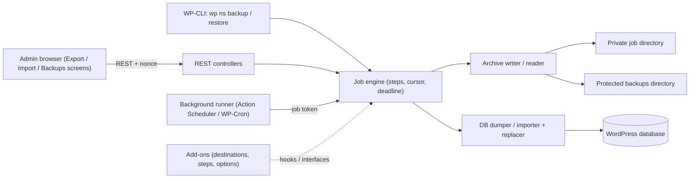
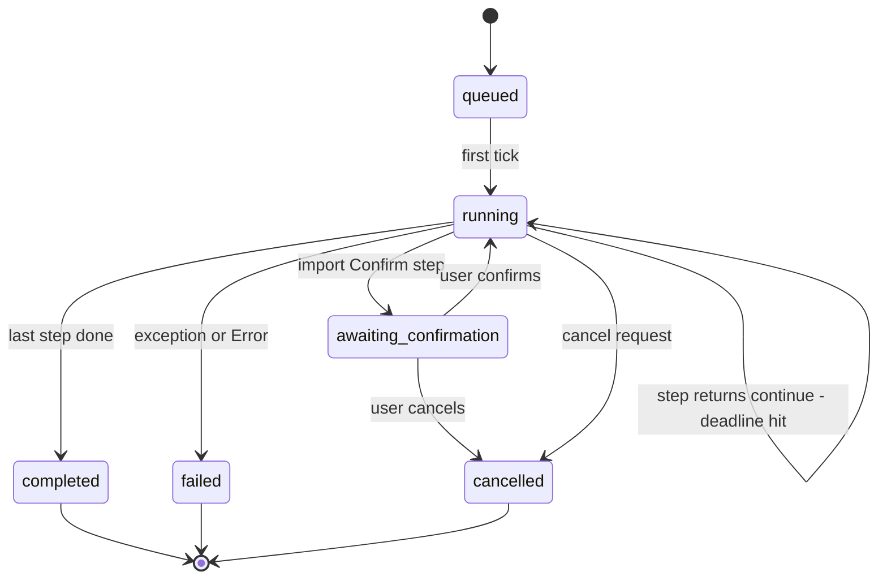
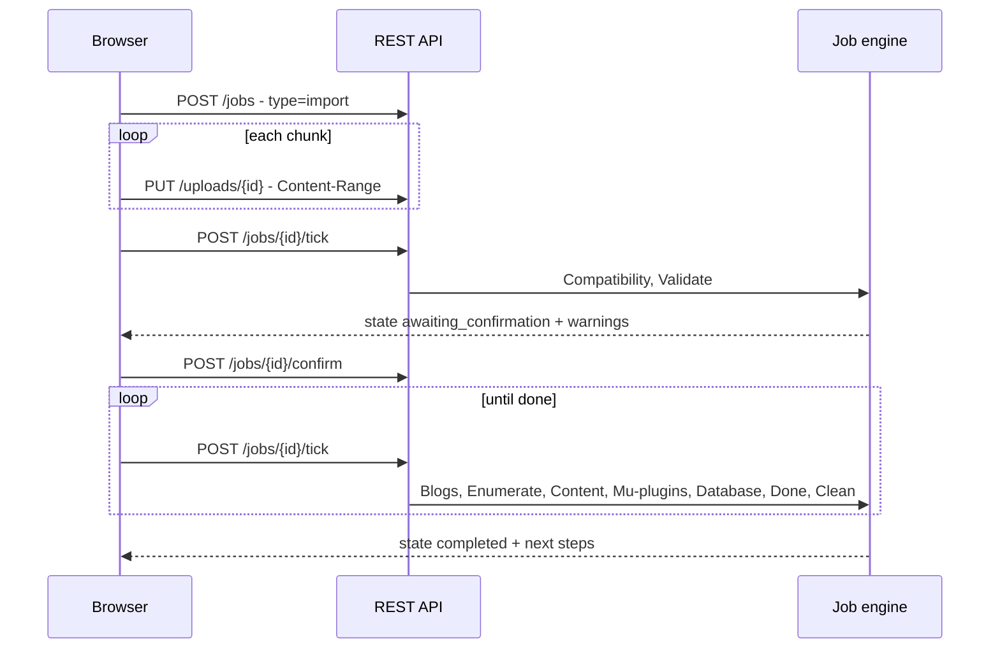

# 02 - Software Requirements Specification (SRS)

Testable functional and non-functional requirements for SnapBak, a reimplementation of the behaviour of All-in-One WP Migration v6.77 (ServMask), with the original's defects designed out.

## Table of contents

1. [Introduction](#1-introduction)
2. [Overall description](#2-overall-description)
3. [Functional requirements](#3-functional-requirements)
4. [Non-functional requirements](#4-non-functional-requirements)
5. [User stories](#5-user-stories)
6. [Use cases](#6-use-cases)
7. [Settings reference](#7-settings-reference)
8. [Traceability matrix](#8-traceability-matrix)

---

## 1. Introduction

### 1.1 Purpose

This document states what SnapBak must do, in a form that can be implemented and tested without reading the original code. Each requirement records the behaviour observed in the original plugin (AI1WM), with a `path:line` citation relative to the original plugin root, and the behaviour **required** of SnapBak. Where the original is insecure or buggy, the requirement states the corrected behaviour and adds an "Original behaviour" line that points to the matching `SEC-`/`BUG-`/`PERF-` item in `05-Improvement-Notes.md`.

Readers: the implementer, the tester writing acceptance tests, and the reviewer checking that the reference-code rules are followed (`06-Development-Plan.md` §7).

### 1.2 Scope

SnapBak moves and backs up a single WordPress site. It:

- exports the database, media, plugins, themes, must-use plugins and other `wp-content` files into one archive file;
- imports such an archive into another (or the same) WordPress install, rewriting URLs, paths, the table prefix and user-defined strings, including inside PHP-serialized data;
- keeps finished archives in a protected backups area where they can be listed, downloaded, restored and deleted;
- offers the same operations from WP-CLI;
- runs backups automatically: on a schedule, before every import or restore, and optionally before automatic WordPress updates, configured on a Settings tab (§3.15);
- exposes an extension API so add-ons can provide remote destinations, extra pipeline steps and extra options.

Out of scope for this SRS (see `01-BRD.md` §5.4): the ServMask updater service, social widgets, the `X-Forwarded-Proto` override, PHP 5 and 32-bit large-file emulation, and the ext/mysql driver. Remote cloud destinations, encryption, compression and full multisite network migration are later phases (`01-BRD.md` §5.2); where the original exposes an extension point for them, this SRS specifies the extension point.

The original's facts that bound this SRS:

- There are no custom post types, taxonomies, shortcodes, blocks, widgets, REST routes or custom DB tables in the original. All persistence is options, files in `storage/<job>/`, and `wp-content/ai1wm-backups/` (Source: `lib/controller/class-ai1wm-main-controller.php:900-921`; A-core note §8).
- The original's AJAX endpoints are registered for both priv and nopriv. Authentication is a 12-character secret key only: no nonces and no capability checks, except the updater, which requires `update_plugins` (Source: `lib/controller/class-ai1wm-main-controller.php:902-920`).
- In the original free plugin only the "File" export/import target works. Every other target is an upsell link to a premium extension (Source: `lib/controller/class-ai1wm-export-controller.php:120-137`; `lib/controller/class-ai1wm-import-controller.php:124-142`).
- `AI1WM_MAX_FILE_SIZE` is defined as `2 << 28 * 4` (`constants.php:284`). By operator precedence that is `2 << 112`, which evaluates to 0 on PHP 7+, and 0 is treated as "unlimited". The intended limit was probably 512 MB (changelog 1.2.0). **Unclear/likely bug** (BUG-01). SnapBak uses an explicit, filterable limit (FR-064).

### 1.3 Definitions, acronyms and abbreviations

| Term | Meaning |
|---|---|
| AI1WM, the original plugin | All-in-One WP Migration v6.77 by ServMask, the plugin being reimplemented. |
| SnapBak | The plugin specified here, by Riyadh Mobin (identity in §1.6). |
| `snapbak` | Placeholder for SnapBak's prefix (option names, hook names, REST namespace, CLI command). Chosen at branding time. |
| `.wpress` | The original's archive format: a flat sequence of entries, each a 4377-byte header (name 255, size 14, mtime 12, path 4096 bytes, NUL-padded) followed by the raw file bytes, ending with a 4377-byte all-NUL EOF block. No compression, checksum or index (Source: `lib/vendor/servmask/archiver/class-ai1wm-archiver.php:43-58, 79`). |
| Archive (new) | SnapBak's archive: versioned, with a manifest and per-file SHA-256 (FR-039 to FR-044). |
| Job | One export, import or restore run, identified by a job ID, with its options, cursor (resume offsets), counters and state. In the original a job is the `$params` array plus a `storage` folder. |
| Job directory / storage dir | The per-job working folder. Original: `wp-content/plugins/all-in-one-wp-migration/storage/<storage>/`, where `<storage>` is `uniqid()` (server) or 12 random `[a-z0-9]` characters (browser) (Source: `functions.php:32-44, 507-509`). SnapBak: a private directory outside the plugin folder (FR-003). |
| Backups directory | Where finished archives are kept. Original: `wp-content/ai1wm-backups/` (Source: `constants.php:321`). |
| Step | One unit of the export or import pipeline, e.g. Enumerate, Content, Database. |
| Priority | In the original, the WordPress filter priority on `ai1wm_export` / `ai1wm_import` that identifies a step and fixes its order (export 5 to 300, import 5 to 400). The client sends the priority to run (Source: `lib/controller/class-ai1wm-main-controller.php:131-157`). SnapBak uses a step registry instead (FR-011). |
| Completed flag | `$params['completed']`. A step sets it to false when it ran out of time; the same step is then re-run with the saved offsets (Source: `lib/controller/class-ai1wm-export-controller.php:92-98`). |
| Time slice / deadline | The time budget per request. Original: filter `ai1wm_completed_timeout`, default 10 s, 0 = unlimited. SnapBak: `min(20 s, 0.6 x max_execution_time)`, filterable (`06-Development-Plan.md` §2.2). |
| Secret key | Original option `ai1wm_secret_key`: 12 alphanumeric characters generated on first `admin_init`; the only credential on all action endpoints (Source: `lib/controller/class-ai1wm-main-controller.php:868-873`; `functions.php:1377-1383`). Not used by SnapBak (FR-006). |
| Job token | SnapBak: an HMAC of the job ID and an expiry, keyed with `wp_salt('auth')`, used only for background continuation (`06-Development-Plan.md` §2.3). |
| Manual mode | Original: a request that carries `ai1wm_manual_export`, `ai1wm_manual_import` or `ai1wm_manual_restore`. The server echoes the next `$params` as JSON and the browser drives the loop. Status is written only in manual mode (Source: `functions.php:1390-1404`). |
| Scheduled mode | Original: any request without a `manual_*` flag (loopback chain, cron, WP-CLI). The server chains itself with a non-blocking `wp_remote_post`, writes no status, and may send notification e-mails (Source: `lib/controller/class-ai1wm-export-controller.php:104-111`). |
| Loopback | A non-blocking HTTP POST from the site to its own `admin-ajax.php` to continue a job. |
| Find/replace | Pairs of strings applied to the database on import. Built from the source and target site URL, home URL, content dir, e-mail domain and user-defined pairs, each in several encodings (§3.5). |
| Serialization-aware replace | Replacing inside PHP-serialized values and re-serializing so that `s:N:` string lengths stay correct. |
| `SERVMASK_PREFIX_` | The placeholder table prefix the original writes into the SQL dump instead of the real `$wpdb->base_prefix`; replaced with the target prefix on import (Source: `constants.php:119`). SnapBak uses its own placeholder (FR-049). |
| `package.json` | The original's archive-root metadata file: site/home URLs, options, versions, active plugins and theme (Source: `lib/model/export/class-ai1wm-export-config.php:44-151`). |
| `multisite.json`, `blogs.json` | Multisite metadata (written only by the paid Multisite extension) and the import-time blog mapping file (Source: `lib/model/import/class-ai1wm-import-blogs.php:28-127`). |
| Drop-in | A `wp-content` file such as `advanced-cache.php`, `db.php`, `object-cache.php` listed by WordPress `_get_dropins()`. |
| Extension / add-on | A separate plugin that hooks into SnapBak's API. In the original: 16 ServMask premium extensions (Source: `constants.php:360-947`). |
| Purchase ID | The licence UUID stored per extension in `ai1wm<x>e_plugin_key` and used in the extension download URL (Source: `lib/controller/class-ai1wm-updater-controller.php:55-81`). |
| Tier | Where a feature lives in the original: **core-free** (works in the free plugin), **extension-point** (the free plugin only exposes a hook or API for it), **premium-in-original** (only works with a paid extension). |
| MC | Short for `lib/controller/class-ai1wm-main-controller.php` in Source cells. |

### 1.4 References

| Document | Use |
|---|---|
| `01-BRD.md` | Business goals, personas P1-P5, MVP scope (§5), monetization (§7). |
| `03-Technical-Architecture.md` | Original architecture, hooks reference (§6), archive and SQL formats (§5), find/replace engine (§9). |
| `04-UI-UX-Spec.md` | Screens and UX requirements `UX-01`...`UX-62` (§12.4). |
| `05-Improvement-Notes.md` | Security findings `SEC-01`...`SEC-19`, bugs `BUG-01`...`BUG-35`, performance `PERF-01`...`PERF-11`. |
| `06-Development-Plan.md` | Architecture, REST surface (§2.3), tasks `0.1`...`3.9` (§4). |
| Original plugin source | `all-in-one-wp-migration/` v6.77; all `path:line` citations are relative to its root. |
| IEEE Std 830-1998 | Structure of this document. |

### 1.5 Overview

§1.6 fixes SnapBak's names and identifiers. §2 describes the product context; §2.7 summarises every export and import option in one place. §3 lists functional requirements FR-001 to FR-124 grouped by area (FR-113 to FR-124 cover the Settings tab and automatic backups, §3.15). §4 lists non-functional requirements. §5 and §6 give user stories and use cases. §7 is the settings reference (options, request parameters, filters). §8 traces each FR to source files, the UI spec and the development-plan task.

Requirement keywords: **must** is mandatory, **should** is recommended, **may** is optional.

### 1.6 Product identity

These names are fixed. Every requirement below that mentions a hook, option, route, command or folder uses them.

| Item | Value |
|---|---|
| Product name | **SnapBak** |
| Author | **Riyadh Mobin** |
| Plugin slug and folder | `snapbak` (main file `snapbak/snapbak.php`) |
| Text domain | `snapbak` (translations in `snapbak/languages/`) |
| PHP namespace | `SnapBak\` (PSR-4, mapped to `src/`) |
| Option, hook and filter prefix | `snapbak_` (e.g. option `snapbak_settings`, action `snapbak_job_completed`) |
| Constant prefix | `SNAPBAK_` (e.g. `SNAPBAK_VERSION`, `SNAPBAK_MAX_IMPORT_SIZE`) |
| REST namespace | `snapbak/v1` |
| WP-CLI command | `wp snapbak` (`backup`, `restore`, `list`, `config`, `doctor`, `addons`) |
| Capability filter | `snapbak_capability` (default `manage_options`) |
| Admin menu and page title | "SnapBak", one menu entry with the tabs Export, Import, Backups and Settings (FR-002, FR-113) |
| Admin page slug | `snapbak` (tabs via `&tab=export|import|backups|settings`) |
| CSS class / HTML id prefix | `snapbak-` |
| Script and style handles | `snapbak-admin`, `snapbak-admin-style` |
| Working folder | `wp-content/snapbak-work/` (FR-003) |
| Backups folder | `wp-content/snapbak-backups/` (FR-004) |
| Archive file extension | `.snapbak` (name pattern in FR-015) |
| Archive signature | The first 8 bytes are `SNAPBAK` followed by a NUL byte, then the format version (FR-038) |
| Licence | GPLv2 or later; **GPLv3 or later** if any code is adapted from the original (`06-Development-Plan.md` §7) |

**Plugin header (main file):** Plugin Name "SnapBak"; Description "Back up, move and restore your whole WordPress site."; Version; Requires at least 6.0; Requires PHP 7.4; Author "Riyadh Mobin"; License "GPLv2 or later"; Text Domain `snapbak`; Domain Path `/languages`. Plugin URI, Author URI and Update URI are **not yet decided**.

No identifier, string, icon or file extension from the original (`ai1wm`, `AI1WM_`, `.wpress`, ServMask, "All-in-One WP Migration") may appear in SnapBak's code or UI. The only exception is an optional read-only legacy importer (FR-043), which has to recognise the original's archives.

---

## 2. Overall description

### 2.1 Product perspective

SnapBak is a self-contained WordPress plugin. It has no custom tables; it stores job state in non-autoloaded options (or one row per job), files in a private working directory, and archives in a protected backups directory. It replaces the original's `admin-ajax` actions with REST routes under `/wp-json/snapbak/v1/` (`06-Development-Plan.md` §2.3).

The original instead drives each step through a new `admin-ajax.php` request, either echoed back to the browser (manual mode) or chained through a non-blocking loopback POST (scheduled mode) (Source: `lib/controller/class-ai1wm-export-controller.php:62-117`; `03-Technical-Architecture.md` §1.2).

### 2.2 Product functions (summary)

| Function | Original tier | FR range |
|---|---|---|
| Bootstrap, menus, protected folders | core-free | FR-001 to FR-008 |
| Job engine, export pipeline and the 11 export options | core-free | FR-009 to FR-037 |
| Archive format | core-free | FR-038 to FR-043 |
| Database dump | core-free | FR-044 to FR-050 |
| Find/replace and serialization | core-free | FR-051 to FR-058 |
| Import pipeline (upload to clean) | core-free | FR-059 to FR-075 |
| Backups list, download, delete, restore | core-free | FR-076 to FR-080 |
| Status/progress, stop/cancel | core-free | FR-081 to FR-085 |
| Notifications, logging | extension-point / core-free | FR-086 to FR-089 |
| WP-CLI backup/list/restore | core-free | FR-090 to FR-093 |
| Extension compatibility, updater, purchase ID | extension-point / premium-in-original | FR-094 to FR-098 |
| Feedback and report forms | core-free | FR-099 to FR-100 |
| Admin notices, multisite | core-free / premium-in-original | FR-101 to FR-105 |
| Activation, uninstall, developer API | core-free / extension-point | FR-106 to FR-112 |
| Settings tab and automatic backups (scheduled, safety, before updates) | new; scheduling is premium-in-original | FR-113 to FR-124 |

### 2.3 User classes and characteristics

| Class | Persona (`01-BRD.md` §3) | Characteristics | Access |
|---|---|---|---|
| Site owner | P1 | Low technical skill; uses the browser UI only; may be on shared hosting with small upload limits. | Administrator (`manage_options`). |
| Agency developer | P2 | Clones dev/staging/live; uses find/replace and exclusions; staging may sit behind HTTP Basic auth. | Administrator. |
| Sysadmin using WP-CLI | P3, P4 | Scripts backups and restores; needs exit codes and non-interactive flags. | Shell access as the web user. |
| Multisite network admin | P5 | Needs network-level access. The original offers nothing without the paid extension. | Super admin. |
| Add-on developer | — | Builds destinations, steps or options against the extension API. | Code. |

### 2.4 Operating environment

| Item | Original | SnapBak |
|---|---|---|
| PHP | 5.2.17+ (`readme.txt:6`) | 7.4+, 64-bit only; CI on 7.4 to 8.3 (`06-Development-Plan.md` §1) |
| WordPress | 3.3+, tested to 4.9 (`readme.txt:4-5`) | 6.0+ |
| Database | MySQL / MariaDB via `mysql` or `mysqli`; SQL Server refused (`lib/vendor/servmask/database/class-ai1wm-database.php:138-165`) | MySQL 5.7+/8.x, MariaDB 10.x via `$wpdb`'s mysqli connection |
| Web server | Apache, Nginx, IIS, LiteSpeed (`readme.txt:20-21`; `lib/vendor/servmask/filesystem/class-ai1wm-file-htaccess.php:54-60`) | Same, with a reachability self-test for the protected directories (FR-004) |
| Multisite | Network-activated only (`all-in-one-wp-migration.php:10`); usable only with the paid extension | Network-activated; single-site export/import of the main site in MVP (FR-104) |

### 2.5 Design and implementation constraints

1. Reference, not copy: the original code may be consulted, but SnapBak's code is written new. Any adapted logic is attributed and makes SnapBak GPLv3-or-later (`06-Development-Plan.md` §7). The original's names and branding are not used (§1.6).
2. No public, unauthenticated action endpoints. Every REST route has a `permission_callback` that checks the plugin capability (default `manage_options`, filterable) and the REST nonce; background continuation uses job tokens (NFR-010 to NFR-013).
3. Job state must not be autoloaded and must not be written more than once per second per job (NFR-003).
4. SnapBak must not change global request state (`$_SERVER['HTTPS']`) or store credentials it was not given (SEC-08, SEC-11).
5. No third-party scripts in wp-admin (SEC-09, UX-60).
6. GPL-compatible licence; one licence statement (the original's headers say GPLv3+ while `readme.txt:8` says GPLv2+).

### 2.6 Assumptions and dependencies

- The web user can write to `wp-content/` (or to a configured directory) for the job and backups directories.
- `$wpdb` uses mysqli. Hosts that use a custom `db.php` drop-in (e.g. HyperDB) still expose `$wpdb->dbh`; the original copies `dbhost`/`dbname` from `$wpdb->last_used_server` in that case (Source: `lib/vendor/servmask/database/class-ai1wm-database.php:138-165`).
- WP-CLI is available for the CLI requirements.
- Remote destinations and the Multisite network UI are provided by add-ons or later phases. Scheduled and safety backups to this server are part of SnapBak (§3.15, development phase 3).
- **Unclear:** the fields of `multisite.json` and the multisite blog-mapping UI are produced by the paid Multisite extension, which is not in the original's code (C-import note §11). Requirements that depend on them are limited to what core reads.

### 2.7 Export and import options at a glance

One place to see every option a user can set for an export or an import, where each one appears (Export tab, Settings tab, WP-CLI), its default and the requirement that specifies it. Request keys are SnapBak's job options (`POST /jobs`, FR-009); §7.b maps them to the original's request parameters. All options are real booleans in SnapBak. The original treated a checkbox as "on" whenever the key was present, even with the value `0` (BUG-22).

#### 2.7.1 Export options

| # | Option (request key) | Export tab label | WP-CLI (`wp snapbak backup`) | Default | In scheduled backups (Settings tab, FR-114) | Effect | FR | Original (source) |
|---|---|---|---|---|---|---|---|---|
| 1 | `no_spam_comments` | "Don't export spam comments" | `--exclude-spam-comments` | off | Leave out › Spam comments (default **on**) | The database dump skips comments marked as spam. | FR-026 | `exp/class-ai1wm-export-database.php:71-74` |
| 2 | `no_post_revisions` | "Don't export post revisions" | `--exclude-post-revisions` | off | Leave out › Post revisions (default off) | The dump skips revision posts and their postmeta. | FR-027 | `exp/class-ai1wm-export-database.php:77-79` (leaves revision meta behind, BUG-23) |
| 3 | `no_media` | "Don't export the media library" | `--exclude-media` | off | Set by the "Database only" preset | The uploads folder is not archived. | FR-028 | `exp/class-ai1wm-export-enumerate.php:101-103` |
| 4 | `no_themes` | "Don't export themes" | `--exclude-themes` | off | Set by "Database only" | The themes folder is not archived. | FR-029 | `exp/class-ai1wm-export-enumerate.php:56` |
| 5 | `no_inactive_themes` | "Don't export inactive themes" | `--exclude-inactive-themes` | off | Leave out › Inactive themes (default off) | Only the active theme and its parent are archived. | FR-030 | `exp/class-ai1wm-export-enumerate.php:62-73` (checkbox shown only in "unlimited" mode) |
| 6 | `no_plugins` | "Don't export plugins" | `--exclude-plugins` | off | Set by "Database only" | The plugins folder is not archived. | FR-032 | `exp/class-ai1wm-export-enumerate.php:81` |
| 7 | `no_inactive_plugins` | "Don't export inactive plugins" | `--exclude-inactive-plugins` | off | Leave out › Inactive plugins (default off) | Only active plugins are archived. | FR-033 | `exp/class-ai1wm-export-enumerate.php:86-97` ("unlimited" mode only) |
| 8 | `no_muplugins` | "Don't export must-use plugins" | `--exclude-muplugins` | off | Set by "Database only" | The `mu-plugins` folder is not archived. | FR-031 | `exp/class-ai1wm-export-enumerate.php:76` |
| 9 | `no_cache` | "Don't export cache files" | `--exclude-cache` | off | Leave out › Cache files (default **on**); also set by "Database only" | The cache folder is not archived. | FR-034 | `exp/class-ai1wm-export-enumerate.php:51-53` ("unlimited" mode only) |
| 10 | `no_database` | "Don't export the database" (hint: "The backup will contain files only.") | `--exclude-database` | off | Set by the "Files only" preset | No `database.sql` in the archive. | FR-035 | `exp/class-ai1wm-export-database.php:32-34` |
| 11 | `no_email_replace` | "Don't change email domains on import" | `--exclude-email-replace` | off | Not offered (always off) | Stored in the archive metadata; the import then skips e-mail domain rewriting (FR-053). | FR-036 | `exp/class-ai1wm-export-config.php:123-125` |
| 12 | `replace.old[]`, `replace.new[]` | Find and replace rows: "Find" / "Replace with", with "Add replacement" and per-row "Remove" | `--replace <old> <new>` (repeatable, strictly in pairs) | none | Not offered | Up to 50 pairs (filterable); an empty "Replace with" is allowed. Stored in the archive metadata and applied during the **import** (FR-054). | FR-037, FR-091 | `lib/view/export/find-replace.php:40-41`; `exp/class-ai1wm-export-config.php:63-70` (rows can't be removed; CLI pairs overlap, BUG-25) |
| 13 | `destination` | "Export to file" button; other destinations under "Other destinations" (marked "Add-on") | Always this server | `local` | "Save to" (default "This server") | Where the finished archive goes. | FR-110, FR-114 | `lib/controller/class-ai1wm-export-controller.php:120-136` (14 targets; only "File" works in the free plugin) |

Command-line only (`wp snapbak backup`): `--notify` (send the result e-mail, FR-121) and `--porcelain` (print only the backup path), FR-091. Scheduled backups also have their own timing and retention settings (frequency, day, time, how many to keep), which are not export options: FR-114, FR-116.

The "What to back up" presets in the Settings tab are shortcuts for the options above: **Whole site** sets none of them, **Database only** sets options 3, 4, 6, 8 and 9, and **Files only** sets option 10 (FR-114).

#### 2.7.2 Import options

An import has few options by design. Most of its behaviour is automatic (2.7.3).

| # | Option | Where in the UI | WP-CLI (`wp snapbak restore`) | Default | Effect | FR | Original (source) |
|---|---|---|---|---|---|---|---|
| 1 | Source: file upload | Import tab › "Choose file", or drag and drop | Not available (the CLI restores files already in the backups folder) | — | Chunked, resumable upload into the job folder. | FR-059, FR-060 | `imp/class-ai1wm-import-upload.php:28-108` |
| 2 | Source: existing backup | Backups tab › "Restore" | `<file\|id>` argument | — | The backup is read in place and never modified. | FR-079, FR-093 | `functions.php:71-90` (`ai1wm_manual_restore`) |
| 3 | Source: add-on | Import tab › "Import from another source" (marked "Add-on") | — | — | The add-on downloads the archive into the job folder before validation. | FR-110 | `lib/controller/class-ai1wm-import-controller.php:124-141` (15 targets; only "File" works in the free plugin) |
| 4 | Confirm overwrite | Confirmation dialog: "Cancel" (focused) / "Replace this site" | Prompt, or `--yes` to skip it; without `--yes` a non-interactive shell exits with code 1 | Must confirm | Nothing on the site changes before confirmation. | FR-065, FR-093 | `imp/class-ai1wm-import-confirm.php:28-63` (CLI had no confirmation) |
| 5 | Safety backup first | Settings › Automatic safety backups › "Before importing or restoring a backup"; the confirmation states whether it will happen | Follows the setting | **on** | Backs up the current site before any destructive step; keeps the latest 3. | FR-119 | none (new) |
| 6 | Maximum import size | Not user-editable; shown as "Maximum file size: … / No limit" | — | `0` = no limit (filter `snapbak_max_import_size`, constant `SNAPBAK_MAX_IMPORT_SIZE`) | Larger archives are refused at job creation and re-checked when the upload completes. | FR-062 | `constants.php:284` (evaluates to "unlimited" on PHP 7+, BUG-01) |
| 7 | Result e-mail | Settings › Email notifications | `--notify` | Failure on, success off (background and CLI jobs only) | E-mail with the result. | FR-086, FR-121 | `lib/model/class-ai1wm-notification.php:28-80` (both off) |

Two **export** options change what the import does: `no_email_replace` (export option 11) turns off e-mail domain rewriting, and the find/replace pairs (export option 12) are applied during the import.

#### 2.7.3 What the import does automatically (not configurable)

| Behaviour | FR |
|---|---|
| Rewrite the site and home URLs in every variant (http/https/`//`, www/apex, URL-encoded, JSON-escaped), content and upload paths, e-mail domains and the table prefix, including inside serialized data | FR-051 to FR-058 |
| Keep this site's own values: `siteurl`, `home`, the plugin's settings and state, credentials, and the backups index | FR-071 |
| Re-activate the source site's plugins and theme; deactivate plugins known to break after a move (SSL forcing, login hiding, host caches) | FR-072, FR-073 |
| Refresh permalinks and show next steps (log in again with the source site's credentials) | FR-074 |

---
## 3. Functional requirements

Each requirement is a two-column table. "Acceptance" lists testable criteria. "Source" cites the original's code that the requirement is derived from. "Tier" is the original's tier (§1.3). "Original behaviour" appears where the original is insecure or buggy, with the `05-Improvement-Notes.md` ID.

### 3.1 Bootstrap and folder protection (FR-001 to FR-008)

#### FR-001 Bootstrap and environment checks

| Field | Requirement |
|---|---|
| Description | Load the plugin, check the runtime, and register hooks without side effects on unrelated requests. |
| Inputs | PHP version, WordPress version, `PHP_INT_SIZE`, loaded extensions. |
| Processing | On load, verify PHP >= 7.4, WP >= 6.0 and a 64-bit build. If unmet, register only an admin notice that names the unmet requirement and do not register menus, routes or CLI commands. Load classes through an autoloader; load admin, REST and CLI code only in the matching context. |
| Outputs | Registered hooks; or a single requirements notice. |
| Acceptance | • On PHP 7.3 the plugin shows one notice and adds no menu or REST route. • A front-end request with header `X-Forwarded-Proto: https` leaves `$_SERVER['HTTPS']` unchanged. • Front-end requests do not load admin, archive or database classes (measured by `get_included_files()`). |
| Source | `all-in-one-wp-migration.php:37-77`; `loader.php:27-368` |
| Tier | core-free |
| Original behaviour | Sets `$_SERVER['HTTPS']='on'` for every request whose `X-Forwarded-Proto` is `https`, with no trusted-proxy check (SEC-11). Loads 64 files with `require_once` on every request (PERF-11). Supports PHP 5.2 and bundles BigInteger for 32-bit (`05-Improvement-Notes.md` §5). |

#### FR-002 Admin menu and capability

| Field | Requirement |
|---|---|
| Description | Provide one top-level menu entry that opens a single admin page with Export, Import and Backups **tabs** (no submenus). |
| Inputs | Current user, `is_multisite()`, network-support setting. |
| Processing | Register one top-level page with no submenus. The page shows an ARIA tablist (Export, Import, Backups); the active tab comes from a `tab` query argument (default Export), so each tab has its own URL and assets are loaded per tab. The page and every tab require the plugin capability, default `manage_options`, filterable through `snapbak_capability`. The menu title is translatable. On multisite register on `network_admin_menu` (FR-104). |
| Outputs | Menu entries; screen hook suffixes used for asset loading (FR-008). |
| Acceptance | • The admin menu shows one entry with no submenu; the page shows three tabs, and `…&tab=import` / `…&tab=backups` open those tabs directly. • Tabs are keyboard-operable (arrow keys, Home/End) and the Backups tab shows the backup count. • A user without the capability gets no menu and a 403 on direct page URLs. • Filtering `snapbak_capability` to `export` lets an Editor with that cap see the menu and use the routes. • The menu title appears translated when a translation is loaded. |
| Source | MC:456-497 |
| Tier | core-free |
| Original behaviour | Top level and Export use capability `export`, Import and Backups use `import`; title "All-in-One WP Migration" is not translated; position `'76.295'`. Menu caps gate the pages but not the actions (SEC-01). |

#### FR-003 Private job (working) directory

| Field | Requirement |
|---|---|
| Description | Provide a per-job working directory that is never web-readable. |
| Inputs | Job ID. |
| Processing | Base directory: `wp-content/snapbak-work/` (filterable `snapbak_work_dir`), created with `wp_mkdir_p` and default WordPress permissions. Write `index.php`, an Apache `.htaccess` that denies all access, and an IIS `web.config` that denies all access. Each job uses `<base>/<job-id>/` where job-id is 128 bits from a CSPRNG (hex). Never derive a path from a client-supplied name without `basename`-style normalisation and an allow-list `[a-f0-9]{32}`. |
| Outputs | Directory and protection files. |
| Acceptance | • The job directory name matches `^[a-f0-9]{32}$`. • An HTTP GET for any file in the base directory returns 403 or 404 on Apache and IIS; on Nginx the self-test (FR-004) reports "reachable" if a deny rule is missing. • Directories are not created with mode 0777. |
| Source | `functions.php:32-44, 507-509`; MC:222-252; `lib/vendor/servmask/filesystem/class-ai1wm-directory.php:34-36` |
| Tier | core-free |
| Original behaviour | Uses `<plugin>/storage/<uniqid>` (server) or 12 `Math.random` characters (browser), protected only by `index.php`; holds `database.sql` and logs with the secret key; mkdir 0777 (SEC-04, SEC-16). |

#### FR-004 Backups directory, protection files and reachability self-test

| Field | Requirement |
|---|---|
| Description | Keep finished archives in a directory that cannot be downloaded without authentication. |
| Inputs | None (runs on activation, on Backups screen load, and in Site Health). |
| Processing | Create `wp-content/snapbak-backups/` (filterable). Write `index.php`, a deny-all `.htaccess` and a deny-all `web.config` if missing; rewrite them on activation. Run a self-test: create a random probe file, request its URL with `wp_remote_get` (non-blocking for the UI, cached 1 day), and record whether it is reachable. Expose the result as a Site Health test and an admin notice (FR-101). |
| Outputs | Protected directory; self-test result. |
| Acceptance | • After activation the directory contains the three protection files. • On a server where the probe is reachable, the Backups screen shows a warning with server-specific instructions (Nginx `location` rule). • Downloads still work through FR-077 when the directory is unreachable. |
| Source | MC:46-56, 222-252; `lib/vendor/servmask/filesystem/class-ai1wm-file-htaccess.php:34-46`; `class-ai1wm-file-webconfig.php:34-50`; `class-ai1wm-file-index.php:34-36` |
| Tier | core-free |
| Original behaviour | `.htaccess`/`web.config` only force `application/octet-stream` for `.wpress`, set `DirectoryIndex index.php` and disable listing; archives are publicly downloadable by predictable name; Nginx gets nothing (SEC-02). |

#### FR-005 Authentication of interactive actions

| Field | Requirement |
|---|---|
| Description | Every browser-initiated action is authenticated by the WordPress session. |
| Inputs | REST request, cookie, `X-WP-Nonce`. |
| Processing | Every route under `/snapbak/v1/` has a `permission_callback` that requires `current_user_can(snapbak_capability)`. The REST nonce is required for cookie auth (WordPress core behaviour). No route is reachable unauthenticated except the background tick, which requires a job token (FR-006). |
| Outputs | 401/403 on failure with a JSON error body. |
| Acceptance | • A logged-out request to any route returns 401. • A logged-in Subscriber gets 403. • A request without a valid nonce gets 403 (`rest_cookie_invalid_nonce`). • No secret appears in any URL or page source (UX-62). |
| Source | MC:900-921; `functions.php:1377-1383`; `lib/controller/class-ai1wm-export-controller.php:49-59` |
| Tier | core-free |
| Original behaviour | Actions `ai1wm_export`, `ai1wm_import`, `ai1wm_status`, `ai1wm_backups`, `ai1wm_feedback`, `ai1wm_report` are registered `wp_ajax_nopriv_*` too; the only check is a static 12-character key compared with `!==`; wrong key gives an empty 200 (SEC-01, SEC-03, SEC-12). |

#### FR-006 Background continuation token (replaces the secret key)

| Field | Requirement |
|---|---|
| Description | Allow a background runner to continue a job without a user session, using a credential scoped to one job. |
| Inputs | Job ID, expiry. |
| Processing | Issue a token = HMAC-SHA256(job ID, expiry, step) keyed with `wp_salt('auth')`. Send it only in a request header or body, never in a URL. Verify with `hash_equals`; reject expired tokens (default lifetime 10 min, renewed per tick). The token authorises only "advance this job" and "read this job's status"; it cannot create, confirm or delete jobs or backups. |
| Outputs | Token string; verification result. |
| Acceptance | • A token for job A is rejected for job B. • A token older than its expiry is rejected. • Changing `wp_salt('auth')` invalidates all tokens. • No option stores a long-lived shared secret for the endpoints. |
| Source | MC:868-873; `functions.php:1377-1383`; `lib/model/import/class-ai1wm-import-database.php:699, 823` |
| Tier | core-free |
| Original behaviour | One never-rotated key in option `ai1wm_secret_key`, preserved across imports, printed into page JS, sent as a GET parameter to the status endpoint every 3 s, written to `export.log`/`import.log`, and sent in loopback bodies with TLS verification off (SEC-01, SEC-03). |

#### FR-007 HTTP Basic auth for background requests (opt-in)

| Field | Requirement |
|---|---|
| Description | Let the background runner pass an HTTP Basic auth gate on staging sites. |
| Inputs | Username and password entered by an administrator on a settings screen or via constants `SNAPBAK_HTTP_USER` / `SNAPBAK_HTTP_PASSWORD`. |
| Processing | Store credentials only when explicitly entered. Store the password encrypted with a key derived from `wp_salt('secure_auth')`, non-autoloaded. Add `Authorization: Basic` only to the plugin's own background requests. Never read `$_SERVER['PHP_AUTH_*']` implicitly. |
| Outputs | Header on background requests. |
| Acceptance | • Sending `Authorization: Basic xxx` to any admin URL does not create or change any option. • With credentials configured, a background export on a Basic-auth-protected site completes. • The option value is not the plaintext password. |
| Source | MC:875-885; `lib/controller/class-ai1wm-export-controller.php:139-147`; `lib/controller/class-ai1wm-import-controller.php:144-152` |
| Tier | core-free |
| Original behaviour | On every `admin_init` (including anonymous admin-ajax), copies `PHP_AUTH_USER`/`REMOTE_USER`/`PHP_AUTH_PW` into `ai1wm_auth_user`/`ai1wm_auth_password` in plaintext; anyone can overwrite them (SEC-08). |

#### FR-008 Screen assets and long-running session handling

| Field | Requirement |
|---|---|
| Description | Load scripts and styles only on the plugin's screens and keep long jobs from being interrupted by WordPress session UI. |
| Inputs | Screen hook suffix. |
| Processing | Enqueue the built bundle and its translations (`wp_set_script_translations`) only when the hook suffix equals one of the plugin's screens (exact, case-insensitive comparison). While a job is running on a plugin screen, the UI keeps the REST nonce fresh (heartbeat `wp_refresh_nonces` or a refresh route) instead of disabling heartbeat. RTL is handled by the build. |
| Outputs | Assets; localised config without secrets. |
| Acceptance | • `admin.php?page=other` loads none of the plugin's assets. • A 2-hour export completes with the default 24 h nonce lifetime and a session that expires mid-run is detected and reported, not silently failed. • Localised data contains no token or key. |
| Source | MC:98-110, 504-850 |
| Tier | core-free |
| Original behaviour | Gating uses `stripos` with swapped arguments (BUG-30); deregisters `heartbeat` and removes `wp_auth_check_load` on its screens; prints an inline `<style>` with an icon font on every admin page (MC:86, 856-861). |

### 3.2 Job engine and export pipeline (FR-009 to FR-037)

The original export step order (filter `ai1wm_export`, priority = step) is: Init 5, Compatibility 5, Archive 10, Config 50, Config_File 60, Enumerate 100, Content 150, Database 200, Database_File 220, Download 250, Clean 300 (Source: MC:131-143).

#### FR-009 Job creation and option parsing

| Field | Requirement |
|---|---|
| Description | Create an export (or import) job from validated options. |
| Inputs | `POST /jobs` body: `type`, `options` (the 11 export flags of FR-026 to FR-036 as booleans), `replace` (FR-037), optional `destination` (FR-110). |
| Processing | Validate against a schema: flags are real booleans (`"0"`, `"false"`, `0` are false); unknown keys are rejected unless registered by an add-on (FR-111). Generate the job ID (FR-003). Persist the job (non-autoloaded). Only one running export or import per site at a time; a second create returns 409. |
| Outputs | `201` with job ID and initial state `queued`. |
| Acceptance | • `options.no_media=false` exports media; `true` excludes it. • A second job while one is running gets 409 with the running job's ID. • An unknown option key gets 400. |
| Source | `lib/controller/class-ai1wm-export-controller.php:32-52`; `lib/model/export/class-ai1wm-export-config.php:73-127`; `lib/model/export/class-ai1wm-export-enumerate.php:51-103` |
| Tier | core-free |
| Original behaviour | Params are `stripslashes_deep(array_merge($_GET, $_POST))`; every flag is tested with `isset`, so `options[no_media]=0` still excludes media (BUG-22); the client chooses the step to run through `priority` (`05-Improvement-Notes.md` §5). |

#### FR-010 Step registry and ordering

| Field | Requirement |
|---|---|
| Description | Run steps in a fixed, documented order that add-ons can extend. |
| Inputs | Registered steps with numeric order keys. |
| Processing | Core registers the export steps with the same order keys as the original (5, 10, 50, 60, 100, 150, 200, 220, 250, 300) and the import steps (5, 10, 50, 100, 150, 200, 250, 270, 300, 350, 400). Add-ons register a step object at any free key through `snapbak_export_steps` / `snapbak_import_steps`. The engine decides the next step server-side from the job state; the client never chooses the step. |
| Outputs | Ordered step list per job type. |
| Acceptance | • An add-on step registered at 255 runs after Download-equivalent 250 and before 300. • A tick request that names a step is ignored; the job's stored step is used. • The engine does not read `$wp_filter`. |
| Source | MC:131-157; `lib/controller/class-ai1wm-export-controller.php:62-117` |
| Tier | extension-point |
| Original behaviour | Iterates `$wp_filter['ai1wm_export']->callbacks` directly, with a WP 4.7 special case, and runs the priority sent by the client (`05-Improvement-Notes.md` §5). |

#### FR-011 Time-sliced, resumable execution

| Field | Requirement |
|---|---|
| Description | Run long steps in slices that each finish within the host's limits, resuming from a saved cursor. |
| Inputs | Job cursor (offsets), deadline. |
| Processing | Deadline = `min(20 s, 0.6 x max_execution_time)` (when `max_execution_time` is 0, 20 s), filterable `snapbak_tick_deadline`; 0 means "no deadline" (CLI). A step returns `done`, `continue` (with a new cursor) or `needs_input`. On `continue` the same step runs again. Every step is idempotent: re-running a slice from the same cursor produces the same result (truncate partial writes back to the saved offset). |
| Outputs | Updated cursor, step result. |
| Acceptance | • Killing the PHP process mid-slice and re-running the tick yields a byte-identical archive to an uninterrupted run (excluding timestamps). • With `max_execution_time=30`, no tick runs longer than 20 s plus one file chunk. • `snapbak_tick_deadline` returning 0 runs a step to completion in one call. |
| Source | `lib/controller/class-ai1wm-export-controller.php:92-98`; `lib/model/export/class-ai1wm-export-content.php:118`; `lib/vendor/servmask/archiver/class-ai1wm-compressor.php:106`; `lib/vendor/servmask/database/class-ai1wm-database.php:738, 823` |
| Tier | core-free |
| Original behaviour | Fixed 10 s budget via `ai1wm_completed_timeout`; resume state travels in the client-held `$params`; Enumerate and Mu_Plugins are not sliced (BUG-14, PERF-04). |

#### FR-012 Browser-driven runner

| Field | Requirement |
|---|---|
| Description | Advance a job by repeated authenticated requests from the open admin screen. |
| Inputs | `POST /jobs/{id}/tick`. |
| Processing | Each tick runs steps until the deadline, then returns state, phase, percent and message. The client calls tick again while state is `running`. Network errors are retried with exponential backoff (1, 2, 4, 8, 16 s; max 5 attempts), then the UI offers Retry and Cancel (UX-32). |
| Outputs | JSON job status. |
| Acceptance | • Disconnecting the network for 10 s during an export does not fail the job. • After 5 failed attempts the UI shows Retry and Cancel; Retry resumes from the stored cursor. • Two concurrent ticks for one job: the second gets 409 (job lock). |
| Source | `lib/controller/class-ai1wm-export-controller.php:99-102`; `lib/view/assets/javascript/export.min.js:574-768`; `lib/view/assets/javascript/import.min.js:524-614` |
| Tier | core-free |
| Original behaviour | Server echoes the whole `$params` (including the secret key) and the browser re-posts it; export retries 5 times, import `run()` retries forever (BUG-17). |

#### FR-013 Background runner

| Field | Requirement |
|---|---|
| Description | Continue a job without an open browser (scheduled backups, add-ons, closed tab). |
| Inputs | Job ID, job token. |
| Processing | After each slice, enqueue the next tick with Action Scheduler if available, else a single WP-Cron event, else a loopback POST to the tick route with the job token (FR-006), TLS verification on (`sslverify` filterable, default true), timeout 5 s, non-blocking. A watchdog marks a job `failed` if no tick ran for 15 min (filterable). |
| Outputs | Next tick scheduled. |
| Acceptance | • Closing the browser after starting an export with "continue in background" still produces a finished archive. • On a host that blocks loopbacks and has no Action Scheduler, the Site Health test reports background continuation as unavailable and the UI uses FR-012. • A stalled job is marked failed after the watchdog period and its job dir is removed. |
| Source | `lib/controller/class-ai1wm-export-controller.php:104-111`; `lib/controller/class-ai1wm-import-controller.php:108-113` |
| Tier | core-free (runner); extension-point in original (only extensions use the non-manual path) |
| Original behaviour | Non-blocking `wp_remote_post` to admin-ajax with `sslverify=false`, `timeout=5`, the full `$params` and secret key in the body; a failed loopback stalls the job silently (SEC-10, PERF-01). |

#### FR-014 Step error handling

| Field | Requirement |
|---|---|
| Description | Fail a job cleanly on any exception or PHP `Error`. |
| Inputs | Throwable from a step. |
| Processing | Catch `Throwable` around each step. Set state `failed`, store an error code, a user message (structured, not HTML) and a technical detail for the log. Remove the job directory except, for imports, an uploaded archive the user may retry with. Never call a function that can throw inside the error handler without its own guard. |
| Outputs | Job status `failed`; log entry; notification (FR-086). |
| Acceptance | • A `TypeError` thrown in a step marks the job failed and the UI shows the error, not an endless spinner. • A job whose working directory was deleted externally fails with "working directory missing", not a fatal. • Error text containing `<script>` is displayed literally (UX-33). |
| Source | `lib/controller/class-ai1wm-export-controller.php:83-88`; `lib/controller/class-ai1wm-import-controller.php:83-92` |
| Tier | core-free |
| Original behaviour | Catches only `Exception`; the catch calls `ai1wm_storage_path()`, which can throw again; messages contain HTML and paths and are rendered with `.html()` (BUG-18, SEC-13). |

#### FR-015 Export Init: archive name and job setup

| Field | Requirement |
|---|---|
| Description | Name the archive and create the job directory. |
| Inputs | Site URL, current time, optional add-on-supplied name. |
| Processing | Name = `<host>-<path segments>-<YYYYMMDD>-<HHMMSS>-<16 hex chars from random_bytes>.snapbak`, lowercased, segments joined with `-`, time in UTC. A supplied name is reduced to `basename`, must match `^[a-z0-9._-]{1,200}$` and end with the archive extension. |
| Outputs | `archive` name in the job; job directory. |
| Acceptance | • Two exports in the same second get different names. • A supplied name `../x.php` is rejected with 400. • Example: site `https://example.com/sub` gives `example.com-sub-20260101-120000-<16 hex>.snapbak`. |
| Source | `lib/model/export/class-ai1wm-export-init.php:33-47`; `functions.php:331-356` |
| Tier | core-free |
| Original behaviour | Suffix is `rand(100,999)`, about 900 guesses per second of creation time; client may pass any `archive` (subdirectories, any extension) checked only by `validate_file` (SEC-02, SEC-05). |

#### FR-016 Export Compatibility step

| Field | Requirement |
|---|---|
| Description | Refuse to export when an active add-on is older than the minimum version core requires. |
| Inputs | Add-on registry (FR-094). |
| Processing | Run FR-095. If any add-on fails, fail the job with a message that lists each add-on and its required version, and send a failure notification even if notifications are off (FR-086). |
| Outputs | Pass, or failed job. |
| Acceptance | • An add-on declaring version 1.0 with core minimum 1.1 blocks export with its name in the message. • Version `develop` always passes. |
| Source | `lib/model/export/class-ai1wm-export-compatibility.php:28-46`; `lib/model/class-ai1wm-compatibility.php:28-71` |
| Tier | extension-point |

#### FR-017 Export Archive: create the archive file

| Field | Requirement |
|---|---|
| Description | Create an empty archive in the job directory. |
| Inputs | Job directory, archive name. |
| Processing | Create the file and write the format header (FR-038). |
| Outputs | Archive file, status "Creating an empty archive...". |
| Acceptance | • After the step the file exists and contains only the format header. |
| Source | `lib/model/export/class-ai1wm-export-archive.php` |
| Tier | core-free |

#### FR-018 Export Config: write the manifest metadata

| Field | Requirement |
|---|---|
| Description | Record the source site's facts needed for import. |
| Inputs | Site URL, home URL, raw `siteurl`/`home` options, options of the job, user pairs, versions, active plugins, template, stylesheet, table prefix, charset/collation, `WP_CONTENT_DIR`, uploads base path and URL. |
| Processing | Build a JSON metadata object with at least: `SiteURL`, `HomeURL`, `InternalSiteURL`/`InternalHomeURL` (when the raw option differs from the filtered value), `Replace` pairs, the 11 option flags, plugin version, WP version, DB server version, PHP version, active plugins (minus SnapBak and its add-ons), `Template`, `Stylesheet`, `TablePrefix`, `Charset`, `Collation`, `ContentDir` (relative form plus absolute path), `UploadsDir`, `UploadsURL`, `Multisite` (bool). |
| Outputs | Metadata file in the job directory. |
| Acceptance | • A site with `WP_HOME` overriding `home` records both `HomeURL` and `InternalHomeURL`. • SnapBak's own plugin basename is not in the active plugins list. • Pairs with an empty old value are dropped; pairs with an empty new value are kept. |
| Source | `lib/model/export/class-ai1wm-export-config.php:44-151` |
| Tier | core-free |
| Original behaviour | Writes `package.json`; drops pairs where either side is `empty()`, so replacing with an empty string or `"0"` is impossible; omits table prefix and charset; records the absolute `WP_CONTENT_DIR` (B-export note §3). |

#### FR-019 Export Config_File: add the metadata to the archive

| Field | Requirement |
|---|---|
| Description | Add the metadata file as the first archive entry. |
| Inputs | Metadata file, archive cursor. |
| Processing | Append the entry using FR-039 (resumable). |
| Outputs | Status "Archiving configuration file... N%". |
| Acceptance | • The first entry of every archive is the metadata file at the archive root. • A 0-byte metadata file does not cause a division by zero. |
| Source | `lib/model/export/class-ai1wm-export-config-file.php:66-111` |
| Tier | core-free |
| Original behaviour | Progress = offset / size with no zero guard (BUG-19). |

#### FR-020 Export Enumerate: build the file list

| Field | Requirement |
|---|---|
| Description | List every regular file under `wp-content` to be archived, applying exclusions. |
| Inputs | `WP_CONTENT_DIR`, job options, exclusion filter `snapbak_export_exclude`. |
| Processing | Walk the tree resumably (cursor = directory stack position), within the deadline. Always exclude: the backups directory, the job/work directory, SnapBak's own directory and every registered add-on's directory, and root-level files named like archive metadata. Apply FR-028 to FR-034. Exclusions match exact relative paths component-wise. Do not follow symlinked directories by default (`snapbak_follow_symlinks`, default false); record symlinked files' targets only if inside `ABSPATH`. Skip paths containing `\n` or `\r` and log them. Record path, size, mtime per file. |
| Outputs | File list in the job directory; total count and size. |
| Acceptance | • A site with 500,000 files enumerates across several ticks with no tick over the deadline. • A symlink loop under `uploads/` does not hang the walk. • `snapbak-backups/` and the job directory never appear in the list. • Skipped files are listed in the job log with the reason. |
| Source | `lib/model/export/class-ai1wm-export-enumerate.php:48-142`; `functions.php:643-779`; `lib/vendor/servmask/filter/class-ai1wm-recursive-exclude-filter.php:37-43`; `lib/vendor/servmask/filter/class-ai1wm-recursive-newline-filter.php:28-31`; `lib/vendor/servmask/iterator/class-ai1wm-recursive-directory-iterator.php` |
| Tier | core-free (exclusion filter: extension-point) |
| Original behaviour | Walks all of `wp-content` in one request (PERF-04); follows symlinked directories (B-export note §11 S7); excludes `ai1wm-backups`, `package.json`, `multisite.json`, `database.sql` and the plugin plus 16 extension folders; filter `ai1wm_exclude_content_from_export`. |

#### FR-021 Export Content: copy files into the archive

| Field | Requirement |
|---|---|
| Description | Append every listed file to the archive, resumably, without losing or truncating any file. |
| Inputs | File list, list cursor, archive cursor, in-file offset. |
| Processing | For each file: write the entry header, stream the bytes in chunks (default 1 MiB), hash with SHA-256, and record the entry in the manifest. Stop at the deadline and save list index, in-file offset and archive offset. Read the list by index, not by line truthiness. A file that cannot be opened, or changes size during copy, is recorded as a warning (job log and end-of-job summary) and skipped or stored with its actual copied length. |
| Outputs | Archive entries; progress "Archiving N files... P%" written per FR-083. |
| Acceptance | • A root-level `wp-content` file named `0`, and an empty line in a list, do not end archiving early. • An unreadable file appears in the end-of-job warnings. • A file over 4 GiB round-trips with matching SHA-256. |
| Source | `lib/model/export/class-ai1wm-export-content.php:85-137`; `lib/vendor/servmask/archiver/class-ai1wm-compressor.php:63-145` |
| Tier | core-free |
| Original behaviour | `while (trim(fgets()))` stops at an empty or `"0"` line and can later overwrite content via a stale offset (BUG-02); unreadable files are skipped silently; names over 255 bytes and paths over 4096 bytes are truncated silently (BUG-20); status written per file (PERF-02). |

#### FR-022 Export Database: dump to SQL

| Field | Requirement |
|---|---|
| Description | Dump the site's tables into the job directory, resumably. |
| Inputs | Table list (FR-044), cursor (table index, last key), options FR-026, FR-027, FR-035. |
| Processing | Skip entirely if `no_database`. Otherwise run FR-044 to FR-050 within the deadline; save table index and keyset cursor. |
| Outputs | SQL dump file; progress "Exporting database... P%" by rows done / estimated rows. |
| Acceptance | • A table of 10 million rows exports across ticks with every row exactly once. • With 0 tables the step completes without a division error. |
| Source | `lib/model/export/class-ai1wm-export-database.php:32-174` |
| Tier | core-free |
| Original behaviour | Progress = table index / table count, with a possible division by zero (BUG-19). |

#### FR-023 Export Database_File: add the dump to the archive

| Field | Requirement |
|---|---|
| Description | Append the SQL dump as an archive-root entry. |
| Inputs | Dump file, archive cursor. |
| Processing | Skip if `no_database`. Append with FR-039. |
| Outputs | Status "Archiving database... P%". |
| Acceptance | • The dump is the last data entry before the manifest/end marker. • An empty dump file does not cause a division error. |
| Source | `lib/model/export/class-ai1wm-export-database-file.php:31-116` |
| Tier | core-free |

#### FR-024 Export finalize (Download step)

| Field | Requirement |
|---|---|
| Description | Close the archive, move it to the backups directory and offer an authenticated download. |
| Inputs | Archive in the job directory. |
| Processing | Write the manifest and end marker (FR-040), fsync, then move atomically to the backups directory. Make the step idempotent: if the archive is already in the backups directory and valid, do nothing. If the move fails, fail the job with a message. Register the archive in the backups index (FR-076). Hand the archive to the selected destination (FR-110); for "File" set status `download` with the backup ID, name and size. |
| Outputs | Finished archive; status `download`. |
| Acceptance | • Replaying the finalize tick after success leaves the backup intact (same size and checksum). • A failed rename produces a failed job, not a silent success. • The status contains a backup ID, not a public URL. |
| Source | `lib/model/export/class-ai1wm-export-download.php:34-70` |
| Tier | core-free |
| Original behaviour | A retried Download creates an empty archive and renames it over the good backup (BUG-03); rename failure is silent; status contains a public static URL (SEC-02). |

#### FR-025 Export Clean

| Field | Requirement |
|---|---|
| Description | Remove the job's working files after success, failure or stop. |
| Inputs | Job directory. |
| Processing | Delete the job directory recursively without following symlinks. Mark the job `completed` or `cancelled`. Keep the job record (state, summary, log) for 7 days (filterable), then purge. |
| Outputs | Removed directory. |
| Acceptance | • A symlink inside the job directory pointing elsewhere is removed without deleting its target. • The finished archive in the backups directory is untouched. |
| Source | `lib/model/export/class-ai1wm-export-clean.php:28-31`; `lib/vendor/servmask/filesystem/class-ai1wm-directory.php:44-61` |
| Tier | core-free |
| Original behaviour | Recursive delete follows symlinked directories (B-export note §5); Clean `exit`s and returns nothing. |

#### FR-026 Export option: exclude spam comments (`no_spam_comments`)

| Field | Requirement |
|---|---|
| Description | Omit spam comments and their meta. |
| Inputs | Boolean `no_spam_comments`. |
| Processing | For each blog's comments table add the condition `comment_approved <> 'spam'`; for its commentmeta table keep only rows whose `comment_id` belongs to a non-spam comment. Record the flag in metadata. |
| Outputs | Filtered rows. |
| Acceptance | • A site with 3 spam comments and 5 meta rows on them exports 0 of both. |
| Source | `lib/model/export/class-ai1wm-export-database.php:71-74`; `lib/view/export/advanced-settings.php` |
| Tier | core-free |
| Original behaviour | On multisite applies only to the main site's tables (BUG-23). |

#### FR-027 Export option: exclude post revisions (`no_post_revisions`)

| Field | Requirement |
|---|---|
| Description | Omit revision posts and their meta. |
| Inputs | Boolean `no_post_revisions`. |
| Processing | Exclude `posts` rows with `post_type = 'revision'` and `postmeta` rows whose `post_id` is a revision. |
| Outputs | Filtered rows. |
| Acceptance | • After export, the dump contains no postmeta for revision IDs. |
| Source | `lib/model/export/class-ai1wm-export-database.php:77-79` |
| Tier | core-free |
| Original behaviour | Revision postmeta is still exported (BUG-23). |

#### FR-028 Export option: exclude media (`no_media`)

| Field | Requirement |
|---|---|
| Description | Omit the media library files. |
| Inputs | Boolean `no_media`. |
| Processing | Exclude the real uploads base directory (`wp_upload_dir()['basedir']`, relative to `wp-content` when inside it) and, on multisite, `blogs.dir`. |
| Outputs | Exclusion entries. |
| Acceptance | • With `UPLOADS` set to `wp-content/files`, `files/` is excluded. |
| Source | `lib/model/export/class-ai1wm-export-enumerate.php:101-103` |
| Tier | core-free |
| Original behaviour | Excludes only the literal `uploads` and `blogs.dir` paths (B-export note §4). |

#### FR-029 Export option: exclude themes (`no_themes`)

| Field | Requirement |
|---|---|
| Description | Omit all theme files. |
| Inputs | Boolean `no_themes`. |
| Processing | Exclude every registered theme root that lies inside `wp-content` (default `themes`). |
| Outputs | Exclusion entries. |
| Acceptance | • With the option on, no entry path starts with `themes/`. |
| Source | `lib/model/export/class-ai1wm-export-enumerate.php:56` |
| Tier | core-free |

#### FR-030 Export option: exclude inactive themes (`no_inactive_themes`)

| Field | Requirement |
|---|---|
| Description | Omit themes other than the active template and stylesheet. |
| Inputs | Boolean `no_inactive_themes`; ignored when `no_themes` is set. |
| Processing | Exclude `themes/<dir>` for each installed theme that is neither `get_template()` nor `get_stylesheet()` (on multisite: not active on any site). |
| Outputs | Exclusion entries. |
| Acceptance | • A child theme and its parent are both kept. • The option is always visible in the UI. |
| Source | `lib/model/export/class-ai1wm-export-enumerate.php:62-73`; `lib/view/export/advanced-settings.php:60-68` |
| Tier | core-free |
| Original behaviour | The checkbox is shown only when `ai1wm_max_file_size` is 0 (meant as an Unlimited-extension feature; in this copy always shown on PHP 7+ because of BUG-01). |

#### FR-031 Export option: exclude must-use plugins (`no_muplugins`)

| Field | Requirement |
|---|---|
| Description | Omit `mu-plugins`. |
| Inputs | Boolean `no_muplugins`. |
| Processing | Exclude the `WPMU_PLUGIN_DIR` path relative to `wp-content`. |
| Outputs | Exclusion entry. |
| Acceptance | • With the option on, no entry path starts with `mu-plugins/`. |
| Source | `lib/model/export/class-ai1wm-export-enumerate.php:76` |
| Tier | core-free |

#### FR-032 Export option: exclude plugins (`no_plugins`)

| Field | Requirement |
|---|---|
| Description | Omit all plugin files. |
| Inputs | Boolean `no_plugins`. |
| Processing | Exclude the `WP_PLUGIN_DIR` path relative to `wp-content`. |
| Outputs | Exclusion entry. |
| Acceptance | • With the option on, no entry path starts with `plugins/`. |
| Source | `lib/model/export/class-ai1wm-export-enumerate.php:81` |
| Tier | core-free |

#### FR-033 Export option: exclude inactive plugins (`no_inactive_plugins`)

| Field | Requirement |
|---|---|
| Description | Omit plugins that are not active. |
| Inputs | Boolean `no_inactive_plugins`; ignored when `no_plugins` is set. |
| Processing | Load `wp-admin/includes/plugin.php` if needed. Exclude `plugins/<dir>` (or `plugins/<file>.php` for single-file plugins) for each plugin that is neither site-active nor network-active. |
| Outputs | Exclusion entries. |
| Acceptance | • Works under WP-CLI (no fatal for missing `get_plugins`). • A network-active plugin is kept. |
| Source | `lib/model/export/class-ai1wm-export-enumerate.php:86-97`; `lib/view/export/advanced-settings.php:84` |
| Tier | core-free |
| Original behaviour | Shown only when `ai1wm_max_file_size` is 0; **Unclear** whether `get_plugins()` is loaded under WP-CLI (B-export note §9). |

#### FR-034 Export option: exclude cache (`no_cache`)

| Field | Requirement |
|---|---|
| Description | Omit the `wp-content/cache` directory. |
| Inputs | Boolean `no_cache`. |
| Processing | Exclude `cache`. Add-ons may add more cache paths through `snapbak_export_exclude`. |
| Outputs | Exclusion entry. |
| Acceptance | • With the option on, no entry path starts with `cache/`. |
| Source | `lib/model/export/class-ai1wm-export-enumerate.php:51-53` |
| Tier | core-free |
| Original behaviour | Shown only when `ai1wm_max_file_size` is 0. |

#### FR-035 Export option: exclude database (`no_database`)

| Field | Requirement |
|---|---|
| Description | Produce a files-only archive. |
| Inputs | Boolean `no_database`. |
| Processing | Skip FR-022 and FR-023; record the flag. On import, an archive without a dump skips the database step (FR-070). |
| Outputs | Archive without SQL. |
| Acceptance | • The archive has no SQL entry and imports without touching the database. |
| Source | `lib/model/export/class-ai1wm-export-database.php:32-34`; `lib/model/export/class-ai1wm-export-database-file.php:31`; `lib/model/import/class-ai1wm-import-database.php:32-34` |
| Tier | core-free |

#### FR-036 Export option: do not replace e-mail domain (`no_email_replace`)

| Field | Requirement |
|---|---|
| Description | Keep `@old-domain` e-mail addresses unchanged on import. |
| Inputs | Boolean `no_email_replace`. |
| Processing | Record the flag in metadata. FR-053 honours it on import. |
| Outputs | Metadata flag. |
| Acceptance | • Import of an archive with the flag leaves `admin@old.example` unchanged while URLs are rewritten. |
| Source | `lib/model/export/class-ai1wm-export-config.php:123-125`; `lib/model/import/class-ai1wm-import-database.php:311, 413, 516, 618` |
| Tier | core-free |

#### FR-037 Export find/replace pairs

| Field | Requirement |
|---|---|
| Description | Let the user define extra string pairs applied to the database when the archive is imported. |
| Inputs | Arrays `replace.old[]`, `replace.new[]` (up to 50 pairs, filterable). |
| Processing | Validate equal lengths. Drop pairs whose old value is empty. Allow an empty new value. Store pairs in metadata. Applied on import by FR-054. |
| Outputs | Metadata `Replace`. |
| Acceptance | • Pair (`staging.`, ``) is stored and applied. • Pair with old value `0` is stored. • 51 pairs gets 400. |
| Source | `lib/view/export/find-replace.php:27-49`; `lib/model/export/class-ai1wm-export-config.php:63-70` |
| Tier | core-free |
| Original behaviour | Pairs are dropped if either side is `empty()`, so empty replacements and `"0"` are impossible; rows cannot be removed in the UI (`04-UI-UX-Spec.md` §4.2). |

### 3.3 Archive format (FR-038 to FR-043)

The original `.wpress` layout is described in `03-Technical-Architecture.md` §5.1. SnapBak uses its own versioned format; the exact byte layout is fixed in the archive format specification produced by task 1.4 and published by task 2.10 (`06-Development-Plan.md` §4). The requirements below are the constraints that specification must meet.

#### FR-038 Archive structure and entry header

| Field | Requirement |
|---|---|
| Description | Store many files and metadata in one sequential, streamable file. |
| Inputs | Entries (relative path, size, mtime, mode, bytes). |
| Processing | The file starts with a magic signature and a format version. Each entry has a length-prefixed UTF-8 relative path (up to 4096 bytes, `/` separators), a 64-bit unsigned size, a 64-bit mtime and a POSIX mode, followed by the raw (or, later, compressed/encrypted) bytes. No field is padded or truncated; an over-long path is rejected with a warning, never cut. |
| Outputs | Archive bytes. |
| Acceptance | • A file named ` leading and trailing spaces .txt` round-trips with its exact name. • A 300-byte file name round-trips exactly. • A path over the limit is reported as a warning and not written. • A reader rejects a file whose magic or version it does not know with a clear error. |
| Source | `lib/vendor/servmask/archiver/class-ai1wm-archiver.php:43-58`; `lib/vendor/servmask/archiver/class-ai1wm-compressor.php:163-196`; `lib/vendor/servmask/archiver/class-ai1wm-extractor.php:493-528` |
| Tier | core-free |
| Original behaviour | Fixed 4377-byte header (`a255` name, `a14` size, `a12` mtime, `a4096` path), NUL-padded and silently truncated; reader `trim()`s fields, which strips real spaces (BUG-20, BUG-21). |

#### FR-039 Resumable writing

| Field | Requirement |
|---|---|
| Description | Append entries across many requests without corrupting the archive. |
| Inputs | Archive offset, in-file offset. |
| Processing | Before writing in a slice, truncate the archive to the saved archive offset. Write the header only when the in-file offset is 0. Stream the content in chunks and keep an incremental SHA-256 state (serialised into the cursor) so hashing resumes. After each chunk check the deadline. Detect short writes and fail with "out of disk space" including the free-space figure. |
| Outputs | Updated offsets and hash state. |
| Acceptance | • An archive built with a forced 1-second deadline is byte-identical (except timestamps) to one built in a single call. • Filling the disk produces a failed job with a disk-space message, and no partial archive is left in the backups directory. |
| Source | `lib/vendor/servmask/archiver/class-ai1wm-compressor.php:63-145`; `class-ai1wm-archiver.php:75-98, 139-153`; `functions.php:1155-1168` |
| Tier | core-free |

#### FR-040 Manifest, end marker and integrity

| Field | Requirement |
|---|---|
| Description | Make archives verifiable. |
| Inputs | Entry records collected during export. |
| Processing | After the last entry write a manifest (JSON) listing every entry's path, size, mtime and SHA-256, plus the metadata of FR-018 and a SHA-256 of the manifest itself, then a fixed-size trailer holding the manifest offset, length and an end signature. A reader validates the trailer, the manifest hash, then each entry's hash while extracting. |
| Outputs | Self-describing archive. |
| Acceptance | • Flipping one byte inside any entry makes import fail with "checksum mismatch" naming that entry. • Truncating the last byte makes Validate fail with "archive incomplete". • Appending a duplicate chunk (simulated upload retry) is detected. |
| Source | `lib/vendor/servmask/archiver/class-ai1wm-archiver.php:79, 193-205`; `lib/model/import/class-ai1wm-import-validate.php:75-83` |
| Tier | core-free |
| Original behaviour | The only check is that the last 4377 bytes are NUL; no checksum or index (BUG-04, `01-BRD.md` §5.3). |

#### FR-041 Entry order and reserved names

| Field | Requirement |
|---|---|
| Description | Fix the order and reserve metadata names. |
| Inputs | — |
| Processing | Order: metadata entry, content entries in enumeration order, SQL dump (unless `no_database`), add-on entries, manifest, trailer. Reserved archive-root names (metadata, dump, manifest, multisite metadata) live under a reserved prefix (e.g. `.snapbak/`) so that they cannot collide with real `wp-content` files. |
| Outputs | — |
| Acceptance | • A real `wp-content/database.sql` file is exported as content and restored as content, not executed. |
| Source | `lib/model/export/class-ai1wm-export-config-file.php`; `lib/model/export/class-ai1wm-export-database-file.php`; `functions.php:643-650` |
| Tier | core-free |
| Original behaviour | Metadata and dump sit at archive root (path `.`) with plain names, so the export excludes same-named `wp-content` files (B-export note §4). |

#### FR-042 Safe extraction (path containment)

| Field | Requirement |
|---|---|
| Description | Never write outside the intended target directory. |
| Inputs | Entry path, target root. |
| Processing | Reject entry paths that are absolute, contain a drive letter, a NUL, a `..` component, or backslashes. Join to the target root and verify the normalised result starts with the root plus separator. Refuse to write through an existing symlink in the destination path. Create directories with `wp_mkdir_p` and files with `FS_CHMOD_FILE`. Report every rejected entry. If a destination cannot be opened or written, fail the job (or record a warning for non-critical paths, filterable), never skip silently. |
| Outputs | Extracted files; list of rejected entries. |
| Acceptance | • An archive containing `../wp-config.php` fails validation and writes nothing. • An entry whose destination is a symlink to `/etc` is refused. • An unwritable destination produces a visible error. |
| Source | `lib/vendor/servmask/archiver/class-ai1wm-extractor.php:161-260, 276-385, 402-484` |
| Tier | core-free |
| Original behaviour | Joins header path and name onto `WP_CONTENT_DIR` with no containment check (zip-slip); unwritable targets and failed writes are skipped silently (SEC-06; C-import note §5). |

#### FR-043 Legacy `.wpress` import (optional)

| Field | Requirement |
|---|---|
| Description | Read archives made by the original plugin, if the business decision in `01-BRD.md` §6.4 allows it. |
| Inputs | `.wpress` file. |
| Processing | Detect by the absence of the new magic and a trailing 4377-byte all-NUL block. Parse headers per `03-Technical-Architecture.md` §5.1 (no trim beyond trailing NULs). Map `package.json` fields to FR-018 metadata, `database.sql` to the dump with `SERVMASK_PREFIX_` as the placeholder. Apply FR-042 to every entry. Show a notice that legacy archives have no checksums. Read-only: SnapBak never writes `.wpress`. |
| Outputs | Import job using the normal pipeline. |
| Acceptance | • A `.wpress` exported by AI1WM 6.77 imports into SnapBak with URLs and prefix rewritten. • A `.wpress` with a `../` entry is rejected. |
| Source | `lib/vendor/servmask/archiver/class-ai1wm-archiver.php:43-58`; `lib/vendor/servmask/archiver/class-ai1wm-extractor.php:493-528`; `constants.php:119-159` |
| Tier | core-free (in the original, the native format) |

### 3.4 Database dump (FR-044 to FR-050)

#### FR-044 Table selection

| Field | Requirement |
|---|---|
| Description | Export exactly the tables that belong to this WordPress install. |
| Inputs | `$wpdb->base_prefix`, `SHOW FULL TABLES`, filters `snapbak_export_tables_include` / `_exclude`. |
| Processing | Include base tables whose names start with the prefix (case-sensitive) and match WordPress's own naming (`<prefix><name>`, or `<prefix><n>_<name>` on multisite where `<n>` is an existing blog ID). Tables with the prefix that fit neither pattern are included by default but listed in the job log, and can be excluded by filter. Views are exported as views (FR-045). Sort the table list by name so resume by index is stable. |
| Outputs | Ordered table list. |
| Acceptance | • In a shared DB with `wp_` and `wpold_` tables, `wpold_*` is not exported. • A view `wp_report_view` is exported with its definition, not as an empty table. • The list order is identical across ticks. |
| Source | `lib/model/export/class-ai1wm-export-database.php:108-118`; `lib/vendor/servmask/database/class-ai1wm-database.php:501-553` |
| Tier | core-free |
| Original behaviour | Include rule is case-insensitive "starts with base_prefix", catching unrelated tables (BUG-24); views produce an empty CREATE plus INSERTs (BUG-09); order is whatever MySQL returns. |

#### FR-045 Schema statements

| Field | Requirement |
|---|---|
| Description | Emit portable DDL for each table and view. |
| Inputs | `SHOW CREATE TABLE` / `SHOW CREATE VIEW`. |
| Processing | For each table: `DROP TABLE IF EXISTS` then the CREATE statement with the placeholder prefix (FR-048) applied to the table identifier only. Remove foreign-key constraints (re-added after data if `snapbak_keep_foreign_keys` is true). Normalise options: `TYPE=` to `ENGINE=`; `ENGINE=Aria` to `MyISAM`; drop `TRANSACTIONAL`, `PAGE_CHECKSUM`, `TABLE_CHECKSUM`, `ROW_FORMAT=PAGE`. For views: emit after all tables, rewrite the definer to `CURRENT_USER` and prefix identifiers. |
| Outputs | DDL in the dump. |
| Acceptance | • A MariaDB Aria table imports into MySQL 8. • A table with an FK to another table imports regardless of order. |
| Source | `lib/vendor/servmask/database/class-ai1wm-database.php:563-623, 1165-1172, 1262-1294` |
| Tier | core-free |

#### FR-046 Row paging

| Field | Requirement |
|---|---|
| Description | Read every row exactly once, at a cost linear in table size. |
| Inputs | Primary or unique non-null key, cursor. |
| Processing | If the table has a primary key (or a unique key on non-null columns), page by keyset: `WHERE (key) > (last key) ORDER BY key LIMIT n`. Otherwise use a consistent snapshot (`START TRANSACTION WITH CONSISTENT SNAPSHOT` on InnoDB) and OFFSET paging ordered by all columns, and log that the table had no key. Page size adapts so one page fits within 8 MiB of memory (default 1000 rows). |
| Outputs | Row pages, last-key cursor. |
| Acceptance | • A 5-million-row table: the time for the last page is within 2x of the first page. • A keyless table with duplicate rows exports the same multiset of rows as `SELECT *`. |
| Source | `lib/vendor/servmask/database/class-ai1wm-database.php:624-679, 948-963` |
| Tier | core-free |
| Original behaviour | Deferred join still uses `LIMIT offset,1000` (PERF-05); keyless tables use `ORDER BY 1` with OFFSET, losing or duplicating rows (BUG-08). |

#### FR-047 Row encoding and transactions

| Field | Requirement |
|---|---|
| Description | Write rows as compact, safely escaped INSERT statements. |
| Inputs | Rows, `max_allowed_packet` of the source server. |
| Processing | Emit multi-row `INSERT INTO ... (columns) VALUES (...),(...);` with an explicit column list, each statement at most `min(max_allowed_packet, 16 MiB) - 1 KiB`. Escape with the connection's escape function; write NULL as `NULL`; write binary columns as hex literals. A single row bigger than the limit is written alone and the job log notes it. Wrap each table's data in transactions. Write the dump header once, at offset 0 only. |
| Outputs | Dump statements. |
| Acceptance | • A row containing `\0`, `\n`, `'`, `\` and a 4-byte emoji round-trips byte-identically. • A timeout during the first table does not repeat the header. • The dump of a 100k-row table has at most `100000/1000` INSERT statements for small rows. |
| Source | `lib/vendor/servmask/database/class-ai1wm-database.php:33, 563-751, 1321-1337` |
| Tier | core-free |
| Original behaviour | One INSERT per row without column list (PERF-06); header repeated after a timeout in table 0 (BUG-10). |

#### FR-048 Table-prefix placeholder

| Field | Requirement |
|---|---|
| Description | Make the dump independent of the source table prefix. |
| Inputs | Source prefix. |
| Processing | Replace the source prefix with a placeholder (`SNAPBAK_PREFIX_`) in table identifiers in DDL and DML. Replace it at the start of values in `options.option_name` and `usermeta.meta_key` (e.g. `wp_user_roles`, `wp_capabilities`, `wp_user_level`) for each blog's tables. Never replace inside other data. On multisite, keep the blog number: `wp_2_posts` becomes `SNAPBAK_PREFIX_2_posts`. Record the source prefix in metadata. |
| Outputs | Prefix-neutral dump. |
| Acceptance | • Export with prefix `abc_` and import with prefix `wp_` gives working roles and capabilities. • A post whose content contains the text `wp_` is unchanged. |
| Source | `lib/model/export/class-ai1wm-export-database.php:81-106, 132-133`; `constants.php:119`; `functions.php:611-635` |
| Tier | core-free |

#### FR-049 Option rows excluded from the dump

| Field | Requirement |
|---|---|
| Description | Do not carry site-specific state and secrets of the plugin to another site. |
| Inputs | Options table of every blog. |
| Processing | Exclude: `active_plugins`, `template`, `stylesheet` (restored from metadata by FR-072), the plugin's own job/state/credential/settings options, transients (`_transient_%`, `_site_transient_%`), and `cron` events of the plugin. Excluded names are filterable (`snapbak_export_excluded_options`). |
| Outputs | Filtered options rows. |
| Acceptance | • The dump contains no row for the plugin's job or credential options. • On multisite, each blog's options table is filtered, not only the main one. |
| Source | `lib/model/export/class-ai1wm-export-database.php:129` |
| Tier | core-free |
| Original behaviour | Excludes `active_plugins`, `template`, `stylesheet`, `ai1wm_status`, `ai1wm_secret_key`, `ai1wm_auth_user`, `ai1wm_auth_password`, on the main options table only; `ai1wm_updater`, `ai1wm_messages` and purchase keys are exported (E-updater-security note §3; BUG-23). |

#### FR-050 Database connection handling

| Field | Requirement |
|---|---|
| Description | Work with the site's existing DB connection on supported servers. |
| Inputs | `$wpdb`. |
| Processing | Use `$wpdb->dbh` (mysqli). Refuse with a clear message if the connection is not MySQL/MariaDB. Support HyperDB-style drop-ins by reading the active connection's host and name. Set `sql_mode` per session to a known value (`NO_AUTO_VALUE_ON_ZERO` added, strict modes removed) and restore it afterwards. On error 1194 (table marked crashed) run `REPAIR TABLE` once and retry, logging it. |
| Outputs | Connection ready for dump/import. |
| Acceptance | • A crashed MyISAM table is repaired and exported, with a log line. • A SQL Server connection fails the job with "unsupported database server". |
| Source | `lib/vendor/servmask/database/class-ai1wm-database.php:138-165, 563-570, 672-679`; `lib/model/export/class-ai1wm-export-database.php:64-68` |
| Tier | core-free |
| Original behaviour | Chooses ext/mysql when `$wpdb->use_mysqli` is empty, which fatals on PHP 7 (`05-Improvement-Notes.md` §5). |

### 3.5 Find/replace and serialization (FR-051 to FR-058)

These requirements run during the import Database step (FR-070). The original builds three lists: serialization-aware value pairs, raw pairs applied to the whole statement, and table-prefix pairs (`03-Technical-Architecture.md` §9.1). Each old value is added once; the first mapping wins (Source: `lib/model/import/class-ai1wm-import-database.php:80-690`).

#### FR-051 Site and home URL pairs with variants

| Field | Requirement |
|---|---|
| Description | Rewrite every reference to the source site's URLs to the target's URLs. |
| Inputs | Source `SiteURL`, `HomeURL` (and internal variants) from metadata; target `site_url()`, `home_url()`. |
| Processing | Parse each URL into scheme, host, port and path. For every source URL that differs from its target in any component, generate pairs for: scheme `http://`, `https://` and protocol-relative `//`; host with and without a leading `www.` (only the first host label is toggled); with and without trailing slash at word boundaries; and each in four encodings: plain, `urlencode`, `rawurlencode`, JSON-escaped (`\/`). All map to the target URL with the target's scheme. Also add the `'host','path/'` raw pair used by `wp_blogs`/`wp_site` rows on multisite. Pairs are sorted longest-first. |
| Outputs | Value pairs. |
| Acceptance | • Source `http://www.old.test`, target `https://new.test`: `http://old.test/x`, `https://www.old.test/x`, `//old.test/x`, `http%3A%2F%2Fold.test`, and `http:\/\/old.test` all become `https://new.test/...`. • Source and target identical except scheme: http links become https. • `http://old.test.evil.com` is not rewritten to `https://new.test.evil.com` (host boundary check). |
| Source | `lib/model/import/class-ai1wm-import-database.php:219-319, 424-626`; `functions.php:1121-1127` |
| Tier | core-free |
| Original behaviour | Variants are built only when the primary URL string differs; the www inversion runs `str_ireplace('//','//www.')` on the whole URL; no host-boundary check (BUG-12). |

#### FR-052 Internal URL, content-dir and uploads path pairs

| Field | Requirement |
|---|---|
| Description | Rewrite filesystem paths and upload URLs that differ between source and target. |
| Inputs | Source `ContentDir` (absolute), `UploadsDir`, `UploadsURL`; target equivalents; `ABSPATH`. |
| Processing | If the absolute content path differs, add pairs (four encodings) for the content path and for the uploads base path. If the uploads URL is not under the site URL (custom `UPLOADS` or CDN), add a pair for it. Add the `ABSPATH` pair when it differs. Paths are matched with a trailing separator to avoid prefix collisions. |
| Outputs | Value pairs. |
| Acceptance | • Source `/var/www/a/wp-content`, target `/srv/b/wp-content`: a serialized option holding the old path is rewritten and stays unserializable. • `/var/www/a/wp-content-old` is not rewritten. |
| Source | `lib/model/import/class-ai1wm-import-database.php:629-658` |
| Tier | core-free |
| Original behaviour | Only `WordPress.Content` is replaced; no ABSPATH or uploads-URL pair (C-import note §4.9.2). |

#### FR-053 E-mail domain pairs

| Field | Requirement |
|---|---|
| Description | Rewrite `@old-host` to `@new-host` in addresses unless the export disabled it. |
| Inputs | Source and target hosts; `no_email_replace` flag. |
| Processing | When the flag is absent and the hosts differ, add pairs `@<old host>` to `@<new host>` (with and without `www.`), applied only where followed by a host boundary. |
| Outputs | Value pairs. |
| Acceptance | • `info@old.test` becomes `info@new.test`; `info@old.test.example` is unchanged. • With the flag set, no e-mail changes. |
| Source | `lib/model/import/class-ai1wm-import-database.php:311, 413, 516, 618` |
| Tier | core-free |

#### FR-054 User-defined pairs

| Field | Requirement |
|---|---|
| Description | Apply the pairs entered at export time (FR-037). |
| Inputs | Metadata `Replace`. |
| Processing | Add each pair in the four encodings. Apply them in the same pass as URL pairs, longest match first, with no re-replacement of output. |
| Outputs | Value pairs. |
| Acceptance | • Pair (`Acme`, `Initech`) rewrites post content and a serialized widget title, and the widget still loads. • Pairs (`a`,`b`) and (`b`,`c`) applied to `ab` give `bc` (single pass). |
| Source | `lib/model/import/class-ai1wm-import-database.php:661-690`; `lib/vendor/servmask/database/class-ai1wm-database-utility.php` |
| Tier | core-free |

#### FR-055 Multisite upload-path pairs

| Field | Requirement |
|---|---|
| Description | Map per-blog upload paths and URLs when an archive from a network subsite is imported into a single site (or later, between networks). |
| Inputs | Blog mapping (FR-066): old blog ID, new blog ID; `UPLOADBLOGSDIR`; target `upload_path`. |
| Processing | For each mapping, add pairs that map `wp-content/blogs.dir/<old>/files/` and `wp-content/uploads/sites/<old>/` (plain, URL-encoded, JSON-escaped) to the target uploads location, and `<old home>/files/` to the target uploads URL. Build paths from the real content directory name, not a literal `wp-content`. Raw (whole-statement) pairs are limited to the exact quoted values in `options` rows `upload_path` and `upload_url_path`. |
| Outputs | Value pairs. |
| Acceptance | • Subsite 3's `uploads/sites/3/2020/01/a.jpg` URL becomes `uploads/2020/01/a.jpg` in post content on the single-site target. • A post containing the literal `'wp-content/uploads'` elsewhere is unchanged. |
| Source | `lib/model/import/class-ai1wm-import-database.php:80-216`; `functions.php:527-603` |
| Tier | premium-in-original (archives with `multisite.json` come only from the Multisite extension) |
| Original behaviour | Raw pairs such as `'wp-content/uploads'` to `''` apply to any matching literal anywhere in the dump; paths hard-code `/wp-content/` (BUG-11). |

#### FR-056 Serialization-aware replacement

| Field | Requirement |
|---|---|
| Description | Replace inside PHP-serialized strings without breaking them and without instantiating objects. |
| Inputs | A SQL string literal value; value pairs. |
| Processing | Pre-filter: skip values that contain no old value (fast `strpos` on a combined automaton). For values that look serialized, parse them with a serialized-string-aware parser that walks strings, arrays and objects (including objects of classes not loaded, and nested serialized strings) without calling `unserialize` on objects, replaces inside string tokens, and recomputes `s:N:` lengths. If parsing fails, apply plain replacement only when no `s:N:` token would be affected; otherwise leave the value unchanged and log it. Plain values use single-pass longest-match replacement. |
| Outputs | Rewritten literal. |
| Acceptance | • `a:1:{s:3:"url";s:18:"http://old.test/x/";}` becomes a valid serialized array with the new URL and correct length. • An object of class `Foo` not loaded during import has its string properties rewritten and `Foo::__wakeup`/`__destruct` never run. • Double-serialized values are rewritten at both levels. |
| Source | `lib/vendor/servmask/database/class-ai1wm-database-utility.php:56-96`; `lib/vendor/servmask/database/class-ai1wm-database.php:1050-1087` |
| Tier | core-free |
| Original behaviour | Calls `unserialize()` with no `allowed_classes` on archive data, then assigns properties (object injection, SEC-07); `__PHP_Incomplete_Class` objects are not rewritten (BUG-13). |

#### FR-057 SQL statement tokenization and identifier rewriting

| Field | Requirement |
|---|---|
| Description | Apply prefix, collation and value rewriting to the right parts of each SQL statement. |
| Inputs | One SQL statement from the dump. |
| Processing | Tokenise the statement into identifiers, string literals (handling `\\`, `\'`, `''`) and other tokens. Prefix placeholder replacement (FR-048) applies only to backtick-quoted identifiers and to the start of `option_name`/`meta_key` literals in `options`/`usermeta` inserts. Collation and charset rewriting applies only in DDL. Value pairs (FR-051 to FR-056) apply only to string literals. |
| Outputs | Rewritten statement. |
| Acceptance | • A literal ending in an escaped backslash (`'C:\\'`) followed by another literal is tokenised correctly. • A post containing the text `SERVMASK_PREFIX_` or `utf8mb4_unicode_520_ci` is imported unchanged. • A serialized value containing the placeholder text keeps a valid length. |
| Source | `lib/vendor/servmask/database/class-ai1wm-database.php:760-845, 995-1014, 1050-1157` |
| Tier | core-free |
| Original behaviour | Literal regex `'(.*?)(?<!\\)'` mis-tokenises escaped backslashes (BUG-05); prefix and collation `str_ireplace` run over the whole statement, data included, before the serialization pass (BUG-06). |

#### FR-058 Collation/engine fallbacks and page-builder payloads

| Field | Requirement |
|---|---|
| Description | Import dumps created on newer servers and rewrite URLs inside known encoded payloads. |
| Inputs | Target server capabilities; installed plugins/themes after extraction. |
| Processing | (a) Collations: if the target lacks `utf8mb4_unicode_520_ci`, map it to `utf8mb4_unicode_ci`; if it lacks `utf8mb4_0900_*`, map to `utf8mb4_unicode_520_ci` or `utf8mb4_unicode_ci`; if it lacks `utf8mb4`, map to `utf8`/`utf8_unicode_ci` and warn about 4-byte characters. (b) Engines: on error 1030/1286 (engine unavailable) retry with `ENGINE=InnoDB`. (c) Payloads: base64 bodies of `[vc_raw_html]...[/vc_raw_html]` (when `js_composer` is present) and BeTheme `mfn-page-items` values (when the `betheme` theme is present) are decoded, rewritten (serialization-aware for BeTheme) and re-encoded. Add-ons may register more payload decoders through `snapbak_replace_payload_handlers`. |
| Outputs | Rewritten statements. |
| Acceptance | • A MySQL 8 dump with `utf8mb4_0900_ai_ci` imports into MariaDB 10.3. • A `[vc_raw_html]` block containing the old URL contains the new URL after import. |
| Source | `lib/vendor/servmask/database/class-ai1wm-database.php:1095-1147, 1302-1314`; `lib/model/import/class-ai1wm-import-database.php:769-772` |
| Tier | core-free |
| Original behaviour | Handles only `utf8mb4_unicode_520_ci` and `utf8mb4`; MySQL 8 `0900` collations are not handled (B-export note §7.5). |

### 3.6 Import pipeline (FR-059 to FR-075)

The original import step order (filter `ai1wm_import`) is: Upload 5, Compatibility 10, Validate 50, Confirm 100, Blogs 150, Enumerate 200, Content 250, Mu_Plugins 270, Database 300, Done 350, Clean 400 (Source: MC:146-156).

#### FR-059 Import job creation

| Field | Requirement |
|---|---|
| Description | Start an import from an upload, an existing backup (FR-079) or an add-on source. |
| Inputs | `POST /jobs` with `type=import` and `source` (`upload` with declared size and SHA-256 if the browser can compute it, `backup` with backup ID, or an add-on source). |
| Processing | Check the size limit (FR-062) and free disk space (declared size x 2.2 for archive plus extracted dump, configurable). Create the job and an upload session. |
| Outputs | Job ID, upload URL, accepted chunk size. |
| Acceptance | • Declaring a size larger than free space returns 507 with the shortfall in MB. • The response carries the chunk size from FR-061. |
| Source | `lib/controller/class-ai1wm-import-controller.php:32-59`; `lib/view/assets/javascript/import.min.js:1986-2010` |
| Tier | core-free |
| Original behaviour | Default priority is 10, so the client must send 5 explicitly to upload; storage names come from `Math.random` (SEC-04). |

#### FR-060 Chunked, resumable upload

| Field | Requirement |
|---|---|
| Description | Upload archives larger than PHP's request limits, reliably. |
| Inputs | `PUT /uploads/{id}` with `Content-Range: bytes a-b/total` and the chunk body. |
| Processing | Write the chunk at offset `a` (not append). Accept a chunk only if `a` equals the current received length (or re-accept an identical, already-received range idempotently). Return the received length. `HEAD`/`GET` on the session returns the received length so the client can resume after a reload. When `received == total`: verify size, verify the declared SHA-256 if given, check the archive magic/trailer (FR-040) and the extension; reject anything that is not an archive. Write uploads to the job directory using a server-chosen file name. |
| Outputs | Received length; on completion, a verified archive. |
| Acceptance | • Re-sending the same chunk twice does not change the file. • Reloading the page mid-upload and selecting the same file resumes from the received length. • Uploading `shell.php` renamed to `x.wpress` is rejected and deleted. • The uploaded file's name on disk is never client-controlled. |
| Source | `lib/model/import/class-ai1wm-import-upload.php:28-108`; `functions.php:1271-1279`; `lib/view/assets/javascript/import.min.js:1891-1953` |
| Tier | core-free |
| Original behaviour | Appends each chunk with no offset, so a retried chunk is duplicated (BUG-04); file type is checked only in JS, the `archive` name is client-controlled and the file lands in a web-reachable dir (SEC-05); uses `copy()` rather than `move_uploaded_file`. |

#### FR-061 Chunk size determination

| Field | Requirement |
|---|---|
| Description | Pick a chunk size that the server will accept. |
| Inputs | `post_max_size`, `upload_max_filesize`, filter `snapbak_max_chunk_size` (default 5 MiB). |
| Processing | Parse ini values with `wp_convert_hr_to_bytes` (binary units). Treat 0 or -1 as "no limit". Chunk = min(non-zero limits, 5 MiB) minus 64 KiB of multipart overhead, floored at 256 KiB. On HTTP 413 the client halves the chunk, never below 256 KiB, and counts it as a retry; after the floor is reached it fails with a message naming the PHP setting. The client honours a server-provided `max_retries` (default 10). |
| Outputs | Chunk size in the job response. |
| Acceptance | • `post_max_size=0`, `upload_max_filesize=2M` gives a chunk of 2 MiB minus 64 KiB. • `post_max_size=8M` is parsed as 8,388,608 bytes. • A server returning 413 forever ends in an error after `max_retries`, not an endless loop. |
| Source | `lib/controller/class-ai1wm-import-controller.php:154-160`; `functions.php:299-313`; MC:661-673; `constants.php:289-294` |
| Tier | core-free (filter: extension-point) |
| Original behaviour | Ini `"0"` gives a chunk of 0; decimal multipliers; 413 halving is unbounded and not counted; JS ignores `max_retries` (10) and hard-codes 30 (BUG-15, BUG-16). |

#### FR-062 Import size limit

| Field | Requirement |
|---|---|
| Description | Enforce an explicit, documented import size limit. |
| Inputs | Filter `snapbak_max_import_size`, constant `SNAPBAK_MAX_IMPORT_SIZE`; default **0 = no limit**. |
| Processing | If the limit is non-zero, reject declared sizes above it at job creation (FR-059), and re-check the received size at upload completion. The Import screen shows "Maximum upload file size: X" or "No limit" (UX-40). The limit never hides export options. |
| Outputs | Accept or 413-style error with the limit. |
| Acceptance | • Filtering the limit to 100 MB rejects a 101 MB upload before any byte is sent and again server-side if the client lies. • With the default, a 10 GB archive is accepted (subject to disk space). |
| Source | `constants.php:284`; `lib/model/import/class-ai1wm-import-validate.php:85-100`; `lib/view/import/import-buttons.php:61-72`; `lib/view/export/advanced-settings.php:60, 84`; MC:671, 710-718 |
| Tier | core-free (lifting the limit was premium-in-original: Unlimited extension) |
| Original behaviour | `AI1WM_MAX_FILE_SIZE` is `2 << 28 * 4`, which is 0 on PHP 7+, so there is no cap in this copy; intended value probably 512 MB. **Unclear/likely bug** (BUG-01). |

#### FR-063 Import Compatibility step

| Field | Requirement |
|---|---|
| Description | Refuse to import when an active add-on is too old, or when the archive needs an add-on that is not active. |
| Inputs | Add-on registry; archive metadata `RequiredAddons` (if any). |
| Processing | Run FR-095. Additionally, if the archive declares an add-on capability (e.g. encryption, multisite network) that is not available, fail with a message naming it. |
| Outputs | Pass or failed job. |
| Acceptance | • An archive marked as a network export fails on a site without network support with a clear message. |
| Source | `lib/model/import/class-ai1wm-import-compatibility.php:28-46` |
| Tier | extension-point |

#### FR-064 Import Validate step

| Field | Requirement |
|---|---|
| Description | Verify the archive before anything on the site changes. |
| Inputs | Archive (uploaded or in backups). |
| Processing | Check magic/version, trailer and manifest hash (FR-040), every entry path (FR-042), and the presence of the metadata entry. Extract the metadata and the SQL dump to the job directory, resumably. Compute required disk space for extraction and compare to free space. Report progress "Validating archive... P%" (guard total = 0). |
| Outputs | Metadata and dump in the job directory; validation report. |
| Acceptance | • An archive without metadata fails with "This file was not created by a compatible exporter". • A truncated archive fails with "archive incomplete" before Confirm. • A 0-byte file fails without a PHP warning. |
| Source | `lib/model/import/class-ai1wm-import-validate.php:31-165`; `functions.php:1334-1351` |
| Tier | core-free |
| Original behaviour | Only checks the trailing EOF block; 32-bit PHP check; division by zero on an empty file (BUG-19). |

#### FR-065 Import Confirm step

| Field | Requirement |
|---|---|
| Description | Require explicit confirmation before overwriting the site. |
| Inputs | Metadata, validation report. |
| Processing | Set state `awaiting_confirmation` with: the overwrite warning ("The import will overwrite this site's database, media, plugins and themes..."), the archive name, source URL, creation date, size, and compatibility warnings: source PHP major version lower than target, source WP version newer than target, missing collations, source table prefix, and whether the current admin's login will change (FR-074). Resume only on `POST /jobs/{id}/confirm` by a user with the capability. |
| Outputs | Confirmation state with warnings. |
| Acceptance | • No file or table is modified before confirm. • Confirm by a background token is rejected. • An archive from WP 6.6 on a WP 6.2 target shows a version warning. |
| Source | `lib/model/import/class-ai1wm-import-confirm.php:28-63` |
| Tier | core-free |
| Original behaviour | Shows the overwrite text and only a PHP 5 to 7 warning; the confirm step is reached by posting priority 150 with the secret key. |

#### FR-066 Import Blogs step (blog mapping)

| Field | Requirement |
|---|---|
| Description | Decide how archive sites map to target sites. |
| Inputs | Metadata `Multisite`, sites list (from an add-on's multisite metadata, if present). |
| Processing | Single-site archive into single site: one mapping, old = source, new = current site. Network archive into single site: fail with "Unable to import a WordPress network into a single site". Archive with exactly one subsite into single site: map that subsite to the current site, filling missing fields with defaults. Write the mapping to the job. Add-ons may replace the mapping UI and logic (`snapbak_import_blog_mapping`). |
| Outputs | Blog mapping. |
| Acceptance | • An archive listing two subsites into a single site fails with the message "The archive must contain a single site". • A plain single-site archive produces one mapping with no prompt. |
| Source | `lib/model/import/class-ai1wm-import-blogs.php:28-127` |
| Tier | extension-point (multisite archives are premium-in-original) |

#### FR-067 Import Enumerate step

| Field | Requirement |
|---|---|
| Description | Count files and bytes for progress. |
| Inputs | Manifest. |
| Processing | Read counts from the manifest (no archive scan). For legacy archives, scan headers resumably within the deadline. |
| Outputs | `total_files`, `total_bytes`. |
| Acceptance | • For a new-format archive the step completes in one tick regardless of size. |
| Source | `lib/model/import/class-ai1wm-import-enumerate.php:28-49`; `lib/vendor/servmask/archiver/class-ai1wm-extractor.php:57-144` |
| Tier | core-free |
| Original behaviour | Scans every header in one request, not time-sliced (BUG-14). |

#### FR-068 Import Content step (file extraction)

| Field | Requirement |
|---|---|
| Description | Restore files into `wp-content`, resumably and safely. |
| Inputs | Archive, manifest, blog mapping, cursor. |
| Processing | Extract each entry under `WP_CONTENT_DIR` with FR-042, verifying SHA-256. Skip: metadata entries, drop-ins (`_get_dropins()` keys), SnapBak's own directory and active add-ons' directories, the backups and work directories, and `mu-plugins` (FR-069). Remap `uploads/sites/<old>` and `blogs.dir/<old>/files` to the target uploads location per the blog mapping (specific subsite paths before generic ones). Overlay semantics: existing files not in the archive are kept. Progress "Restoring N files... P%". |
| Outputs | Extracted files. |
| Acceptance | • An archive containing `advanced-cache.php` at root does not overwrite the target's. • An archive containing a copy of SnapBak does not overwrite the running plugin. • Subsite 3's `uploads/sites/3/2018/x.jpg` lands in `uploads/2018/x.jpg` on a single-site target. |
| Source | `lib/model/import/class-ai1wm-import-content.php:28-228` |
| Tier | core-free |
| Original behaviour | Excludes drop-ins, metadata names and `mu-plugins`, but not its own plugin directory (**Unclear** whether an archive can contain it, C-import note §4.7); no checksums; silent skips (SEC-06, BUG-20). |

#### FR-069 Import Mu-plugins step

| Field | Requirement |
|---|---|
| Description | Restore must-use plugins except host-specific ones. |
| Inputs | Archive entries under `mu-plugins/`. |
| Processing | Extract them resumably (cursor), skipping a filterable list (`snapbak_import_skip_mu_plugins`) whose default is `endurance-page-cache.php`, `endurance-php-edge.php`, `endurance-browser-cache.php`, `gd-system-plugin.php`. Status "Restoring must-use plugins...". |
| Outputs | Files in `mu-plugins/`. |
| Acceptance | • `mu-plugins/gd-system-plugin.php` in the archive is not written. • With a 1-second deadline, 200 mu-plugin files are all restored across ticks. |
| Source | `lib/model/import/class-ai1wm-import-mu-plugins.php:28-53`; `constants.php:164-184` |
| Tier | core-free |
| Original behaviour | Scans the whole archive in one request and ignores the extractor's "not completed" result, so a timeout leaves a partial set (BUG-14). |

#### FR-070 Import Database step

| Field | Requirement |
|---|---|
| Description | Execute the dump against the target database with rewriting. |
| Inputs | Dump file, metadata, blog mapping, cursor (byte offset). |
| Processing | Skip if the archive has no dump. Build pairs (FR-051 to FR-055). Read statements with the tokenizer (FR-057), not "line ends with `;`". Allow only `DROP TABLE`, `CREATE TABLE`, `CREATE VIEW` (FR-045), `INSERT`, `START TRANSACTION`, `COMMIT`, `SET` of session variables, `LOCK/UNLOCK TABLES`, `ALTER TABLE ... ADD CONSTRAINT`; any other statement fails the job. Only placeholder-prefixed table names are allowed as targets. Import into temporary names (`<prefix>tmp_<table>`) and swap with `RENAME TABLE` at the end (filterable; off restores directly in order). The options table is imported atomically within one tick. A statement larger than the target `max_allowed_packet` is split if it is a multi-row INSERT, otherwise the job fails naming the table. Any SQL error fails the job with the table, the error number and message. Progress "Restoring database... P%" by bytes. |
| Outputs | Restored tables. |
| Acceptance | • A dump containing `GRANT ALL` or `SELECT ... INTO OUTFILE` is refused before execution. • A row bigger than `max_allowed_packet` produces an error, not a silent loss. • Killing the process mid-import leaves the original tables intact when the swap mode is on. • Tables in the target that are not in the dump are left intact. |
| Source | `lib/model/import/class-ai1wm-import-database.php:32-808`; `lib/vendor/servmask/database/class-ai1wm-database.php:760-892, 1180-1254` |
| Tier | core-free |
| Original behaviour | Executes any SQL in the archive (SEC-18); skips oversized statements and ignores all SQL errors except 1030 (BUG-07); legacy archives older than 4.10 trigger a DROP of every prefixed table. |

#### FR-071 Preserve target-site values across import

| Field | Requirement |
|---|---|
| Description | Keep the target's identity and the plugin's own state after the options table is replaced. |
| Inputs | Target `siteurl`, `home`, the plugin's settings/credential options (`snapbak_settings`), the job record, the backups index (`snapbak_backups_index`), the schedule state (`snapbak_schedule_state`), the active state of SnapBak and its add-ons. |
| Processing | Capture these before the options table is replaced; restore them right after; re-add SnapBak and active add-ons to `active_plugins` (and `active_sitewide_plugins` on multisite). Flush the object cache with `wp_cache_flush()`. Do not remove other plugins' or core's option sanitisation filters. |
| Outputs | Restored options. |
| Acceptance | • After import `siteurl` and `home` equal their pre-import values even if the dump contains other values. • SnapBak is still active and the job continues to completion. • `has_filter('sanitize_option_siteurl')` is unchanged after the step. • The Backups tab lists the same backups after the import as before it, plus the safety backup (FR-119), and the next scheduled run is unchanged. |
| Source | `lib/model/import/class-ai1wm-import-database.php:692-705, 810-829`; `functions.php:786-873, 918-931, 1094-1112` |
| Tier | core-free |
| Original behaviour | Restores `siteurl`, `home`, secret key and auth options; `ai1wm_cache_flush` removes all `sanitize_option_siteurl`/`home` filters, core's included (BUG-28). |

#### FR-072 Import Done: plugins and theme

| Field | Requirement |
|---|---|
| Description | Re-activate the source site's plugins and theme on the target. |
| Inputs | Metadata `Plugins`, `Template`, `Stylesheet`; blog mapping. |
| Processing | For each plugin in the list that exists (`validate_plugin`), add it to `active_plugins` without running activation hooks during the import request, and schedule a one-time action on the next admin load that runs `activate_plugin()` silently for plugins whose activation hook is registered (filterable list `snapbak_post_import_run_activation`). Set `template`/`stylesheet` only if `wp_get_theme(..)->exists()`; otherwise keep the current theme and warn. |
| Outputs | Active plugins and theme; warnings. |
| Acceptance | • An archive whose theme folder is missing leaves the current theme active and shows a warning naming the theme. • A plugin listed but not present is reported, not added. |
| Source | `lib/model/import/class-ai1wm-import-done.php:28-120`; `functions.php:899-969` |
| Tier | core-free |
| Original behaviour | Writes `active_plugins`, `template`, `stylesheet` directly without lifecycle hooks or theme existence check; the same block is copied three times (BUG-26, BUG-27). |

#### FR-073 Import Done: deactivate risky plugins

| Field | Requirement |
|---|---|
| Description | Prevent lock-out and redirect loops after a move. |
| Inputs | Target scheme; filterable list `snapbak_post_import_deactivate`. |
| Processing | If the target request is not HTTPS, deactivate SSL-forcing plugins (default: `really-simple-ssl/rlrsssl-really-simple-ssl.php`, `wordpress-https/wordpress-https.php`, `wp-force-ssl/wp-force-ssl.php`). Always deactivate login-hiding/captcha plugins (default: `invisible-recaptcha/invisible-recaptcha.php`, `wps-hide-login/wps-hide-login.php`, `hide-my-wp/index.php`, `hide-my-wordpress/index.php`, `mycustomwidget/my_custom_widget.php`, `lockdown-wp-admin/lockdown-wp-admin.php`, `rename-wp-login/rename-wp-login.php`). Match renamed folders by file name. Remove Jetpack modules `photon` and `sso` from `jetpack_active_modules`. List every deactivation in the done summary. |
| Outputs | Deactivated plugins; summary. |
| Acceptance | • Importing an HTTPS site with Really Simple SSL onto an HTTP target deactivates it and the summary says so. • A plugin in folder `wps-hide-login-renamed/wps-hide-login.php` is matched. |
| Source | `lib/model/import/class-ai1wm-import-done.php:49-70, 105-126, 163-184`; `functions.php:977-1051` |
| Tier | core-free |

#### FR-074 Import Done: completion message and post-import actions

| Field | Requirement |
|---|---|
| Description | Finish the import so the site works without manual steps. |
| Inputs | Job result. |
| Processing | Schedule `flush_rewrite_rules()` on the next request (option flag consumed on `init`). Set state `completed` with a summary: counts, warnings, deactivated plugins, and whether the user must log in again (true when the users table was replaced and the current user's session token is not in the imported `usermeta`). Offer "Go to Dashboard" / "Log in" links (UX-46). |
| Outputs | Completed job, summary. |
| Acceptance | • After import, pretty permalinks resolve without visiting Settings > Permalinks. • When the session is gone, the done state says "Log in with the source site's credentials". |
| Source | `lib/model/import/class-ai1wm-import-done.php:190-203` |
| Tier | core-free |
| Original behaviour | Tells the user to save permalinks twice; no rewrite flush; no re-login guidance (BUG-26; `05-Improvement-Notes.md` §6). |

#### FR-075 Import Clean step

| Field | Requirement |
|---|---|
| Description | Remove temporary files after success, failure or cancel. |
| Inputs | Job directory. |
| Processing | Delete the job directory (not following symlinks). For restores, never touch the source backup. Keep the job record per FR-025. |
| Outputs | Removed directory. |
| Acceptance | • After a restore the backup file is unchanged (same checksum). • After a failed CLI restore the job directory is removed. |
| Source | `lib/model/import/class-ai1wm-import-clean.php:28-31` |
| Tier | core-free |
| Original behaviour | Storage is not cleaned after a WP-CLI error (BUG-25). |

### 3.7 Backups (FR-076 to FR-080)

#### FR-076 List backups

| Field | Requirement |
|---|---|
| Description | Show every archive the plugin manages. |
| Inputs | `GET /backups`; backups index; backups directory. |
| Processing | Keep a server-side index (ID, file name, sub-path, size, mtime, SHA-256 of manifest, source URL, created-by job). On listing, reconcile with the directory: add valid archives found on disk (including sub-folders added by add-ons), drop index entries whose file is gone. Sort newest first. Return ID, name, sub-folder, size, created time (ISO 8601 and relative), and source site. |
| Outputs | JSON list; Backups table (`04-UI-UX-Spec.md` §6.3). |
| Acceptance | • An archive copied into the directory by FTP appears after reload. • Sizes over 2 GB are exact. • A non-archive file in the directory is not listed. |
| Source | `lib/model/class-ai1wm-backups.php:33-104`; `lib/controller/class-ai1wm-backups-controller.php:28-39`; `lib/view/backups/index.php:27-141` |
| Tier | core-free |
| Original behaviour | Lists `*.wpress` by extension; shows "2GB+" when size is unknown on 32-bit PHP; passes the Basic-auth credentials to the view unused. |

#### FR-077 Download a backup (authenticated)

| Field | Requirement |
|---|---|
| Description | Let an authorised user download an archive without exposing it publicly. |
| Inputs | `GET /backups/{id}/download` with nonce. |
| Processing | Check capability and nonce. Stream the file with `Content-Type: application/octet-stream`, `Content-Disposition: attachment`, `Content-Length`, and HTTP Range support; disable output buffering and compression. Use `X-Sendfile`/`X-Accel-Redirect` when configured (filter). |
| Outputs | File stream. |
| Acceptance | • A logged-out request gets 401 and no bytes. • A resumed download with `Range: bytes=1000-` returns 206 with the correct bytes. • A 5 GB download does not exceed `memory_limit`. |
| Source | `lib/view/backups/index.php:74`; `functions.php:218-220`; `lib/model/export/class-ai1wm-export-download.php:52-70` |
| Tier | core-free |
| Original behaviour | Direct static URL into `wp-content/ai1wm-backups/`, guessable name, no auth (SEC-02); href not passed through `esc_url` (SEC-14). |

#### FR-078 Delete a backup

| Field | Requirement |
|---|---|
| Description | Delete one archive. |
| Inputs | `DELETE /backups/{id}` with nonce. |
| Processing | Resolve the ID through the index (never a client path). Refuse to delete anything that is not an indexed archive inside the backups directory. Report unlink failures. Remove the index entry. Fire `snapbak_backup_deleted`. |
| Outputs | 204, or an error with the reason. |
| Acceptance | • Deleting `.htaccess` or `index.php` through the API is impossible. • A read-only file returns an error the UI shows inline (UX-43). |
| Source | `lib/controller/class-ai1wm-backups-controller.php:41-79`; `lib/model/class-ai1wm-backups.php:85-89`; `lib/view/assets/javascript/backups.min.js:1031-1060` |
| Tier | core-free |
| Original behaviour | Any file under the backups dir can be deleted with the secret key, `@unlink` result ignored, errors ignored by the JS (SEC-17, BUG-31). |

#### FR-079 Restore from a backup

| Field | Requirement |
|---|---|
| Description | Import an existing archive in place, without uploading it. |
| Inputs | `POST /backups/{id}/restore`. |
| Processing | Create an import job whose source is the backup file, read in place (no copy). Run from Compatibility onward, including Confirm (FR-065), whose message names the archive and its date (UX-42). The backup file is never modified or deleted by the job. |
| Outputs | Import job. |
| Acceptance | • Restore asks for confirmation before any change. • The backup's checksum is identical before and after restore. |
| Source | `lib/view/assets/javascript/backups.min.js:1063-1076`; `functions.php:71-90`; `lib/view/backups/index.php:120` |
| Tier | core-free |

#### FR-080 Backups directory status on the Backups screen

| Field | Requirement |
|---|---|
| Description | Explain when backups cannot be created or are exposed. |
| Inputs | Directory readability/writability, self-test (FR-004). |
| Processing | If the backups directory is not readable and writable, show an error naming the **backups** directory path and the fix. If the self-test says it is web-reachable, show a warning. Empty state: "There are no backups yet" with a "Create backup" link to Export. |
| Outputs | Screen messages. |
| Acceptance | • Making the backups directory read-only shows its own path in the error, not the work directory's. |
| Source | `lib/view/backups/index.php:104-115` |
| Tier | core-free |
| Original behaviour | Checks `AI1WM_BACKUPS_PATH` but prints `AI1WM_STORAGE_PATH` (BUG-32). |

### 3.8 Status, progress, stop and cancel (FR-081 to FR-085)

#### FR-081 Job status record

| Field | Requirement |
|---|---|
| Description | Hold one structured status per job. |
| Inputs | Step progress. |
| Processing | Status fields: `state` (FR-009 state machine), `phase` (step key), `percent` (0-100 or null), `message_code`, `message_args`, `title_code`, `warnings[]`, `result` (for `download`: backup ID, name, size; for `done`: summary). Messages are codes plus arguments, rendered by the client with translations; no HTML. |
| Outputs | Status object. |
| Acceptance | • An archive name containing `` appears as text in the UI (UX-33). • Every original status type (`info`, `error`, `download`, `confirm`, `done`, `blogs`, `progress`) maps to a state/phase. |
| Source | `lib/model/class-ai1wm-status.php:28-60` |
| Tier | core-free |
| Original behaviour | Single autoloaded option `ai1wm_status` with HTML messages; never cleared after completion; holds the last download link (SEC-13, E-updater-security note §3). |

#### FR-082 Status endpoint and polling

| Field | Requirement |
|---|---|
| Description | Let the UI read progress cheaply. |
| Inputs | `GET /jobs/{id}` (capability + nonce, or job token for the background runner). |
| Processing | Return the status object. The browser runner gets status in every tick response and polls only when the job runs in the background, every 3 s with backoff to 10 s when unchanged. |
| Outputs | Status JSON. |
| Acceptance | • No secret appears in the status URL. • A logged-out request gets 401. • A job that is not running returns its final state and summary for 7 days. |
| Source | `lib/controller/class-ai1wm-status-controller.php:28-50`; MC:585-593, 676-683 |
| Tier | core-free |
| Original behaviour | `GET admin-ajax.php?action=ai1wm_status&secret_key=...` every 3 s, unauthenticated except for the key in the query string (SEC-03, PERF-03). |

#### FR-083 Status write frequency and modes

| Field | Requirement |
|---|---|
| Description | Record progress for every run mode without flooding the database. |
| Inputs | Progress events. |
| Processing | Keep progress in memory during a tick; persist at most once per second and at step boundaries, in a non-autoloaded option or job row. Write status for browser, background and CLI runs alike. |
| Outputs | Persisted status. |
| Acceptance | • Exporting 100,000 small files causes at most (duration in seconds + number of steps) status writes. • A background run's status is visible in the UI. |
| Source | `lib/model/class-ai1wm-status.php:56-60`; `functions.php:1390-1404`; `lib/model/export/class-ai1wm-export-content.php:76, 115` |
| Tier | core-free |
| Original behaviour | `update_option` on an autoloaded option for every file (PERF-02); writes only in manual mode, so loopback/CLI runs have no status. |

#### FR-084 Stop an export

| Field | Requirement |
|---|---|
| Description | Let the user stop an export at any time. |
| Inputs | `DELETE /jobs/{id}`. |
| Processing | Set a cancel flag; the running tick checks it between chunks and stops; then run Clean (FR-025). The partial archive is never moved to the backups directory. The UI shows "Stopping..." with no actionable Stop button until done (UX-44). |
| Outputs | State `cancelled`. |
| Acceptance | • Stopping during Content leaves no file in the backups directory and no job directory. • Stop during finalize either completes the backup or leaves none; never a partial file in backups. |
| Source | `lib/view/assets/javascript/export.min.js:674-721`; `lib/model/export/class-ai1wm-export-clean.php:28-31` |
| Tier | core-free |
| Original behaviour | Stop posts `priority=300` with the secret key; any key holder can jump to any step. |

#### FR-085 Cancel an import or restore

| Field | Requirement |
|---|---|
| Description | Let the user cancel an import in every non-terminal state. |
| Inputs | `DELETE /jobs/{id}`. |
| Processing | During upload, validate or confirm: cancel immediately and clean. After confirm (destructive phases): ask for a second confirmation in the UI, then stop at the next safe point (between files; between tables, or before the swap in swap mode) and report what was already changed. |
| Outputs | State `cancelled` with a "partially restored" note when applicable. |
| Acceptance | • Cancel at the confirm prompt leaves the site unchanged. • Cancel during the database step in swap mode leaves the original tables in place. • The Stop control is present in every non-terminal state (UX-41). |
| Source | `lib/view/assets/javascript/import.min.js:712-759, 1039-1190`; `lib/model/import/class-ai1wm-import-clean.php:28-31` |
| Tier | core-free |
| Original behaviour | Import can be stopped during upload and at confirm, but the info state after confirm has no Stop button (`05-Improvement-Notes.md` §6). |

### 3.9 Notifications and logging (FR-086 to FR-089)

#### FR-086 E-mail notifications

| Field | Requirement |
|---|---|
| Description | Notify by e-mail when a background or scheduled job succeeds or fails. |
| Inputs | Settings `notify_on_success` (default off), `notify_on_failure` (default **on**, see FR-121), recipient (default `admin_email`); filters `snapbak_notification_{success,failure}_{enabled,email,subject,message}`. |
| Processing | Send with `wp_mail` as HTML-escaped plain text for jobs not driven by an open browser (background, CLI with `--notify`). Add-on compatibility failures force a failure mail. Subject and body contain the site, job type, archive name, duration and the error code/message, never credentials or tokens. |
| Outputs | E-mail. |
| Acceptance | • With failure notifications on, a failing background export sends one mail. • A browser-driven failure sends no mail. • The mail body contains no job token. |
| Source | `lib/model/class-ai1wm-notification.php:28-80`; `lib/model/export/class-ai1wm-export-compatibility.php:42`; `functions.php:1390-1404` |
| Tier | extension-point (toggles default off; only extensions enable them in the original) |
| Original behaviour | `ok()` is never called by core; error mails go only when a filter enables them (E-updater-security note §3). |

#### FR-087 Per-job log

| Field | Requirement |
|---|---|
| Description | Keep a readable log of each job for support. |
| Inputs | Engine events. |
| Processing | Append timestamped (ISO 8601 UTC) lines: step start/end, slice boundaries, counts, warnings, errors. Store in the job directory while running and move to a protected logs directory on completion; keep the last 20 logs or 30 days (filterable). Offer "View log" and "Download log" to capability holders. |
| Outputs | Log file. |
| Acceptance | • After a failed export the log is downloadable from the job's error state. • Logs older than the retention are deleted on the next job. |
| Source | `lib/model/class-ai1wm-log.php:28-64`; `lib/controller/class-ai1wm-export-controller.php:81`; `lib/controller/class-ai1wm-import-controller.php:81` |
| Tier | core-free |
| Original behaviour | Appends the full `json_encode($params)` after every step to `export.log`/`import.log` in the web-reachable storage dir; deleted with the job (SEC-03, SEC-04). |

#### FR-088 PHP error capture

| Field | Requirement |
|---|---|
| Description | Record PHP warnings and fatals that occur during plugin jobs. |
| Inputs | PHP errors during a tick. |
| Processing | During a tick, install an error handler that respects `error_reporting()` (so `@`-suppressed errors are not logged) and chains to the previous handler; record entries in the job log. Register a shutdown function that records fatal errors only (`E_ERROR`, `E_PARSE`, `E_CORE_ERROR`, `E_COMPILE_ERROR`) and marks the job failed. Restore the previous handler after the tick. |
| Outputs | Log entries; failed job on fatal. |
| Acceptance | • A fatal in a step marks the job failed with the fatal message. • No global, ever-growing error log file exists. |
| Source | `lib/model/class-ai1wm-handler.php:37-55`; `functions.php:184-186, 1411-1434` |
| Tier | core-free |
| Original behaviour | Logs every error, including suppressed ones, to a single `storage/error.log` at a fixed public URL that is never rotated (SEC-04). |

#### FR-089 Log redaction

| Field | Requirement |
|---|---|
| Description | Keep secrets out of logs and messages. |
| Inputs | Any value written to a log, status or notification. |
| Processing | A redactor removes job tokens, nonces, passwords, Basic-auth values, `DB_PASSWORD`, salts, and replaces absolute paths outside `ABSPATH` with `[path]`. Find/replace values are logged truncated to 40 characters. |
| Outputs | Redacted text. |
| Acceptance | • Grepping all logs after a test run for the job token and the DB password finds nothing. |
| Source | `lib/model/class-ai1wm-log.php:28-83` |
| Tier | core-free |
| Original behaviour | Secret key, find/replace values and storage paths written in plaintext (SEC-03). |

### 3.10 WP-CLI (FR-090 to FR-093)

#### FR-090 `wp snapbak backup`

| Field | Requirement |
|---|---|
| Description | Create a backup from the shell. |
| Inputs | Flags of FR-091. |
| Processing | Ensure directories (FR-003, FR-004). Create an export job and run it in-process with no deadline. Print a progress bar per phase. On success print "Backup complete." and the backup file path and ID. On failure print the error (plain text, no HTML), clean the job directory, and exit non-zero. |
| Outputs | Archive in the backups directory; exit code 0. |
| Acceptance | • `wp snapbak backup` exits 0 and prints the path. • A failure exits 1 and leaves no job directory. • No HTML tags appear in output. |
| Source | `lib/vendor/servmask/command/class-ai1wm-wp-cli-command.php:85-208, 276-278`; `loader.php:38-46` |
| Tier | core-free |
| Original behaviour | Error output contains `<strong>` tags; storage not cleaned on error; no progress output; refuses multisite with "WPI CLI is not supported in Multisite mode" (BUG-25). |

#### FR-091 Backup flags and `--replace`

| Field | Requirement |
|---|---|
| Description | Expose every export option on the command line. |
| Inputs | `--exclude-spam-comments`, `--exclude-post-revisions`, `--exclude-media`, `--exclude-themes`, `--exclude-inactive-themes`, `--exclude-muplugins`, `--exclude-plugins`, `--exclude-inactive-plugins`, `--exclude-cache`, `--exclude-database`, `--exclude-email-replace`, `--replace=<old>,<new>` (repeatable) or `--replace <old> <new>` positional pairs, `--notify`, `--porcelain`. |
| Processing | Map flags to FR-026 to FR-036. Parse positional replace arguments strictly in pairs (step 2); an odd count is an error. `--porcelain` prints only the backup path. |
| Outputs | Job options. |
| Acceptance | • `--replace a b c d` yields pairs (a,b) and (c,d) only. • `--replace a b c` fails with "replace needs pairs". • Each `--exclude-*` flag has the same effect as its UI checkbox. |
| Source | `lib/vendor/servmask/command/class-ai1wm-wp-cli-command.php:41-78, 133-183` |
| Tier | core-free |
| Original behaviour | Pairs are built with step 1, so a b c d gives (a,b), (b,c), (c,d) (BUG-25). |

#### FR-092 `wp snapbak backup --list` / `wp snapbak list`

| Field | Requirement |
|---|---|
| Description | List backups from the shell. |
| Inputs | Optional `--format=table|json|csv`. |
| Processing | Use FR-076. Columns: ID, name, created (ISO 8601 and relative), size (human and bytes). |
| Outputs | Table or structured output. |
| Acceptance | • `--format=json` output parses and includes size in bytes. |
| Source | `lib/vendor/servmask/command/class-ai1wm-wp-cli-command.php:111-131` |
| Tier | core-free |

#### FR-093 `wp snapbak restore <file|id>`

| Field | Requirement |
|---|---|
| Description | Restore a backup from the shell. |
| Inputs | Backup name or ID; `--yes`; `--notify`. |
| Processing | Resolve the name via the backups index (no path traversal; invalid names give the friendly "A valid backup name must be provided" error with an example). Show the FR-065 warnings and prompt for confirmation unless `--yes`. Run the import in-process with no deadline, skipping upload. Print progress; on success "Restore complete."; on failure clean up and exit non-zero. |
| Outputs | Restored site; exit code. |
| Acceptance | • Without `--yes` in a non-interactive shell the command exits 1 without changes. • `wp snapbak restore ../x` prints the friendly error, not an uncaught exception. |
| Source | `lib/vendor/servmask/command/class-ai1wm-wp-cli-command.php:220-273` |
| Tier | core-free |
| Original behaviour | No confirmation and no flags; names with `..` throw outside the try block; storage not cleaned on error; strings untranslated (BUG-25). |

### 3.11 Extension compatibility, updater and purchase ID (FR-094 to FR-098)

`01-BRD.md` §5.4 puts the ServMask updater service out of scope. The requirements below define what core provides so that add-ons can be licensed and updated, with the original's behaviour recorded for reference.

#### FR-094 Add-on registry

| Field | Requirement |
|---|---|
| Description | Know which add-ons are active and what they need. |
| Inputs | Add-ons registering through `snapbak_register_addon` with: slug, title, version, plugin basename, minimum core version they need, the core feature flags they provide (destination, step, option, multisite), and an optional licence descriptor. |
| Processing | Store the registry in memory per request. Core declares, per add-on slug, the minimum add-on version it supports (filterable table). |
| Outputs | Registry used by FR-095, FR-097, FR-110. |
| Acceptance | • An add-on that registers twice with the same slug triggers `_doing_it_wrong` and the first registration wins. • `wp snapbak addons` lists registered add-ons with versions. |
| Source | `lib/model/class-ai1wm-extensions.php:33-245`; `constants.php:360-947` |
| Tier | extension-point |
| Original behaviour | 16 hard-coded extensions detected by constants such as `AI1WMDE_PLUGIN_NAME`, each with a hard-coded `requires` version. |

#### FR-095 Compatibility check

| Field | Requirement |
|---|---|
| Description | Block jobs when versions do not match. |
| Inputs | Registry; the job's selected destination/source add-on. |
| Processing | Check the add-ons involved in the job (or all active add-ons if none is selected). An add-on fails if its version is below core's minimum for it, or core's version is below the add-on's declared minimum. Version `develop` passes. The message names each add-on, both versions and links to the Plugins screen. |
| Outputs | List of failures. |
| Acceptance | • Export with an outdated destination add-on fails before any file is written. • An outdated add-on not involved in the job does not block it when another add-on is selected. |
| Source | `lib/model/class-ai1wm-compatibility.php:28-71` |
| Tier | extension-point |
| Original behaviour | Checks only add-on >= core minimum; the message contains raw HTML and links to `plugins.php?ai1wm_updater=1`. |

#### FR-096 Add-on update metadata

| Field | Requirement |
|---|---|
| Description | Let licensed add-ons appear in the WordPress update system. |
| Inputs | Add-on licence descriptor: metadata URL, licence option name. |
| Processing | Core does not contact any vendor itself. For add-ons that request it, core offers a helper that: fetches metadata on the core update cycle with a cached transient (12 h TTL), `sslverify` on, a 10 s timeout, at most one request per add-on per cycle; validates required fields (slug, version, download URL, homepage) and **continues** with the next add-on on a bad response; injects an update into `site_transient_update_plugins` only when the transient is an object, the licence key is set and the remote version is higher; reports `tested` from the metadata, never the current WP version; answers `plugins_api` from the cache. |
| Outputs | Update rows; "View details" data. |
| Acceptance | • One malformed metadata response does not prevent updates for other add-ons. • `site_transient_update_plugins` returning `false` causes no warning. • No remote request happens on page loads outside the update cycle. |
| Source | `lib/model/class-ai1wm-updater.php:36-147`; `lib/controller/class-ai1wm-updater-controller.php:28-51`; MC:193, 205-214 |
| Tier | premium-in-original |
| Original behaviour | `return` instead of `continue` on a malformed response so nothing is saved; no non-object guard; `tested` set to the current WP version; no TTL; synchronous 15 s requests inside `pre_set_site_transient_update_plugins` (BUG-29, PERF-10). |

#### FR-097 Licence key (purchase ID) entry

| Field | Requirement |
|---|---|
| Description | Let an administrator enter or clear an add-on's licence key. |
| Inputs | Licence key, add-on slug. |
| Processing | Provide a licence field per licensed add-on on a settings screen (or a Plugins-row dialog using the shared accessible dialog, UX-23). Save through a REST route that requires `update_plugins` and a nonce; validate the key server-side against the add-on's licence endpoint (if any) through the add-on's callback; store it non-autoloaded; never send it from the browser to a third party. Clearing requires an explicit "Remove key" action. |
| Outputs | Stored key; validation result shown inline. |
| Acceptance | • A cross-site POST without a nonce cannot change or clear a key. • An invalid key shows the add-on's error text, escaped. |
| Source | `lib/controller/class-ai1wm-updater-controller.php:55-81`; `lib/view/updater/modal.php:27-47`; `lib/view/assets/javascript/updater.min.js:101-147`; MC:918-920 |
| Tier | premium-in-original |
| Original behaviour | Browser calls `https://servmask.com/purchase/<id>/check`, then posts the returned UUID to `wp_ajax_ai1wm_updater` with no nonce; an empty UUID clears the key; handler never exits; modal opened by CSS `:target` (SEC-12). |

#### FR-098 Plugins-screen row links

| Field | Requirement |
|---|---|
| Description | Show licence and update state for add-ons on the Plugins screen. |
| Inputs | Registry, licence state, update cache. |
| Processing | For each licensed add-on: with a key, show "Check for updates" (a nonce-protected action that clears the add-on's cache and redirects back); without a key, show "Enter licence key" only — and "Update available" only when the cache really shows a newer version. Core's own row gets no marketing link by default (UX-02). |
| Outputs | Row meta links. |
| Acceptance | • With no key and no newer version, the row does not claim an update is available. • "Check for updates" without a valid nonce does nothing. |
| Source | `lib/model/class-ai1wm-updater.php:156-190`; MC:120, 443-449, 884-892 |
| Tier | premium-in-original |
| Original behaviour | "There is an update available" shows whenever no key is stored; `?ai1wm_updater=1` triggers checks with no nonce (SEC-12); "Get Support" link on core's row. |

### 3.12 Feedback and report forms (FR-099 to FR-100)

`01-BRD.md` §5.4 excludes forwarding support forms to a third party by default. These requirements define the optional, opt-in form.

#### FR-099 Feedback form (optional)

| Field | Requirement |
|---|---|
| Description | Let a user send feedback to the plugin vendor, with consent. |
| Inputs | Type (`review`, `suggestion`, `help`), e-mail, message, consent checkbox. |
| Processing | Hidden unless a vendor endpoint is configured (filter `snapbak_feedback_endpoint`, default empty). Validate server-side: type in the allow-list, valid e-mail, non-empty message, consent given; return all errors at once. Before sending, show exactly what will be sent and where. Send through the REST route (capability + nonce), timeout 15 s, rate-limited to 5 per hour per user. Check the remote response status. |
| Outputs | Success or error messages. |
| Acceptance | • With no endpoint configured, no form and no outbound request exist. • Unknown type gets an error. • On a network failure the Send button is re-enabled with an error (UX-61). |
| Source | `lib/controller/class-ai1wm-feedback-controller.php:28-79`; `lib/model/class-ai1wm-feedback.php:38-69`; `lib/view/common/leave-feedback.php`; `constants.php:104` |
| Tier | core-free |
| Original behaviour | Posts to `https://servmask.com/ai1wm/feedback/create` (nopriv, secret key only); returns only the first error; type not whitelisted; remote status ignored; no failure handler in JS (SEC-19, BUG-31). |

#### FR-100 Report-a-problem form (optional)

| Field | Requirement |
|---|---|
| Description | Let a user report a problem, optionally attaching a redacted job log. |
| Inputs | E-mail, message, consent, optional "attach last job log" checkbox (default off). |
| Processing | Same rules as FR-099 (endpoint filter `snapbak_report_endpoint`, default empty). The attached log passes through FR-089. The dialog can be reused after a successful send. |
| Outputs | Success or error messages. |
| Acceptance | • Two reports in a row work without a page reload. • The sent payload never contains site data unless the checkbox was ticked. |
| Source | `lib/controller/class-ai1wm-report-controller.php:28-73`; `lib/model/class-ai1wm-report.php:37-65`; `lib/view/common/report-problem.php`; `constants.php:109` |
| Tier | core-free |
| Original behaviour | Posts e-mail and message to `https://servmask.com/ai1wm/report/create`; submit handler throws a ReferenceError; a second report needs a reload (BUG-31). |

### 3.13 Admin notices and multisite (FR-101 to FR-105)

#### FR-101 Folder and protection-file notices

| Field | Requirement |
|---|---|
| Description | Tell the administrator when the plugin cannot create or protect its directories. |
| Inputs | Results of FR-003 and FR-004. |
| Processing | Show a dismissible-per-session error notice (on `admin_notices`, or `network_admin_notices` on multisite) only on the plugin's screens, the Plugins screen and the Dashboard, for: work dir not creatable, backups dir not creatable, protection file not writable, directory web-reachable. Text names the path (escaped) and the fix, without asking for 0777. Mirror each as a Site Health test. |
| Outputs | Notices; Site Health results. |
| Acceptance | • Making `wp-content` read-only shows the "cannot create" notice with the path. • The notice text never recommends 0777. |
| Source | MC:222-364; `lib/view/main/storage-path-notice.php`; `lib/view/main/backups-path-notice.php`; `lib/view/main/backups-htaccess-notice.php`; `lib/view/main/backups-webconfig-notice.php`; `lib/view/main/backups-index-notice.php`; `lib/view/main/storage-index-notice.php`; `lib/view/main/wordpress-htaccess-notice.php` |
| Tier | core-free |
| Original behaviour | Undismissable notices on every admin page, recommending 0777; activation-time notices probably never display because of the activation redirect (**Unclear**, A-core note §6). |

#### FR-102 Multisite availability notice

| Field | Requirement |
|---|---|
| Description | Never leave a network admin with no UI and no explanation. |
| Inputs | `is_multisite()`, network-support add-on present. |
| Processing | On multisite, register the network admin menu (FR-104). Features that need an add-on (full-network export, subsite-to-subsite) are shown as unavailable with a short explanation, not as a separate upsell notice on every screen. |
| Outputs | Menu and in-screen explanations. |
| Acceptance | • On a network without add-ons, the network admin sees the plugin menu and can export the main site. |
| Source | MC:177-188; `lib/view/main/multisite-notice.php` |
| Tier | premium-in-original |
| Original behaviour | Without the Multisite extension: no menu at all, only a network-admin error notice with a "Get multisite" link (`05-Improvement-Notes.md` §6). |

#### FR-103 Plugin row meta

| Field | Requirement |
|---|---|
| Description | Provide useful links on the plugin's row. |
| Inputs | — |
| Processing | Add "Settings" (to Export) and "Documentation" links. Support/marketing links only via filter `snapbak_plugin_row_links` (UX-02). External links state that they open in a new tab (UX-03). |
| Outputs | Row links. |
| Acceptance | • The default row has no link to a vendor support page. |
| Source | MC:120, 443-449; `lib/view/main/get-support.php` |
| Tier | core-free |

#### FR-104 Multisite: network activation and main-site jobs

| Field | Requirement |
|---|---|
| Description | Run on a network without breaking subsites. |
| Inputs | Network activation. |
| Processing | Require network activation. Register screens in Network Admin, capability `manage_network_options` (filterable). In core, export covers the whole database and `wp-content`, and import accepts single-site archives into a single site only; on a network, core supports export of the full network as a backup and restore of that same network (same prefix, same blog IDs), with full-network migration and subsite mapping left to add-ons (FR-066). CLI commands work on multisite for these cases. |
| Outputs | Network UI; supported job types. |
| Acceptance | • `wp snapbak backup` on a network produces an archive that restores the same network. • Importing a single-site archive into a network is refused with an explanation unless an add-on provides mapping. |
| Source | `all-in-one-wp-migration.php:10`; MC:177-188; `lib/vendor/servmask/command/class-ai1wm-wp-cli-command.php:86-90, 221-225` |
| Tier | premium-in-original |
| Original behaviour | No UI on multisite without the extension; WP-CLI refuses multisite. |

#### FR-105 Multisite: per-blog prefix and path mapping

| Field | Requirement |
|---|---|
| Description | Keep per-blog table names and upload paths consistent when blog IDs are mapped. |
| Inputs | Blog mapping (FR-066). |
| Processing | Placeholder `SNAPBAK_PREFIX_<old>_` maps to the target table prefix for the new blog ID (base prefix for the main site). Main-site tables map to the base prefix. Blog IDs from JSON are compared as integers. Upload paths per FR-055. |
| Outputs | Prefix and path pairs. |
| Acceptance | • Blog ID `"1"` (string) from metadata is treated as the main site. • Subsite 2's tables import as `<target>2_*` when mapped to blog 2. |
| Source | `lib/model/import/class-ai1wm-import-database.php:707-740`; `functions.php:517-635` |
| Tier | premium-in-original |
| Original behaviour | `ai1wm_main_site()` uses strict `=== 1`, so a string `"1"` is treated as a subsite (C-import note §10). |

### 3.14 Activation, uninstall and developer API (FR-106 to FR-112)

#### FR-106 Activation

| Field | Requirement |
|---|---|
| Description | Prepare the site when the plugin is activated. |
| Inputs | Activation (single or network). |
| Processing | Create directories and protection files (FR-003, FR-004), rewriting protection files unconditionally to repair old ones. Register the capability mapping. Run requirement checks; on failure, deactivate and show why. |
| Outputs | Ready state. |
| Acceptance | • Activating twice is harmless. • Protection files that were edited are restored on activation. |
| Source | MC:34, 46-56 |
| Tier | core-free |

#### FR-107 LiteSpeed long-request support

| Field | Requirement |
|---|---|
| Description | Prevent LiteSpeed from aborting long requests. |
| Inputs | Server software. |
| Processing | If the server is LiteSpeed (`litespeed` extension or `SERVER_SOFTWARE`), write a marked `<IfModule Litespeed> SetEnv noabort 1 </IfModule>` block into the root `.htaccess` using `insert_with_markers` with the plugin's own marker; remove the block on deactivation and uninstall. Report failure as a notice. |
| Outputs | `.htaccess` block. |
| Acceptance | • After deactivation the root `.htaccess` no longer contains the plugin's marker. |
| Source | MC:53-54; `lib/vendor/servmask/filesystem/class-ai1wm-file-htaccess.php:54-60` |
| Tier | core-free |
| Original behaviour | Writes a block with marker `LiteSpeed` on activation and never removes it (BUG-35). |

#### FR-108 Deactivation

| Field | Requirement |
|---|---|
| Description | Leave nothing running when deactivated. |
| Inputs | Deactivation. |
| Processing | Cancel running jobs (state `cancelled`, clean job dirs), unschedule all plugin events and Action Scheduler actions, remove the LiteSpeed block (FR-107). Keep backups and settings. |
| Outputs | Clean state. |
| Acceptance | • After deactivation, `wp cron event list` shows no plugin events. |
| Source | MC:34 (only an activation hook is registered) |
| Tier | core-free |
| Original behaviour | No deactivation hook (A-core note §9). |

#### FR-109 Uninstall

| Field | Requirement |
|---|---|
| Description | Remove everything the plugin created, with the option to keep backups. |
| Inputs | Setting `keep_backups_on_uninstall` (default true). |
| Processing | Without loading the full plugin: delete all plugin options (settings, jobs, credentials, licence keys, caches, update cache), on every site of a network; delete the work and logs directories; delete the backups directory only if `keep_backups_on_uninstall` is false; remove the LiteSpeed block; unschedule events. |
| Outputs | No plugin data left (except kept backups). |
| Acceptance | • After uninstall, `SELECT option_name FROM *_options WHERE option_name LIKE 'snapbak\_%'` returns nothing on every site. • With the default setting, the backups directory and its archives remain. |
| Source | `uninstall.php:27-41` |
| Tier | core-free |
| Original behaviour | Loads the whole plugin, deletes only 4 options on the current blog; leaves `ai1wm_messages`, `ai1wm_updater`, 16 purchase-key options, `ai1wm-backups/`, `storage/` and the LiteSpeed block (BUG-35). |

#### FR-110 Destination (target) API

| Field | Requirement |
|---|---|
| Description | Let add-ons provide export destinations and import sources. |
| Inputs | Objects implementing a `Destination` interface (upload, download, list, delete, label, availability) registered via `snapbak_register_destinations`. |
| Processing | Core registers "File" (local download). The Export and Import screens list registered destinations; unavailable ones are marked "requires add-on" and are not mixed with working options (`05-Improvement-Notes.md` §6). The selected destination is stored on the job; export finalize calls its `upload`, import source calls its `download` into the job directory before Validate. |
| Outputs | Destination list; job integration. |
| Acceptance | • A test add-on registering a destination appears in "Export to" and receives the finished archive path. • With no add-ons, only "File" is selectable. |
| Source | `lib/controller/class-ai1wm-export-controller.php:120-137`; `lib/controller/class-ai1wm-import-controller.php:124-142`; `lib/view/export/export-buttons.php:39`; `lib/view/import/import-buttons.php:48` |
| Tier | extension-point (all non-File targets are premium-in-original) |
| Original behaviour | 14 export and 15 import HTML-string filters (`ai1wm_export_<x>`, `ai1wm_import_<x>`), each defaulting to an upsell link; `ai1wm_export_buttons`/`ai1wm_import_buttons` echoed raw (SEC-14). |

#### FR-111 UI and option extension points

| Field | Requirement |
|---|---|
| Description | Let add-ons add options and UI on the plugin screens. |
| Inputs | Registered option schemas and UI slots. |
| Processing | Provide: `snapbak_export_options` (register an option with schema, label and default; it appears in Advanced options and is validated by FR-009), `snapbak_import_options`, and JS slot fills for the Export, Import and Backups screens equivalent to the original's action hooks. Keep PHP actions `snapbak_export_screen_after`, `snapbak_import_screen_after`, `snapbak_backups_screen_after` for server-rendered additions. |
| Outputs | Extended screens and options. |
| Acceptance | • A test add-on option appears in Advanced options, is sent with the job and reaches the add-on's step. |
| Source | `lib/view/export/index.php:42, 52`; `lib/view/export/advanced-settings.php:114`; `lib/view/import/index.php:44, 52`; `lib/view/backups/index.php:118` |
| Tier | extension-point |

#### FR-112 Scheduling and job API for add-ons

| Field | Requirement |
|---|---|
| Description | Let add-ons start and observe jobs (for scheduled backups and remote workflows). |
| Inputs | PHP API `snapbak()->jobs()->create(type, options)`; actions `snapbak_job_started`, `snapbak_job_step_done`, `snapbak_job_completed`, `snapbak_job_failed`, `snapbak_job_cancelled`. |
| Processing | Jobs created through the API run on the background runner (FR-013). Provide `weekly` and `monthly` schedules only if not already defined, with a fixed monthly interval of 30 days. Provide a one-time flash-message helper for add-ons (stored per user, non-autoloaded). |
| Outputs | Jobs and events. |
| Acceptance | • A test add-on schedules a weekly export that runs without a browser and fires `snapbak_job_completed` with the backup ID. • An existing `weekly` schedule from another plugin is not overwritten. |
| Source | `lib/vendor/servmask/cron/class-ai1wm-cron.php:37-71`; MC:123, 929-940; `lib/model/class-ai1wm-message.php:28-58`; `functions.php:1390-1404` |
| Tier | extension-point (scheduled backups are premium-in-original) |
| Original behaviour | `Ai1wm_Cron::add/clear` and `Ai1wm_Message` have no callers in core; `monthly` is `strtotime('+1 month') - time()`, which drifts (BUG-34); schedules overwrite existing ones at priority 9999; `Ai1wm_Cron::clear` edits the `cron` option directly. |

### 3.15 Settings tab and automatic backups (FR-113 to FR-124)

**New in SnapBak.** The original's free core has no settings screen and runs no automatic backups. It ships only a cron helper with no callers, `weekly`/`monthly` schedules, and notification filters that default to off; scheduled backups are sold through its extensions (`lib/vendor/servmask/cron/class-ai1wm-cron.php:37-71`; MC:123, 929-940; `lib/model/class-ai1wm-notification.php:28-80`; `01-BRD.md` §5.3). "Source" rows below therefore cite the closest related original code, or say "none (new)". Screens: `04-UI-UX-Spec.md` §15; mock-up: `preview/index.html#settings`.

All settings live in the `snapbak_settings` option (non-autoloaded) and are read and written only through `GET`/`PUT /snapbak/v1/settings` (capability + REST nonce, NFR-010, NFR-011). Default values are listed in §7.a.2.

#### FR-113 Settings tab

| Field | Requirement |
|---|---|
| Description | A fourth tab, "Settings", on the plugin page (FR-002) holds every plugin setting. |
| Inputs | `snapbak_settings`; the form fields of FR-114 and FR-119 to FR-123. |
| Processing | Render five sections in this order: Scheduled backups (FR-114 to FR-118), Automatic safety backups (FR-119, FR-120), Email notifications (FR-121), Storage and logs (FR-122), Advanced (FR-123, collapsed by default). Save with one "Save changes" button through `PUT /settings`. The server validates the whole payload against a JSON schema (types, ranges, enums, cross-field rules) and rejects the save if any field is invalid, returning one error code and message per field. On success it writes the option and re-syncs the schedule (FR-115). The UI shows "You have unsaved changes" while the form differs from the saved values, and on error shows an error summary with links to each field plus an inline message next to the field (UX-70, UX-71). A section that contains an error is expanded automatically. |
| Outputs | Saved settings; updated schedule; success notice ("Settings saved. Next scheduled backup: …"). |
| Acceptance | • `PUT /settings` from an anonymous user returns 401; from a Subscriber 403; without a nonce 403. • One invalid field (e.g. `schedule.keep = 0`) returns 400 listing that field, and no setting changes. • `snapbak_settings` has `autoload = no`. • An error inside the collapsed Advanced section expands it and focuses the error summary. • Leaving the tab with unsaved changes keeps them in the form until the page is reloaded (no auto-save). |
| Source | none (new). The original has no settings screen; its only "setting" is captured implicitly from `$_SERVER` (MC:875-885, SEC-08). |
| Tier | core-free (new) |

#### FR-114 Scheduled backup configuration

| Field | Requirement |
|---|---|
| Description | Let the admin turn scheduled backups on and choose when they run, what they contain, where they go and how many are kept. |
| Inputs | `schedule.enabled` (bool); `schedule.frequency` (`twicedaily`, `daily`, `weekly`, `monthly`); `schedule.weekday` (0 to 6, 0 = Sunday, used when weekly); `schedule.monthday` (1 to 28, used when monthly); `schedule.time` (`HH:MM`, site time zone); `schedule.contents` (`full`, `database`, `files`); `schedule.exclude` (subset of `spam_comments`, `post_revisions`, `inactive_plugins`, `inactive_themes`, `cache`); `schedule.destination` (`local` or a registered destination ID, FR-110); `schedule.keep` (1 to 100). |
| Processing | Validate every field; the day of the month is capped at 28 so that it exists in every month. Interpret `time` in the site time zone (`wp_timezone()`) and show the zone next to the field. Map `contents` to export options: `database` sets `no_media`, `no_themes`, `no_plugins`, `no_muplugins` and `no_cache` (FR-028 to FR-034); `files` sets `no_database` (FR-035). Map `exclude` to FR-026, FR-027, FR-033, FR-030 and FR-034. List destinations from FR-110; destinations whose add-on is not active are shown disabled with "(add-on)". Show "Next backup" computed live from the form values. |
| Outputs | Schedule configuration in `snapbak_settings`. |
| Acceptance | • `monthday = 31` is rejected with "Day of the month must be a whole number from 1 to 28." • A "Database only" scheduled backup contains `database.sql` and no `wp-content` files. • With time zone `Europe/Berlin`, a daily 03:00 schedule runs at 03:00 local time on both sides of the March and October DST changes. • Weekday and day-of-month fields are only shown for weekly and monthly frequencies. |
| Source | none (new); related: `lib/vendor/servmask/cron/class-ai1wm-cron.php:37-71`; MC:929-940 |
| Tier | core-free (new; premium-in-original) |

#### FR-115 Schedule execution

| Field | Requirement |
|---|---|
| Description | Run scheduled backups reliably in the background, exactly once per due time. |
| Inputs | Saved schedule; background runner (FR-013); job engine (FR-009); job API (FR-112). |
| Processing | On save, compute the next run as an absolute UTC timestamp and register **one single (non-recurring) action** `snapbak_scheduled_backup`, with Action Scheduler if available, else `wp_schedule_single_event`. Each run schedules its successor from the configured wall-clock time, so monthly runs and DST changes stay exact (no fixed-interval drift, unlike BUG-34). When the action fires: (1) schedule the next run first, so a crash cannot stop the schedule; (2) if another job is running, defer by 15 minutes, up to 6 times, then skip this run and send a failure notification (FR-121); (3) create an export job of type `scheduled` through the job API, with the options from FR-114, on the background runner. **Missed runs:** if one or more due times passed while nothing fired (site offline, WP-Cron not triggered), run once and log how many were missed; never run a backlog. Turning the schedule off, or setting the runner to "Browser only", unschedules the action. |
| Outputs | Scheduled export jobs; schedule state (`snapbak_schedule_state`: next run, last run result, deferral count). |
| Acceptance | • With an import running at the scheduled time, the backup starts within 15 minutes after the import ends (or is skipped with a notification after 6 deferrals). • After a 3-day outage with a daily schedule, exactly one backup runs when the site is back. • Turning the schedule off leaves no `snapbak_scheduled_backup` action or cron event. • Two concurrent cron requests do not start two backups (lock, NFR-032). |
| Source | none (new); related: MC:123, 929-940 (`weekly`/`monthly` schedules, drifting monthly interval) |
| Tier | core-free (new; premium-in-original) |
| Original behaviour | Core schedules nothing; extensions call `Ai1wm_Cron::add`, which uses recurring `wp_schedule_event` with the drifting `monthly` interval (BUG-34). |

#### FR-116 Retention of scheduled backups

| Field | Requirement |
|---|---|
| Description | Keep disk use bounded by deleting old scheduled backups automatically. |
| Inputs | `schedule.keep`; backups index (FR-076) with the backup type (FR-124). |
| Processing | Only after a scheduled backup **succeeds**: delete the oldest backups of type `scheduled` on the same destination until at most `keep` remain. Never delete `manual` or `safety` backups. Never delete anything after a failed run. Log each deletion and include the count in the success notification. |
| Outputs | Deleted archives; log lines. |
| Acceptance | • With `keep = 7` and 7 scheduled backups, the 8th successful run deletes exactly the oldest scheduled backup. • A failed run deletes nothing. • Manual and safety backups are untouched regardless of count. |
| Source | none (new) |
| Tier | core-free (new) |

#### FR-117 Run scheduled backup now

| Field | Requirement |
|---|---|
| Description | Let the admin run the configured scheduled backup immediately, for example to test the settings. |
| Inputs | Click on "Run scheduled backup now" (shown while the schedule switch is on; the run uses the last saved settings). |
| Processing | Create an export job of type `scheduled` with the saved schedule's contents and destination. While the page is open, drive it with the browser runner and show the standard progress dialog (FR-081 to FR-085), titled "Running scheduled backup". The result counts towards retention (FR-116). The next scheduled time is not changed. |
| Outputs | One scheduled backup; updated "Last backup" status. |
| Acceptance | • The new backup appears on the Backups tab with the "Scheduled" label. • "Next backup" shows the same time before and after the run. |
| Source | none (new) |
| Tier | core-free (new) |

#### FR-118 Schedule status and health

| Field | Requirement |
|---|---|
| Description | Show whether scheduled backups are working. |
| Inputs | `snapbak_schedule_state`; `DISABLE_WP_CRON`; Action Scheduler availability; runner setting. |
| Processing | On the Settings tab, show "Next backup" (localized date and time plus relative time) and "Last backup" (Succeeded or Failed, when, size, or the error with a link to its log, FR-087). Show a warning when WP-Cron is disabled and Action Scheduler is not available, explaining that backups start only when the host runs `wp-cron.php`. Register a Site Health test, `snapbak_scheduled_backups`, that reports "recommended" when a due run is more than 1 hour late and "critical" when the last two scheduled runs failed. On the Backups tab show "Next scheduled backup: … · Change" or "Scheduled backups are off · Turn on", linking to the Settings tab. |
| Outputs | Status text, warnings, Site Health result. |
| Acceptance | • With `DISABLE_WP_CRON` true and no Action Scheduler, enabling the schedule shows the warning. • A run that is 90 minutes overdue makes Site Health report the test as "recommended". • The Backups tab line changes between the two texts when the schedule is turned on or off. |
| Source | none (new) |
| Tier | core-free (new) |

#### FR-119 Safety backup before import or restore

| Field | Requirement |
|---|---|
| Description | Back up the current site automatically before an import or restore overwrites it. |
| Inputs | `auto.before_import` (bool, default on); `auto.keep_safety` (1 to 20, default 3); free disk space (`disk_free_space` of the backups directory). |
| Processing | The confirmation step (FR-065) states whether a safety backup will be made. After the admin confirms and **before any destructive step**, run a full export of the current site as a step called "Backing up this site first", type `safety`. Before starting, estimate the size (database size + `wp-content` size from enumeration); if free space is below 110% of the estimate, ask "There isn't enough free disk space for a safety backup" with **Cancel import** (default) and **Continue without a safety backup**. If the safety export fails, stop the import with nothing changed and offer the same two choices. Keep the latest `auto.keep_safety` safety backups. The done message names the safety backup. The backups index entry for the safety backup must survive the database replacement (preserve it like the other target-site values in FR-071). |
| Outputs | One `safety` backup per import or restore. |
| Acceptance | • With the setting on, the Backups tab lists a "Safety" backup created before the import started, and restoring it returns the site to its pre-import state (verification script, `06-Development-Plan.md` §5.2). • With insufficient disk space the import does not start until the admin chooses. • A failed safety export leaves the site unchanged. • With the setting off, the confirmation says "No safety backup will be made". |
| Source | none (new); addresses `01-BRD.md` R-1 (`lib/model/import/class-ai1wm-import-confirm.php:28-63` has no pre-import snapshot) |
| Tier | core-free (new) |

#### FR-120 Backup before automatic updates

| Field | Requirement |
|---|---|
| Description | Optionally back up before WordPress applies automatic core, plugin or theme updates. |
| Inputs | `auto.before_updates` (bool, default off); `auto.updates_contents` (`database` default, or `full`). |
| Processing | Hook the core automatic-update run (`pre_auto_update`). On the first call in a request, run a backup of type `safety` in-process with no deadline (as the CLI does, FR-090), because automatic updates already run in a background request. Run at most once per automatic-update batch. If the backup fails, log it and send a failure notification, but let the updates continue (filter `snapbak_block_updates_on_backup_failure`, default false). Disabled when the runner is "Browser only". |
| Outputs | One `safety` backup before each automatic-update batch. |
| Acceptance | • Triggering `wp_maybe_auto_update` with a pending plugin update creates one safety backup before the plugin files change. • Two updates in the same batch produce one backup. |
| Source | none (new) |
| Tier | core-free (new) |
| Open question | **Unclear:** a whole-site backup inside the automatic-update request can exceed the time limit on shared hosts, which is why the default is "Database only". Backups before *manual* updates (Dashboard › Updates) are out of scope for now; `upgrader_pre_install` is a candidate hook. |

#### FR-121 Notification settings

| Field | Requirement |
|---|---|
| Description | UI for the e-mail notifications of FR-086. |
| Inputs | `notify_on_failure` (default **on**); `notify_on_success` (default off); `notify_email` (comma-separated, empty = site admin e-mail). |
| Processing | Validate each address with `is_email()`. Apply to jobs not driven by an open browser: scheduled (FR-115), safety (FR-119, FR-120) and CLI jobs with `--notify`. A "Send a test email" button sends a test message with `wp_mail` and reports failure if `wp_mail` returns false. Messages contain the site name, job type, result, size and duration or the error code, and a link to the Backups tab; never a token or password (NFR-012). |
| Outputs | E-mails. |
| Acceptance | • "admin@example.com, ops@" is rejected with "“ops@” isn't a valid email address." • With defaults, a failed scheduled backup sends one e-mail to the admin address and a successful one sends none. • When `wp_mail` fails, the test button shows an error. |
| Source | `lib/model/class-ai1wm-notification.php:28-80` (toggle, e-mail, subject and message filters, all off by default) |
| Tier | core-free |
| Original behaviour | No UI; both toggles default to false, and `ok()` is never called by core. |

#### FR-122 Storage and log settings

| Field | Requirement |
|---|---|
| Description | Show where backups are kept and how much space they use, and control log retention and uninstall behaviour. |
| Inputs | `storage_warn_gb` (whole number, 0 = off, default 0); `log_retention_days` (1 to 365, default 30, FR-087); `keep_backups_on_uninstall` (default on, FR-109). |
| Processing | Display: backups folder (path relative to `ABSPATH`), protection status and time of the last self-test (FR-004), space used and number of backups, free disk space (or "Unknown" if `disk_free_space` is disabled). When total backup size exceeds `storage_warn_gb`, show an admin notice on the plugin page and send at most one e-mail per day. |
| Outputs | Status display; warnings. |
| Acceptance | • With `storage_warn_gb = 5` and 6 GB of backups, the plugin page shows the warning and one e-mail is sent that day. • With `disk_free_space` disabled the field shows "Unknown" without a PHP warning. |
| Source | `lib/model/class-ai1wm-log.php:28-83` (logs never cleaned); `uninstall.php:27-41` |
| Tier | core-free |

#### FR-123 Advanced settings

| Field | Requirement |
|---|---|
| Description | Settings most users never need: background runner and HTTP Basic authentication. |
| Inputs | `background_runner` (`auto` default, `action_scheduler`, `wp_cron`, `loopback`, `off` = "Browser only"); `http_auth_user`; `http_auth_password`. |
| Processing | The runner setting feeds FR-013. "Browser only" is rejected while scheduled backups are on ("Scheduled backups need background jobs…") and disables FR-120. The Basic-auth password is stored encrypted (NFR-030), never sent back to the browser (the field shows "Saved. Leave empty to keep it."), and a password without a username is rejected. Credentials are entered only here, never captured from requests (FR-007, SEC-08). |
| Outputs | Runner selection; credentials for background requests. |
| Acceptance | • Choosing "Browser only" with the schedule on returns a validation error for the runner field. • `GET /settings` never returns the password. • A background export on a Basic-auth staging site succeeds after the credentials are saved. |
| Source | MC:875-885 (implicit capture); `lib/controller/class-ai1wm-export-controller.php:104-111` |
| Tier | core-free |

#### FR-124 Backup types

| Field | Requirement |
|---|---|
| Description | Record and show why each backup was made. |
| Inputs | Job type at creation: `manual` (Export tab, CLI), `scheduled` (FR-115, FR-117), `safety` (FR-119, FR-120). |
| Processing | Store the type in the backups index (FR-076) and the archive manifest. Show it as a label next to the name on the Backups tab (Manual, Scheduled, Safety) and in `wp snapbak list` output (`type` column). Retention rules use it (FR-116, FR-119). |
| Outputs | Type label. |
| Acceptance | • Each backup on the Backups tab shows exactly one of the three labels. • `wp snapbak list --format=json` includes `"type"` for every backup. |
| Source | none (new); the original only distinguishes backups by sub-folder (`lib/model/class-ai1wm-backups.php:33-77`) |
| Tier | core-free (new) |

---

## 4. Non-functional requirements

Reference test site ("RS-M"): 2 GB `wp-content` with 60,000 files, a 500 MB database with 1.5 million `postmeta` rows, on a 2-vCPU host with PHP-FPM, `max_execution_time=30`, `memory_limit=256M`. Fixture sites are defined by task 0.4 (`06-Development-Plan.md` §5.3).

| ID | Category | Requirement | Measurable criterion | Source (original behaviour it improves on) |
|---|---|---|---|---|
| NFR-001 | Performance | Export throughput | RS-M export to File completes in <= 10 min; file copy runs at >= 50% of `cp` throughput on the same disk. | `lib/vendor/servmask/archiver/class-ai1wm-compressor.php:63-145` (512,000-byte chunks, 10 s slices) |
| NFR-002 | Performance | Import throughput | RS-M import (after upload) completes in <= 15 min, including find/replace for a domain change. | `lib/model/import/class-ai1wm-import-database.php`; PERF-06, PERF-07 |
| NFR-003 | Performance | Database write load from progress | <= 1 status write per second per job; job/status options are not autoloaded. | `lib/model/class-ai1wm-status.php:56-60`; PERF-02 |
| NFR-004 | Performance | Front-end overhead | On a non-admin front-end request the plugin adds <= 2 ms and <= 5 included files (measured with Query Monitor). | `loader.php:27-368`; PERF-11 |
| NFR-005 | Performance | Replacement cost | For values that contain no old string, replacement costs <= 1 µs per KB (pre-filter). No `pcre.backtrack_limit` change. | `lib/vendor/servmask/database/class-ai1wm-database.php:1050-1087`; `functions.php:1411-1434`; PERF-07 |
| NFR-006 | Scalability | Archive and table size | Archives up to 100 GB, single files up to 20 GB, tables up to 50 million rows export and import correctly; per-page DB cost is constant (keyset). | `functions.php:1291-1368` (BigInteger, 32-bit); PERF-05 |
| NFR-007 | Scalability | Memory | Peak memory per tick <= 64 MB above WordPress baseline, independent of archive size and file count. | `lib/vendor/servmask/database/class-ai1wm-database-mysqli.php` (buffered 1000-row pages) |
| NFR-008 | Reliability | Resumability | Killing PHP at random points 50 times during an RS-M export and import, then resuming, yields a valid archive and a site whose verification script (`06-Development-Plan.md` §5.2) shows zero diff. | `lib/controller/class-ai1wm-export-controller.php:92-111`; BUG-02, BUG-03, BUG-04 |
| NFR-009 | Reliability | Bounded retries and stall detection | Every client retry loop is bounded (<= 10 attempts); a job with no progress for 15 min is marked failed. | `lib/view/assets/javascript/import.min.js:585-614`; BUG-16, BUG-17 |
| NFR-010 | Security | Authentication and authorisation | 100% of REST routes have a `permission_callback`; automated test enumerates routes and asserts 401 for anonymous and 403 for Subscriber. | MC:900-921; SEC-01 |
| NFR-011 | Security | CSRF | Every state-changing route rejects requests without a valid nonce (test per route). | SEC-12 |
| NFR-012 | Security | Secrets handling | No secret in URLs, page source, logs or archives: an automated grep after an E2E run finds no job token, password or salt in access logs, logs, status and archives. Token comparison uses `hash_equals`. | `functions.php:1377-1383`; SEC-03 |
| NFR-013 | Security | Private files | Work, logs and backups directories return 403/404 for direct HTTP access on Apache, LiteSpeed and IIS; on Nginx the self-test detects exposure. Archive names contain >= 64 bits of CSPRNG randomness. | `lib/vendor/servmask/filesystem/class-ai1wm-file-htaccess.php:34-46`; SEC-02, SEC-04 |
| NFR-014 | Security | Untrusted archives | A fuzz corpus of 10,000 malformed archives causes no write outside the target, no PHP fatal, and no object instantiation (`unserialize` never called on archive data with classes allowed). | `lib/vendor/servmask/archiver/class-ai1wm-extractor.php:161-260`; SEC-06, SEC-07 |
| NFR-015 | Security | Input validation and escaping | All request input is validated by REST schemas; all output escaped; PHPCS WordPress-Extra security sniffs report zero errors; every PHP file has an `ABSPATH` guard. | SEC-14, SEC-15 |
| NFR-016 | Compatibility | Platforms | CI matrix PHP 7.4, 8.0, 8.1, 8.2, 8.3 x WordPress 6.0 and latest x MySQL 5.7, 8.0, MariaDB 10.4, 10.11 passes round-trip tests; manual pass on Apache, Nginx, LiteSpeed, IIS (task 2.9). | `readme.txt:4-6`; `06-Development-Plan.md` §1 |
| NFR-017 | Compatibility | Host quirks | Round-trip passes with: subdirectory install, custom `WP_CONTENT_DIR`, custom `UPLOADS`, table prefix change, HTTP to HTTPS, `www` to apex, Basic-auth-protected staging, object cache (Redis), and a host that blocks loopback requests. | `lib/model/import/class-ai1wm-import-database.php:219-658`; `lib/controller/class-ai1wm-export-controller.php:139-147` |
| NFR-018 | Compatibility | Original archives | If FR-043 is in scope: 100% of a corpus of AI1WM 6.x `.wpress` exports (at least 20 sites) import with zero verification diff. | `lib/vendor/servmask/archiver/class-ai1wm-archiver.php:43-58` |
| NFR-019 | i18n | Translatability | 100% of user-facing strings (PHP and JS) use the plugin text domain; no HTML inside msgids; a `.pot` ships in `languages/`; text domain loads on `init`. `wp i18n make-pot` reports no warnings. | MC:63-65, 83; `04-UI-UX-Spec.md` §12.2; UX-50, UX-51, UX-53 |
| NFR-020 | i18n | RTL and locale formats | Screens render correctly in an RTL locale (visual regression test); numbers, sizes and dates use locale formatting (UX-52). | `lib/view/assets/css/*.rtl.css` |
| NFR-021 | Accessibility | WCAG | Export, Import and Backups screens and all dialogs meet WCAG 2.1 AA: axe-core reports zero serious/critical issues; full keyboard operation verified by an E2E test; UX-10 to UX-34 pass. | `04-UI-UX-Spec.md` §12.1 |
| NFR-022 | Multisite | Network behaviour | On a network, all plugin options are removed from every site on uninstall, screens appear in Network Admin, and capability checks use the network capability; tested on subdomain and subdirectory networks. | `uninstall.php:34-41`; MC:177-188 |
| NFR-023 | Maintainability | Code quality | PSR-4 autoloading; no static-only service classes except the bootstrap; PHPStan level 6 with zero errors; PHPCS (WPCS) zero errors; no `@` error suppression except around documented filesystem probes. | `05-Improvement-Notes.md` §5 |
| NFR-024 | Maintainability | Tests | Unit coverage >= 80% lines for Archive, Database and Replacement namespaces; integration round-trip tests for every fixture site in CI. | `05-Improvement-Notes.md` §5 (no tests in original) |
| NFR-025 | Maintainability | Source availability | JS/CSS sources and build config are in the repository; release builds are reproducible from source. | `lib/view/assets/javascript/*.min.js` (bundles without source) |
| NFR-026 | Observability | Logs and diagnostics | Every job has a log (FR-087) with step timings; Site Health shows directory status, background-runner availability, free disk space and PHP limits; `wp snapbak doctor` prints the same. | `lib/model/class-ai1wm-log.php`; task 2.5 |
| NFR-027 | Observability | Error reporting | Every failed job has an error code from a documented catalogue, a translated message, and the technical detail in the log; no "Unable to ... Refresh the page" without a reason. | `lib/view/assets/javascript/export.min.js:575-721`; UX-32 |
| NFR-028 | Privacy | No tracking | Zero third-party requests from wp-admin screens (network-panel test); zero outbound server requests except those the admin configures (destinations, add-on updates, optional forms). | `lib/view/common/share-buttons.php`; SEC-09, SEC-19 |
| NFR-029 | Privacy | Personal data | The plugin registers privacy-policy text (`wp_add_privacy_policy_content`) describing archives (which contain personal data), retention and forms; job records and logs are purged per retention settings. | `readme.txt:104-105` |
| NFR-030 | Privacy | Credentials | The plugin never stores credentials it was not explicitly given; stored credentials are encrypted at rest and excluded from exports. | MC:875-885; SEC-08 |
| NFR-031 | Reliability | Schedule accuracy | With Action Scheduler or a real cron job calling `wp-cron.php` every 5 minutes, ≥ 99% of scheduled backups start within 10 minutes of their due time over a 30-day soak test. With visit-triggered WP-Cron, a backup starts on the first request after the due time. | none (new); FR-115 |
| NFR-032 | Reliability | One job at a time | Never more than one export or import job runs per site: a concurrency test firing 10 simultaneous scheduled, manual and CLI starts results in exactly one running job and the others deferred or refused with a clear message. | none (new); FR-115 |
| NFR-033 | Reliability | Safe automatic backups | No automatic backup deletes or overwrites data before its own success is confirmed; fault injection at every step of a scheduled run and a safety backup leaves all existing backups intact. | none (new); FR-116, FR-119 |

---

## 5. User stories

Format: "As a <persona>, I want <goal>, so that <benefit>." Acceptance criteria are testable; FR links show where they are specified.

### 5.1 Site owner (P1)

**US-001 Export my whole site to a file.** As a site owner, I want to export my site to one file with one click, so that I can move it to a new host.
- Clicking Export > Export to > File starts the export and shows a progress bar with phase and percent (FR-012, UX-31).
- When it finishes I see Download, Go to Backups and Close (UX-45); Download starts the file in my browser (FR-077).
- The archive appears in Backups (FR-076).

**US-002 Import a file on a small shared host.** As a site owner, I want to drag my archive onto the Import page, so that my site appears on the new host even if the host limits uploads to 2 MB.
- Upload works with `upload_max_filesize=2M` (FR-061).
- If my connection drops for a minute, the upload resumes rather than restarting (FR-060).
- Before anything is overwritten I am asked to confirm, and the warning names the archive and source site (FR-065).

**US-003 Know what to do after import.** As a site owner, I want clear next steps after an import, so that I am not locked out or left with broken links.
- Permalinks work without me saving them (FR-074).
- I am told whether I must log in again and with which site's credentials (FR-074).
- I see which plugins were deactivated and why (FR-073).

**US-004 Stop a run I started by mistake.** As a site owner, I want to stop an export or import at any time, so that I can undo a mistake.
- A Stop control exists in every non-terminal state (FR-084, FR-085, UX-41).
- Stopping before confirm leaves my site unchanged (FR-085).

**US-005 Keep my backups private.** As a site owner, I want my backup files to be downloadable only by me, so that nobody can steal my database.
- A logged-out visitor cannot download a backup even with its exact name (FR-077, NFR-013).
- I get a warning if my server exposes the backups folder (FR-004).

### 5.2 Agency developer (P2)

**US-006 Change domain and prefix in one move.** As an agency developer, I want URLs, paths, e-mail domains and the table prefix rewritten automatically, so that staging to live needs no SQL.
- `http://www.staging.test` to `https://example.com` rewrites all scheme/www/encoded variants, including in serialized and JSON data (FR-051, FR-056).
- Table prefix `stg_` to `wp_` keeps roles and capabilities working (FR-048).
- With "Do not replace email domain", e-mails stay unchanged (FR-036, FR-053).

**US-007 Extra find/replace pairs.** As an agency developer, I want to add and remove custom find/replace rows, including replacing with an empty string, so that I can strip staging markers.
- Rows can be added and removed; each has visible labels (FR-037, UX-13).
- An empty replacement is applied (FR-054).

**US-008 Lean exports.** As an agency developer, I want to exclude media, inactive plugins/themes, cache, spam and revisions, so that archives are small.
- Each of the 11 options is always available and has exactly its documented effect (FR-026 to FR-036).
- Revision postmeta is excluded with revisions (FR-027).

**US-009 Staging behind Basic auth.** As an agency developer, I want background jobs to work on a password-protected staging site, so that long exports finish without my browser.
- After I enter the Basic-auth credentials once, a background export completes (FR-007, FR-013).
- The credentials are not stored unless I enter them (NFR-030).

**US-010 Restore a known-good backup.** As an agency developer, I want to restore any backup from the list, so that I can roll back a failed deploy.
- Restore asks for confirmation naming the archive and date (FR-079, UX-42).
- The backup file is unchanged after restore (FR-079).

### 5.3 Sysadmin using WP-CLI (P3, P4)

**US-011 Scripted backup.** As a sysadmin, I want `wp snapbak backup` with the same options as the UI, so that cron can make nightly backups.
- Every `--exclude-*` flag exists (FR-091).
- Exit code is 0 on success and non-zero on failure; `--porcelain` prints only the path (FR-090, FR-091).
- A failure leaves no temporary files (FR-090).

**US-012 Non-interactive restore.** As a sysadmin, I want `wp snapbak restore <name> --yes`, so that I can restore in a deploy script, while an accidental run without `--yes` does nothing.
- Without `--yes` in a non-interactive shell, nothing changes and the exit code is 1 (FR-093).
- An invalid name prints a friendly error (FR-093).

**US-013 Machine-readable listing.** As a sysadmin, I want `wp snapbak list --format=json`, so that I can prune old backups with a script.
- Output includes ID, name, created time and size in bytes (FR-092).

### 5.4 Multisite network admin (P5)

**US-014 See the plugin on my network.** As a network admin, I want the plugin's screens in Network Admin, so that I am not left with only an upsell notice.
- Screens appear in Network Admin after network activation (FR-102, FR-104).
- Unavailable features are explained in place (FR-102).

**US-015 Back up and restore the whole network.** As a network admin, I want to back up and restore my entire network, so that I can recover from a failure.
- A full-network backup restores the same network with all subsites working (FR-104).
- Uninstall removes plugin options from every site (FR-109, NFR-022).

**US-016 Move one subsite out of a network.** As a network admin, I want to import a subsite archive into a single site, so that a client can leave the network.
- With an add-on that exports a single subsite, importing into a single site maps uploads and tables correctly (FR-055, FR-066, FR-105).

### 5.5 Add-on developer

**US-017 Add a remote destination.** As an add-on developer, I want to register a destination, so that users can export to my storage service.
- Implementing the `Destination` interface and registering it makes it appear in Export to and Import from (FR-110).
- My add-on receives the finished archive path and job ID (FR-110, FR-112).

**US-018 Add a step and an option.** As an add-on developer, I want to add a pipeline step and an Advanced option, so that I can extend exports (e.g. encryption).
- A step registered at a free order key runs in that position (FR-010).
- My option is validated, stored on the job and passed to my step (FR-111).

**US-019 Schedule jobs and react to results.** As an add-on developer, I want to create jobs from PHP and receive completion events, so that I can build scheduled backups.
- `jobs()->create()` runs in the background and fires `snapbak_job_completed` (FR-112).
- My add-on's version incompatibility blocks jobs with a clear message (FR-095).

### 5.6 Automatic backups (all personas)

**US-020 Automatic backups without thinking about it.** As a site owner, I want my site backed up every night, so that I can recover from a mistake without having remembered to export.
- I can turn scheduled backups on, pick daily at 03:00 and save in under a minute (FR-113, FR-114).
- The Settings and Backups tabs show when the next backup will run (FR-118).
- Old scheduled backups are removed automatically, but my manual backups never are (FR-116).

**US-021 An undo button for imports.** As a site owner, I want this site backed up automatically before I import over it, so that I can go back if the import was the wrong file.
- The confirmation tells me a safety backup will be made (FR-119).
- After the import, the done message names the safety backup, and it is on the Backups tab with a "Safety" label (FR-119, FR-124).

**US-022 Know when backups fail.** As a site owner, I want an e-mail when an automatic backup fails, so that I don't discover it only when I need a backup.
- Failure e-mails are on by default and go to the site admin address (FR-121).
- If scheduled backups are running late, Site Health tells me (FR-118).

**US-023 Back up before automatic updates.** As an agency developer, I want a database backup before WordPress auto-updates plugins on client sites, so that I can roll back a bad update.
- Turning on "Before automatic updates" creates one safety backup per update batch (FR-120).

**US-024 Control disk use.** As a sysadmin, I want to cap how many scheduled backups are kept and be warned when backups use too much space, so that backups don't fill the disk.
- "Scheduled backups to keep" and "Warn when backups use more than" work as described (FR-116, FR-122).

---

## 6. Use cases

Actor "Admin" is a user with the plugin capability (FR-002). "System" is SnapBak.

### UC-01 Export to file

| Item | Content |
|---|---|
| Actors | Admin (primary); background runner (secondary) |
| Preconditions | Admin is logged in; work and backups directories are writable (FR-003, FR-004); no other job is running. |
| Main flow | 1. Admin opens Export, optionally sets find/replace rows and Advanced options. 2. Admin chooses Export to > File. 3. System validates options and creates the job (FR-009). 4. System runs Init, Compatibility, Archive, Config, Config_File, Enumerate, Content, Database, Database_File in ticks, showing phase and percent (FR-015 to FR-023, FR-081). 5. System finalizes the archive into the backups directory (FR-024) and cleans up (FR-025). 6. System shows Download / Go to Backups / Close. 7. Admin downloads the archive (FR-077). |
| Alternate flows | 2a. Admin selects an add-on destination: step 5 uploads through the add-on (FR-110). 4a. Admin closes the tab with "continue in background" on: the background runner continues (FR-013); Admin finds the result in Backups. |
| Exceptions | E1. Outdated add-on: job fails at Compatibility (FR-016). E2. Disk full: job fails with a disk-space message, no partial archive in backups (FR-039). E3. Network errors: bounded retries, then Retry/Cancel (FR-012). E4. Unreadable file: export completes with a warning listing it (FR-021). |
| Postconditions | Success: one new archive in backups, indexed, job record `completed`, job directory removed. Failure: no new archive, job `failed`, log available. |

### UC-02 Import from file

| Item | Content |
|---|---|
| Actors | Admin |
| Preconditions | Admin is logged in; archive is accessible on Admin's computer; enough free disk space. |
| Main flow | 1. Admin opens Import and drops or chooses an archive. 2. System checks extension and size client-side (FR-062) and creates the job (FR-059). 3. Browser uploads chunks (FR-060, FR-061). 4. System runs Compatibility and Validate (FR-063, FR-064). 5. System shows the overwrite confirmation with warnings (FR-065). 6. Admin clicks Proceed. 7. System runs Blogs, Enumerate, Content, Mu-plugins, Database, Done, Clean (FR-066 to FR-075), preserving target values (FR-071). 8. System shows the completion summary and next steps (FR-074). |
| Alternate flows | 3a. Upload interrupted: Admin reloads and re-selects the file; upload resumes (FR-060). 6a. Admin clicks Cancel: job cancelled, site unchanged (FR-085). |
| Exceptions | E1. Not an archive / corrupt / truncated: fails at upload completion or Validate (FR-060, FR-064). E2. Over the size limit: rejected before upload (FR-062). E3. Unsafe entry path: rejected at Validate (FR-042). E4. SQL error or disallowed statement: job fails with table and error (FR-070). E5. Missing theme: current theme kept, warning (FR-072). |
| Postconditions | Success: site content and database replaced; `siteurl`/`home` unchanged; plugin active; rewrite flush scheduled; job directory removed. Failure before confirm: site unchanged. Failure after confirm: summary of what was changed; original tables intact in swap mode. |

### UC-03 Restore from backup

| Item | Content |
|---|---|
| Actors | Admin |
| Preconditions | At least one archive is listed in Backups. |
| Main flow | 1. Admin clicks Restore on a row. 2. System creates an import job reading the backup in place (FR-079). 3. System runs Compatibility and Validate. 4. System shows the confirmation naming the archive and date (UX-42). 5. Admin proceeds. 6. Steps continue as UC-02 step 7-8. |
| Alternate flows | 4a. Admin cancels: site unchanged. |
| Exceptions | E1. Backup file deleted meanwhile: job fails with "backup not found" and the index entry is removed (FR-076). E2. Same as UC-02 E3-E5. |
| Postconditions | Site restored; backup file unchanged (checksum equal). |

### UC-04 Delete backup

| Item | Content |
|---|---|
| Actors | Admin |
| Preconditions | Backup is listed. |
| Main flow | 1. Admin clicks Delete. 2. System asks for confirmation naming the file (UX-43). 3. Admin confirms. 4. System deletes the file and its index entry (FR-078). 5. Row disappears; empty state shown if none remain (FR-080). |
| Alternate flows | 2a. Admin cancels: nothing changes. |
| Exceptions | E1. File not deletable: inline error with the reason; row remains (FR-078). E2. Backup in use by a running restore: 409 with explanation. |
| Postconditions | File and index entry removed; `snapbak_backup_deleted` fired. |

### UC-05 Stop export

| Item | Content |
|---|---|
| Actors | Admin |
| Preconditions | An export job is `queued` or `running`. |
| Main flow | 1. Admin clicks Stop. 2. UI shows "Stopping..." with no actionable Stop button (UX-44). 3. System sets the cancel flag, the current tick stops at the next chunk boundary (FR-084). 4. System runs Clean (FR-025). 5. UI shows "Export stopped". |
| Alternate flows | 3a. The job was in finalize: System completes the move atomically or rolls it back; never a partial file in backups. |
| Exceptions | E1. Network failure during stop: bounded retries; the server-side watchdog cleans up a job that receives no further ticks (FR-013). |
| Postconditions | Job `cancelled`; no job directory; no new archive. |

### UC-06 Cancel import

| Item | Content |
|---|---|
| Actors | Admin |
| Preconditions | An import job is not terminal. |
| Main flow | 1. Admin clicks Cancel. 2a. If upload, validate or confirm is in progress: System cancels and cleans at once; site unchanged. 2b. If after confirm: UI asks for a second confirmation explaining the site may be partially restored; Admin confirms; System stops at the next safe point (FR-085). 3. UI shows the final state and what was changed. |
| Alternate flows | 2b-i. Admin declines the second confirmation: import continues. |
| Exceptions | E1. Cancel arrives after Done: job is already `completed`; UI shows the completion summary. |
| Postconditions | Job `cancelled`; job directory removed; uploaded archive removed (restores keep the backup). |

### UC-07 CLI backup

| Item | Content |
|---|---|
| Actors | Sysadmin (shell) |
| Preconditions | WP-CLI available; plugin active. |
| Main flow | 1. Sysadmin runs `wp snapbak backup [flags]`. 2. System validates flags and replace pairs (FR-091). 3. System creates the job and runs all steps in-process with no deadline, printing progress (FR-090). 4. System prints "Backup complete." and the path; exit code 0. |
| Alternate flows | 1a. `--porcelain`: only the path is printed. 1b. `--list`: System prints the backups table and exits (FR-092). |
| Exceptions | E1. Odd number of replace arguments: error, exit 1, no job. E2. Directory not writable: error naming the path, exit 1. E3. Step failure: error text, job dir removed, exit 1. |
| Postconditions | New archive in backups (success) or none (failure). |

### UC-08 CLI restore

| Item | Content |
|---|---|
| Actors | Sysadmin (shell) |
| Preconditions | WP-CLI available; backup exists. |
| Main flow | 1. Sysadmin runs `wp snapbak restore <name>`. 2. System resolves the backup through the index (FR-093). 3. System validates the archive and prints the FR-065 warnings. 4. System prompts "Restore will overwrite this site. Continue? [y/n]". 5. Sysadmin answers y. 6. System runs the import steps in-process with progress, then "Restore complete."; exit 0. |
| Alternate flows | 4a. `--yes`: no prompt. 4b. Non-interactive without `--yes`: exit 1, no change. |
| Exceptions | E1. Invalid or traversal name: friendly error with example, exit 1. E2. Step failure: error, cleanup, exit 1. |
| Postconditions | Site restored; backup unchanged. |

### UC-09 Report a problem

| Item | Content |
|---|---|
| Actors | Admin; vendor endpoint (external) |
| Preconditions | A report endpoint is configured (FR-100); otherwise the form is absent. |
| Main flow | 1. Admin opens Report issue. 2. Admin enters e-mail and message, ticks consent, optionally attaches the last job log. 3. System shows what will be sent and where. 4. Admin clicks Send. 5. System validates server-side, redacts the log (FR-089), posts to the endpoint and checks the response. 6. UI shows "Thanks for submitting your request". |
| Alternate flows | 2a. Admin cancels: nothing is sent. |
| Exceptions | E1. Validation errors: all listed at once. E2. Endpoint unreachable or non-2xx: error shown, Send re-enabled. E3. Rate limit reached: message with retry time. |
| Postconditions | One request sent to the configured endpoint; nothing stored locally except a rate-limit counter. |

### UC-10 Enter licence key (purchase ID) and check for updates

| Item | Content |
|---|---|
| Actors | Admin with `update_plugins`; licensed add-on; add-on vendor's licence/update service |
| Preconditions | A licensed add-on is active (FR-094). |
| Main flow | 1. Admin opens the add-on's licence field (FR-097). 2. Admin enters the key and saves. 3. System (server-side, nonce + capability) asks the add-on to validate the key. 4. System stores the key and shows "Licence active". 5. Admin clicks "Check for updates" (FR-098). 6. System clears the add-on's metadata cache and refreshes it (FR-096). 7. If a newer version exists, WordPress shows the update on the Plugins screen; Admin updates it with the core updater. |
| Alternate flows | 2a. Admin clicks Remove key: key deleted after confirmation. |
| Exceptions | E1. Invalid key: escaped error from the add-on, key not stored. E2. Metadata service unreachable: cached data kept, message "Could not check for updates". E3. Malformed metadata for one add-on: other add-ons still checked (FR-096). |
| Postconditions | Key stored (non-autoloaded); update data cached with TTL. |

### UC-11 Configure scheduled backups

| Item | Content |
|---|---|
| Actors | Admin |
| Preconditions | Backups directory writable (FR-003); background runner available (FR-013). |
| Main flow | 1. Admin opens the Settings tab (FR-113). 2. Admin turns on "Back up this site automatically". 3. System shows frequency, time, contents, destination and "keep" fields with defaults, and the computed next run (FR-114). 4. Admin chooses Weekly, Sunday, 03:00, Whole site, keep 7. 5. Admin clicks Save changes. 6. System validates, saves, schedules the next run (FR-115) and shows "Settings saved. Next scheduled backup: Sun … 3:00 AM". 7. The Backups tab shows the same next run (FR-118). |
| Alternate flows | 4a. Admin clicks "Run scheduled backup now": a backup runs with the progress dialog (FR-117). 2a. Admin turns the schedule off: the scheduled action is removed. |
| Exceptions | E1. Invalid values: error summary and inline errors, nothing saved (FR-113). E2. "Browser only" runner selected: validation error on the runner field (FR-123). E3. WP-Cron disabled and no Action Scheduler: warning shown, settings still saved (FR-118). |
| Postconditions | Settings stored; exactly one `snapbak_scheduled_backup` action scheduled at the next due time. |

### UC-12 Scheduled backup runs

| Item | Content |
|---|---|
| Actors | System (scheduler, primary); Admin (receives notifications) |
| Preconditions | Scheduled backups on (UC-11). |
| Main flow | 1. The scheduler fires `snapbak_scheduled_backup` at the due time. 2. System schedules the following run (FR-115). 3. System checks that no other job is running. 4. System creates an export job of type `scheduled` and runs it on the background runner (FR-013). 5. On success, System applies retention (FR-116), updates "Last backup" (FR-118) and, if enabled, sends a success e-mail (FR-121). |
| Alternate flows | 3a. Another job is running: defer by 15 minutes, up to 6 times, then skip with a failure e-mail. 1a. Due times were missed: run once and log the number missed. |
| Exceptions | E1. Export fails: no retention deletion; failure e-mail (default on); "Last backup" shows Failed with a log link; Site Health reports critical after two consecutive failures (FR-118). |
| Postconditions | Success: one new "Scheduled" backup; at most `keep` scheduled backups remain. Failure: existing backups unchanged. |

---

## 7. Settings reference

### 7.a Options

#### 7.a.1 Options owned or written by the original plugin

| Option | Type | Default | Set by | Purpose | Cleaned on uninstall? | Source |
|---|---|---|---|---|---|---|
| `ai1wm_secret_key` | string, 12 alphanumeric | generated on first `admin_init` with `wp_generate_password(12,false)` | MC `init()`; restored after import | Sole credential for all nopriv actions | Yes | MC:868-873; `lib/model/import/class-ai1wm-import-database.php:699, 823`; `uninstall.php:39` |
| `ai1wm_auth_user` | string | unset | MC `init()` from `PHP_AUTH_USER`/`REMOTE_USER`; restored after import | Basic-auth user for loopbacks | Yes | MC:875-880; `lib/model/import/class-ai1wm-import-database.php:826`; `uninstall.php:40` |
| `ai1wm_auth_password` | string, plaintext | unset | MC `init()` from `PHP_AUTH_PW`; restored after import | Basic-auth password for loopbacks | Yes | MC:883-885; `lib/model/import/class-ai1wm-import-database.php:829`; `uninstall.php:41` |
| `ai1wm_status` | array `{type, title?, message?, percent?}` | `[]` | `Ai1wm_Status::log` (manual mode only) | Last progress message for polling | Yes | `lib/model/class-ai1wm-status.php:56-60`; `uninstall.php:38` |
| `ai1wm_messages` | array type => message | `[]` | `Ai1wm_Message::flash` (no core caller) | Flash messages for extensions | No | `lib/model/class-ai1wm-message.php:28-58` |
| `ai1wm_updater` | array slug => remote metadata | `[]` | `Ai1wm_Updater::check_for_updates` | Extension update cache (no TTL) | No | `lib/model/class-ai1wm-updater.php:106-147` |
| `ai1wm<x>e_plugin_key` (16 options, e.g. `ai1wmde_plugin_key`) | string (UUID) | unset | `Ai1wm_Updater_Controller::updater` | Extension purchase ID used in the download URL | No | `lib/controller/class-ai1wm-updater-controller.php:55-81`; `constants.php:360-947` |
| `active_plugins` (core) | array | — | `ai1wm_activate_plugins` / `ai1wm_deactivate_plugins` after import | Re-activate source plugins, keep ServMask plugins active, deactivate risky plugins | n/a | `functions.php:889-1010` |
| `active_sitewide_plugins` (core, site option) | array | — | `ai1wm_activate_sitewide_plugins` / `ai1wm_deactivate_sitewide_plugins` | Same for network-active plugins | n/a | `functions.php:880-988` |
| `template`, `stylesheet` (core) | string | — | Import Done | Set the source theme | n/a | `functions.php:938-969`; `lib/model/import/class-ai1wm-import-done.php` |
| `jetpack_active_modules` (Jetpack) | array | — | Import Done | Remove `photon`, `sso` | n/a | `functions.php:1018-1031` |
| `siteurl`, `home` (core) | string | — | Import Database | Preserve target URLs | n/a | `lib/model/import/class-ai1wm-import-database.php:693-696, 817-820` |
| `cron` (core) | array | — | `Ai1wm_Cron::clear` (no core caller) | Remove events for a hook | n/a | `lib/vendor/servmask/cron/class-ai1wm-cron.php:53-71` |

The original uses no transients, user meta or post meta (A-core note §7).

#### 7.a.2 Options of SnapBak

| Option | Type | Default | Set by | Purpose | Cleaned on uninstall? | Source (original counterpart) |
|---|---|---|---|---|---|---|
| `snapbak_settings` | array (non-autoloaded) | see rows below | Settings screen / CLI `wp snapbak config` | Holds the settings below | Yes | — |
| `settings.capability_override` | string | `''` (use `snapbak_capability` filter default `manage_options`) | Settings | Who may use the plugin | Yes | MC:456-497 |
| `settings.http_auth_user` / `http_auth_password` | string / encrypted string | `''` | Settings (explicit entry only) | Basic auth for background requests (FR-007) | Yes | MC:875-885 |
| `settings.background_runner` | enum `auto`, `action_scheduler`, `wp_cron`, `loopback`, `off` | `auto` | Settings | Runner selection (FR-013) | Yes | `lib/controller/class-ai1wm-export-controller.php:104-111` |
| `settings.notify_on_success` / `notify_on_failure` | bool | `false` / `true` | Settings | E-mail notifications (FR-086, FR-121) | Yes | `lib/model/class-ai1wm-notification.php:30, 57` |
| `settings.schedule.enabled` | bool | `false` | Settings tab | Turn scheduled backups on (FR-114) | Yes | — (new) |
| `settings.schedule.frequency` | enum `twicedaily`, `daily`, `weekly`, `monthly` | `daily` | Settings tab | FR-114 | Yes | MC:929-940 (`weekly`/`monthly` schedules) |
| `settings.schedule.weekday` / `monthday` | int 0-6 (0 = Sunday) / int 1-28 | `0` / `1` | Settings tab | FR-114 | Yes | — |
| `settings.schedule.time` | string `HH:MM` (site time zone) | `03:00` | Settings tab | FR-114 | Yes | — |
| `settings.schedule.contents` | enum `full`, `database`, `files` | `full` | Settings tab | FR-114 | Yes | — |
| `settings.schedule.exclude` | array of `spam_comments`, `post_revisions`, `inactive_plugins`, `inactive_themes`, `cache` | `["spam_comments", "cache"]` | Settings tab | FR-114 | Yes | export options FR-026 to FR-034 |
| `settings.schedule.destination` | string | `local` | Settings tab | FR-114, FR-110 | Yes | — |
| `settings.schedule.keep` | int 1-100 | `7` | Settings tab | Retention (FR-116) | Yes | — |
| `settings.auto.before_import` | bool | `true` | Settings tab | Safety backup before import/restore (FR-119) | Yes | — |
| `settings.auto.keep_safety` | int 1-20 | `3` | Settings tab | FR-119 | Yes | — |
| `settings.auto.before_updates` / `updates_contents` | bool / enum `database`, `full` | `false` / `database` | Settings tab | FR-120 | Yes | — |
| `settings.storage_warn_gb` | int ≥ 0 (0 = off) | `0` | Settings tab | FR-122 | Yes | — |
| `snapbak_schedule_state` | array `{next_run, last_run, last_result, last_size, last_error, deferrals}` (non-autoloaded) | — | FR-115 | Schedule status (FR-118) | Yes | — |
| `settings.notify_email` | string | `''` (= `admin_email`) | Settings | Recipient (FR-086) | Yes | `lib/model/class-ai1wm-notification.php:35, 62` |
| `settings.keep_backups_on_uninstall` | bool | `true` | Settings | FR-109 | Yes | `uninstall.php` |
| `settings.log_retention_days` / `log_retention_count` | int | `30` / `20` | Settings tab (days only; count via filter) | FR-087, FR-122 | Yes | `lib/model/class-ai1wm-log.php` |
| `snapbak_job_<id>` (or a jobs table row, decided in `03-Technical-Architecture.md`) | array (non-autoloaded) | — | Job engine | Job state, cursor, status (FR-009, FR-081) | Yes | `ai1wm_status` + client-held `$params` |
| `snapbak_backups_index` | array (non-autoloaded) | `[]` | FR-024, FR-076 | Backups index | Yes | `lib/model/class-ai1wm-backups.php:33-77` |
| `snapbak_selftest` | array `{reachable, checked_at}` | — | FR-004 | Cached reachability result | Yes | — |
| `snapbak_flush_rewrite` | bool | — | FR-074 | One-shot rewrite flush | Yes | `lib/model/import/class-ai1wm-import-done.php:190-203` |
| `snapbak_licence_<addon>` | string (non-autoloaded) | — | FR-097 | Add-on licence key | Yes | `ai1wm<x>e_plugin_key` |
| `snapbak_addon_meta_<addon>` (transient) | array, TTL 12 h | — | FR-096 | Add-on update metadata | Yes | `ai1wm_updater` |

### 7.b Request parameters that act as settings

For a user-facing summary of the export and import options (UI labels, CLI flags, defaults), see §2.7. This table maps every original request parameter to its SnapBak equivalent.

| Original parameter | Where | Type / values | Effect | SnapBak equivalent | Source |
|---|---|---|---|---|---|
| `options[no_spam_comments]` | export | presence = on (`isset`) | FR-026 | `options.no_spam_comments` boolean | `lib/model/export/class-ai1wm-export-database.php:71-74` |
| `options[no_post_revisions]` | export | presence | FR-027 | `options.no_post_revisions` | `lib/model/export/class-ai1wm-export-database.php:77-79` |
| `options[no_media]` | export | presence | FR-028 | `options.no_media` | `lib/model/export/class-ai1wm-export-enumerate.php:101-103` |
| `options[no_themes]` | export | presence | FR-029 | `options.no_themes` | `lib/model/export/class-ai1wm-export-enumerate.php:56` |
| `options[no_inactive_themes]` | export | presence (UI shown only when max file size is 0) | FR-030 | `options.no_inactive_themes` | `lib/model/export/class-ai1wm-export-enumerate.php:62-73` |
| `options[no_muplugins]` | export | presence | FR-031 | `options.no_muplugins` | `lib/model/export/class-ai1wm-export-enumerate.php:76` |
| `options[no_plugins]` | export | presence | FR-032 | `options.no_plugins` | `lib/model/export/class-ai1wm-export-enumerate.php:81` |
| `options[no_inactive_plugins]` | export | presence (UI conditional) | FR-033 | `options.no_inactive_plugins` | `lib/model/export/class-ai1wm-export-enumerate.php:86-97` |
| `options[no_cache]` | export | presence (UI conditional) | FR-034 | `options.no_cache` | `lib/model/export/class-ai1wm-export-enumerate.php:51-53` |
| `options[no_database]` | export | presence | FR-035 | `options.no_database` | `lib/model/export/class-ai1wm-export-database.php:32-34` |
| `options[no_email_replace]` | export | presence | FR-036 | `options.no_email_replace` | `lib/model/export/class-ai1wm-export-config.php:123-125` |
| `options[replace][old_value][]`, `options[replace][new_value][]` | export | string arrays; pairs with an empty side dropped | FR-037 | `replace.old[]`, `replace.new[]`; empty new allowed | `lib/view/export/find-replace.php:40-41`; `lib/model/export/class-ai1wm-export-config.php:63-70` |
| `options[sites][]` | export (multisite tooling) | blog IDs; one element selects that blog's archive name | Archive naming | `options.sites[]` (add-on) | `lib/model/export/class-ai1wm-export-init.php:33-37` |
| `ai1wm_manual_export` / `ai1wm_manual_import` / `ai1wm_manual_restore` | all | presence | Manual vs scheduled mode; restore reads the archive in place | Runner type stored on the job | `functions.php:71-90, 1390-1404` |
| `priority` | export, import | int; default 5 (export) / 10 (import) | Selects the step to run | Removed: server chooses (FR-010) | `lib/controller/class-ai1wm-export-controller.php:43-46`; `lib/controller/class-ai1wm-import-controller.php:43-46` |
| `secret_key` | all nopriv actions | string | Authentication | Removed (FR-005, FR-006) | `functions.php:1377-1383` |
| `storage` | export, import | string; `basename()`d | Job folder name | Server-generated job ID | `functions.php:32-44` |
| `archive` | export, import, backups delete, CLI restore | string; `validate_file()` | Archive file name | Server-generated (export) / backup ID (restore, delete) | `functions.php:52-87`; `lib/model/class-ai1wm-backups.php:85-89` |
| `<short>` keys (`dropbox`, `s3`, `ftp`, ...) | export, import | presence | Narrow the compatibility check to that extension | `destination` field | `lib/model/class-ai1wm-compatibility.php:28-61` |
| `completed` and offsets (`archive_bytes_offset`, `file_bytes_offset`, `filemap_bytes_offset`, `table_index`, `table_offset`, `query_offset`, ...) | export, import | ints, client-held | Resume cursor | Server-held cursor (FR-011) | `03-Technical-Architecture.md` §4.8 |
| `upload-file` | import upload | multipart file | Chunk body, appended | `PUT /uploads/{id}` with `Content-Range` | `lib/model/import/class-ai1wm-import-upload.php:28-108` |
| CLI `--exclude-*` (11 flags), `--replace`, `--list` | `wp ai1wm backup` | flags | Map to the options above | Same flags under `wp snapbak backup`, strict pairs, `--porcelain`, `--notify` | `lib/vendor/servmask/command/class-ai1wm-wp-cli-command.php:41-183` |
| CLI `<file>` | `wp ai1wm restore` | backup name | Archive to restore | `<file|id>` plus `--yes` | `lib/vendor/servmask/command/class-ai1wm-wp-cli-command.php:220-273` |

### 7.c Developer filters that change a default

#### 7.c.1 Original filters

| Filter | Default | Effect | Source |
|---|---|---|---|
| `ai1wm_max_file_size` | `AI1WM_MAX_FILE_SIZE` = `2 << 28 * 4` = 0 on PHP 7+ (**Unclear/likely bug**, BUG-01) | Import size cap; 0 = unlimited and shows three extra export options | MC:671, 717; `lib/model/import/class-ai1wm-import-validate.php:85`; `lib/view/import/import-buttons.php:62`; `lib/view/export/advanced-settings.php:60, 84` |
| `ai1wm_max_chunk_size` | 5,242,880 (core callback returns min of `post_max_size`, `upload_max_filesize`, 5 MB) | Upload chunk size | MC:202, 662; `lib/controller/class-ai1wm-import-controller.php:154-160` |
| `ai1wm_max_chunk_retries` | 10 (not read by the JS, which uses 30) | Upload retries | MC:663; `constants.php:294` |
| `ai1wm_completed_timeout` | 10 (seconds; 0 = no limit; CLI sets 0) | Time slice per request | `lib/model/export/class-ai1wm-export-content.php:118`; `lib/model/import/class-ai1wm-import-content.php:174`; `lib/vendor/servmask/archiver/class-ai1wm-compressor.php:106`; `lib/vendor/servmask/archiver/class-ai1wm-extractor.php:374, 455`; `lib/vendor/servmask/database/class-ai1wm-database.php:738, 823` |
| `ai1wm_http_export_url` / `ai1wm_http_import_url` | `admin_url('admin-ajax.php?action=ai1wm_export')` / `...ai1wm_import` | Loopback URL | `lib/controller/class-ai1wm-export-controller.php:104-109`; `lib/controller/class-ai1wm-import-controller.php:108-113` |
| `ai1wm_http_export_timeout` / `ai1wm_http_import_timeout` | 5 | Loopback timeout (s) | same |
| `ai1wm_http_export_blocking` / `ai1wm_http_import_blocking` | `false` | Loopback blocking | same |
| `ai1wm_http_export_sslverify` / `ai1wm_http_import_sslverify` | `false` | Loopback TLS verification (SEC-10) | same |
| `ai1wm_http_export_headers` / `ai1wm_http_import_headers` | `[]` (core adds Basic auth) | Loopback headers | same; MC:196, 199 |
| `ai1wm_http_export_body` / `ai1wm_http_import_body` | `$params` | Loopback body | same |
| `ai1wm_exclude_content_from_export` | built-in exclusion list (`ai1wm-backups`, `package.json`, `multisite.json`, `database.sql`, own and extension plugin dirs, plus option-driven paths) | Export exclusions | `lib/model/export/class-ai1wm-export-enumerate.php:115`; `functions.php:643-779` |
| `ai1wm_notification_ok_toggle` / `ai1wm_notification_error_toggle` | `false` / `false` | Enable notification mails | `lib/model/class-ai1wm-notification.php:30, 57` |
| `ai1wm_notification_ok_email` / `ai1wm_notification_error_email` | `get_option('admin_email')` | Recipient | `lib/model/class-ai1wm-notification.php:35, 62` |
| `ai1wm_notification_ok_subject` / `ai1wm_notification_error_subject` | subject passed by caller | Subject | `lib/model/class-ai1wm-notification.php:40, 67` |
| `ai1wm_notification_ok_message` / `ai1wm_notification_error_message` | message passed by caller | Body | `lib/model/class-ai1wm-notification.php:45, 72` |
| `ai1wm_export_buttons` / `ai1wm_import_buttons` | `[]` (core callbacks fill the lists) | Target button lists | MC:166, 169; `lib/view/export/export-buttons.php:39`; `lib/view/import/import-buttons.php:48` |
| `ai1wm_export_{file,ftp,dropbox,gdrive,s3,b2,onedrive,box,mega,digitalocean,gcloud_storage,azure_storage,glacier,pcloud}` | template `export/button-<x>` (File works; others are upsell links) | One export target's HTML | `lib/controller/class-ai1wm-export-controller.php:120-137` |
| `ai1wm_import_{file,url,ftp,dropbox,gdrive,s3,b2,onedrive,box,mega,digitalocean,gcloud_storage,azure_storage,glacier,pcloud}` | template `import/button-<x>` | One import source's HTML | `lib/controller/class-ai1wm-import-controller.php:124-142` |

#### 7.c.2 Filters of SnapBak (defaults)

| Filter | Default | Effect | FR |
|---|---|---|---|
| `snapbak_capability` | `manage_options` (`manage_network_options` on multisite) | Required capability | FR-002, FR-005 |
| `snapbak_work_dir` / `snapbak_backups_dir` | `WP_CONTENT_DIR/snapbak-work`, `WP_CONTENT_DIR/snapbak-backups` | Directory locations | FR-003, FR-004 |
| `snapbak_tick_deadline` | `min(20, 0.6 x max_execution_time)` s; 20 if unlimited; 0 under CLI | Time slice | FR-011 |
| `snapbak_job_token_ttl` | 600 s | Background token lifetime | FR-006 |
| `snapbak_background_sslverify` | `true` | TLS verification for loopback fallback | FR-013 |
| `snapbak_stall_timeout` | 900 s | Watchdog | FR-013, NFR-009 |
| `snapbak_max_import_size` | 0 (no limit) | Import size limit | FR-062 |
| `snapbak_max_chunk_size` | 5 MiB, capped by PHP limits minus 64 KiB, floor 256 KiB | Upload chunk size | FR-061 |
| `snapbak_max_chunk_retries` | 10 | Upload retries | FR-061 |
| `snapbak_max_replace_pairs` | 50 | Find/replace rows | FR-037 |
| `snapbak_export_exclude` | always-excluded set of FR-020 plus option-driven paths | Export exclusions | FR-020 |
| `snapbak_follow_symlinks` | `false` | Follow symlinked dirs on export | FR-020 |
| `snapbak_export_tables_include` / `snapbak_export_tables_exclude` | WordPress tables of this install / `[]` | Table selection | FR-044 |
| `snapbak_export_excluded_options` | `active_plugins`, `template`, `stylesheet`, plugin options, transients | Options not exported | FR-049 |
| `snapbak_keep_foreign_keys` | `false` | Re-add FKs after import | FR-045 |
| `snapbak_import_table_swap` | `true` | Import into temp tables then swap | FR-070 |
| `snapbak_import_skip_mu_plugins` | `endurance-page-cache.php`, `endurance-php-edge.php`, `endurance-browser-cache.php`, `gd-system-plugin.php` | mu-plugins not restored | FR-069 |
| `snapbak_post_import_deactivate` | SSL list (only when target is HTTP) + login-hiding list of FR-073; Jetpack `photon`, `sso` | Post-import deactivations | FR-073 |
| `snapbak_replace_payload_handlers` | Visual Composer, BeTheme | Encoded payload rewriting | FR-058 |
| `snapbak_notification_{success,failure}_{enabled,email,subject,message}` | settings values (off, `admin_email`, built-in texts) | Notification mails | FR-086 |
| `snapbak_job_retention_days` | 7 | Job record retention | FR-025 |
| `snapbak_feedback_endpoint` / `snapbak_report_endpoint` | `''` (forms hidden) | Support forms | FR-099, FR-100 |
| `snapbak_plugin_row_links` | Settings, Documentation | Plugin row links | FR-103 |

---

## 8. Traceability matrix

Source paths are relative to the original plugin root; `MC` = `lib/controller/class-ai1wm-main-controller.php`, `exp/` = `lib/model/export/`, `imp/` = `lib/model/import/`, `arch/` = `lib/vendor/servmask/archiver/`, `db/` = `lib/vendor/servmask/database/`. "04" = section of `04-UI-UX-Spec.md`; "06" = task number in `06-Development-Plan.md` §4. "—" means no UI.

| FR | Title | Original source files | 04 | 06 |
|---|---|---|---|---|
| FR-001 | Bootstrap and environment checks | `all-in-one-wp-migration.php`, `loader.php` | — | 0.3 |
| FR-002 | Admin menu and capability | MC | 2.1, 2.2; UX-01 | 0.3, 1.14 |
| FR-003 | Private job directory | `functions.php`, MC, `lib/vendor/servmask/filesystem/class-ai1wm-directory.php` | — | 1.3 |
| FR-004 | Backups dir protection and self-test | MC, `lib/vendor/servmask/filesystem/class-ai1wm-file-{htaccess,webconfig,index}.php` | 9.2 | 1.3, 2.5 |
| FR-005 | Authentication of interactive actions | MC, `functions.php`, export/import controllers | 12.3; UX-62 | 1.2 |
| FR-006 | Background continuation token | MC, `functions.php`, `imp/class-ai1wm-import-database.php` | — | 1.2, 3.1 |
| FR-007 | HTTP Basic auth (opt-in) | MC, export/import controllers | — | 1.2, 3.1 |
| FR-008 | Screen assets and session handling | MC | 11.3, 11.4 | 1.14, 2.7 |
| FR-009 | Job creation and option parsing | `lib/controller/class-ai1wm-export-controller.php`, `exp/class-ai1wm-export-config.php`, `exp/class-ai1wm-export-enumerate.php` | 4.5 | 1.1 |
| FR-010 | Step registry and ordering | MC, export controller | — | 1.1 |
| FR-011 | Time-sliced, resumable execution | export controller, `exp/class-ai1wm-export-content.php`, `arch/class-ai1wm-compressor.php`, `db/class-ai1wm-database.php` | — | 1.1 |
| FR-012 | Browser-driven runner | export controller, `export.min.js`, `import.min.js` | 4.5, 7.2, 7.3; UX-32 | 1.1, 1.14 |
| FR-013 | Background runner | export/import controllers | — | 3.1 |
| FR-014 | Step error handling | export/import controllers | 7.2, 7.3; UX-33 | 1.1 |
| FR-015 | Export Init | `exp/class-ai1wm-export-init.php`, `functions.php` | — | 1.1, 1.3 |
| FR-016 | Export Compatibility | `exp/class-ai1wm-export-compatibility.php`, `lib/model/class-ai1wm-compatibility.php` | 10.4 | 1.1 |
| FR-017 | Export Archive | `exp/class-ai1wm-export-archive.php` | 10.4 | 1.4 |
| FR-018 | Export Config (metadata) | `exp/class-ai1wm-export-config.php` | — | 1.4 |
| FR-019 | Export Config_File | `exp/class-ai1wm-export-config-file.php` | 10.4 | 1.4 |
| FR-020 | Export Enumerate | `exp/class-ai1wm-export-enumerate.php`, `functions.php`, `lib/vendor/servmask/{filter,iterator}/*` | 10.4 | 1.5 |
| FR-021 | Export Content | `exp/class-ai1wm-export-content.php`, `arch/class-ai1wm-compressor.php` | 10.4 | 1.6 |
| FR-022 | Export Database | `exp/class-ai1wm-export-database.php` | 10.4 | 1.7 |
| FR-023 | Export Database_File | `exp/class-ai1wm-export-database-file.php` | 10.4 | 1.4 |
| FR-024 | Export finalize (Download) | `exp/class-ai1wm-export-download.php` | 7.2; UX-45 | 1.4, 2.1 |
| FR-025 | Export Clean | `exp/class-ai1wm-export-clean.php`, `class-ai1wm-directory.php` | — | 1.1 |
| FR-026 | Option no_spam_comments | `exp/class-ai1wm-export-database.php`, `lib/view/export/advanced-settings.php` | 4.3 | 2.2 |
| FR-027 | Option no_post_revisions | same | 4.3 | 2.2 |
| FR-028 | Option no_media | `exp/class-ai1wm-export-enumerate.php` | 4.3 | 2.2 |
| FR-029 | Option no_themes | same | 4.3 | 2.2 |
| FR-030 | Option no_inactive_themes | same, `advanced-settings.php` | 4.3 | 2.2 |
| FR-031 | Option no_muplugins | `exp/class-ai1wm-export-enumerate.php` | 4.3 | 2.2 |
| FR-032 | Option no_plugins | same | 4.3 | 2.2 |
| FR-033 | Option no_inactive_plugins | same, `advanced-settings.php` | 4.3 | 2.2 |
| FR-034 | Option no_cache | same | 4.3 | 2.2 |
| FR-035 | Option no_database | `exp/class-ai1wm-export-database.php`, `exp/class-ai1wm-export-database-file.php`, `imp/class-ai1wm-import-database.php` | 4.3 | 2.2 |
| FR-036 | Option no_email_replace | `exp/class-ai1wm-export-config.php`, `imp/class-ai1wm-import-database.php` | 4.3 | 2.2, 1.12 |
| FR-037 | Export find/replace pairs | `lib/view/export/find-replace.php`, `exp/class-ai1wm-export-config.php` | 4.2; UX-13 | 1.14, 1.12 |
| FR-038 | Archive structure and header | `arch/class-ai1wm-archiver.php`, `arch/class-ai1wm-compressor.php`, `arch/class-ai1wm-extractor.php` | — | 1.4 |
| FR-039 | Resumable writing | `arch/class-ai1wm-compressor.php`, `arch/class-ai1wm-archiver.php`, `functions.php` | — | 1.4 |
| FR-040 | Manifest, end marker, integrity | `arch/class-ai1wm-archiver.php`, `imp/class-ai1wm-import-validate.php` | — | 1.4 |
| FR-041 | Entry order and reserved names | `exp/class-ai1wm-export-config-file.php`, `exp/class-ai1wm-export-database-file.php`, `functions.php` | — | 1.4 |
| FR-042 | Safe extraction | `arch/class-ai1wm-extractor.php` | — | 1.4, 1.10 |
| FR-043 | Legacy `.wpress` import | `arch/class-ai1wm-archiver.php`, `arch/class-ai1wm-extractor.php`, `constants.php` | — | 3.7 |
| FR-044 | Table selection | `exp/class-ai1wm-export-database.php`, `db/class-ai1wm-database.php` | — | 1.7 |
| FR-045 | Schema statements | `db/class-ai1wm-database.php` | — | 1.7 |
| FR-046 | Row paging | `db/class-ai1wm-database.php` | — | 1.7 |
| FR-047 | Row encoding and transactions | `db/class-ai1wm-database.php` | — | 1.7 |
| FR-048 | Table-prefix placeholder | `exp/class-ai1wm-export-database.php`, `constants.php`, `functions.php` | — | 1.7 |
| FR-049 | Excluded option rows | `exp/class-ai1wm-export-database.php` | — | 1.7 |
| FR-050 | DB connection handling | `db/class-ai1wm-database.php`, `db/class-ai1wm-database-mysqli.php` | — | 1.7, 1.11 |
| FR-051 | Site/home URL pairs and variants | `imp/class-ai1wm-import-database.php`, `functions.php` | — | 1.12 |
| FR-052 | Content-dir and uploads pairs | `imp/class-ai1wm-import-database.php` | — | 1.12 |
| FR-053 | E-mail domain pairs | `imp/class-ai1wm-import-database.php` | — | 1.12 |
| FR-054 | User-defined pairs | `imp/class-ai1wm-import-database.php`, `db/class-ai1wm-database-utility.php` | — | 1.12 |
| FR-055 | Multisite upload-path pairs | `imp/class-ai1wm-import-database.php`, `functions.php` | — | 3.6 |
| FR-056 | Serialization-aware replacement | `db/class-ai1wm-database-utility.php`, `db/class-ai1wm-database.php` | — | 1.12 |
| FR-057 | SQL tokenization and identifier rewriting | `db/class-ai1wm-database.php` | — | 1.11 |
| FR-058 | Collation/engine fallbacks, payloads | `db/class-ai1wm-database.php`, `imp/class-ai1wm-import-database.php` | — | 1.11, 1.12 |
| FR-059 | Import job creation | `lib/controller/class-ai1wm-import-controller.php`, `import.min.js` | 5.1, 5.6 | 1.1, 1.8 |
| FR-060 | Chunked, resumable upload | `imp/class-ai1wm-import-upload.php`, `functions.php`, `import.min.js` | 5.3, 5.6 | 1.8 |
| FR-061 | Chunk size determination | import controller, `functions.php`, MC, `constants.php` | 5.6 | 1.8 |
| FR-062 | Import size limit | `constants.php`, `imp/class-ai1wm-import-validate.php`, `lib/view/import/import-buttons.php`, `advanced-settings.php`, MC | 5.3, 5.5; UX-40 | 1.8, 1.9 |
| FR-063 | Import Compatibility | `imp/class-ai1wm-import-compatibility.php` | 10.4 | 1.9 |
| FR-064 | Import Validate | `imp/class-ai1wm-import-validate.php`, `functions.php` | 10.4 | 1.9 |
| FR-065 | Import Confirm | `imp/class-ai1wm-import-confirm.php` | 7.3; UX-42 | 1.9, 1.14 |
| FR-066 | Import Blogs | `imp/class-ai1wm-import-blogs.php` | 7.3 | 1.10, 3.6 |
| FR-067 | Import Enumerate | `imp/class-ai1wm-import-enumerate.php`, `arch/class-ai1wm-extractor.php` | 10.4 | 1.10 |
| FR-068 | Import Content | `imp/class-ai1wm-import-content.php` | 10.4 | 1.10 |
| FR-069 | Import Mu-plugins | `imp/class-ai1wm-import-mu-plugins.php`, `constants.php` | 10.4 | 2.3 |
| FR-070 | Import Database | `imp/class-ai1wm-import-database.php`, `db/class-ai1wm-database.php` | 10.4 | 1.11 |
| FR-071 | Preserve target values | `imp/class-ai1wm-import-database.php`, `functions.php` | — | 1.13 |
| FR-072 | Done: plugins and theme | `imp/class-ai1wm-import-done.php`, `functions.php` | 7.3 | 1.13 |
| FR-073 | Done: deactivate risky plugins | `imp/class-ai1wm-import-done.php`, `functions.php` | 7.3 | 2.3 |
| FR-074 | Done: message and post-import actions | `imp/class-ai1wm-import-done.php` | 7.3; UX-46 | 1.13 |
| FR-075 | Import Clean | `imp/class-ai1wm-import-clean.php` | — | 1.1 |
| FR-076 | List backups | `lib/model/class-ai1wm-backups.php`, `lib/controller/class-ai1wm-backups-controller.php`, `lib/view/backups/index.php` | 6.1-6.3 | 2.1 |
| FR-077 | Download a backup | `lib/view/backups/index.php`, `functions.php`, `exp/class-ai1wm-export-download.php` | 6.4; UX-45 | 2.1 |
| FR-078 | Delete a backup | backups controller and model, `backups.min.js` | 6.4, 6.5; UX-43 | 2.1 |
| FR-079 | Restore from a backup | `backups.min.js`, `functions.php`, `lib/view/backups/index.php` | 6.6; UX-42 | 2.1 |
| FR-080 | Backups directory status | `lib/view/backups/index.php` | 6.2, 6.5 | 2.1, 2.5 |
| FR-081 | Job status record | `lib/model/class-ai1wm-status.php` | 7.1-7.3; UX-30, UX-33 | 1.1 |
| FR-082 | Status endpoint and polling | `lib/controller/class-ai1wm-status-controller.php`, MC | 7.2, 7.3; UX-62 | 1.1 |
| FR-083 | Status write frequency | `lib/model/class-ai1wm-status.php`, `functions.php`, `exp/class-ai1wm-export-content.php` | — | 1.1 |
| FR-084 | Stop an export | `export.min.js`, `exp/class-ai1wm-export-clean.php` | 7.4; UX-41, UX-44 | 1.1, 1.14 |
| FR-085 | Cancel an import or restore | `import.min.js`, `imp/class-ai1wm-import-clean.php` | 7.4; UX-41 | 1.1, 1.14 |
| FR-086 | E-mail notifications | `lib/model/class-ai1wm-notification.php`, `exp/class-ai1wm-export-compatibility.php` | — | 3.5 |
| FR-087 | Per-job log | `lib/model/class-ai1wm-log.php`, export/import controllers | — | 2.6 |
| FR-088 | PHP error capture | `lib/model/class-ai1wm-handler.php`, `functions.php` | — | 2.6 |
| FR-089 | Log redaction | `lib/model/class-ai1wm-log.php` | — | 1.2, 2.6 |
| FR-090 | `wp snapbak backup` | `lib/vendor/servmask/command/class-ai1wm-wp-cli-command.php`, `loader.php` | — | 2.4 |
| FR-091 | Backup flags and `--replace` | CLI command | — | 2.4 |
| FR-092 | `wp snapbak list` | CLI command | — | 2.4 |
| FR-093 | `wp snapbak restore` | CLI command | — | 2.4 |
| FR-094 | Add-on registry | `lib/model/class-ai1wm-extensions.php`, `constants.php` | — | 2.10 (API docs); Phase 4 |
| FR-095 | Compatibility check | `lib/model/class-ai1wm-compatibility.php` | 10.4 | 1.9 |
| FR-096 | Add-on update metadata | `lib/model/class-ai1wm-updater.php`, `lib/controller/class-ai1wm-updater-controller.php`, MC | 8.1 | Phase 4 |
| FR-097 | Licence key entry | updater controller, `lib/view/updater/modal.php`, `updater.min.js`, MC | 8.3; UX-23 | Phase 4 |
| FR-098 | Plugins-screen row links | `lib/model/class-ai1wm-updater.php`, MC | 2.3, 8.2, 8.3; UX-02 | Phase 4 |
| FR-099 | Feedback form (optional) | `lib/controller/class-ai1wm-feedback-controller.php`, `lib/model/class-ai1wm-feedback.php`, `lib/view/common/leave-feedback.php` | 3.3; UX-15, UX-61 | 1.14 |
| FR-100 | Report form (optional) | `lib/controller/class-ai1wm-report-controller.php`, `lib/model/class-ai1wm-report.php`, `lib/view/common/report-problem.php` | 3.2; UX-61 | 1.14 |
| FR-101 | Folder and protection-file notices | MC, `lib/view/main/*-notice.php` | 9.2 | 2.5 |
| FR-102 | Multisite availability notice | MC, `lib/view/main/multisite-notice.php` | 2.2, 9.1 | 3.6 |
| FR-103 | Plugin row meta | MC, `lib/view/main/get-support.php` | 2.3; UX-02, UX-03 | 1.14 |
| FR-104 | Multisite network and main-site jobs | `all-in-one-wp-migration.php`, MC, CLI command | 2.2 | 3.6 |
| FR-105 | Multisite prefix and path mapping | `imp/class-ai1wm-import-database.php`, `functions.php` | — | 3.6 |
| FR-106 | Activation | MC | — | 0.3 |
| FR-107 | LiteSpeed long-request support | MC, `class-ai1wm-file-htaccess.php` | 9.2 | 2.5 |
| FR-108 | Deactivation | MC | — | 0.3 |
| FR-109 | Uninstall | `uninstall.php` | — | 2.8 |
| FR-110 | Destination API | export/import controllers, `lib/view/export/export-buttons.php`, `lib/view/import/import-buttons.php` | 4.4, 5.4, 2.5; UX-11 | 1.14, Phase 4 |
| FR-111 | UI and option extension points | `lib/view/export/index.php`, `advanced-settings.php`, `lib/view/import/index.php`, `lib/view/backups/index.php` | 4.1, 4.3, 5.1, 6.1 | 1.14, 2.10 |
| FR-112 | Scheduling and job API | `lib/vendor/servmask/cron/class-ai1wm-cron.php`, MC, `lib/model/class-ai1wm-message.php`, `functions.php` | — | 3.1, 3.4 |
| FR-113 | Settings tab | — (new) | 15.1, 15.7 | 3.10 |
| FR-114 | Scheduled backup configuration | `lib/vendor/servmask/cron/class-ai1wm-cron.php`, MC | 15.2 | 3.4 |
| FR-115 | Schedule execution | `lib/vendor/servmask/cron/class-ai1wm-cron.php`, MC | — | 3.4 |
| FR-116 | Retention of scheduled backups | — (new) | 15.2 | 3.4 |
| FR-117 | Run scheduled backup now | — (new) | 15.2 | 3.4 |
| FR-118 | Schedule status and health | — (new) | 15.2, 15.6 | 3.4 |
| FR-119 | Safety backup before import or restore | `imp/class-ai1wm-import-confirm.php` | 15.3, 15.6 | 3.11 |
| FR-120 | Backup before automatic updates | — (new) | 15.3 | 3.11 |
| FR-121 | Notification settings | `lib/model/class-ai1wm-notification.php` | 15.4 | 3.5 |
| FR-122 | Storage and log settings | `lib/model/class-ai1wm-log.php`, `uninstall.php` | 15.5 | 3.12 |
| FR-123 | Advanced settings | MC, `lib/controller/class-ai1wm-export-controller.php` | 15.5 | 3.10 |
| FR-124 | Backup types | `lib/model/class-ai1wm-backups.php` | 15.6 | 3.12 |

### 8.1 Coverage of `05-Improvement-Notes.md` items

| 05 ID | Addressed by |
|---|---|
| SEC-01 | FR-005, FR-006, NFR-010 |
| SEC-02 | FR-004, FR-015, FR-024, FR-077, NFR-013 |
| SEC-03 | FR-006, FR-082, FR-087, FR-089, NFR-012 |
| SEC-04 | FR-003, FR-087, FR-088 |
| SEC-05 | FR-015, FR-060 |
| SEC-06 | FR-042, FR-068, NFR-014 |
| SEC-07 | FR-056, NFR-014 |
| SEC-08 | FR-007, NFR-030 |
| SEC-09 | NFR-028 |
| SEC-10 | FR-013 |
| SEC-11 | FR-001 |
| SEC-12 | FR-005, FR-097, FR-098, NFR-011 |
| SEC-13 | FR-014, FR-081 |
| SEC-14 | FR-077, FR-110, NFR-015 |
| SEC-15 | NFR-015 |
| SEC-16 | FR-003 |
| SEC-17 | FR-078 |
| SEC-18 | FR-070 |
| SEC-19 | FR-099, FR-100, NFR-028 |
| BUG-01 | FR-062 |
| BUG-02 | FR-021 |
| BUG-03 | FR-024 |
| BUG-04 | FR-040, FR-060 |
| BUG-05, BUG-06 | FR-057 |
| BUG-07 | FR-070 |
| BUG-08 | FR-046 |
| BUG-09 | FR-044, FR-045 |
| BUG-10 | FR-047 |
| BUG-11 | FR-055 |
| BUG-12 | FR-051 |
| BUG-13 | FR-056 |
| BUG-14 | FR-011, FR-067, FR-069 |
| BUG-15, BUG-16 | FR-061 |
| BUG-17 | FR-012, NFR-009 |
| BUG-18 | FR-014 |
| BUG-19 | FR-019, FR-022, FR-023, FR-064 |
| BUG-20, BUG-21 | FR-038, FR-021 |
| BUG-22 | FR-009 |
| BUG-23 | FR-026, FR-027, FR-049 |
| BUG-24 | FR-044 |
| BUG-25 | FR-075, FR-090, FR-091, FR-093 |
| BUG-26 | FR-072, FR-074 |
| BUG-27 | FR-072 |
| BUG-28 | FR-071 |
| BUG-29 | FR-096 |
| BUG-30 | FR-008 |
| BUG-31 | FR-078, FR-099, FR-100 |
| BUG-32 | FR-080 |
| BUG-33 | not carried over (dead code is not reimplemented) |
| BUG-34 | FR-112, FR-115 |
| BUG-35 | FR-107, FR-109 |
| PERF-01 | FR-012, FR-013 |
| PERF-02 | FR-083, NFR-003 |
| PERF-03 | FR-082 |
| PERF-04 | FR-020 |
| PERF-05 | FR-046 |
| PERF-06 | FR-047 |
| PERF-07 | FR-056, NFR-005 |
| PERF-08 | later phase: compression (06 task 3.3) |
| PERF-09 | NFR-006 (64-bit only, no full-file read for size) |
| PERF-10 | FR-096 |
| PERF-11 | FR-001, NFR-004 |
