# 03 - Technical Architecture: All-in-One WP Migration v6.77 (ServMask)

Purpose: describe the internal architecture, data formats, hooks and endpoints of the original plugin (AI1WM) precisely enough for SnapBak, a clean-room reimplementation by Riyadh Mobin, to be built from it.

## Table of contents

1. [Architecture overview](#1-architecture-overview)
2. [Directory and file map](#2-directory-and-file-map)
3. [Class and module diagrams](#3-class-and-module-diagrams)
4. [Data model](#4-data-model)
5. [The .wpress archive format and the SQL dump format](#5-the-wpress-archive-format-and-the-sql-dump-format)
6. [Hooks reference](#6-hooks-reference)
7. [AJAX, endpoint and CLI reference](#7-ajax-endpoint-and-cli-reference)
8. [Data-flow sequence diagrams](#8-data-flow-sequence-diagrams)
9. [Find/replace and serialization engine](#9-findreplace-and-serialization-engine)
10. [Dependencies and external services](#10-dependencies-and-external-services)
11. [Extension architecture](#11-extension-architecture)
12. [Summary of items marked Unclear](#12-summary-of-items-marked-unclear)

Conventions:

- Citations are `path:line` relative to the plugin root `all-in-one-wp-migration/`. "MC" in prose means `lib/controller/class-ai1wm-main-controller.php`.
- "params" means the request/state associative array that flows through the export and import pipelines (see [4.8](#48-params-state-keys)).
- Requirements derived from this document live in `02-SRS.md`. Screens are in `04-UI-UX-Spec.md`. Defects and security fixes are collected in `05-Improvement-Notes.md`.

---

## 1. Architecture overview

### 1.1 Layers

| Layer | Location | Responsibility | Source |
|---|---|---|---|
| Bootstrap | `all-in-one-wp-migration.php`, `constants.php`, `deprecated.php`, `functions.php`, `exceptions.php`, `loader.php`, `uninstall.php` | Defines path/URL constants, forces `$_SERVER['HTTPS']` when `X-Forwarded-Proto: https`, loads every class with `require_once` (there is no autoloader), and instantiates the single `Ai1wm_Main_Controller`. | `all-in-one-wp-migration.php:37-77`, `loader.php:27-368` |
| Controllers | `lib/controller/` (8 classes) | Hook wiring (Main), admin page rendering (`index()`), and AJAX handlers. Every controller except Main is a static class. | `lib/controller/class-ai1wm-main-controller.php:33-39` |
| Pipeline step models | `lib/model/export/` (11), `lib/model/import/` (11) | One class per pipeline step. Each has a single static `execute( $params )` that returns the updated params. | MC:131-157 |
| Support models | `lib/model/` (13) | Status channel, logging, notifications, compatibility, extension registry, updater, backups listing, feedback/report relays, template engine wrapper, error handler, deprecated stubs. | `lib/model/*.php` |
| Vendor libraries | `lib/vendor/servmask/` (in-house), `lib/vendor/bandar/` (MIT), `lib/vendor/math/` (MIT) | Archive writer/reader, DB dump/restore with find/replace, filesystem helpers, SPL iterators and filters, cron helper, WP-CLI command, template engine, big-integer arithmetic. | `loader.php:27-192` |
| Views and JS | `lib/view/` (54 PHP templates), `lib/view/assets/` (CSS, JS bundles, font, images) | Admin screens, provider buttons, notices, updater UI. The browser JS drives the manual export/import loop and the chunked upload. | MC:504-849 |

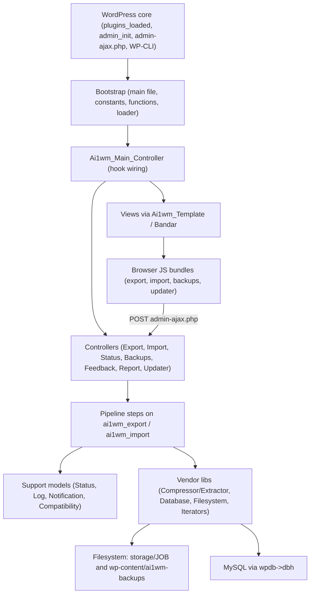

### 1.2 Request lifecycle

1. **Plugin load (every request, front end included).**
   - If `$_SERVER['HTTP_X_FORWARDED_PROTO'] === 'https'`, the plugin sets `$_SERVER['HTTPS']='on'` (`all-in-one-wp-migration.php:37-39`).
   - It defines the path and URL constants (`:42-57`), then requires `constants.php`, `deprecated.php`, `functions.php`, `exceptions.php` and `loader.php` (`:60-72`).
   - `loader.php` `require_once`s all 64 class files. The WP-CLI command is loaded only when `WP_CLI` exists (`loader.php:38-46`).
   - It then runs `new Ai1wm_Main_Controller()` (`:77`). The constructor registers the activation hook, every action and every filter (MC:33-39, 72-123).
2. **`plugins_loaded` (priority 10).** Three callbacks run here:
   - `ai1wm_loaded` registers the menus or the multisite notice, the updater hooks, the loopback header filters and the chunk-size filter (MC:177-215).
   - `ai1wm_commands` registers the pipeline steps (MC:131-157).
   - `ai1wm_buttons` registers the provider button lists (MC:164-170).
3. **`admin_init`.** This also fires for every `admin-ajax.php` request, including unauthenticated `nopriv` ones.
   - `init` creates the secret key if it is missing, copies HTTP Basic credentials into options, and handles `?ai1wm_updater` (MC:868-893).
   - `router` registers the AJAX actions (MC:900-921).
   - `setup_folders` creates the storage and backups directories and their protection files (MC:222-252).
   - `load_text_domain` loads translations (MC:63-65).
4. **Admin screen request.**
   - WP checks the menu capability: `export` for Export, `import` for Import and Backups (MC:456-497).
   - `admin_enqueue_scripts` at priority 5 registers and enqueues the screen's assets and localizes the JS globals, including the secret key (MC:504-849).
   - The menu callback (`*_Controller::index`) renders `export/index`, `import/index` or `backups/index` through `Ai1wm_Template::render`.
5. **AJAX request** (`admin-ajax.php?action=ai1wm_*`).
   - The handler is a static controller method.
   - The export, import and updater handlers first call `ai1wm_setup_environment()` (`functions.php:1411-1434`). It sets `ignore_user_abort`, `set_time_limit(0)`, `max_input_time=-1` and `pcre.backtrack_limit`, and installs the error and shutdown handlers.
   - The handler builds params from the superglobals, verifies `secret_key` (except the updater), does its work, echoes a body and calls `exit`.
   - A wrong key always produces an empty HTTP 200 body.
6. **WP-CLI** (`wp ai1wm backup|restore`). The command builds params itself and calls `apply_filters('ai1wm_export'|'ai1wm_import', $params)` once, in-process, with time slicing disabled (`lib/vendor/servmask/command/class-ai1wm-wp-cli-command.php:191-197, 255-263`).

### 1.3 The step/priority pipeline

**Registration.** Export and import are each a chain of filter callbacks on the custom hooks `ai1wm_export` and `ai1wm_import`. The **priority number is the step identifier**, and the gaps between numbers are deliberate so that extensions can insert steps (MC:131-157). The step tables are in [6.3](#63-pipeline-step-tables).

**Dispatch by the web controllers** (`lib/controller/class-ai1wm-export-controller.php:32-117`; the import controller mirrors it at `class-ai1wm-import-controller.php:32-122`):

1. Params are `stripslashes_deep(array_merge($_GET, $_POST))`, so POST wins on key collisions (`:38-40`).
2. `priority` is cast to int. It defaults to **5 for export** and **10 for import** (`export-controller:43-46`, `import-controller:43-46`).
3. `secret_key` is trimmed and checked by `ai1wm_verify_secret_key()`. A mismatch causes an empty `exit` (`:49-59`).
4. The controller reads `$wp_filter['ai1wm_export']` directly instead of calling `apply_filters`. It uses `->callbacks` when the value is a `WP_Hook` (WP 4.7 and later) and `ksort`s the priorities (`:62-69`).
5. It runs **only** the callbacks whose priority equals the requested one, in registration order. After each callback it calls `Ai1wm_Log::export|import($params)` (`:72-89`).
6. After that bucket, `completed` is read with a default of true (`:92-95`). Two cases continue the chain:
   - `completed === false`: the **same** priority is requested again.
   - A later priority exists: it is written into `params['priority']`.

   These are evaluated as `A || (B && C)` at `:98` (export) and `:102` (import).
7. **Continuation mode:**
   - If a manual flag is present, the controller echoes `json_encode($params)` and exits. The browser re-posts that JSON. The flag is `ai1wm_manual_export` for export, and `ai1wm_manual_import` or `ai1wm_manual_restore` for import.
   - Otherwise it fires a self-loopback with `wp_remote_post` and exits. The request is non-blocking with a 5 s timeout, `sslverify` false and the full params as body, and every option is filterable (`export-controller:104-111`, `import-controller:108-115`).
8. **Exceptions:**
   - Any `Exception` thrown by a step triggers `Ai1wm_Status::error`, then `Ai1wm_Notification::error`, then deletion of the job directory, then `exit` (`export-controller:83-88`, `import-controller:86-91`).
   - `Ai1wm_Import_Retry_Exception` is different. It sends an HTTP status equal to the exception code (400 or 413) and the body `{"errors":[{"code":N,"message":"..."}]}` (`import-controller:82-85`).
   - PHP `Error`s are not caught. Only the shutdown handler logs them.
9. **Steps that `exit` themselves** and so end the chain for that request:
   - Import Upload (5) echoes `{"errors":[]}`.
   - Import Confirm (100) sets a `confirm` status and waits for the user.
   - Export Clean (300) and Import Clean (400) delete the job directory.

**Dispatch modes compared:**

| Mode | Who starts it | How the next step is requested | Status option written? | Error e-mail possible? | Time slicing | Source |
|---|---|---|---|---|---|---|
| Browser-driven ("manual") | Export page "File", Import upload, Backups "Restore" | The browser JS re-POSTs the echoed params (`Export.run` / `Import.run`) | Yes: a `ai1wm_manual_*` flag is in the request | No: `ai1wm_is_scheduled_backup()` is false | 10 s per request | `export-controller:99-102`; `lib/view/assets/javascript/export.min.js:636-672` |
| Self-chaining loopback ("scheduled") | Any caller that omits the manual flag. In practice premium extensions (cron/scheduled backups). | Non-blocking `wp_remote_post` to `admin-ajax.php?action=ai1wm_export|import` | No | Yes, if `ai1wm_notification_error_toggle` returns true | 10 s per request | `export-controller:104-111`; `functions.php:1390-1404` |
| In-process (WP-CLI) | `wp ai1wm backup` / `restore` | A single `apply_filters` runs every priority in one PHP process | No | Yes, if toggled | Disabled (`ai1wm_completed_timeout` returns 0) | `class-ai1wm-wp-cli-command.php:191-197, 255-263` |

**Unclear:** core has no code that *starts* a loopback run. Neither `Ai1wm_Cron::add` nor a loopback entry point is called by core. How premium extensions start scheduled exports, for example by calling `Ai1wm_Export_Controller::export($params)` from a cron hook, cannot be verified without the extension code (`lib/vendor/servmask/cron/class-ai1wm-cron.php:37-71`).

### 1.4 Time-slice and resume model

- **Budget.** `apply_filters('ai1wm_completed_timeout', 10)` sets the number of seconds a step may run before it yields. 0 disables slicing; WP-CLI uses 0. The budget is checked at these points:

  | Checkpoint | Granularity | Source |
  |---|---|---|
  | Compressor | after each 512,000-byte chunk | `lib/vendor/servmask/archiver/class-ai1wm-compressor.php:92-106` |
  | Export Content | after each file | `lib/model/export/class-ai1wm-export-content.php:118` |
  | DB export | after each 1,000-row page | `lib/vendor/servmask/database/class-ai1wm-database.php:738` |
  | DB import | after each non-atomic statement | `class-ai1wm-database.php:823` |
  | Extractor | per 512,000-byte chunk and per entry | `lib/vendor/servmask/archiver/class-ai1wm-extractor.php:374, 455` |
  | Import Content | after each file | `lib/model/import/class-ai1wm-import-content.php:174` |
- **Yielding.** A step that runs out of time stores its cursors in params, sets `completed=false` and returns. The controller then re-requests the same priority. When the step finishes, it `unset`s its cursor keys and `completed`.
- **Cursor types.** Every cursor is a byte offset or a counter:
  - archive pointer: `archive_bytes_offset`
  - position inside the current source or target file: `file_bytes_offset`
  - position in `filemap.list`: `filemap_bytes_offset`
  - DB export: `table_index` and `table_offset`
  - DB import: `query_offset` into `database.sql`
- **Idempotent archive writes.** On resume the writer seeks to the saved `archive_bytes_offset`. Every writing step ends with `truncate()` at the current pointer, so bytes left by a killed request are discarded (`lib/vendor/servmask/archiver/class-ai1wm-archiver.php:212-231`).
- **Append-only dump.** The SQL dump is opened in append mode and each 1,000-row page is complete, so resume needs no truncation (`class-ai1wm-database.php:563-751`).
- **Steps that are not time-sliced:**
  - Export Enumerate walks all of wp-content in one request.
  - Import Enumerate scans every header in one request.
  - Import Mu_Plugins may stop part-way with no resume state.
  - Config, Blogs, Confirm and Done.

  These rely on `set_time_limit(0)` (`lib/model/export/class-ai1wm-export-enumerate.php:109-139`, `lib/model/import/class-ai1wm-import-enumerate.php:28-49`, `lib/model/import/class-ai1wm-import-mu-plugins.php:28-53`).
- **Atomic statements.** On DB import, statements into `<prefix>options` never trigger a yield, so the options table is never left half-populated between requests (`lib/model/import/class-ai1wm-import-database.php:766`).

### 1.5 Storage job directories

- **Storage root.** `AI1WM_STORAGE_PATH = <plugin dir>/storage` (`constants.php:49`). It ships with `storage/index.php`. There is no `.htaccess` or `web.config` in it.
- **Job directory.** `storage/<basename(params.storage)>/` is created on demand by `ai1wm_storage_path()`, which throws `Ai1wm_Storage_Exception` when `storage` is empty (`functions.php:32-44`). The job id comes from:
  - browser runs: `Ai1wm.Util.random(12)` from `[a-z0-9]` (`lib/view/assets/javascript/util.min.js:166-175`);
  - server-side runs (Export Init, WP-CLI): `uniqid()` (`functions.php:507-509`).
- **Job directory contents.** Names come from `constants.php:124-199`; helpers are at `functions.php:95-177`.

  | File | Export | Import |
  |---|---|---|
  | `<archive>.wpress` | Being built (moved to backups at step 250) | Uploaded chunks (not used for restore from Backups) |
  | `package.json` | Written at 50 | Extracted at 50 |
  | `filemap.list` | Written at 100 | n/a |
  | `database.sql` | Written at 200 | Extracted at 50 |
  | `multisite.json` | n/a in core | Extracted at 50 if present |
  | `blogs.json` | n/a | Written at 150 |
  | `export.log` / `import.log` | Appended after every step | Appended after every step |
  | `settings.json`, `multipart.list` | Path helpers only. **Unclear:** no core reader or writer (`functions.php:115-117, 165-167`). | Same |
- **Lifetime.** The job directory is deleted recursively by Clean (300 export / 400 import), by the controllers' exception handler, and by WP-CLI after success (`lib/vendor/servmask/filesystem/class-ai1wm-directory.php:44-61`). It is left behind on PHP fatals, on WP-CLI errors and when the browser simply stops polling.
- **Global error log.** `storage/error.log` is not per-job and is never rotated (`functions.php:184-186`, `lib/model/class-ai1wm-log.php:66-83`).
- **Backups directory.** `AI1WM_BACKUPS_PATH = WP_CONTENT_DIR/ai1wm-backups` (`constants.php:321`).
  - It receives finished exports by `rename()` (`lib/model/export/class-ai1wm-export-download.php:34-37`).
  - Restores read archives in place when `ai1wm_manual_restore` is set (`functions.php:71-87`).
  - Protection files are `index.php`, `.htaccess` and `web.config` (MC:222-252). None of them denies direct download.
- **WordPress root `.htaccess`.** On activation, if the `litespeed` extension is loaded, a `LiteSpeed` marker block with `SetEnv noabort 1` is inserted (MC:46-56, `lib/vendor/servmask/filesystem/class-ai1wm-file-htaccess.php:54-60`).

---

## 2. Directory and file map

There are 158 files in total. Every PHP file starts with a ~25-line GPL header and ASCII art.

### 2.1 Root

| File | Role |
|---|---|
| `all-in-one-wp-migration.php` | Plugin header (v6.77, `Network: True`), X-Forwarded-Proto handling, path/URL constants, requires, instantiates the main controller. |
| `constants.php` | All `AI1WM_*` constants, plus per-extension constant defaults for 16 extensions (`:360-947`). |
| `deprecated.php` | Empty `ai1wm_progress_path()` stub kept for old extensions. |
| `functions.php` | Global helpers: path helpers, naming, multisite helpers, plugin/theme (de)activation, file I/O wrappers, BigInteger file-size helpers, secret-key check, environment setup. |
| `exceptions.php` | 19 empty `Exception` subclasses (`:26-44`). |
| `loader.php` | Ordered `require_once` of every class file. Loads the CLI command conditionally. |
| `uninstall.php` | Deletes four options on uninstall (`:38-41`). |
| `readme.txt` | wordpress.org readme: requirements, premium list, changelog 6.38 to 6.77. |
| `changelog.txt` | Changelog 1.0.0 to 5.56. |
| `LICENSE` | GPL v3 text. |
| `storage/index.php` | "silence is golden" placeholder in the working directory. |

### 2.2 `lib/controller/`

| File | Role |
|---|---|
| `class-ai1wm-main-controller.php` | The only instantiated class. Wires hooks, menus, assets, notices, folders, the secret key, the AJAX router and cron schedules. |
| `class-ai1wm-export-controller.php` | Export page `index()`, the `export()` pipeline runner, the export `buttons()` list, Basic-auth header filter. |
| `class-ai1wm-import-controller.php` | Import page `index()`, the `import()` pipeline runner, `buttons()`, Basic-auth header filter, `max_chunk_size()`. |
| `class-ai1wm-status-controller.php` | `status()`: returns the `ai1wm_status` option as JSON. |
| `class-ai1wm-backups-controller.php` | Backups page `index()` and the `delete()` AJAX handler. |
| `class-ai1wm-updater-controller.php` | Static proxy to `Ai1wm_Updater`, plus the `updater()` AJAX handler that stores a purchase id. |
| `class-ai1wm-feedback-controller.php` | `feedback()` AJAX relay to servmask.com. |
| `class-ai1wm-report-controller.php` | `report()` AJAX relay to servmask.com. |

### 2.3 `lib/model/`

| File | Role |
|---|---|
| `class-ai1wm-backups.php` | Lists `*.wpress` under the backups directory, newest first; deletes a file. |
| `class-ai1wm-compatibility.php` | Builds "extension is outdated" messages. |
| `class-ai1wm-deprecated.php` | Empty stubs `Ai1wm_Export_Abstract`, `Ai1wm_Import_Abstract`, `Ai1wm_Config`. |
| `class-ai1wm-extensions.php` | Registry of the 16 known extensions, with minimum versions. |
| `class-ai1wm-feedback.php` | Validates feedback and POSTs it to `AI1WM_FEEDBACK_URL`. |
| `class-ai1wm-handler.php` | PHP error and shutdown handlers that write to `storage/error.log`. |
| `class-ai1wm-log.php` | Appends date + JSON(params) to export.log, import.log or error.log. |
| `class-ai1wm-message.php` | Flash messages in the `ai1wm_messages` option. No core caller. |
| `class-ai1wm-notification.php` | `ok()` / `error()` e-mails, gated by filters and by "scheduled" mode. |
| `class-ai1wm-report.php` | Validates a problem report and POSTs it to `AI1WM_REPORT_URL`. |
| `class-ai1wm-status.php` | Writes `{type,title,message}` to the `ai1wm_status` option. |
| `class-ai1wm-template.php` | `Ai1wm_Template extends Bandar`: `render`, `get_content`, `asset_link`. |
| `class-ai1wm-updater.php` | Extension update metadata: `check_for_updates`, `update_plugins`, `plugins_api`, `plugin_row_meta`. |

### 2.4 `lib/model/export/` (pipeline steps)

| File | Priority | Role |
|---|---|---|
| `class-ai1wm-export-init.php` | 5 | Sets `archive` (file name) and `storage` (job id) when absent. |
| `class-ai1wm-export-compatibility.php` | 5 | Blocks export when an installed extension is below its minimum version. |
| `class-ai1wm-export-archive.php` | 10 | Creates an empty archive file. |
| `class-ai1wm-export-config.php` | 50 | Writes `package.json`. |
| `class-ai1wm-export-config-file.php` | 60 | Adds `package.json` to the archive (resumable). |
| `class-ai1wm-export-enumerate.php` | 100 | Walks wp-content with exclusions and writes `filemap.list`. |
| `class-ai1wm-export-content.php` | 150 | Archives every file listed in `filemap.list` (resumable). |
| `class-ai1wm-export-database.php` | 200 | Dumps the DB to `database.sql` (resumable). |
| `class-ai1wm-export-database-file.php` | 220 | Adds `database.sql` to the archive (resumable). |
| `class-ai1wm-export-download.php` | 250 | Appends the EOF block, moves the archive to backups, sets the `download` status. |
| `class-ai1wm-export-clean.php` | 300 | Deletes the job directory and exits. |

### 2.5 `lib/model/import/` (pipeline steps)

| File | Priority | Role |
|---|---|---|
| `class-ai1wm-import-upload.php` | 5 | Appends one uploaded chunk to the archive and exits. |
| `class-ai1wm-import-compatibility.php` | 10 | Checks extension versions. |
| `class-ai1wm-import-validate.php` | 50 | Checks 32-bit limits, the EOF block and the size limit; extracts `package.json`, `multisite.json` and `database.sql` (resumable). |
| `class-ai1wm-import-confirm.php` | 100 | Sets the `confirm` status (overwrite warning, PHP 5 to 7 note) and exits. |
| `class-ai1wm-import-blogs.php` | 150 | Writes `blogs.json`: `[]` for single-site archives, or one mapping for a one-site network export. |
| `class-ai1wm-import-enumerate.php` | 200 | Counts entries and total bytes in the archive. |
| `class-ai1wm-import-content.php` | 250 | Extracts files into wp-content with dropin and metadata exclusions and blog path remapping (resumable). |
| `class-ai1wm-import-mu-plugins.php` | 270 | Extracts `mu-plugins/` except four host-specific files. |
| `class-ai1wm-import-database.php` | 300 | Builds the replacement and prefix maps, runs the dump (resumable), restores preserved options. |
| `class-ai1wm-import-done.php` | 350 | Activates plugins and theme from package/blogs, deactivates risky plugins and Jetpack modules, sets the `done` status. |
| `class-ai1wm-import-clean.php` | 400 | Deletes the job directory and exits. |

### 2.6 `lib/vendor/`

| File | Role |
|---|---|
| `bandar/bandar/lib/Bandar.php` | Micro template engine: resolve `<views>/<name>.php`, `extract` the args, include under an output buffer. |
| `bandar/bandar/lib/Exceptions/TemplateDoesNotExistException.php` | Exception for missing templates. |
| `bandar/bandar/LICENSE` | MIT, (c) 2013 Yani Iliev. |
| `math/BigInteger.php` | PEAR `Math_BigInteger` (MIT, Jim Wigginton): sizes and offsets over 2 GB on 32-bit PHP. |
| `servmask/archiver/class-ai1wm-archiver.php` | Abstract base: header format, EOF block, pointer, truncate, close, `is_valid`. |
| `servmask/archiver/class-ai1wm-compressor.php` | Archive writer (`add_file` with header size patching). |
| `servmask/archiver/class-ai1wm-extractor.php` | Archive reader (count, extract one, extract by name list). |
| `servmask/command/class-ai1wm-wp-cli-command.php` | `wp ai1wm backup` and `wp ai1wm restore`. |
| `servmask/cron/class-ai1wm-cron.php` | `add()` / `clear()` helpers for scheduled events. No core caller. |
| `servmask/database/class-ai1wm-database.php` | Abstract dump/restore engine: table listing, export, import, prefix/collation/value replacement. |
| `servmask/database/class-ai1wm-database-mysql.php` | `ext/mysql` driver wrapping `$wpdb->dbh`. |
| `servmask/database/class-ai1wm-database-mysqli.php` | `mysqli` driver wrapping `$wpdb->dbh`. |
| `servmask/database/class-ai1wm-database-utility.php` | `strtr` replace, serialization-aware replace, MySQL escape/unescape, base64 wrappers. |
| `servmask/filesystem/class-ai1wm-directory.php` | `create` (mkdir 0777, recursive) and `delete` (recursive, child first). |
| `servmask/filesystem/class-ai1wm-file.php` | `create` (write a file) and `create_with_markers` (WP `insert_with_markers`). |
| `servmask/filesystem/class-ai1wm-file-htaccess.php` | Backups `.htaccess` content and the LiteSpeed noabort block. |
| `servmask/filesystem/class-ai1wm-file-index.php` | "silence is golden" index.php. |
| `servmask/filesystem/class-ai1wm-file-webconfig.php` | IIS `web.config` for backups. |
| `servmask/filter/class-ai1wm-recursive-exclude-filter.php` | Rejects exact relative paths in the exclusion list. |
| `servmask/filter/class-ai1wm-recursive-extension-filter.php` | Accepts directories and files with listed extensions (used by Backups). |
| `servmask/filter/class-ai1wm-recursive-newline-filter.php` | Rejects paths containing CR or LF. |
| `servmask/iterator/class-ai1wm-recursive-directory-iterator.php` | `RecursiveDirectoryIterator` that skips dot entries and follows symlinked directories. |
| `servmask/iterator/class-ai1wm-recursive-iterator-iterator.php` | Empty subclass of `RecursiveIteratorIterator`. |

### 2.7 `lib/view/`: all 54 templates

**`export/` (19 files)**

| File | Role |
|---|---|
| `export/index.php` | Export screen shell: form `#ai1wm-export-form`, hooks `ai1wm_export_left_options` and `ai1wm_export_left_end`, hidden `ai1wm_manual_export=1`, sidebar. |
| `export/find-replace.php` | Find/Replace rows `options[replace][old_value][]` and `options[replace][new_value][]`, plus the "Add" button. |
| `export/advanced-settings.php` | 11 "Do not export ..." checkboxes. Three of them appear only when the max file size is 0. Hook `ai1wm_export_advanced_settings`. |
| `export/export-buttons.php` | "Export To" dropdown that prints `apply_filters('ai1wm_export_buttons', array())`. |
| `export/help-section.php` | Help copy. Never included (dead). |
| `export/button-file.php` | Working "File" target (`#ai1wm-export-file`). |
| `export/button-ftp.php` | FTP upsell link. |
| `export/button-dropbox.php` | Dropbox upsell link. |
| `export/button-gdrive.php` | Google Drive upsell link. |
| `export/button-s3.php` | Amazon S3 upsell link. |
| `export/button-b2.php` | Backblaze B2 upsell link. |
| `export/button-onedrive.php` | OneDrive upsell link. |
| `export/button-box.php` | Box upsell link. |
| `export/button-mega.php` | Mega upsell link. |
| `export/button-digitalocean.php` | DigitalOcean Spaces upsell link. |
| `export/button-gcloud-storage.php` | Google Cloud Storage upsell link. |
| `export/button-azure-storage.php` | Azure Storage upsell link. |
| `export/button-glacier.php` | Amazon Glacier upsell link. |
| `export/button-pcloud.php` | pCloud upsell link. |

**`import/` (17 files)**

| File | Role |
|---|---|
| `import/index.php` | Import screen shell: form `#ai1wm-import-form`, hooks `ai1wm_import_left_options` and `ai1wm_import_left_end`, hidden `ai1wm_manual_import=1`. |
| `import/import-buttons.php` | Drop zone, "Import From" dropdown (`ai1wm_import_buttons`), max upload size and "Get unlimited" badge, storage-permission error box. |
| `import/button-file.php` | Working "File" item with a hidden file input `#ai1wm-select-file`. |
| `import/button-url.php` | URL extension upsell (import only). |
| `import/button-ftp.php` | FTP upsell. |
| `import/button-dropbox.php` | Dropbox upsell. |
| `import/button-gdrive.php` | Google Drive upsell. |
| `import/button-s3.php` | Amazon S3 upsell. |
| `import/button-b2.php` | Backblaze B2 upsell. |
| `import/button-onedrive.php` | OneDrive upsell. |
| `import/button-box.php` | Box upsell. |
| `import/button-mega.php` | Mega upsell. |
| `import/button-digitalocean.php` | DigitalOcean upsell. |
| `import/button-gcloud-storage.php` | Google Cloud Storage upsell. |
| `import/button-azure-storage.php` | Azure Storage upsell. |
| `import/button-glacier.php` | Amazon Glacier upsell. |
| `import/button-pcloud.php` | pCloud upsell. |

**`backups/` (1), `common/` (5), `main/` (10), `updater/` (2)**

| File | Role |
|---|---|
| `backups/index.php` | Backups table (Download / Restore / Delete), empty state, "Create backup", hook `ai1wm_backups_left_end`, hidden `ai1wm_manual_restore=1`. |
| `common/leave-feedback.php` | "Leave Feedback" sidebar widget. |
| `common/report-problem.php` | "Report issue" popover. |
| `common/share-buttons.php` | Facebook SDK and Twitter widgets (shown when `AI1WM_DEBUG` is false). |
| `common/http-authentication.php` | Empty (header only, dead). |
| `common/maintenance-mode.php` | Empty (header only, dead). |
| `main/admin-head.php` | Inline CSS on every admin page: icon font, `.ai1wm-label`, menu icon. |
| `main/get-support.php` | "Get Support" plugin-row link. |
| `main/multisite-notice.php` | Network notice upselling the Multisite extension. |
| `main/storage-path-notice.php` | "Cannot create storage folder" notice. |
| `main/storage-index-notice.php` | "Cannot create storage index.php" notice. |
| `main/backups-path-notice.php` | "Cannot create backups folder" notice. |
| `main/backups-index-notice.php` | "Cannot create backups index.php" notice. |
| `main/backups-htaccess-notice.php` | "Cannot create backups .htaccess" notice. |
| `main/backups-webconfig-notice.php` | "Cannot create backups web.config" notice. |
| `main/wordpress-htaccess-notice.php` | "Cannot write the LiteSpeed block to the root .htaccess" notice. |
| `updater/check.php` | "Check for updates" plugin-row link. |
| `updater/modal.php` | Purchase ID modal and the "update available" row text. |

### 2.8 `lib/view/assets/` (27 files)

| Group | Files | Role |
|---|---|---|
| CSS | `css/export.min.css`, `css/export.min.rtl.css` | Export screen (LTR/RTL). |
| | `css/import.min.css`, `css/import.min.rtl.css` | Import screen. |
| | `css/backups.min.css`, `css/backups.min.rtl.css` | Backups screen. |
| | `css/updater.min.css`, `css/updater.min.rtl.css` | Plugins-screen updater modal. |
| | `css/servmask.min.css`, `css/servmask.min.rtl.css` | Registered as `ai1wm_servmask` for extensions. Never enqueued by core. |
| | `css/common.min.css` | Not referenced anywhere. |
| JS (webpack bundles, not actually minified) | `javascript/util.min.js` | `Ai1wm.Util` (random id, JSON extraction); handle `ai1wm_util`. |
| | `javascript/export.min.js` | Export model, find/replace UI, modal, feedback/report modules. |
| | `javascript/import.min.js` | Import model, chunked uploader, modal, feedback/report. |
| | `javascript/backups.min.js` | Backups delete/restore, import model and modal. |
| | `javascript/updater.min.js` | Purchase-id check and save. |
| | `javascript/feedback.min.js`, `javascript/report.min.js` | Registered for extensions only. |
| Font | `font/servmask.eot`, `font/servmask.svg`, `font/servmask.ttf`, `font/servmask.woff` | IcoMoon icon font "servmask". |
| Images | `img/logo-20x20.png` | Admin menu icon. |
| | `img/logo-32x32.png` | Modal spinner. |
| | `img/logo-128x128.png` | Base `.ai1wm-loader` background. |
| | `img/logo.svg`, `img/ajax-loader.gif` | Unused. |

---

## 3. Class and module diagrams

All controllers except `Ai1wm_Main_Controller` and all step classes expose **static** methods only. The diagrams omit the static marker for readability.

### 3.1 Controllers, support models and templating

```mermaid
classDiagram
    class Ai1wm_Main_Controller {
        +__construct()
        +activation_hook()
        +ai1wm_loaded()
        +ai1wm_commands()
        +ai1wm_buttons()
        +init()
        +router()
        +setup_folders()
        +admin_menu()
        +register_scripts_and_styles()
        +enqueue_export_scripts_and_styles(hook)
        +enqueue_import_scripts_and_styles(hook)
        +enqueue_backups_scripts_and_styles(hook)
        +enqueue_updater_scripts_and_styles(hook)
        +add_cron_schedules(schedules)
    }
    class Ai1wm_Export_Controller {
        +index()
        +export(params)
        +buttons() array
        +http_export_headers(headers) array
    }
    class Ai1wm_Import_Controller {
        +index()
        +import(params)
        +buttons() array
        +http_import_headers(headers) array
        +max_chunk_size() int
    }
    class Ai1wm_Status_Controller {
        +status(params)
    }
    class Ai1wm_Backups_Controller {
        +index()
        +delete(params)
    }
    class Ai1wm_Updater_Controller {
        +plugins_api(result, action, args)
        +pre_update_plugins(transient)
        +update_plugins(transient)
        +check_for_updates()
        +plugin_row_meta(links, file)
        +updater(params)
    }
    class Ai1wm_Feedback_Controller {
        +feedback(params)
    }
    class Ai1wm_Report_Controller {
        +report(params)
    }
    class Ai1wm_Status {
        +error(title, message)
        +info(message)
        +download(message)
        +confirm(message)
        +done(title, message)
        +blogs(title, message)
        +progress(percent)
        +log(data)
    }
    class Ai1wm_Log {
        +export(params)
        +import(params)
        +error(params)
    }
    class Ai1wm_Notification {
        +ok(subject, message)
        +error(subject, message)
    }
    class Ai1wm_Handler {
        +error(errno, errstr, errfile, errline)
        +shutdown()
    }
    class Ai1wm_Compatibility {
        +get(params) array
        +check(extension) bool
    }
    class Ai1wm_Extensions {
        +get() array
    }
    class Ai1wm_Updater {
        +plugins_api(result, action, args)
        +update_plugins(transient)
        +check_for_updates()
        +plugin_row_meta(links, file)
    }
    class Ai1wm_Backups {
        +get_files() array
        +delete_file(file)
        +compare(a, b) int
    }
    class Ai1wm_Feedback {
        +add(type, email, message, terms) array
    }
    class Ai1wm_Report {
        +add(email, message, terms) array
    }
    class Ai1wm_Message {
        +flash(type, message)
        +has(type) bool
        +get(type)
    }
    class Bandar {
        +setTemplate(template, path)
        +templateExists(template) bool
        +render(template, args, path)
        +getTemplateContent(template, args, path) string
    }
    class Ai1wm_Template {
        +render(view, args, path)
        +get_content(template, args, path) string
        +asset_link(asset, prefix) string
    }
    Bandar <|-- Ai1wm_Template
    Ai1wm_Main_Controller ..> Ai1wm_Export_Controller : registers AJAX and menu callbacks
    Ai1wm_Main_Controller ..> Ai1wm_Import_Controller : registers
    Ai1wm_Main_Controller ..> Ai1wm_Status_Controller : registers
    Ai1wm_Main_Controller ..> Ai1wm_Backups_Controller : registers
    Ai1wm_Main_Controller ..> Ai1wm_Updater_Controller : registers
    Ai1wm_Main_Controller ..> Ai1wm_Feedback_Controller : registers
    Ai1wm_Main_Controller ..> Ai1wm_Report_Controller : registers
    Ai1wm_Main_Controller ..> Ai1wm_Template : renders views
    Ai1wm_Export_Controller ..> Ai1wm_Log : logs each step
    Ai1wm_Export_Controller ..> Ai1wm_Status : error
    Ai1wm_Export_Controller ..> Ai1wm_Notification : error
    Ai1wm_Import_Controller ..> Ai1wm_Log
    Ai1wm_Import_Controller ..> Ai1wm_Status
    Ai1wm_Import_Controller ..> Ai1wm_Notification
    Ai1wm_Updater_Controller ..> Ai1wm_Updater : delegates
    Ai1wm_Updater ..> Ai1wm_Extensions : reads registry
    Ai1wm_Compatibility ..> Ai1wm_Extensions : reads registry
    Ai1wm_Backups_Controller ..> Ai1wm_Backups
    Ai1wm_Feedback_Controller ..> Ai1wm_Feedback
    Ai1wm_Report_Controller ..> Ai1wm_Report
    Ai1wm_Handler ..> Ai1wm_Log : error log
```

### 3.2 Pipeline step classes

Every step class has exactly one method, `execute(params) array`. The hook and priority are shown as a stereotype, e.g. `export_150`.

```mermaid
classDiagram
    class Ai1wm_Export_Controller {
        +export(params)
    }
    class Ai1wm_Import_Controller {
        +import(params)
    }
    class Ai1wm_Export_Init {
        <<export_5>>
        +execute(params)
    }
    class Ai1wm_Export_Compatibility {
        <<export_5>>
        +execute(params)
    }
    class Ai1wm_Export_Archive {
        <<export_10>>
        +execute(params)
    }
    class Ai1wm_Export_Config {
        <<export_50>>
        +execute(params)
    }
    class Ai1wm_Export_Config_File {
        <<export_60>>
        +execute(params)
    }
    class Ai1wm_Export_Enumerate {
        <<export_100>>
        +execute(params)
    }
    class Ai1wm_Export_Content {
        <<export_150>>
        +execute(params)
    }
    class Ai1wm_Export_Database {
        <<export_200>>
        +execute(params)
    }
    class Ai1wm_Export_Database_File {
        <<export_220>>
        +execute(params)
    }
    class Ai1wm_Export_Download {
        <<export_250>>
        +execute(params)
    }
    class Ai1wm_Export_Clean {
        <<export_300>>
        +execute(params)
    }
    class Ai1wm_Import_Upload {
        <<import_5>>
        +execute(params)
    }
    class Ai1wm_Import_Compatibility {
        <<import_10>>
        +execute(params)
    }
    class Ai1wm_Import_Validate {
        <<import_50>>
        +execute(params)
    }
    class Ai1wm_Import_Confirm {
        <<import_100>>
        +execute(params)
    }
    class Ai1wm_Import_Blogs {
        <<import_150>>
        +execute(params)
    }
    class Ai1wm_Import_Enumerate {
        <<import_200>>
        +execute(params)
    }
    class Ai1wm_Import_Content {
        <<import_250>>
        +execute(params)
    }
    class Ai1wm_Import_Mu_Plugins {
        <<import_270>>
        +execute(params)
    }
    class Ai1wm_Import_Database {
        <<import_300>>
        +execute(params)
    }
    class Ai1wm_Import_Done {
        <<import_350>>
        +execute(params)
    }
    class Ai1wm_Import_Clean {
        <<import_400>>
        +execute(params)
    }
    Ai1wm_Export_Controller --> Ai1wm_Export_Init
    Ai1wm_Export_Controller --> Ai1wm_Export_Compatibility
    Ai1wm_Export_Controller --> Ai1wm_Export_Archive
    Ai1wm_Export_Controller --> Ai1wm_Export_Config
    Ai1wm_Export_Controller --> Ai1wm_Export_Config_File
    Ai1wm_Export_Controller --> Ai1wm_Export_Enumerate
    Ai1wm_Export_Controller --> Ai1wm_Export_Content
    Ai1wm_Export_Controller --> Ai1wm_Export_Database
    Ai1wm_Export_Controller --> Ai1wm_Export_Database_File
    Ai1wm_Export_Controller --> Ai1wm_Export_Download
    Ai1wm_Export_Controller --> Ai1wm_Export_Clean
    Ai1wm_Import_Controller --> Ai1wm_Import_Upload
    Ai1wm_Import_Controller --> Ai1wm_Import_Compatibility
    Ai1wm_Import_Controller --> Ai1wm_Import_Validate
    Ai1wm_Import_Controller --> Ai1wm_Import_Confirm
    Ai1wm_Import_Controller --> Ai1wm_Import_Blogs
    Ai1wm_Import_Controller --> Ai1wm_Import_Enumerate
    Ai1wm_Import_Controller --> Ai1wm_Import_Content
    Ai1wm_Import_Controller --> Ai1wm_Import_Mu_Plugins
    Ai1wm_Import_Controller --> Ai1wm_Import_Database
    Ai1wm_Import_Controller --> Ai1wm_Import_Done
    Ai1wm_Import_Controller --> Ai1wm_Import_Clean
```

Step dependencies on vendor classes:

| Step | Uses | Source |
|---|---|---|
| Export Archive, Config_File, Content, Database_File, Download | `Ai1wm_Compressor` | `lib/model/export/*` |
| Export Config, Database | `Ai1wm_Database_Mysql` or `_Mysqli` | `class-ai1wm-export-config.php:38-42`, `class-ai1wm-export-database.php:64-68` |
| Export Enumerate | Directory iterator, Newline and Exclude filters, Iterator_Iterator | `class-ai1wm-export-enumerate.php:109-118` |
| Import Validate, Enumerate, Content, Mu_Plugins | `Ai1wm_Extractor` | `lib/model/import/*` |
| Import Database | `Ai1wm_Database_*`, `Ai1wm_Database_Utility` (indirectly) | `class-ai1wm-import-database.php:742-775` |
| Both Clean steps, controllers | `Ai1wm_Directory::delete` | `class-ai1wm-directory.php:44-61` |
| Both Compatibility steps | `Ai1wm_Compatibility` | `class-ai1wm-export-compatibility.php:28-46` |

### 3.3 Archiver and database hierarchies

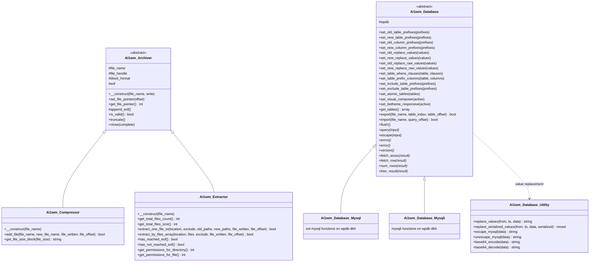

Sources: `lib/vendor/servmask/archiver/class-ai1wm-archiver.php:26-245`, `class-ai1wm-compressor.php:26-210`, `class-ai1wm-extractor.php:26-575`, `lib/vendor/servmask/database/class-ai1wm-database.php:26-1407`, `class-ai1wm-database-mysql.php:26-112`, `class-ai1wm-database-mysqli.php:26-113`, `class-ai1wm-database-utility.php:26-150`.

### 3.4 Filesystem, iterators, filters, cron and CLI

```mermaid
classDiagram
    class RecursiveDirectoryIterator
    class RecursiveIteratorIterator
    class RecursiveFilterIterator
    class Ai1wm_Recursive_Directory_Iterator {
        +__construct(path)
        +rewind()
        +next()
        +hasChildren(allow_links) bool
        #skipdots()
    }
    class Ai1wm_Recursive_Iterator_Iterator
    class Ai1wm_Recursive_Exclude_Filter {
        +__construct(iterator, exclude)
        +accept() bool
        +getChildren()
    }
    class Ai1wm_Recursive_Extension_Filter {
        +__construct(iterator, include)
        +accept() bool
        +getChildren()
    }
    class Ai1wm_Recursive_Newline_Filter {
        +accept() bool
    }
    RecursiveDirectoryIterator <|-- Ai1wm_Recursive_Directory_Iterator
    RecursiveIteratorIterator <|-- Ai1wm_Recursive_Iterator_Iterator
    RecursiveFilterIterator <|-- Ai1wm_Recursive_Exclude_Filter
    RecursiveFilterIterator <|-- Ai1wm_Recursive_Extension_Filter
    RecursiveFilterIterator <|-- Ai1wm_Recursive_Newline_Filter

    class Ai1wm_Directory {
        +create(path) bool
        +delete(path) bool
    }
    class Ai1wm_File {
        +create(path, content) bool
        +create_with_markers(path, marker, content) bool
    }
    class Ai1wm_File_Htaccess {
        +create(path) bool
        +litespeed(path) bool
    }
    class Ai1wm_File_Index {
        +create(path) bool
    }
    class Ai1wm_File_Webconfig {
        +create(path) bool
    }
    Ai1wm_File_Htaccess ..> Ai1wm_File : delegates
    Ai1wm_File_Index ..> Ai1wm_File : delegates
    Ai1wm_File_Webconfig ..> Ai1wm_File : delegates
    Ai1wm_Directory ..> Ai1wm_Recursive_Directory_Iterator : child-first walk

    class Ai1wm_Cron {
        +add(hook, recurrence, args)
        +clear(hook)
    }
    class WP_CLI_Command
    class Ai1wm_WP_CLI_Command {
        +backup(args, assoc_args)
        +restore(args, assoc_args)
    }
    WP_CLI_Command <|-- Ai1wm_WP_CLI_Command
```

Sources: `lib/vendor/servmask/iterator/*.php`, `lib/vendor/servmask/filter/*.php`, `lib/vendor/servmask/filesystem/*.php`, `lib/vendor/servmask/cron/class-ai1wm-cron.php:37-71`, `lib/vendor/servmask/command/class-ai1wm-wp-cli-command.php:21-278`.

**Unclear:** whether `Ai1wm_File_Htaccess`, `Ai1wm_File_Index` and `Ai1wm_File_Webconfig` call `Ai1wm_File::create`. They are not subclasses (the class declarations have no `extends`). The "delegates" edges are inferred from the identical create-file behaviour described at `class-ai1wm-file.php:35-58`, not from reading every call.

---

## 4. Data model

### 4.1 No custom schema

The original plugin registers **no custom DB tables, no custom post types, no taxonomies, no shortcodes, no blocks, no widgets and no REST routes**. A whole-plugin grep found no `register_post_type`, `register_taxonomy`, `add_shortcode`, `register_block_type`, `register_widget`, `register_rest_route` or `CREATE TABLE` issued against the live site. The `CREATE TABLE` statements in dumps are replayed only during import.

All persistence is:

1. rows in `wp_options` (or the site options for multisite plugin lists);
2. files in `storage/<job>/` plus the global `storage/error.log`;
3. archives in `wp-content/ai1wm-backups/`.

### 4.2 Plugin-owned options (complete)

| Option | Type and shape | Written by | Read by | Exported in dump? | Deleted on uninstall? | Source |
|---|---|---|---|---|---|---|
| `ai1wm_secret_key` | string, 12 alphanumeric characters | MC `init()` when empty; restored at the end of each import Database request | `ai1wm_verify_secret_key`; every `wp_localize_script`; import Database (captures it) | No (excluded) | Yes | MC:871-873; `functions.php:1377-1383`; `lib/model/import/class-ai1wm-import-database.php:699, 823` |
| `ai1wm_auth_user` | string | MC `init()` from `PHP_AUTH_USER` or `REMOTE_USER`; restored after import | `http_*_headers`; Backups controller (passed to the view, unused) | No | Yes | MC:876-880; `export-controller:139-147`; `lib/controller/class-ai1wm-backups-controller.php:35` |
| `ai1wm_auth_password` | string, **plaintext** | MC `init()` from `PHP_AUTH_PW`; restored after import | same as above | No | Yes | MC:883-885 |
| `ai1wm_status` | array, last message only: `{type, title?, message?}` or `{type:'progress', percent}` | `Ai1wm_Status::log`, only in manual mode | Status controller | No | Yes | `lib/model/class-ai1wm-status.php:28-60`; `lib/controller/class-ai1wm-status-controller.php:48` |
| `ai1wm_messages` | assoc array `type => message` | `Ai1wm_Message::flash` (no core caller) | `Ai1wm_Message::has/get` | Yes | No | `lib/model/class-ai1wm-message.php:28-58` |
| `ai1wm_updater` | assoc array `extension slug => remote about JSON` | `Ai1wm_Updater::check_for_updates` | `update_plugins`, `plugins_api` | Yes | No | `lib/model/class-ai1wm-updater.php:36-147` |
| `ai1wm<x>e_plugin_key` (16 options, one per extension) | string, the purchase uuid returned by servmask.com | Updater AJAX | Updater (`package` URL), row meta | Yes | No | `lib/controller/class-ai1wm-updater-controller.php:79`; `constants.php:384-939` |

The 16 key option names are: `ai1wmze_`, `ai1wmae_`, `ai1wmbe_`, `ai1wmie_`, `ai1wmde_`, `ai1wmfe_`, `ai1wmce_`, `ai1wmge_`, `ai1wmre_`, `ai1wmee_`, `ai1wmme_`, `ai1wmoe_`, `ai1wmpe_`, `ai1wmse_`, `ai1wmue_` and `ai1wmle_`, each suffixed with `plugin_key` (`constants.php:360-947`).

No transients, user meta or post meta are owned by the plugin.

### 4.3 WordPress core (and third-party) options touched

| Option | Access | Purpose | Source |
|---|---|---|---|
| `siteurl`, `home` | Read before the import DB run; written back after every import Database request | Keep the target's own URLs regardless of the dump | `class-ai1wm-import-database.php:693-696, 817-820` |
| `active_plugins` | Excluded from the export dump. Rebuilt on import: ServMask plugins re-added after each Database request, then package/blog `Plugins` added in Done. No activation hooks run. | Plugin state transfer | `lib/model/export/class-ai1wm-export-database.php:129`; `functions.php:889-931`; `class-ai1wm-import-done.php:43-178` |
| `active_sitewide_plugins` (site option) | Helpers for read, activate and deactivate. Deactivation is used by Done for the risky-plugin list. | Network plugin state | `functions.php:880-988` |
| `template`, `stylesheet` | Excluded from export. Set in Done from `package.json` or `blogs.json` without validating that the theme exists. | Theme transfer | `functions.php:938-969`; `class-ai1wm-import-done.php:94-103` |
| `jetpack_active_modules` | Removes `photon` and `sso` in Done | Avoid CDN/SSO breakage | `functions.php:1018-1031`; `class-ai1wm-import-done.php:67-70` |
| `upload_path` | Read when building blog path replacements | Multisite to single uploads mapping | `class-ai1wm-import-database.php:102, 108` |
| `admin_email` | Read | Default notification recipient | `lib/model/class-ai1wm-notification.php:35, 62` |
| `cron` | Read and written directly by `Ai1wm_Cron::clear` (no core caller) | Remove all events of a hook | `lib/vendor/servmask/cron/class-ai1wm-cron.php:53-71` |
| `update_plugins` (site transient) | Filtered on set and on read | Inject extension updates | MC:208-211 |
| `alloptions` / `notoptions` cache | Reset by `ai1wm_cache_flush()`, which also removes all `sanitize_option_siteurl` and `sanitize_option_home` filters | Make the freshly imported options visible | `functions.php:1094-1112` |

**Options-table rows excluded from every export dump:** `active_plugins`, `template`, `stylesheet`, `ai1wm_status`, `ai1wm_secret_key`, `ai1wm_auth_user`, `ai1wm_auth_password`. The filter applies only to `<base_prefix>options` (`class-ai1wm-export-database.php:129`).

Because the dump contains `DROP TABLE IF EXISTS` and `CREATE TABLE` for the options table, the **target's** previous rows for those excluded names are gone after import. They are recreated as follows:

- `siteurl`, `home`, the secret key and the auth options are written back from values captured at the start of the request.
- `active_plugins`, `template` and `stylesheet` are rebuilt from the archive's `package.json` in Done.

This conclusion is derived from `class-ai1wm-import-database.php:692-705, 810-829` together with `class-ai1wm-import-done.php:85-103`.

### 4.4 Storage job artifacts

| Artifact | Format | Producer | Consumer | Source |
|---|---|---|---|---|
| `filemap.list` | One relative path per line (OS separators, PHP_EOL). Regular files only. Paths containing CR or LF are excluded. | Export Enumerate | Export Content | `class-ai1wm-export-enumerate.php:109-139` |
| `package.json` | JSON object ([4.7.1](#471-packagejson)) | Export Config; extracted by Import Validate | Import Confirm, Database, Done | `class-ai1wm-export-config.php:44-151` |
| `database.sql` | SQL text ([5.2](#52-sql-dump-format)) | Export Database; extracted by Import Validate | Export Database_File; Import Database | `class-ai1wm-database.php:563-845` |
| `multisite.json` | JSON ([4.7.3](#473-multisitejson)) | **Not written by core** (Multisite extension) | Import Blogs, Done | `class-ai1wm-import-blogs.php:45-110`; `class-ai1wm-import-done.php:40-70` |
| `blogs.json` | JSON array ([4.7.2](#472-blogsjson)) | Import Blogs | Import Content, Database, Done | `class-ai1wm-import-blogs.php:28-127` |
| `settings.json` | **Unclear.** Path helper only; no core reader or writer. | presumably extensions | presumably extensions | `functions.php:165-167`; `constants.php:149` |
| `multipart.list` | **Unclear.** Path helper only; no core reader or writer. | presumably extensions (e.g. multipart cloud uploads) | presumably extensions | `functions.php:115-117`; `constants.php:154` |
| `export.log` / `import.log` | Repeated records: `date('M d Y H:i:s')`, newline, `json_encode(params)`, blank line. Includes `secret_key`. | Controllers after every step | Nobody (diagnostics) | `lib/model/class-ai1wm-log.php:28-64` |
| `error.log` (global, `storage/error.log`) | Same record format with `{Number, Message, File, Line}` or the `error_get_last()` array | `Ai1wm_Handler` | Nobody | `lib/model/class-ai1wm-handler.php:37-55` |
| `<archive>.wpress` | [5.1](#51-wpress-archive-format) | Export (built here, moved at 250); Import Upload (chunks appended) | Import steps (unless restoring from backups) | `functions.php:71-87` |

### 4.5 Backups directory

- **Location.** `wp-content/ai1wm-backups/` (`AI1WM_BACKUPS_PATH`, `constants.php:321`); URL `content_url('ai1wm-backups')` (`all-in-one-wp-migration.php:54`).
- **Contents.** Finished archives named `<host>[-<path segments>]-YYYYMMDD-HHMMSS-<100..999>.wpress`, lowercased. The date and time come from PHP `date()`, which WordPress sets to UTC (`functions.php:331-356`). Subdirectories are allowed and listed recursively (`lib/model/class-ai1wm-backups.php:33-77`).
- **Protection files** (MC:222-252):
  - `index.php` ("silence is golden").
  - `.htaccess`: `AddType application/octet-stream .wpress`, `DirectoryIndex index.php` and `Options -Indexes`, each inside an IfModule block.
  - `web.config`: `.wpress` mimeMap, `defaultDocument` index.php and `directoryBrowse` disabled.
  - None of them denies direct access, so archives are downloadable by static URL.
- **Lifetime.** Archives are never deleted automatically. They survive uninstall. They are removed only by the Backups Delete action.

### 4.6 Entity-relationship view

`SERVMASK_PREFIX_` is the placeholder table prefix written into dumps (`AI1WM_TABLE_PREFIX`, `constants.php:119`). On export, the site's `$wpdb->base_prefix` at position 0 of table names, `options.option_name` and `usermeta.meta_key` is replaced by the placeholder. On import, the placeholder is replaced by the target's `base_prefix`, with variants for multisite blog ids ([9.4](#94-table-prefix-rewriting)).

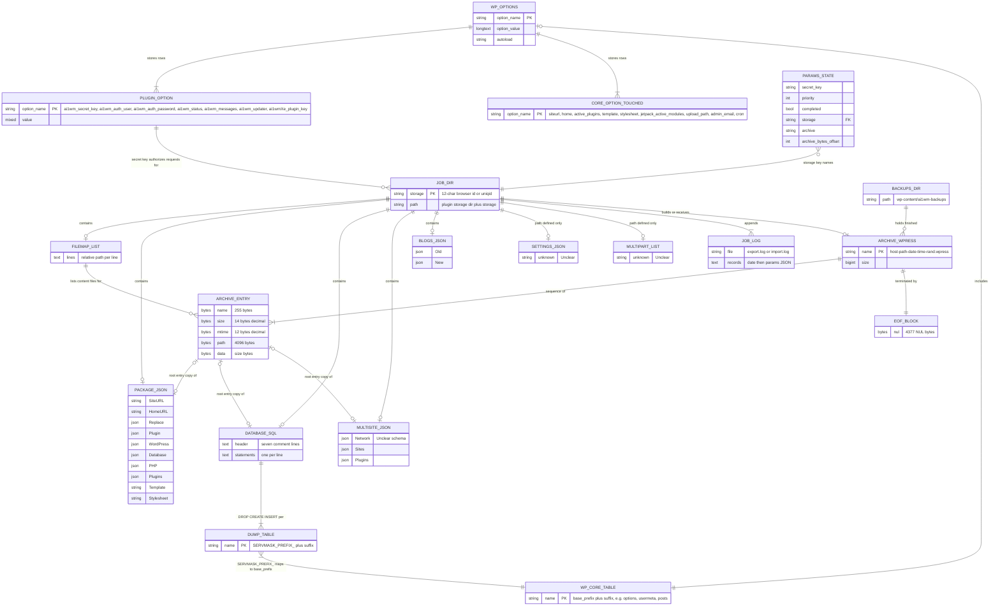

The dump includes **every** table whose name starts (case-insensitively) with `base_prefix`. That covers core tables, plugin tables, multisite subsite tables (`wp_2_posts` becomes `SERVMASK_PREFIX_2_posts`) and unrelated tables with the same prefix in a shared DB (`class-ai1wm-export-database.php:108-118`; `class-ai1wm-database.php:501-553`). Special per-table handling:

| Table | Export handling | Source |
|---|---|---|
| `<prefix>options` | Excluded rows (see 4.3). `option_name` values starting with the prefix are rewritten to the placeholder. Atomic on import. | `class-ai1wm-export-database.php:129-133`; `class-ai1wm-import-database.php:766` |
| `<prefix>usermeta` | `meta_key` values starting with the prefix are rewritten (e.g. `wp_capabilities` becomes `SERVMASK_PREFIX_capabilities`). | `class-ai1wm-export-database.php:132-133` |
| `<prefix>comments`, `<prefix>commentmeta` | With `no_spam_comments`, spam rows and their meta are excluded. | `class-ai1wm-export-database.php:71-74` |
| `<prefix>posts` | With `no_post_revisions`, revisions are excluded. Revision postmeta is still exported. | `class-ai1wm-export-database.php:77-79` |

When `base_prefix` is empty, each table maps to `SERVMASK_PREFIX_<table>`. The column-prefix pairs then cover `user_roles`, `capabilities`, `user_level`, `dashboard_quick_press_last_post_id`, `user-settings` and `user-settings-time` (`class-ai1wm-export-database.php:81-106`).

### 4.7 File schemas

#### 4.7.1 package.json

Written by `class-ai1wm-export-config.php:44-151` as a single `json_encode` with default flags: slashes and unicode escaped, not pretty-printed. Keys appear in this order, and optional keys are omitted.

| Key | Type | Presence | Value | Consumer |
|---|---|---|---|---|
| `SiteURL` | string | always | `site_url()` | Import Database (URL pairs) |
| `HomeURL` | string | always | `home_url()` | Import Database |
| `InternalSiteURL` | string | only if the raw `siteurl` option (untrailingslashed) differs from `site_url()` (`:53-55`) | raw option | Import Database (only used if it has a scheme and host) |
| `InternalHomeURL` | string | same rule for `home` (`:58-60`) | raw option | Import Database |
| `Replace` | object `{OldValues: string[], NewValues: string[]}` | always | user pairs where **both** values are non-empty (`empty()`, so "0" is dropped) (`:63-70`) | Import Database |
| `NoSpamComments` | true | if `options.no_spam_comments` set | | informational |
| `NoPostRevisions` | true | if `no_post_revisions` | | informational |
| `NoMedia` | true | if `no_media` | | informational |
| `NoThemes` | true | if `no_themes` | | informational |
| `NoInactiveThemes` | true | if `no_inactive_themes` | | informational |
| `NoMustUsePlugins` | true | if `no_muplugins` | | informational |
| `NoPlugins` | true | if `no_plugins` | | informational |
| `NoInactivePlugins` | true | if `no_inactive_plugins` | | informational |
| `NoCache` | true | if `no_cache` | | informational |
| `NoDatabase` | true | if `no_database` | | informational (import checks whether `database.sql` exists instead) |
| `NoEmailReplace` | true | if `no_email_replace` | | Import Database: suppresses `@domain` pairs |
| `Plugin` | object `{Version}` | always | `"6.77"` | Import Database: legacy flush if version < 4.10 |
| `WordPress` | object `{Version, Content}` | always | `$wp_version`, absolute `WP_CONTENT_DIR` | Import Database: content-dir pairs |
| `Database` | object `{Version}` | always | MySQL server version string | informational |
| `PHP` | object `{Version}` | always | `PHP_VERSION` | Import Confirm (PHP 5 to 7 warning) |
| `Plugins` | string[] | always | `active_plugins` minus ServMask basenames; sitewide plugins **not** included | Import Done |
| `Template` | string | always | `get_option('template')` | Import Done |
| `Stylesheet` | string | always | `get_option('stylesheet')` | Import Done |

The flag keys are tested with `isset`, so any posted value, including "0", enables them (`class-ai1wm-export-config.php:73-125`).

#### 4.7.2 blogs.json

Written by Import Blogs (`class-ai1wm-import-blogs.php:28-127`). It is a JSON array:

- For a single-site archive (no `multisite.json`) it is `[]`.
- For a one-site network archive it holds exactly one mapping object:

| Path | Type | Value |
|---|---|---|
| `Old.BlogID` | int or string | subsite id from `multisite.json` |
| `Old.SiteURL`, `Old.HomeURL` | string | from the subsite |
| `Old.InternalSiteURL`, `Old.InternalHomeURL` | string or null | from the subsite; null when missing |
| `Old.Plugins` | string[] | subsite plugins; `[]` when missing |
| `Old.Template`, `Old.Stylesheet` | string or null | |
| `New.BlogID` | null | single-site target |
| `New.SiteURL`, `New.InternalSiteURL` | string | `site_url()` |
| `New.HomeURL`, `New.InternalHomeURL` | string | `home_url()` |
| `New.Plugins`, `New.Template`, `New.Stylesheet` | | copied from `Old` |

Consumers: Import Content (path remapping, `class-ai1wm-import-content.php:66-140`), Import Database (per-blog URL, path and prefix pairs, `:80-422, 707-740`) and Import Done (activation, `:140-178`).

`ai1wm_main_site()` compares strictly (`null`, `0` or `1` only), so a string `"1"` from JSON would be treated as a subsite (`functions.php:517-519`).

#### 4.7.3 multisite.json

**Unclear:** core never writes this file. Its writer is the Multisite extension, which is not present. Only the fields core **reads** are known:

| Field | Type | Read by | Behaviour | Source |
|---|---|---|---|---|
| `Network` | truthy or falsy | Import Blogs | Non-empty: error "Unable to import WordPress Network into WordPress Single site." | `class-ai1wm-import-blogs.php:49` |
| `Sites` | array of site objects | Import Blogs | Empty: error "At least one ... site"; more than one: error "should contain Single WordPress site" | `:50-110` |
| `Sites[].BlogID`, `SiteURL`, `HomeURL`, `InternalSiteURL`, `InternalHomeURL`, `Plugins`, `Template`, `Stylesheet` | | Import Blogs | Copied into `blogs.json` `Old` | `:54-98` |
| `Plugins` | string[] | Import Done | Activated as regular plugins when `multisite.json` exists | `class-ai1wm-import-done.php:43` |

### 4.8 `$params` state keys

These are the pipeline params for the `ai1wm_export` and `ai1wm_import` controllers and steps. The one-off AJAX endpoints use their own keys, listed in [section 7](#7-ajax-endpoint-and-cli-reference).

| Key | Set by | Read by | Meaning | Source |
|---|---|---|---|---|
| `action` | Query string (`?action=ai1wm_export|ai1wm_import`), merged from `$_GET` | WordPress admin-ajax routing only | Echoed back and re-posted with the rest of the params | `export-controller:38-40` |
| `secret_key` | Browser JS (from `wp_localize_script`); copied into loopback bodies | Controllers (`ai1wm_verify_secret_key`) | Shared-secret authentication | `export-controller:49-59`; MC:585-593 |
| `priority` | Browser (upload 5; confirm/blogs 150; stop 300 export or 400 import); controller sets the next priority | Controllers | Which step bucket to run. Defaults: export 5, import 10. | `export-controller:43-46, 98`; `lib/view/assets/javascript/import.min.js:626, 674, 723` |
| `completed` | Resumable steps (false while unfinished; unset when done) | Controllers | Re-run the same priority when false | `export-controller:92-98` |
| `storage` | Browser (`Util.random(12)`), Export Init (`uniqid()`) if empty, WP-CLI (`uniqid()`) | `ai1wm_storage_path()` everywhere | Job directory name (basename applied) | `class-ai1wm-export-init.php:45-47`; `functions.php:32-44` |
| `archive` | Export Init (`ai1wm_archive_file()`) if empty; browser (uploaded file name or backup sub-path); WP-CLI restore arg | `ai1wm_archive_path`, `ai1wm_backup_path`, Download, Upload | Archive file name relative to the job dir or the backups dir. Validated by `validate_file()`. | `class-ai1wm-export-init.php:40-42`; `functions.php:52-87` |
| `ai1wm_manual_export` | Hidden input on the Export form | Export controller; `ai1wm_is_scheduled_backup()` | Browser-driven mode | `lib/view/export/index.php:48`; `functions.php:1390-1404` |
| `ai1wm_manual_import` | Hidden input on the Import form | Import controller; scheduled check | Browser-driven mode | `lib/view/import/index.php:48` |
| `ai1wm_manual_restore` | Hidden input on the Backups form; WP-CLI restore (true) | Import controller; `ai1wm_archive_path()`; scheduled check | Browser-driven mode **and** "read the archive from ai1wm-backups in place" | `lib/view/backups/index.php:120`; `functions.php:82-86`; `class-ai1wm-wp-cli-command.php:240` |
| `options[no_spam_comments]` | Export form / CLI `--exclude-spam-comments` | Export Config, Database | Exclude spam comments and their meta | `class-ai1wm-export-database.php:71-74` |
| `options[no_post_revisions]` | Export form / CLI | Config, Database | Exclude revisions | `:77-79` |
| `options[no_media]` | Export form / CLI | Config, Enumerate | Exclude `uploads`, `blogs.dir` | `class-ai1wm-export-enumerate.php:101-103` |
| `options[no_themes]` | Export form / CLI | Config, Enumerate | Exclude `themes` | `:56` |
| `options[no_inactive_themes]` | Export form (only when the max size is 0) / CLI | Config, Enumerate | Exclude non-active themes | `:56-73` |
| `options[no_muplugins]` | Export form / CLI | Config, Enumerate | Exclude `mu-plugins` | `:76` |
| `options[no_plugins]` | Export form / CLI | Config, Enumerate | Exclude `plugins` | `:81` |
| `options[no_inactive_plugins]` | Export form (max size 0) / CLI | Config, Enumerate | Exclude inactive plugins | `:86-94` |
| `options[no_cache]` | Export form (max size 0) / CLI | Config, Enumerate | Exclude `cache` | `:51-53` |
| `options[no_database]` | Export form / CLI | Config, Database, Database_File | Skip DB dump and its archiving | `class-ai1wm-export-database.php:32-34` |
| `options[no_email_replace]` | Export form / CLI | Config (writes `NoEmailReplace`) | Import skips `@domain` pairs | `class-ai1wm-export-config.php:123` |
| `options[replace][old_value][]`, `options[replace][new_value][]` | Export Find/Replace rows / CLI `--replace` | Config (writes `Replace`) | User find/replace, applied at **import** | `class-ai1wm-export-config.php:63-70` |
| `options[sites]` | Only multisite tooling (extension); no core UI | Export Init, Download | If exactly one id: name the archive and download label after that blog | `class-ai1wm-export-init.php:33-37`; `class-ai1wm-export-download.php:45` |
| `archive_bytes_offset` | Export Config_File, Content, Database_File; Import Validate, Content | Same steps | Archive file pointer to resume from | `class-ai1wm-export-config-file.php:95`; `class-ai1wm-import-validate.php:155` |
| `package_bytes_offset` | Export Config_File | Config_File | Bytes of `package.json` already copied | `class-ai1wm-export-config-file.php:98` |
| `total_package_size` | Export Config_File | Config_File | Progress denominator | `:101` |
| `total_files_count` | Export Enumerate; Import Enumerate | Content steps | Progress text "N files" | `class-ai1wm-export-enumerate.php:136`; `class-ai1wm-import-enumerate.php:37` |
| `total_files_size` | Export Enumerate; Import Enumerate | Content steps | Progress denominator | `:139`; `:40` |
| `file_bytes_offset` | Export Content; Import Validate, Content | Same | Bytes of the current file already copied | `class-ai1wm-export-content.php:166`; `class-ai1wm-import-content.php:209` |
| `filemap_bytes_offset` | Export Content | Export Content | Position in `filemap.list` | `class-ai1wm-export-content.php:169` |
| `processed_files_size` | Export and Import Content | Same | Progress numerator | `:172`; `class-ai1wm-import-content.php:212` |
| `table_index` | Export Database | Export Database | Index into the `get_tables()` list | `class-ai1wm-export-database.php:165` |
| `table_offset` | Export Database | Export Database | Row offset within the current table | `:168` |
| `total_tables_count` | Export Database | Export Database | Progress denominator | `:171` |
| `database_bytes_offset` | Export Database_File | Database_File | Bytes of `database.sql` already copied | `class-ai1wm-export-database-file.php:103` |
| `total_database_size` | Export Database_File | Database_File | Progress denominator | `:106` |
| `total_archive_size` | Import Validate | Import Validate | Archive size; progress denominator | `class-ai1wm-import-validate.php:161` |
| `query_offset` | Import Database | Import Database | Byte offset into `database.sql` | `class-ai1wm-import-database.php:801` |
| `total_queries_size` | Import Database | Import Database | Progress denominator (file size) | `:804` |
| `<extension short>` (e.g. `dropbox`, `s3`, `unlimited`) | **Unclear:** set by extension UIs, not core | `Ai1wm_Compatibility::get` | Restrict the version check to the extensions in use | `lib/model/class-ai1wm-compatibility.php:28-61` |
| `upload-file` (in `$_FILES`, not params) | Browser uploader | Import Upload | One chunk of the archive | `class-ai1wm-import-upload.php:28-62` |

---

## 5. The .wpress archive format and the SQL dump format

### 5.1 .wpress archive format

**Overall layout.** The archive is a flat concatenation of `[header][file bytes]` for each entry, followed by one EOF block. There is no compression, checksum, encryption, index or global header. The class named "Compressor" is only a writer (`lib/vendor/servmask/archiver/class-ai1wm-archiver.php:43-58`, `class-ai1wm-compressor.php:52-210`).

**Header: 4377 bytes per entry.**

| Field | Offset | Length | Encoding | Content |
|---|---|---|---|---|
| name | 0 | 255 | ASCII/bytes, NUL-padded on the right (`pack('a255')`) | basename of the entry |
| size | 255 | 14 | decimal ASCII digits, NUL-padded | number of data bytes that follow the header |
| mtime | 269 | 12 | decimal ASCII Unix timestamp, NUL-padded | source modification time |
| path | 281 | 4096 | bytes, NUL-padded | directory of the entry relative to `wp-content`, using `/`; `.` for root entries |

- **Truncation.** Fields that are too long are silently truncated, so names over 255 bytes and paths over 4096 bytes corrupt the entry.
- **Name and path.** The name is `basename(new_name)` and the path is `dirname(new_name)` with OS separators converted to `/` (`class-ai1wm-compressor.php:163-196`).
- **Size patching.** The size and mtime come from `stat()` when the header is written. The size field is **rewritten after every `add_file` call** with the cumulative bytes actually copied. The writer seeks back to header offset 255, writes 14 bytes, then seeks forward again (`class-ai1wm-compressor.php:115-145`). The final value therefore equals the real data length even if the source changed after `stat`.
- **Data.** Raw file bytes follow, exactly `size` of them.

**EOF block.** 4377 NUL bytes (`pack('a4377','')`, `class-ai1wm-archiver.php:79`). It is appended once by `close(true)` in Export Download (`class-ai1wm-export-download.php:34-37`; `class-ai1wm-archiver.php:139-153, 233-245`).

**Validity.** `is_valid()` checks only that the last 4377 bytes equal the EOF block (`class-ai1wm-archiver.php:193-205`). Import Validate rejects archives that fail it with "The archive file is corrupted" (`class-ai1wm-import-validate.php:75-83`).

**Chunking (write).**

- `add_file(src, new_name, &written, &offset)` writes the header only when `offset === 0`.
- It then seeks the source to `offset` and copies in **512,000-byte** chunks, checking `ai1wm_completed_timeout` after each chunk.
- On timeout it returns false with `written` and `offset` updated. The caller stores the archive pointer and offset and later resumes without rewriting the header (`class-ai1wm-compressor.php:52-150`).
- Unreadable or vanished sources are skipped silently: `add_file` returns true.
- A short write throws `Ai1wm_Quota_Exceeded_Exception` ("Out of disk space").

**Chunking (read).**

- The extractor reads one header and, for each entry, copies 512,000-byte chunks to `WP_CONTENT_DIR/<path>/<name>`.
- It opens the target in `wb` mode for a fresh entry and `ab` when resuming.
- It applies `touch(mtime)` and `chmod(FS_CHMOD_FILE or 0644)`. Directories are created recursively with `FS_CHMOD_DIR or 0755` (`class-ai1wm-extractor.php:161-260, 402-484, 555-574`).
- On resume it seeks back `offset + 4377` bytes to re-read the header.
- An all-NUL header is treated as end of archive.

**Header parsing on read.** Each field is `trim()`med, which strips spaces and NULs. The file name is `path + separator + name`, unless the path is `.`. Forward slashes become OS separators (`class-ai1wm-extractor.php:493-528`).

**Entry order produced by export.**

1. `package.json` (path `.`), added at step 60.
2. Every content file in `filemap.list` order, which is the unsorted readdir order. Paths are relative to wp-content, e.g. `plugins/akismet/akismet.php` or `uploads/2018/01/a.jpg`.
3. `database.sql` (path `.`), added at step 220 unless `no_database` is set.
4. The EOF block.

**Path rules.**

- **Export always excludes** `ai1wm-backups`, `package.json`, `multisite.json` and `database.sql` at wp-content level, the core plugin directory and all 16 extension directories (which also excludes `storage/`), and any path containing CR or LF (`functions.php:643-779`; `lib/vendor/servmask/filter/class-ai1wm-recursive-newline-filter.php:28-31`).
- **Matching.** Exclusion is exact, case-sensitive matching of the relative sub-path; excluded directories are not descended (`class-ai1wm-recursive-exclude-filter.php:37-43`).
- **Symlinks.** Symlinked directories are followed (`class-ai1wm-recursive-directory-iterator.php:57-59`).
- **Import excludes** the root-level metadata names `package.json`, `multisite.json` and `database.sql`, all WordPress dropins (`_get_dropins()` keys such as `advanced-cache.php`, `db.php` and `object-cache.php`), and `mu-plugins`, which is handled separately at 270. The match is a component-prefix match (`class-ai1wm-import-content.php:146-153`; `class-ai1wm-extractor.php:161-260`).
- **Mu-plugins.** Import extracts `mu-plugins/` except `endurance-page-cache.php`, `endurance-php-edge.php`, `endurance-browser-cache.php` and `gd-system-plugin.php` (`class-ai1wm-import-mu-plugins.php:33-44`).
- **No containment check.** Import does not normalise `..` or absolute paths, so a crafted archive can write outside wp-content. See `05-Improvement-Notes.md`; SnapBak must enforce containment.

**Validation of file names outside the archive.**

- `archive` param values must pass WordPress `validate_file()`, which rejects `..`, `./` and drive letters but allows subdirectories (`functions.php:52-87`).
- The `.wpress` extension check exists only in browser JS: a case-sensitive suffix test for "wpress" (`lib/view/assets/javascript/import.min.js:1964-1973`).

### 5.2 SQL dump format

Produced by `Ai1wm_Database::export()` (`lib/vendor/servmask/database/class-ai1wm-database.php:563-751`). The file is plain text, appended across requests (mode `ab`).

**File header.** When `table_index === 0` the engine writes seven `-- ` comment lines: the dump title, the servmask.com URL, `--`, `Host: <dbhost>`, `Database: <dbname>`, `Class: <driver class>`, `--` (`:568-570, 1321-1337`).

**Unclear/likely bug:** a timeout during the first table repeats this header mid-file on resume. This is harmless SQL.

**Session setting.** `SET SESSION sql_mode = ''` is executed on the source connection. It is not written to the file.

**Per table**, in `SHOW TABLES` order filtered by the include prefix (`:501-553`):

1. A blank line, then `DROP TABLE IF EXISTS` with the placeholder table name in backticks, then a newline.
2. The `SHOW CREATE TABLE` text, followed by a semicolon and a blank line, with these transformations:
   - the table name prefix is replaced only at character position 14;
   - `FOREIGN KEY ... REFERENCES` constraint clauses are removed (`:1165-1172`);
   - table options are normalised (`:1262-1294`): `TYPE=` becomes `ENGINE=`; `ENGINE=Aria` becomes `ENGINE=MyISAM`; `TRANSACTIONAL`, `PAGE_CHECKSUM`, `TABLE_CHECKSUM` and `ROW_FORMAT=PAGE|FIXED|DYNAMIC` are removed.
3. Rows, one `INSERT INTO` with the placeholder table name and `VALUES (...)` per row, each on a single line:
   - there is no column list;
   - every value is either `NULL` or a single-quoted string escaped by the driver's `real_escape_string`, numbers included;
   - values in prefix columns get column-prefix replacement at position 0 (`:693-710`).
4. **Transactions.**
   - `START TRANSACTION;` is written before the first row of every block of 1,000 rows (`row offset % 1000 == 0`).
   - `COMMIT;` is written after the 1,000th row of each block, and after the last row of the table when the count is not a multiple of 1,000.
   - Empty tables produce no transaction lines (`QUERIES_PER_TRANSACTION`, `:33`; `:700-735`).

**Paging on the source** (`:624-663`), 1,000 rows per page:

- **Tables with a primary key** use a deferred join on a PK-ordered sub-select with `LIMIT offset, 1000`.
- **Tables without a PK** use `ORDER BY 1 LIMIT offset, 1000`, which is non-deterministic when the first column is not unique.
- Optional WHERE clauses apply per table (spam, revisions, excluded options).
- Error 1194 (table crashed) triggers `REPAIR TABLE` and one retry (`:672-679`).

**Known format defects:** views are emitted as tables with an empty CREATE, because `SHOW CREATE TABLE` returns `Create View`. The deferred join does not guarantee outer order. Both issues are recorded in `05-Improvement-Notes.md`.

**Prefix placeholders.**

- Table names: the site prefix at position 0 becomes `SERVMASK_PREFIX_`.
- Column values: `option_name` and `meta_key` values that start with the prefix become `SERVMASK_PREFIX_...`.
- Any other text containing the prefix is untouched on export (`class-ai1wm-export-database.php:81-133`).
- On import the placeholder is replaced **case-insensitively across the whole statement, data included** ([9.4](#94-table-prefix-rewriting)).

**Import parsing** (`Ai1wm_Database::import()`, `:760-845`):

1. Read `max_allowed_packet` with `SHOW VARIABLES`.
2. Open the file, set `sql_mode=''`, seek to `query_offset` and issue `START TRANSACTION`.
3. Accumulate lines with `fgets` until the buffer ends with a semicolon followed only by whitespace.
4. Statements longer than `max_allowed_packet` are skipped silently.
5. Each statement is rewritten in this order: table prefixes, collations, values, raw values ([section 9](#9-findreplace-and-serialization-engine)). It is then executed.
6. Error 1030 triggers an engine fallback: `MyISAM` and `Aria` become `InnoDB`, and the statement is retried. All other SQL errors are ignored.
7. The time budget is checked only after non-atomic statements. A statement is atomic if it starts with `DROP TABLE`, `CREATE TABLE`, `START TRANSACTION` or `COMMIT`, or is an INSERT into an atomic table (`:1180-1254`).
8. Each request ends with `COMMIT`.
9. **Legacy archives** with `Plugin.Version < 4.10` cause all tables with the current prefix to be dropped first (`class-ai1wm-import-database.php:757-763`; `class-ai1wm-database.php:852-856`).

---

## 6. Hooks reference

### 6.1 WordPress core hooks used

| Hook | Type | Priority / args | Callback | Purpose | Source |
|---|---|---|---|---|---|
| `register_activation_hook` (plugin file) | activation | n/a | `Ai1wm_Main_Controller::activation_hook` | Rewrite backups protection files if the dir exists; add the LiteSpeed noabort block | MC:34, 46-56 |
| `admin_init` | action | 10 | `init` | Secret key, HTTP Basic capture, `?ai1wm_updater` check | MC:74, 868-893 |
| `admin_init` | action | 10 | `router` | Register AJAX actions | MC:77, 900-921 |
| `admin_init` | action | 10 | `setup_folders` | Create storage/backups dirs and protection files; queue notices | MC:80, 222-252 |
| `admin_init` | action | 10 | `load_text_domain` | `load_plugin_textdomain('all-in-one-wp-migration', false, false)` | MC:83, 63-65 |
| `admin_head` | action | 10 | `admin_head` | Inline icon-font CSS and menu icon on every admin page | MC:86, 856-861 |
| `plugins_loaded` | action | 10 | `ai1wm_loaded` | Menus or multisite notice, updater, header and chunk filters | MC:89, 177-215 |
| `plugins_loaded` | action | 10 | `ai1wm_commands` | Register pipeline steps | MC:92, 131-157 |
| `plugins_loaded` | action | 10 | `ai1wm_buttons` | Register button lists | MC:95, 164-170 |
| `admin_enqueue_scripts` | action | 5 | `register_scripts_and_styles` | Register `ai1wm_servmask`, `ai1wm_util`, `ai1wm_feedback`, `ai1wm_report` | MC:98, 504-534 |
| `admin_enqueue_scripts` | action | 5 | `enqueue_export_scripts_and_styles` | Export assets and localization; deregister heartbeat; remove auth check | MC:101, 542-610 |
| `admin_enqueue_scripts` | action | 5 | `enqueue_import_scripts_and_styles` | Import assets and uploader config | MC:104, 618-720 |
| `admin_enqueue_scripts` | action | 5 | `enqueue_backups_scripts_and_styles` | Backups assets | MC:107, 728-808 |
| `admin_enqueue_scripts` | action | 5 | `enqueue_updater_scripts_and_styles` | Updater assets on `plugins.php` | MC:110, 816-849 |
| `admin_enqueue_scripts` | remove_action | n/a | removes `wp_auth_check_load` | No session-expired modal during jobs (export, import and backups screens) | MC:551, 627, 737 |
| `heartbeat` script | `wp_deregister_script` | n/a | n/a | No heartbeat on those screens | MC:548, 624, 734 |
| `plugin_row_meta` | filter | 10, 2 | `Ai1wm_Main_Controller::plugin_row_meta` | "Get Support" link | MC:120, 443-449 |
| `plugin_row_meta` | filter | 10, 2 | `Ai1wm_Updater_Controller::plugin_row_meta` | "Check for updates" or Purchase ID modal per extension | MC:214 |
| `cron_schedules` | filter | 9999 | `add_cron_schedules` | Adds `weekly` (604800 s) and `monthly` (`strtotime('+1 month') - time()`) | MC:123, 929-940 |
| `admin_menu` | action | 10 | `admin_menu` | Menu on single site (or multisite with the extension, non-network) | MC:182, 188, 456-497 |
| `network_admin_menu` | action | 10 | `admin_menu` | Menu in network admin when the Multisite extension is present | MC:186 |
| `network_admin_notices` | action | 10 | `multisite_notice` | Upsell when multisite has no extension (no menu at all) | MC:180 |
| `admin_notices` / `network_admin_notices` | action | 10 | `storage_path_notice`, `backups_path_notice`, `storage_index_notice`, `backups_htaccess_notice`, `backups_webconfig_notice`, `backups_index_notice`, `wordpress_htaccess_notice` | Filesystem failure notices | MC:260-364 |
| `wp_maybe_auto_update` | action | 10 | `Ai1wm_Updater_Controller::check_for_updates` | Refresh extension metadata | MC:193 |
| `plugins_api` | filter | 20, 3 | `Ai1wm_Updater_Controller::plugins_api` | "View details" for extensions | MC:205 |
| `pre_set_site_transient_update_plugins` | filter | 10 | `Ai1wm_Updater_Controller::pre_update_plugins` | Refresh metadata when core checks updates | MC:208 |
| `site_transient_update_plugins` | filter | 10 | `Ai1wm_Updater_Controller::update_plugins` | Inject extension updates | MC:211 |
| `wp_ajax_ai1wm_export` / `wp_ajax_nopriv_ai1wm_export` | action | 10 | `Ai1wm_Export_Controller::export` | Export pipeline | MC:902, 910 |
| `wp_ajax_ai1wm_import` / `wp_ajax_nopriv_ai1wm_import` | action | 10 | `Ai1wm_Import_Controller::import` | Import pipeline and upload | MC:903, 911 |
| `wp_ajax_ai1wm_status` / `wp_ajax_nopriv_ai1wm_status` | action | 10 | `Ai1wm_Status_Controller::status` | Status polling | MC:904, 912 |
| `wp_ajax_ai1wm_backups` / `wp_ajax_nopriv_ai1wm_backups` | action | 10 | `Ai1wm_Backups_Controller::delete` | Delete a backup | MC:905, 913 |
| `wp_ajax_ai1wm_feedback` / `wp_ajax_nopriv_ai1wm_feedback` | action | 10 | `Ai1wm_Feedback_Controller::feedback` | Feedback relay | MC:906, 914 |
| `wp_ajax_ai1wm_report` / `wp_ajax_nopriv_ai1wm_report` | action | 10 | `Ai1wm_Report_Controller::report` | Report relay | MC:907, 915 |
| `wp_ajax_ai1wm_updater` (priv only, registered only if `current_user_can('update_plugins')`) | action | 10 | `Ai1wm_Updater_Controller::updater` | Save a purchase uuid | MC:918-920 |
| `sanitize_option_siteurl`, `sanitize_option_home` | `remove_all_filters` | n/a | n/a | Done inside `ai1wm_cache_flush()` during import | `functions.php:1094-1112` |
| `ai1wm_notification_error_toggle` | add_filter by core | 20 | `__return_true` | Force an error e-mail when the compatibility check fails | `lib/model/export/class-ai1wm-export-compatibility.php:42`; `lib/model/import/class-ai1wm-import-compatibility.php:42` |
| `ai1wm_completed_timeout` | add_filter by CLI | 10 | `__return_zero` | Disable time slicing in WP-CLI | `class-ai1wm-wp-cli-command.php:191, 255` |

No deactivation hook is registered. Uninstall uses `uninstall.php`, which requires the main plugin file and then deletes `ai1wm_status`, `ai1wm_secret_key`, `ai1wm_auth_user` and `ai1wm_auth_password` (`uninstall.php:27-41`).

### 6.2 Custom hooks exposed (complete)

| Hook | Type | Params passed | Default | Purpose | Source |
|---|---|---|---|---|---|
| `ai1wm_export` | filter (pipeline) | `$params` array | n/a | Each priority is one export step. Extensions add steps. | MC:133-143; dispatched at `export-controller:62-117`; CLI `class-ai1wm-wp-cli-command.php:197` |
| `ai1wm_import` | filter (pipeline) | `$params` | n/a | Import steps | MC:146-156; `import-controller:62-122`; CLI `:263` |
| `ai1wm_http_export_url` | filter | URL | `admin_url('admin-ajax.php?action=ai1wm_export')` | Loopback target | `export-controller:104` |
| `ai1wm_http_export_timeout` | filter | int | 5 | Loopback timeout | `:105` |
| `ai1wm_http_export_blocking` | filter | bool | false | Fire-and-forget | `:106` |
| `ai1wm_http_export_sslverify` | filter | bool | false | TLS verification | `:107` |
| `ai1wm_http_export_headers` | filter | array | `array()`; core adds Basic auth | Loopback headers | `:108`; `:139-147` |
| `ai1wm_http_export_body` | filter | array | `$params` | Loopback body | `:109` |
| `ai1wm_http_import_url` | filter | URL | `admin_url('admin-ajax.php?action=ai1wm_import')` | Loopback target | `import-controller:108` |
| `ai1wm_http_import_timeout` | filter | int | 5 | | `:109` |
| `ai1wm_http_import_blocking` | filter | bool | false | | `:110` |
| `ai1wm_http_import_sslverify` | filter | bool | false | | `:111` |
| `ai1wm_http_import_headers` | filter | array | `array()`; core adds Basic auth | | `:112`; `:144-152` |
| `ai1wm_http_import_body` | filter | array | `$params` | | `:113` |
| `ai1wm_export_buttons` | filter | array of HTML | `array()`; core callback returns 14 buttons | "Export To" items | `lib/view/export/export-buttons.php:39`; MC:166 |
| `ai1wm_import_buttons` | filter | array of HTML | `array()`; core returns 15 | "Import From" items | `lib/view/import/import-buttons.php:48`; MC:169 |
| `ai1wm_export_file`, `ai1wm_export_ftp`, `ai1wm_export_dropbox`, `ai1wm_export_gdrive`, `ai1wm_export_s3`, `ai1wm_export_b2`, `ai1wm_export_onedrive`, `ai1wm_export_box`, `ai1wm_export_mega`, `ai1wm_export_digitalocean`, `ai1wm_export_gcloud_storage`, `ai1wm_export_azure_storage`, `ai1wm_export_glacier`, `ai1wm_export_pcloud` | filter | HTML string | `Ai1wm_Template::get_content('export/button-<x>')` | Per-provider export button (extensions replace the upsell) | `export-controller:122-135` |
| `ai1wm_import_file`, `ai1wm_import_url`, `ai1wm_import_ftp`, `ai1wm_import_dropbox`, `ai1wm_import_gdrive`, `ai1wm_import_s3`, `ai1wm_import_b2`, `ai1wm_import_onedrive`, `ai1wm_import_box`, `ai1wm_import_mega`, `ai1wm_import_digitalocean`, `ai1wm_import_gcloud_storage`, `ai1wm_import_azure_storage`, `ai1wm_import_glacier`, `ai1wm_import_pcloud` | filter | HTML string | `import/button-<x>` template | Per-provider import button | `import-controller:126-140` |
| `ai1wm_max_file_size` | filter | int bytes | `AI1WM_MAX_FILE_SIZE` (see note below) | Import size cap; 0 means unlimited and unlocks three export options | MC:671, 717; `lib/view/import/import-buttons.php:62`; `lib/view/export/advanced-settings.php:60, 84`; `class-ai1wm-import-validate.php:85` |
| `ai1wm_max_chunk_size` | filter | int bytes | `AI1WM_MAX_CHUNK_SIZE` (5,242,880); core callback returns min(post_max_size, upload_max_filesize, 5 MB) | Upload chunk size | MC:202, 662; `import-controller:154-160` |
| `ai1wm_max_chunk_retries` | filter | int | 10 | Localized as `max_retries`, but **the JS ignores it and uses 30** | MC:663 |
| `ai1wm_completed_timeout` | filter | int seconds | 10 | Per-request time budget; 0 disables | `class-ai1wm-export-content.php:118`; `class-ai1wm-import-content.php:174`; `class-ai1wm-database.php:738, 823`; `class-ai1wm-extractor.php:374, 455`; `class-ai1wm-compressor.php:106` |
| `ai1wm_exclude_content_from_export` | filter | array of relative paths | built exclusion list | Add or remove export exclusions | `class-ai1wm-export-enumerate.php:115` |
| `ai1wm_notification_ok_toggle` | filter | bool | false | Enable success e-mail | `lib/model/class-ai1wm-notification.php:30` |
| `ai1wm_notification_ok_email` | filter | string | `get_option('admin_email')` | Recipient | `:35` |
| `ai1wm_notification_ok_subject` | filter | string | caller's subject | Subject | `:40` |
| `ai1wm_notification_ok_message` | filter | string | caller's message | Body (HTML) | `:45` |
| `ai1wm_notification_error_toggle` | filter | bool | false (core forces true on compatibility failure) | Enable error e-mail | `:57` |
| `ai1wm_notification_error_email` | filter | string | admin_email | Recipient | `:62` |
| `ai1wm_notification_error_subject` | filter | string | "Unable to export" / "Unable to import" | Subject | `:67` |
| `ai1wm_notification_error_message` | filter | string | exception message | Body | `:72` |
| `ai1wm_export_left_options` | action | none | n/a | Inject fields into the export form | `lib/view/export/index.php:42` |
| `ai1wm_export_left_end` | action | none | n/a | After the export form | `lib/view/export/index.php:52` |
| `ai1wm_export_advanced_settings` | action | none | n/a | Extra `<li>` checkboxes in Advanced options | `lib/view/export/advanced-settings.php:114` |
| `ai1wm_import_left_options` | action | none | n/a | Inject fields into the import form | `lib/view/import/index.php:44` |
| `ai1wm_import_left_end` | action | none | n/a | After the import form | `lib/view/import/index.php:52` |
| `ai1wm_backups_left_end` | action | none | n/a | Inside the backups form | `lib/view/backups/index.php:118` |

**`AI1WM_MAX_FILE_SIZE` (Unclear / likely bug).**

- It is defined as `2 << 28 * 4` (`constants.php:284`). By operator precedence that is `2 << 112`, which evaluates to **0** on PHP 7+. The plugin treats 0 as "unlimited".
- The intended limit was probably 512 MB (changelog 1.2.0).
- SnapBak should define an explicit, filterable limit.

### 6.3 Pipeline step tables

**Export (`ai1wm_export`)**

| Priority | Class | Resumable? | Status messages | Params read | Params written | Exits? | Source |
|---|---|---|---|---|---|---|---|
| 5 | `Ai1wm_Export_Init` | no | none | `options.sites`, `archive`, `storage` | `archive`, `storage` | no | `class-ai1wm-export-init.php:28-50` |
| 5 | `Ai1wm_Export_Compatibility` | no | "Checking extensions compatibility..." | extension short keys | none (throws on failure) | no | `class-ai1wm-export-compatibility.php:28-46` |
| 10 | `Ai1wm_Export_Archive` | no | "Creating an empty archive..." / "Done ..." | `archive`, `storage` | none | no | `class-ai1wm-export-archive.php` |
| 50 | `Ai1wm_Export_Config` | no | "Preparing configuration file..." / "Done ..." | `options.*` | none (writes `package.json`) | no | `class-ai1wm-export-config.php:28-160` |
| 60 | `Ai1wm_Export_Config_File` | yes | "Archiving configuration file... N%" | `archive_bytes_offset`, `package_bytes_offset`, `total_package_size` | same, `completed` | no | `class-ai1wm-export-config-file.php:28-115` |
| 100 | `Ai1wm_Export_Enumerate` | no | "Retrieving a list of all WordPress files..." | `options.no_*` | `total_files_count`, `total_files_size` | no | `class-ai1wm-export-enumerate.php:28-145` |
| 150 | `Ai1wm_Export_Content` | yes | "Archiving N files... P%" | offsets, totals | offsets, totals, `completed` | no | `class-ai1wm-export-content.php:28-190` |
| 200 | `Ai1wm_Export_Database` | yes (skipped if `no_database`) | "Exporting database... P%" | `table_index`, `table_offset`, `total_tables_count`, options | same, `completed` | no | `class-ai1wm-export-database.php:28-180` |
| 220 | `Ai1wm_Export_Database_File` | yes (skipped if `no_database`) | "Archiving database... P%" | `archive_bytes_offset`, `database_bytes_offset`, `total_database_size` | same, `completed` | no | `class-ai1wm-export-database-file.php:28-120` |
| 250 | `Ai1wm_Export_Download` | no | "Renaming exported file...", then `download` status with link and size | `archive`, `options.sites` | none | no | `class-ai1wm-export-download.php:28-75` |
| 300 | `Ai1wm_Export_Clean` | no | none | `storage` | none | **yes** | `class-ai1wm-export-clean.php:28-31` |

**Import (`ai1wm_import`)**

| Priority | Class | Resumable? | Status messages | Params read | Params written | Exits? | Source |
|---|---|---|---|---|---|---|---|
| 5 | `Ai1wm_Import_Upload` | per chunk | none (JSON response) | `storage`, `archive`, `$_FILES['upload-file']` | none | **yes** (`{"errors":[]}`) | `class-ai1wm-import-upload.php:28-108` |
| 10 | `Ai1wm_Import_Compatibility` | no | "Checking extensions compatibility..." | extension short keys | none | no | `class-ai1wm-import-compatibility.php:28-46` |
| 50 | `Ai1wm_Import_Validate` | yes | "Unpacking archive... N%" / "Done unpacking archive." | `archive_bytes_offset`, `file_bytes_offset`, `total_archive_size` | same, `completed` | no | `class-ai1wm-import-validate.php:28-170` |
| 100 | `Ai1wm_Import_Confirm` | no | `confirm` status (overwrite warning; PHP 5 to 7 note) | none (reads `package.json`) | none | **yes** | `class-ai1wm-import-confirm.php:28-63` |
| 150 | `Ai1wm_Import_Blogs` | no | "Preparing blogs..." / "Done preparing blogs." | none (reads `multisite.json`) | none (writes `blogs.json`) | no | `class-ai1wm-import-blogs.php:28-127` |
| 200 | `Ai1wm_Import_Enumerate` | no | "Retrieving a list of all WordPress files..." | none | `total_files_count`, `total_files_size` | no | `class-ai1wm-import-enumerate.php:28-49` |
| 250 | `Ai1wm_Import_Content` | yes | "Restoring N files... P%" | offsets, totals | offsets, totals, `completed` | no | `class-ai1wm-import-content.php:28-228` |
| 270 | `Ai1wm_Import_Mu_Plugins` | no (may stop part-way) | "Activating mu-plugins..." / "Done ..." | none | none | no | `class-ai1wm-import-mu-plugins.php:28-53` |
| 300 | `Ai1wm_Import_Database` | yes (skipped if no `database.sql`) | "Restoring database... N%" / "Done restoring database." | `query_offset`, `total_queries_size` | same, `completed` | no | `class-ai1wm-import-database.php:28-833` |
| 350 | `Ai1wm_Import_Done` | no | `done` status ("Your data has been imported successfully!" plus permalinks instruction) | none (reads package, multisite and blogs files) | none | no | `class-ai1wm-import-done.php:28-207` |
| 400 | `Ai1wm_Import_Clean` | no | none | `storage` | none | **yes** | `class-ai1wm-import-clean.php:28-31` |

WP-CLI removes Export Clean (300), Import Upload (5), Import Confirm (100) and Import Clean (400) before running the chain (`class-ai1wm-wp-cli-command.php:194, 258-260`).

---

## 7. AJAX, endpoint and CLI reference

Common rules for all actions:

- All actions are `POST` or `GET` to `wp-admin/admin-ajax.php?action=<action>`.
- All URLs are localized as root-relative (`wp_make_link_relative`, MC:585-593).
- Auth is the **12-character secret key only**. There are no nonces and no capability checks, with one exception: the updater, which requires `update_plugins`. Every action except the updater is registered for both priv and nopriv.
- An invalid or missing key produces an **empty HTTP 200** body.
- No response sets a JSON `Content-Type`.

| Action | Method | Params | Auth | Response | Errors | Source |
|---|---|---|---|---|---|---|
| `ai1wm_export` | POST (GET merged, POST wins) | `secret_key`; `priority` (int, default 5); `storage`; `archive`; `ai1wm_manual_export`; `options[...]` (11 `no_*` flags, `replace[old_value][]`, `replace[new_value][]`, `sites`); plus every resume key from 4.8 echoed back; `action` | secret key | Manual mode: `json_encode($params)`, including the new `priority`/`completed`. Loopback mode, last step, Clean, or error: empty body. | Step exceptions: status `{type:'error', title:'Unable to export', message}` is written, the job directory is deleted and the body is empty. PHP fatals: HTTP 500 (the browser retries). | `export-controller:32-117` |
| `ai1wm_import` (pipeline) | POST | Same pattern: `secret_key`, `priority` (default 10), `storage`, `archive`, `ai1wm_manual_import` or `ai1wm_manual_restore`, extension fields from `ai1wm_import_left_options`, resume keys | secret key | Manual mode: params JSON. Confirm (100): empty body plus a `confirm` status. Clean: empty. | Status `{type:'error', title:'Unable to import', message}`; job directory deleted (including an uploaded archive) | `import-controller:32-122` |
| `ai1wm_import` (upload, priority 5) | POST multipart | `upload-file` (Blob chunk, `application/octet-binary`), `priority=5`, `secret_key`, `storage`, `archive` | secret key | `{"errors":[]}` on success | HTTP 400 `{"errors":[{"code":400,"message":...}]}` for: "Missing upload file.", "Missing error key in upload file.", "Missing tmp_name in upload file.", "Unable to upload the file because ...", "Missing a temporary folder.", "Failed to write file to disk.", "A PHP extension stopped the file upload.", "Unrecognized error %s during upload.". HTTP 413 for INI_SIZE, FORM_SIZE, PARTIAL or NO_FILE ("The file is too large, retrying with smaller size."); the client halves the chunk. | `class-ai1wm-import-upload.php:28-108`; `import-controller:82-85` |
| `ai1wm_status` | GET | `secret_key` (query string) | secret key | `json_encode(get_option('ai1wm_status', array()))`: `[]` when unset, otherwise `{type, title?, message?}` with type `info`, `error`, `confirm`, `done` or `download` (core); `blogs` and `progress` are defined but have no core caller | Empty body on a wrong key | `lib/controller/class-ai1wm-status-controller.php:28-50`; `lib/model/class-ai1wm-status.php:28-60` |
| `ai1wm_backups` | POST (`$_POST` only) | `secret_key`, `archive` (sub-path under ai1wm-backups) | secret key | `{"errors":[]}` or `{"errors":["..."]}` | `validate_file` failure or other exceptions are returned as messages. An `unlink` failure is **not** reported. Any file type can be deleted. | `lib/controller/class-ai1wm-backups-controller.php:41-79`; `lib/model/class-ai1wm-backups.php:85-89` |
| `ai1wm_feedback` | POST | `secret_key`, `ai1wm_type` (UI sends `review`, `suggestions` or `help-needed`; only non-empty is checked), `ai1wm_email`, `ai1wm_message`, `ai1wm_terms` (0/1) | secret key | `{"errors":[]}` or one error | First failure only: "Feedback type is not valid.", "Your email is not valid.", "Please enter comments in the text area.", "Please accept feedback term conditions.", "Something went wrong: %s" (transport error) | `lib/controller/class-ai1wm-feedback-controller.php:28-79`; `lib/model/class-ai1wm-feedback.php:38-69` |
| `ai1wm_report` | POST | `secret_key`, `ai1wm_email`, `ai1wm_message`, `ai1wm_terms` | secret key | `{"errors":[]}` or one error | "Your email is not valid.", "Please enter comments in the text area.", "Please accept report term conditions.", "Something went wrong: %s" | `lib/controller/class-ai1wm-report-controller.php:28-73`; `lib/model/class-ai1wm-report.php:37-65` |
| `ai1wm_updater` (priv only) | POST | `ai1wm_uuid`, `ai1wm_extension` (must be a key of `Ai1wm_Extensions::get()`) | logged-in cookie; registered only if the user has `update_plugins`; no nonce | The handler echoes nothing, so admin-ajax ends with `0` | Unknown extension: silently ignored. An empty uuid clears the key. | `lib/controller/class-ai1wm-updater-controller.php:55-81`; MC:918-920 |

**Admin-screen GET trigger** (not AJAX): any admin URL with `?ai1wm_updater` (any value) runs `Ai1wm_Updater::check_for_updates()` when the user has `update_plugins`. There is no nonce (MC:887-892).

**REST routes:** none. A whole-plugin grep for `register_rest_route` and `rest_api_init` returns nothing.

### 7.1 WP-CLI commands

The commands are registered as `wp ai1wm` with short description "All-in-One WP Migration Command". The file is loaded only when `WP_CLI` exists and the class only when `WP_CLI_Command` exists. No extension or licence is required (`loader.php:38-46`; `class-ai1wm-wp-cli-command.php:21-23, 276-278`).

| Command | Args / flags | Behaviour | Output | Source |
|---|---|---|---|---|
| `wp ai1wm backup` | `--list` | Prints a table of backups | `cli\Table` with columns "Backup name", "Date created" ("X ago"), "Size" (`size_format(...,2)`) | `class-ai1wm-wp-cli-command.php:111-131` |
| | `--exclude-spam-comments`, `--exclude-post-revisions`, `--exclude-media`, `--exclude-themes`, `--exclude-inactive-themes`, `--exclude-muplugins`, `--exclude-plugins`, `--exclude-inactive-plugins`, `--exclude-cache`, `--exclude-database`, `--exclude-email-replace` | Each maps to the matching `options.no_*` flag | | `:133-178` |
| | `--replace` plus positional `"find" "replace" ...` | Builds pairs `(args[i], args[i+1])` stepping by **1**, so more than one pair produces overlapping bogus pairs (bug) | | `:179-186` |
| | run | Fails on multisite with "WPI CLI is not supported in Multisite mode. Please use web interface to create a backup." (exit 1). Ensures the storage and backups dirs exist. Disables slicing, removes Clean@300, runs `apply_filters('ai1wm_export')`. | "Backup in progress...", "Backup complete.", "Backup location: <absolute path>". Errors: `WP_CLI::error(message)`; the job dir is **not** cleaned. | `:85-208` |
| `wp ai1wm restore <file>` | `<file>`: name relative to `wp-content/ai1wm-backups` | Same multisite refusal. Ensures the storage dir exists. Requires an existing backup, otherwise: "A valid backup name must be provided in order to proceed with the restore process." plus an example. Params: `storage=uniqid()`, `archive`, `ai1wm_manual_restore=true`. Removes Upload@5, Confirm@100 and Clean@400, then runs `apply_filters('ai1wm_import')`. **No confirmation prompt.** | "Restore in progress...", "Restore complete." | `:210-273` |

No progress is printed, because status writes are suppressed in "scheduled" mode.

**Unclear:** whether `get_plugins()` and `is_plugin_inactive()`, which Enumerate needs for `--exclude-inactive-plugins`, are loaded under WP-CLI at that point.

### 7.2 Shortcodes/blocks reference

None. A whole-plugin grep for `add_shortcode`, `register_block_type`, `register_widget`, `WP_Widget`, `register_post_type`, `register_taxonomy`, `register_rest_route`, `rest_api_init`, `add_rewrite` and `admin_post_` finds no matches. The only entry points are the admin menu pages, the admin-ajax actions above and the WP-CLI command.

---

## 8. Data-flow sequence diagrams

Participants: the Browser JS (export/import/backups bundles), `admin-ajax.php` with the plugin controller ("Server"), the job directory, the DB and the backups directory.

### 8.1 (a) Export to file, browser-driven

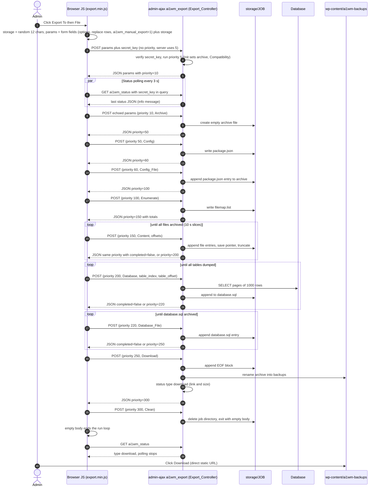

Sources: `lib/view/assets/javascript/export.min.js:370-381, 575-760`; `export-controller:32-117`; `lib/model/export/*`.

### 8.2 (b) Chunked upload plus import with confirm

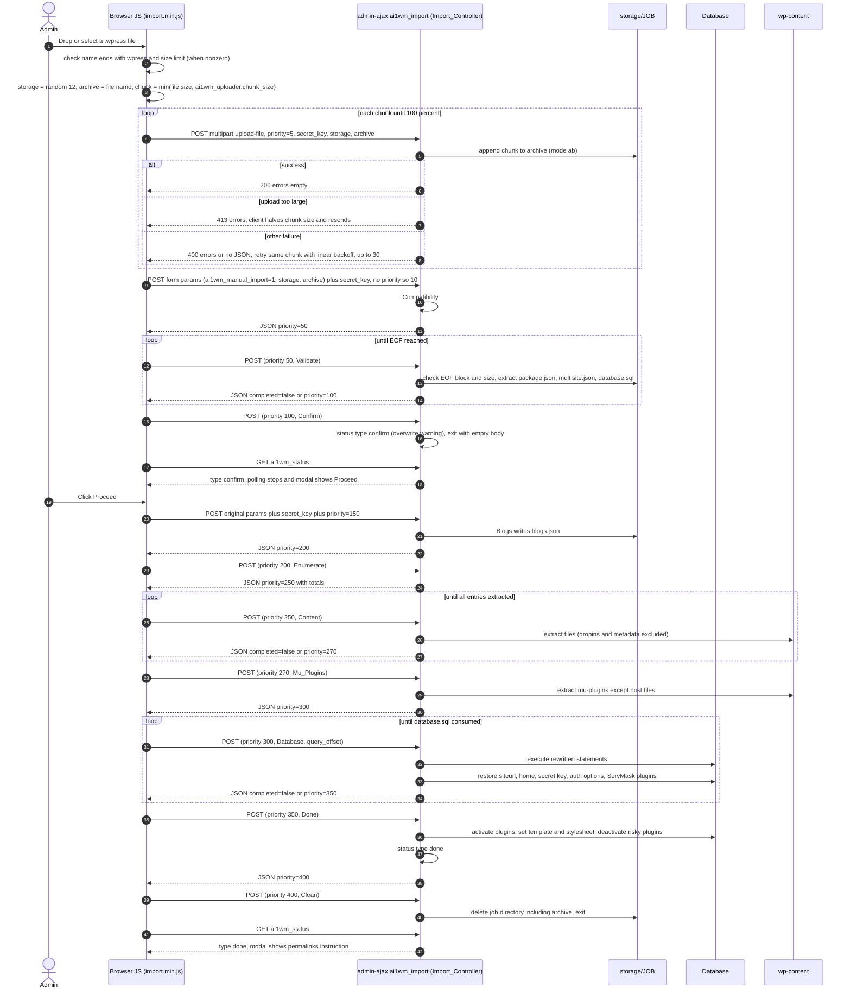

Sources: `import.min.js:524-801, 1820-2025`; `import-controller:32-122`; `lib/model/import/*`.

### 8.3 (c) Restore from the Backups page

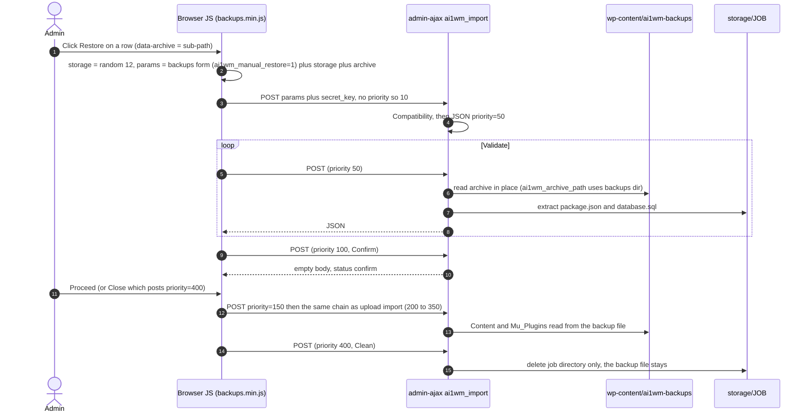

Sources: `lib/view/assets/javascript/backups.min.js:1063-1076`; `functions.php:71-87`; `lib/view/backups/index.php:120`.

### 8.4 (d) Background: loopback (scheduled) export and WP-CLI

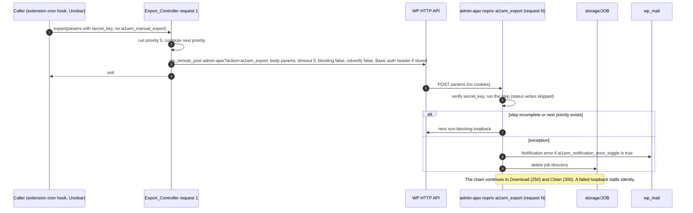

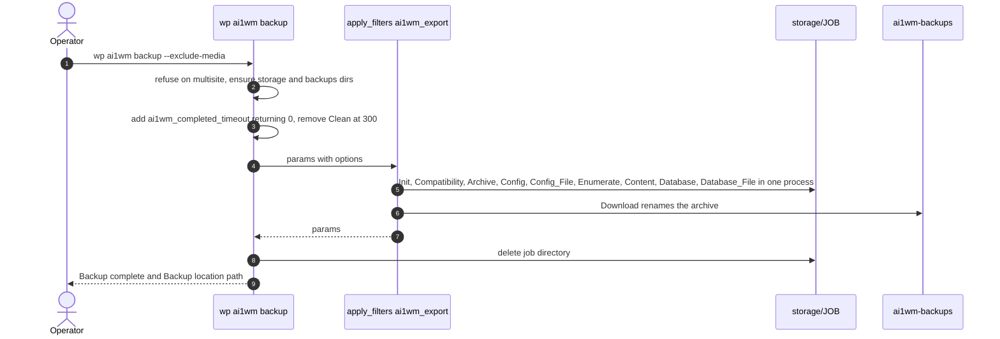

Sources: `export-controller:104-111`; `functions.php:1390-1404`; `lib/model/class-ai1wm-notification.php:55-80`; `class-ai1wm-wp-cli-command.php:85-208`.

### 8.5 (e) Status polling and stop/cancel

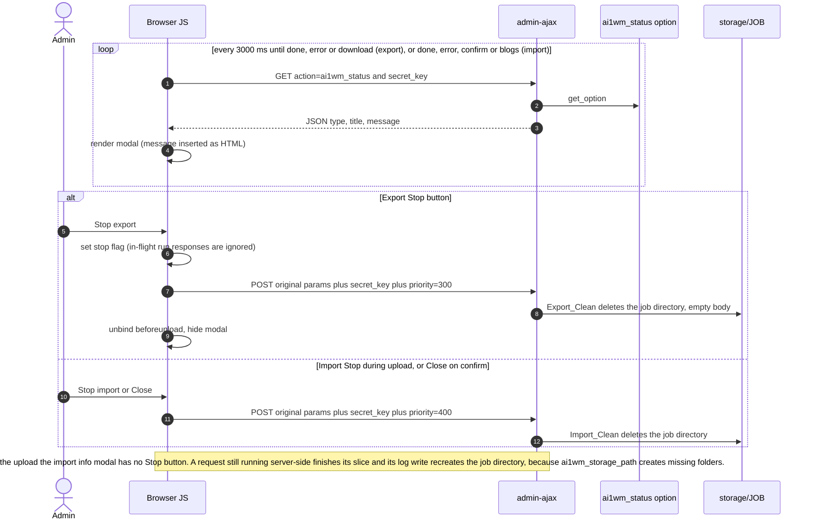

The last note is derived from `lib/model/class-ai1wm-log.php:28-45` calling `ai1wm_export_path()`, which calls `ai1wm_storage_path()`, which runs `mkdir` (`functions.php:32-44`). It has not been verified at runtime.

Sources: `export.min.js:674-760`; `import.min.js:712-801`; `lib/controller/class-ai1wm-status-controller.php:28-50`.

---

## 9. Find/replace and serialization engine

All replacement happens at **import** time (`lib/model/import/class-ai1wm-import-database.php:76-775`). Export only records the user's pairs in `package.json` and rewrites table and column prefixes (`class-ai1wm-export-database.php:81-136`).

### 9.1 Three replacement lists

| List | Applied by | Scope | Source |
|---|---|---|---|
| `old/new_replace_values` | `replace_table_values`: serialization-aware, only inside single-quoted SQL literals, and only when at least one escaped old value occurs in the statement | data values | `class-ai1wm-database.php:1050-1087` |
| `old/new_replace_raw_values` | `replace_raw_values`: plain `strtr` over the whole statement | whole statement | `:1155-1157` |
| `old/new_table_prefixes` | `replace_table_prefixes`: `str_ireplace` over the whole statement | whole statement, data included | `:995-1014` |

**Deduplication.** A pair is added only if its old value is not already in the list (`in_array`), so the first mapping wins. At apply time `strtr` matches the longest key first and never re-replaces its own output (`class-ai1wm-database-utility.php:37-46`).

### 9.2 Pairs built on import, in build order

1. **Per blog from `blogs.json`** (multisite-origin archives only, `:80-422`). For each blog:
   - Raw pairs: the quoted old blogs.dir and uploads paths (e.g. `'wp-content/blogs.dir/3/files'`, `'wp-content/uploads/sites/3'`) map to the quoted `upload_path` option, which is usually empty (`:100-109`).
   - Upload URL and path pairs. With `UPLOADBLOGSDIR`: blogs.dir to blogs.dir. Otherwise: `<HomeURL>/files/` maps to the new uploads URL, and `/wp-content/blogs.dir/<id>/files/` and `/wp-content/uploads/sites/<id>/` map to `/wp-content/uploads/`. Each pair is added in four encodings (`:112-216`).
   - Site URL and Home URL blocks identical to step 2 below, with the blog's `Old.*` values as the source and `New.*` as the target (`:219-421`).
2. **Site URL** (`:424-524`). Sources are `SiteURL` and, if it has a scheme and host, `InternalSiteURL`. A source is processed only if it is `!== site_url()` (exact string compare). For each source **and its www inversion** (strip `//www.`, or insert it after every `//`):
   - Raw: `'olddomain','oldpath/'` maps to `'newdomain','newpath/'`. This matches `wp_blogs` and `wp_site` row fragments.
   - Value: `='olddomain/oldpath` maps to `='newdomain/newpath`, and the same for `="...`.
   - Scheme variants: old `http://...` and `https://...` map to the **target's scheme**. Protocol-relative `//...` maps to `//...` (via `ai1wm_url_scheme`, `functions.php:1121-1127`). Each variant is added in four encodings:
     - plain;
     - `urlencode`;
     - `rawurlencode`;
     - JSON-escaped (`addcslashes(value, '/')`, i.e. every `/` becomes `\/`).
   - Email: `@olddomain` maps to `@newdomain`, unless `NoEmailReplace` is set.
3. **Home URL** (`:526-626`). The same procedure with `HomeURL` / `InternalHomeURL` against `home_url()`.
4. **Content directory** (`:628-658`). If `WordPress.Content` differs from the current `WP_CONTENT_DIR`, the old absolute path maps to the new one in the four encodings. There is **no** `ABSPATH` replacement.
5. **User pairs** (`:660-690`). `Replace.OldValues[i]` maps to `Replace.NewValues[i]` when both are non-empty, in the four encodings.

Because of `in_array` deduplication, the effective precedence is: blogs, site URL, home URL, content dir, user pairs.

### 9.3 Serialized-data repair

**Statement-level procedure** (`class-ai1wm-database.php:1050-1087`; `class-ai1wm-database-utility.php:56-128`):

1. Visual Composer and BeTheme special cases run first ([9.5](#95-special-cases)).
2. If any old value, escaped with the driver's escape function, occurs in the statement text, every single-quoted literal matched by a lazy quote-to-unescaped-quote regex is processed:
   - MySQL-unescape the literal (`\0`, `\n`, `\r`, `\\`, `\'`, `\"`, `\Z`);
   - run `replace_serialized_values`;
   - re-escape and re-quote it.

**`replace_serialized_values` behaviour:**

- **Serialized strings.** If a string `is_serialized()` and `@unserialize` succeeds, the function recurses on the result and then calls `serialize()` again. This recomputes every `s:N:` length.
- **Arrays** are processed element by element.
- **Objects** other than `__PHP_Incomplete_Class` are processed over their public properties (`get_object_vars`), and the results are assigned back.
- **Incomplete-class objects** are left untouched, so URLs inside them are **not** replaced.
- **Plain strings** go through `strtr` with all pairs.
- **Corrupt serialized strings** that fail to unserialize are treated as plain strings, which can break their lengths further.
- **Error handling.** Exceptions are swallowed.

**Defects:**

- Literals ending in an escaped backslash are mis-tokenised, because the lookbehind checks only one character.
- `unserialize` runs without `allowed_classes`, which allows object injection.
- Table-prefix replacement runs **before** the serialized pass and changes string lengths. Any serialized value containing `SERVMASK_PREFIX_` is therefore broken.
- Collation replacement also edits data.

### 9.4 Table prefix rewriting

The import builds a prefix map in this order (`class-ai1wm-import-database.php:707-740`):

1. `SERVMASK_PREFIX_mainsite_` maps to the current base prefix. (`ai1wm_servmask_prefix('mainsite')` yields this string because the strict main-site test treats strings as subsites.)
2. For each non-main old blog, `SERVMASK_PREFIX_<oldid>_` maps to the table prefix of the new id. A null new id maps to the base prefix.
3. For each main old blog, `SERVMASK_PREFIX_basesite_` maps to the new table prefix.
4. For each main old blog, `SERVMASK_PREFIX_` maps to the new table prefix.
5. Finally `SERVMASK_PREFIX_` maps to `$wpdb->base_prefix`.

The map is applied with sequential, case-insensitive `str_ireplace` over the whole statement. **Unclear:** whether the `mainsite` and `basesite` placeholders are ever emitted. Core export never writes them, so they presumably come from the Multisite extension.

Collation compatibility is handled in the same pass (`class-ai1wm-database.php:1129-1147`):

- On servers without `utf8mb4_520` support, `utf8mb4_unicode_520_ci` becomes `utf8mb4_unicode_ci`.
- On servers without `utf8mb4` at all, it becomes `utf8_unicode_ci`, and `utf8mb4` becomes `utf8`.
- No other collations (e.g. MySQL 8 `utf8mb4_0900_ai_ci`) are mapped.

### 9.5 Special cases

| Case | Trigger | Handling | Source |
|---|---|---|---|
| Visual Composer `[vc_raw_html]` | Plugin `js_composer/js_composer.php` is installed on the target after Content extraction | Base64-decode each block, apply a plain `strtr` replace, re-encode | `class-ai1wm-import-database.php:769`; `class-ai1wm-database.php:1095-1104` |
| BeTheme `mfn-page-items` | Theme `betheme/style.css` exists | Base64-decode the value that follows `'mfn-page-items',`, apply a serialization-aware replace, re-encode | `class-ai1wm-import-database.php:772`; `class-ai1wm-database.php:1112-1121` |
| Elementor and other JSON payloads | Always | No plugin-specific code. Covered by the JSON-escaped (`\/`) variants of every URL, path and user pair (changelog 6.47). | `class-ai1wm-import-database.php:508-512, 610-614, 652-656, 683-687` |
| http to https and back | Always | Old `http` and `https` both map to the target's scheme | `:483-513` |
| www and non-www | Always | The www inversion of each old URL is also mapped | `:444-452` |
| Email domains | Unless `NoEmailReplace` | `@olddomain` maps to `@newdomain` (affects any text containing that substring) | `:515-521` |
| Azure / engines | MySQL error 1030 | `ENGINE=MyISAM` / `ENGINE=Aria` become `InnoDB`, then retry | `class-ai1wm-database.php:1302-1314` |
| Oversized statements | Length over `max_allowed_packet` | Skipped silently | `:760-845` |

### 9.6 Excluded and preserved values (import)

- **Excluded at export:** see the options rows in [4.3](#43-wordpress-core-and-third-party-options-touched).
- **Preserved across import.** The current `siteurl`, `home`, `ai1wm_secret_key`, `ai1wm_auth_user` and `ai1wm_auth_password` are captured at the start of every Database request. After the request the plugin:
  1. calls `ai1wm_cache_flush()`;
  2. re-adds this plugin and every active ServMask extension to `active_plugins`;
  3. writes the five captured values back.

  Sources: `class-ai1wm-import-database.php:692-705, 810-829`; `functions.php:786-873, 1094-1112`.
- **Not preserved:** users, usermeta and session tokens. The admin is effectively logged out and must use the source site's credentials. The browser chain keeps working because the endpoints are nopriv and key-authenticated.
- **Done-phase changes** (`class-ai1wm-import-done.php:28-207`):
  - Activates the archive's plugins (validated with `validate_plugin`) and sets `template`/`stylesheet`.
  - Deactivates SSL plugins when the current request is not HTTPS: `really-simple-ssl`, `wordpress-https`, `wp-force-ssl`.
  - Always deactivates `invisible-recaptcha`, `wps-hide-login`, `hide-my-wp`, `hide-my-wordpress`, `mycustomwidget`, `lockdown-wp-admin` and `rename-wp-login`. Folder names are matched loosely through `ai1wm_discover_plugin_basename`.
  - Removes the Jetpack `photon` and `sso` modules.
  - No permalink flush is done. The user is told to save permalinks twice.

---

## 10. Dependencies and external services

### 10.1 Bundled libraries

| Library | Path | Version | Licence | Used for | Source |
|---|---|---|---|---|---|
| Bandar | `lib/vendor/bandar/bandar/lib/Bandar.php` | "GIT: 3.0.0" | MIT, (c) 2013 Yani Iliev | View rendering (`extract` + `include` + output buffering) | `lib/vendor/bandar/bandar/LICENSE`; `Bandar.php:29-32` |
| Math_BigInteger (PEAR) | `lib/vendor/math/BigInteger.php` | n/a | MIT, (c) 2006 Jim Wigginton | File sizes and seeks over 2 GB on 32-bit PHP (`ai1wm_filesize`, `ai1wm_find_smaller_number`, `ai1wm_fseek`). Uses GMP/BCMath when available. | `BigInteger.php:64-69`; `functions.php:1291-1368` |
| ServMask in-house libs | `lib/vendor/servmask/` | n/a | GPL v3 or later (file headers) | Archiver, DB engine, filesystem, iterators, cron, CLI | file headers |

Plugin licence: the file headers and `LICENSE` say GPL v3 or later, while `readme.txt:8` says "GPLv2 or later". This inconsistency is in the original. Browser JS bundles include the whatwg-fetch and core-js polyfills, with no source or build config shipped (`lib/view/assets/javascript/import.min.js`).

### 10.2 servmask.com and other remote endpoints

| # | URL | Method | Purpose | Data sent | When | Source |
|---|---|---|---|---|---|---|
| 1 | `https://servmask.com/products/<extension>/about` | GET (server, timeout 15, `Accept: application/json`) | Extension update metadata | Headers only (WP User-Agent includes the site URL) | Core update-transient refresh, `wp_maybe_auto_update`, `?ai1wm_updater` admin hit; only for installed extensions | `lib/model/class-ai1wm-updater.php:106-147` |
| 2 | `<download_link>/<purchase uuid>?siteurl=<site_url>` | GET (WP upgrader) | Extension package download | Purchase uuid, site URL | When an admin updates an extension | `class-ai1wm-updater.php:65-99` |
| 3 | `https://servmask.com/ai1wm/feedback/create` | POST (server, timeout 15) | Feedback | `type`, `email`, `message` | User submits feedback | `constants.php:104`; `lib/model/class-ai1wm-feedback.php:51` |
| 4 | `https://servmask.com/ai1wm/report/create` | POST (server, timeout 15) | Problem report | `email`, `message` | User submits a report | `constants.php:109`; `lib/model/class-ai1wm-report.php:48` |
| 5 | `https://servmask.com/purchase/<id>/check` | GET (browser, cross-origin) | Validate a purchase id; returns `{uuid, extension}` | The typed purchase id in the path | Updater modal Save | `lib/view/assets/javascript/updater.min.js:101-147` |
| 6 | `admin_url('admin-ajax.php?action=ai1wm_export|import')` | POST (server to itself) | Loopback chaining | Full params including `secret_key`; Basic auth header | Non-manual runs | `export-controller:104-111`; `import-controller:108-115` |

`AI1WM_ARCHIVE_TOOLS_URL` (`https://servmask.com/archive/tools`, `constants.php:114`) is defined but unused.

**Unclear:** the full schema of the `about` JSON. Only `slug`, `version`, `homepage`, `download_link` and `icons` are consumed explicitly; the rest is passed through to `plugins_api`.

### 10.3 Third-party scripts loaded in admin

`lib/view/common/share-buttons.php` is rendered on the Export, Import and Backups screens while `AI1WM_DEBUG` is false (the default, `constants.php:29`). It injects:

- the Facebook SDK (`//connect.facebook.net/en_US/sdk.js`, appId 597242117012725, v2.0);
- Twitter `widgets.js`, loaded over `http` when the admin page is http.

Both run in the same page context as the localized `secret_key`. Static outbound links (no requests) point to servmask.com help and product pages, `feedback.wp-migration.com`, the wordpress.org review page, YouTube and the iubenda privacy policy.

### 10.4 PHP and server requirements

- **PHP extensions:** none are strictly required. The readme claims "no PHP extensions needed, PHP 5.2+" (`readme.txt:6, 27-28`).
  - DB access reuses `$wpdb->dbh` through `mysqli_*` or, when `$wpdb->use_mysqli` is empty, the legacy `mysql_*` functions (`lib/vendor/servmask/database/class-ai1wm-database-mysql.php`, `-mysqli.php`).
  - Microsoft SQL Server connections are refused (`class-ai1wm-database.php:138-165`).
  - JSON and SPL (both core in PHP 5.2+) are used.
  - GMP and BCMath are optional accelerators for BigInteger.
  - If `mbstring.func_overload` is active, internal encoding is forced to ISO-8859-1 (`functions.php:1425-1428`).
  - The `litespeed` extension is detected only to write the noabort block.
- **Runtime settings changed:** `ignore_user_abort(true)`, `set_time_limit(0)`, `max_input_time=-1`, `pcre.backtrack_limit=PHP_INT_MAX`. `memory_limit` is not changed (`functions.php:1411-1434`).
- **Upload limits:** the chunk size is capped by `post_max_size` and `upload_max_filesize`, parsed with decimal multipliers (`functions.php:299-313`; `import-controller:154-160`).
- **Loopback requirements** (non-manual mode only):
  - the server must reach its own `admin_url()` over HTTP(S);
  - non-blocking requests must actually be sent within the 5 s timeout;
  - HTTP Basic protection is passed only if credentials were captured into options;
  - TLS errors are ignored (`sslverify` false);
  - `admin-ajax.php` must accept unauthenticated POSTs (nopriv).
  - A failed loopback stalls the job silently. Browser-driven runs do not need loopbacks.
- **Filesystem:** `wp-content/plugins/<plugin>/storage/` and `wp-content/ai1wm-backups/` must be writable. Directories are created with mode 0777 (`lib/vendor/servmask/filesystem/class-ai1wm-directory.php:34-36`).

---

## 11. Extension architecture

The free plugin is a host for 16 premium ServMask extensions. Core contains every integration point those extensions use. SnapBak should offer an equivalent, documented add-on API.

### 11.1 Identification constants

- Each extension defines `AI1WM<X>E_PLUGIN_NAME`, `AI1WM<X>E_PLUGIN_BASENAME` and `AI1WM<X>E_VERSION` itself.
- Core supplies fallbacks for `_PLUGIN_BASEDIR`, `_PLUGIN_TITLE`, `_PLUGIN_ABOUT`, `_PLUGIN_KEY` and `_PLUGIN_SHORT` (`constants.php:360-947`). The letter codes are ZE Azure, AE B2, BE Box, IE DigitalOcean, DE Dropbox, FE FTP, CE GCS, GE Google Drive, RE Glacier, EE Mega, ME Multisite, OE OneDrive, PE pCloud, SE S3, UE Unlimited and LE URL.
- `Ai1wm_Extensions::get()` includes an extension only when its `_PLUGIN_NAME` constant is defined. Each entry carries `key`, `title`, `about`, `basename`, `version`, `requires` (a minimum version hard-coded in core) and `short` (`lib/model/class-ai1wm-extensions.php:33-245`).
- **Unclear:** the literal values of each extension's `_PLUGIN_NAME` and `_VERSION`, which are defined outside core.

### 11.2 Integration points

| Mechanism | How an extension uses it | Source |
|---|---|---|
| Pipeline steps | `add_filter('ai1wm_export'|'ai1wm_import', callback, <priority>)` in the gaps between core priorities (e.g. upload to a cloud after 250, download from a cloud before 50). A step may set `completed=false` to be re-run. | MC:131-157; [1.3](#13-the-steppriority-pipeline) |
| Storage buttons | Replace the upsell HTML via `ai1wm_export_<provider>` / `ai1wm_import_<provider>`, or append through `ai1wm_export_buttons` / `ai1wm_import_buttons` | `export-controller:120-137`; `import-controller:124-142` |
| Form fields | `ai1wm_export_left_options`, `ai1wm_export_advanced_settings`, `ai1wm_import_left_options`, `ai1wm_backups_left_end`, `*_left_end`. The fields are serialized into params by the JS. | [6.2](#62-custom-hooks-exposed-complete) |
| Compatibility gate | The extension posts its `short` key in params. `Ai1wm_Compatibility::get` then checks only those extensions (or all of them if none is flagged) against `requires`, and a failure throws `Ai1wm_Compatibility_Exception` with a forced error e-mail. | `lib/model/class-ai1wm-compatibility.php:28-71`; `class-ai1wm-export-compatibility.php:42` |
| Limits | Unlimited sets `ai1wm_max_file_size` to 0 (presumed from UI behaviour); chunk size via `ai1wm_max_chunk_size` | `lib/view/import/import-buttons.php:61-72` |
| Content exclusions | `ai1wm_exclude_content_from_export` | `class-ai1wm-export-enumerate.php:115` |
| Loopback transport | `ai1wm_http_export_*` / `ai1wm_http_import_*` filters | [6.2](#62-custom-hooks-exposed-complete) |
| Scheduling | `Ai1wm_Cron::add/clear`, plus the `weekly`/`monthly` schedules. Scheduled runs omit the manual flag, so they loop back, skip status writes and may e-mail via the `ai1wm_notification_*` filters. `Ai1wm_Notification::ok` has no core caller. | `class-ai1wm-cron.php:37-71`; MC:929-940; `class-ai1wm-notification.php:28-80` |
| Status and UI messages | `Ai1wm_Status::blogs` and `progress` (no core caller), and the JS `blogs` modal state that posts to priority 150; `Ai1wm_Message::flash` | `class-ai1wm-status.php:48-54`; `import.min.js:664-710, 1098-1143` |
| Multisite | When `AI1WMME_PLUGIN_NAME` is defined, the menu moves to network admin and the upsell notice disappears. The extension writes `multisite.json` and presumably drives the `blogs` mapping UI. | MC:177-189; `class-ai1wm-import-blogs.php` |
| Templates and assets | `Ai1wm_Template::render/get_content($view, $args, $path)` with the extension's own views path; `Ai1wm_Template::asset_link($asset, '<PREFIX>')` builds `<PREFIX>_URL/lib/view/assets/<asset>?v=<PREFIX>_VERSION`. Pre-registered handles `ai1wm_servmask`, `ai1wm_feedback`, `ai1wm_report` and `ai1wm_util`. | `lib/model/class-ai1wm-template.php:36-53`; MC:504-534 |
| Self-protection | Extension directories are excluded from exports (`ai1wm_plugin_filters`) and kept active after import (`ai1wm_active_servmask_plugins`) | `functions.php:658-873` |
| Updater | The purchase uuid is stored in `ai1wm<x>e_plugin_key`. Metadata comes from the `about` URL and is cached in `ai1wm_updater`. Updates are injected into `update_plugins` with `package = download_link/uuid?siteurl=`. "View details" goes through `plugins_api`. Row meta shows a Purchase ID modal or a "Check for updates" link. | `lib/model/class-ai1wm-updater.php:36-193`; `lib/controller/class-ai1wm-updater-controller.php:28-81` |
| Backward compatibility | Empty stubs `ai1wm_progress_path()`, `Ai1wm_Export_Abstract`, `Ai1wm_Import_Abstract` and `Ai1wm_Config` | `deprecated.php:26`; `lib/model/class-ai1wm-deprecated.php:26-28` |

### 11.3 Implications for SnapBak's add-on API

These follow directly from the integration points above. Details and priorities belong in `05-Improvement-Notes.md` and `06-Development-Plan.md`.

- Keep a priority-ordered step registry for export and import, with documented gaps and a re-entrant step contract: params in, params out, a `completed` flag, and cursors kept in params. Dispatch it through an explicit runner rather than by reading `$wp_filter` internals.
- Replace the hard-coded extension list with a registration API that returns the same information: id, title, version, minimum core-compatible version and short key. The compatibility gate can then work without core knowing each extension in advance.
- Provide provider-button registration that is equivalent to the per-provider filters. In the free plugin only the "File" target works; every other target is an upsell link to a premium extension. Keep that split as data, not as hard-coded templates.
- Keep equivalents of the UI action hooks, the content-exclusion filter, the size/chunk/timeout filters and the notification filters. Replace the "scheduled" heuristic (absence of a manual flag) with an explicit run-mode field.
- Make loopback continuation authenticate with a per-job signed token instead of the static secret key. See `05-Improvement-Notes.md` for the security rationale.
- Scheduling moves into core. In the original, scheduled backups belong to premium extensions, which use the unused `Ai1wm_Cron` helpers and the "scheduled" heuristic. SnapBak has its own Settings tab with scheduled backups, safety backups before import/restore and before automatic updates, and notifications (`02-SRS.md` FR-113 to FR-124; `06-Development-Plan.md` §2 `Schedule/` module). Add-ons therefore don't schedule anything themselves. They register destinations that the schedule's "Save to" field can use (FR-110), and they can still start jobs through the job API (FR-112).

---

## 12. Summary of items marked Unclear

| Topic | Why unclear | Section |
|---|---|---|
| `AI1WM_MAX_FILE_SIZE = 2 << 28 * 4` | Evaluates to 0 ("unlimited") on PHP 7+; the intended value was probably 512 MB. Likely bug. | [6.2](#62-custom-hooks-exposed-complete) |
| `multisite.json` schema | Written only by the Multisite extension; only the fields core reads are known | [4.7.3](#473-multisitejson) |
| `settings.json`, `multipart.list` | Path helpers exist; no core reader or writer | [4.4](#44-storage-job-artifacts) |
| How scheduled or loopback runs are started | No core caller of `Ai1wm_Cron::add` or of a non-manual export | [1.3](#13-the-steppriority-pipeline), [8.4](#84-d-background-loopback-scheduled-export-and-wp-cli) |
| Extension `short` params and `_PLUGIN_NAME` / `_VERSION` values | Set inside the extensions | [4.8](#48-params-state-keys), [11.1](#111-identification-constants) |
| `SERVMASK_PREFIX_mainsite_` / `basesite_` | Never emitted by core export | [9.4](#94-table-prefix-rewriting) |
| `Ai1wm_File_*` delegation edges | Inferred, not traced call by call | [3.4](#34-filesystem-iterators-filters-cron-and-cli) |
| WP-CLI and `get_plugins()` availability | Not verified under WP-CLI bootstrap | [7.1](#71-wp-cli-commands) |
| Servmask `about` JSON schema | Only consumed keys are known | [10.2](#102-servmaskcom-and-other-remote-endpoints) |
| Duplicate dump header on resume | Likely bug, harmless | [5.2](#52-sql-dump-format) |
| Stop-race log write recreating the job dir | Derived from code, not verified at runtime | [8.5](#85-e-status-polling-and-stopcancel) |
