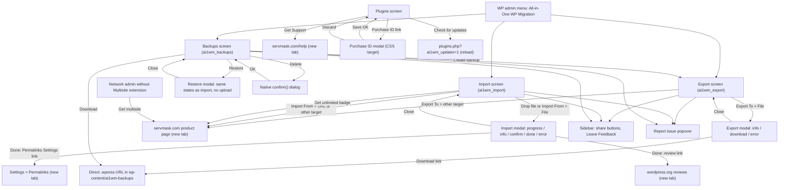
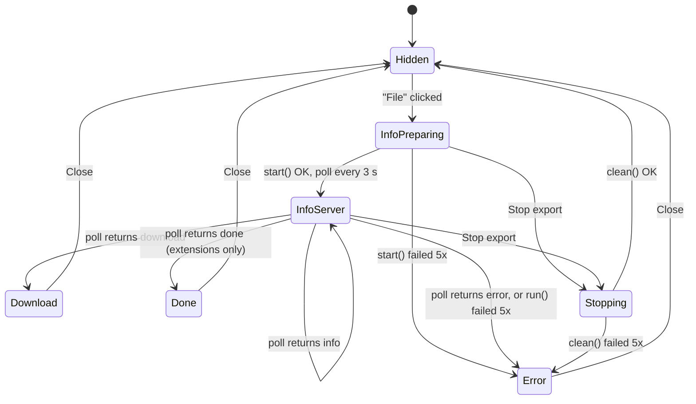
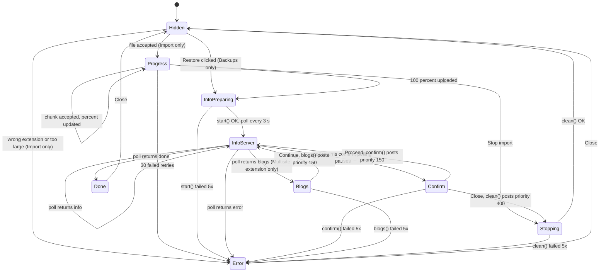

# 04 - UI/UX Specification

Purpose: describe every screen, control, state and user-visible message of All-in-One WP Migration v6.77 (ServMask), called "the original plugin" or "AI1WM", and set the UI/UX requirements for SnapBak, the reimplementation by Riyadh Mobin.

## Contents

1. [Conventions](#1-conventions)
2. [Information architecture](#2-information-architecture)
3. [Shared page shell and sidebar widgets](#3-shared-page-shell-and-sidebar-widgets)
4. [Export screen](#4-export-screen)
5. [Import screen](#5-import-screen)
6. [Backups screen](#6-backups-screen)
7. [Progress modal and state machines](#7-progress-modal-and-state-machines)
8. [Plugins screen: updater and Purchase ID modal](#8-plugins-screen-updater-and-purchase-id-modal)
9. [Admin notices](#9-admin-notices)
10. [Message catalogue](#10-message-catalogue)
11. [Visual design](#11-visual-design)
12. [Accessibility and i18n audit, and requirements for SnapBak](#12-accessibility-and-i18n-audit-and-requirements-for-snapbak)
13. [Known UI bugs and dead code in the original](#13-known-ui-bugs-and-dead-code-in-the-original)
14. [Unclear items](#14-unclear-items)
15. [Settings tab and automatic backups (SnapBak)](#15-settings-tab-and-automatic-backups-snapbak)

Related documents: 01-BRD.md (scope), 02-SRS.md (functional requirements), 03-Technical-Architecture.md (endpoints, pipeline, security model), 05-Improvement-Notes.md, 06-Development-Plan.md.

---

## 1. Conventions

- All `path:line` citations are relative to the plugin root `all-in-one-wp-migration/`.
- "MC" abbreviates `lib/controller/class-ai1wm-main-controller.php`.
- Every template in `lib/view/` starts with the same 24-line licence header, so real markup begins at line 25 or later.
- JavaScript line numbers point at the shipped webpack bundles in `lib/view/assets/javascript/`. These bundles have no source in the repository.
- Short labels are quoted exactly. Long texts are paraphrased.
- "Translated" means wrapped in `__()`/`_e()` with text domain `all-in-one-wp-migration` (AI1WM_PLUGIN_NAME), or passed through `ai1wm_locale` by `wp_localize_script`.
- Requirements for SnapBak are numbered **UX-nn**. They are UI-level only. 02-SRS.md owns the functional requirements.
- Facts that apply across the whole document set:
  - **AI1WM_MAX_FILE_SIZE** is defined as `2 << 28 * 4` (`constants.php:284`). Multiplication binds tighter than the shift, so the value is 2<<112, which is 0 on PHP 7+, and 0 means "unlimited". The intended limit was probably 512 MB (changelog 1.2.0). **Unclear/likely bug.** Several UI branches in this document depend on whether the limit is 0 (sections 4.3, 5.3, 5.5). SnapBak must use an explicit, filterable limit (UX-40).
  - In the free plugin, only the "File" export/import target works. Every other target is an upsell link to a premium extension.
  - AJAX endpoints are registered for both priv and nopriv. Their only auth is a 12-character secret key: no nonces and no capability checks, except the updater, which needs `update_plugins`. The UI exposes this key to the browser (section 12.3).

---

## 2. Information architecture

### 2.1 Admin menu tree

| Item | Page / menu title | Translated | Capability | Slug | Callback | Position / icon | Source |
|---|---|---|---|---|---|---|---|
| Top level | "All-in-One WP Migration" | **No** | `export` | `ai1wm_export` | `Ai1wm_Export_Controller::index` | position `'76.295'` (a string, to avoid collisions); `icon_url` empty, icon drawn by CSS | MC:458-466 |
| Submenu 1 | "Export" | Yes | `export` | `ai1wm_export` (same as parent, so it replaces WP's auto-generated first submenu) | Export controller | - | MC:469-476 |
| Submenu 2 | "Import" | Yes | `import` | `ai1wm_import` | `Ai1wm_Import_Controller::index` | - | MC:479-486 |
| Submenu 3 | "Backups" | Yes | `import` | `ai1wm_backups` | `Ai1wm_Backups_Controller::index` | - | MC:489-496 |

- Resulting hook suffixes: `toplevel_page_ai1wm_export`, `all-in-one-wp-migration_page_ai1wm_import`, `all-in-one-wp-migration_page_ai1wm_backups`. The prefix comes from the untranslated menu title (MC:542-545, 618-621, 728-731).
- Menu icon: `logo-20x20.png`, injected as a background on `.toplevel_page_ai1wm_export > div.wp-menu-image:before` by the inline admin-head CSS. There is an alternate rule for WP < 3.8. When the menu is open, the item background is `#111` (`lib/view/main/admin-head.php:77-117`).
- The parent requires `export` while Import and Backups require `import`. A user who has `import` but not `export` depends on WordPress core's fallback for orphaned submenus. **Unclear:** not tested at runtime. SnapBak should give the parent the weaker of the two capabilities, or gate each page explicitly (UX-01).

### 2.2 Single-site and multisite variants

Registration happens in `ai1wm_loaded()` (MC:177-190).

| Environment | Menu | Other UI |
|---|---|---|
| Single site | `admin_menu` (MC:182, 188) | Folder/permission notices on `admin_notices` |
| Multisite, Multisite extension **absent** (`AI1WMME_PLUGIN_NAME` undefined) | **No menu at all** | Network-admin upsell notice only (section 9.1, MC:180). Folder notices go to `network_admin_notices` |
| Multisite, extension present | `network_admin_menu` (MC:186), Network Admin only | Folder notices on `network_admin_notices` |

### 2.3 Plugins screen row links

| Row | Link / UI | Condition | Source |
|---|---|---|---|
| AI1WM itself | "Get Support" to `https://servmask.com/help`, new tab | always | MC:443-449, `lib/view/main/get-support.php:27` |
| Each installed ServMask extension (not AI1WM) | "Check for updates" to `network_admin_url('plugins.php?ai1wm_updater=1')` | the extension's purchase-ID option is non-empty | `lib/model/class-ai1wm-updater.php:156-190`, `lib/view/updater/check.php:27` |
| Each installed ServMask extension | Inline text "There is an update available. To update, you must enter your [Purchase ID]." plus a hidden modal | purchase ID empty (shown even when no update exists) | `lib/view/updater/modal.php:27-52` |

The updater links are registered at MC:214. Section 8 describes the modal.

### 2.4 Navigation and modal flow



There are no automatic redirects anywhere. After an export the archive also appears on Backups, but the UI does not navigate there. After an import nothing reloads (D-ui §10).

### 2.5 Premium and upsell placements (free plugin)

All of them are plain `target="_blank"` links. None opens a modal.

| Placement | Text | URL | Source |
|---|---|---|---|
| Export To: 13 non-File items | brand names | `https://servmask.com/products/<x>-extension` | `lib/view/export/button-*.php:27` |
| Import From: 14 non-File items, including URL | brand names | same pattern, plus `url-extension` | `lib/view/import/button-*.php:27` |
| Import, under the drop zone (only when the size limit is non-zero) | "Get unlimited" pill | `/products/unlimited-extension` | `lib/view/import/import-buttons.php:64-69` |
| Import error modal for an oversized file | "Unlimited Extension" link inside the message | `/products/unlimited-extension` | MC:710-716 |
| Multisite network notice | "Get multisite" pill | `/products/multisite-extension` | `lib/view/main/multisite-notice.php:36-39` |
| Plugins screen, extensions without a key | "Purchase ID" modal, "here" link | `https://servmask.com/lost-purchase` | `lib/view/updater/modal.php:37-38` |

---

## 3. Shared page shell and sidebar widgets

### 3.1 Two-column shell (Export, Import, Backups)

```
+------------------------------------------------------------+  +-------------------------+
| .ai1wm-holder (card #f9f9f9, 1px #d6d6d6, 3px radius)      |  | .ai1wm-segment (333px)  |
| [icon] EXPORT SITE / IMPORT SITE / BACKUPS  [! REPORT ISSUE]|  |  [Tweet] [FB Recommend] |
|                                    (popover 280px, right)  |  |  LEAVE FEEDBACK         |
| <screen body>                                              |  |  ( ) I would like to    |
|                                                            |  |      review this plugin |
|                                                            |  |  ( ) I have ideas ...   |
|                                                            |  |  ( ) I need help ...    |
|                                                            |  |  [hidden form]          |
+------------------------------------------------------------+  +-------------------------+
 >=855px: sidebar fixed 377px on the right; <=854px: sidebar drops below at full width
```

- H1: floated left, uppercase, weight 300, 22px. Icons: `ai1wm-icon-export` (Export and Backups), `ai1wm-icon-publish` (Import). Sources: `lib/view/export/index.php:31-34`, `lib/view/import/index.php:31-34`, `lib/view/backups/index.php:31-34`.
- The "Report issue" widget is included right after the H1 and outside the form (`export/index.php:36`, `import/index.php:36`, `backups/index.php:36`).
- Sidebar: share buttons if `! AI1WM_DEBUG`, then H2 "Leave Feedback", then the feedback widget (`export/index.php:60-66`, `import/index.php:59-65`, `backups/index.php:129-135`).
- Page-load side effects on all three screens: the WP `heartbeat` script is deregistered and `wp_auth_check_load` is removed. As a result, no "session expired" login modal appears during long jobs (MC:548-551, 624-627, 734-737).

### 3.2 Report issue popover

Source: `lib/view/common/report-problem.php:27-55`, JS `export.min.js:255-325` (identical copies at `import.min.js:~281-350` and `backups.min.js:~1110-1180`).

| Control | Type / id | Default | Behaviour |
|---|---|---|---|
| "Report issue" | `button#ai1wm-report-problem-button.ai1wm-button-red`, notification icon | - | Toggles class `ai1wm-report-active` on the next sibling `.ai1wm-report-problem-dialog` |
| Email | `input[type=text]#ai1wm-report-email`, placeholder "Enter your email address.." | empty | Server validates with FILTER_VALIDATE_EMAIL |
| Message | `textarea#ai1wm-report-message` (3 rows, no resize), placeholder "Please describe your problem here.." | empty | Server requires non-empty |
| Consent | `checkbox#ai1wm-report-terms` + consent sentence + "Privacy policy" link (iubenda 946881) | unchecked | Server requires checked |
| "Cancel" | `a#ai1wm-report-cancel` (red text link, left) | - | Removes `ai1wm-report-active` |
| "Send" | `button#ai1wm-report-submit.ai1wm-button-blue` (paperplane icon), followed by WP `span.spinner` | - | Disables itself and shows the spinner, then POSTs `admin-ajax.php?action=ai1wm_report` with `secret_key`, `ai1wm_email`, `ai1wm_message`, `ai1wm_terms` (0/1) |

Response handling:
- Non-empty `errors`: removes any old `.ai1wm-message` in the dialog and prepends a pink error box, one `<p>` per error (text-escaped).
- Empty `errors`: **replaces the dialog's whole content** with a green "Thanks for submitting your request!", then removes the active class after 2000 ms. Reopening the popover shows only that text, so filing a second report needs a page reload.
- No `.fail` handler: a network error leaves the button disabled and the spinner spinning.
- After firing the AJAX call the handler throws a ReferenceError (section 13, B-1).
- Server validation returns only the first error, in this order: "Your email is not valid." → "Please enter comments in the text area." → "Please accept report term conditions." (`lib/model/class-ai1wm-report.php:41-46`). On success the server forwards email and message to `https://servmask.com/ai1wm/report/create` (E-updater-security §2.2).

### 3.3 Leave Feedback widget

Source: `lib/view/common/leave-feedback.php:27-75`, JS `export.min.js:96-225`.

| Control | Type / id / value | Behaviour |
|---|---|---|
| Option 1, "I would like to review this plugin" | hidden radio `#ai1wm-feedback-type-1` value `review`, wrapped in link `#ai1wm-feedback-type-link-1` | Opens `wordpress.org/support/view/plugin-reviews/all-in-one-wp-migration?rate=5#postform` in a new tab; the JS toggles the radio. **Does not open the form** |
| Option 2, "I have ideas to improve this plugin" | radio `#ai1wm-feedback-type-2` value `suggestions`, link `#ai1wm-feedback-type-link-2` | Opens `https://feedback.wp-migration.com` in a new tab; same toggle; no form |
| Option 3, "I need help with this plugin" | radio `#ai1wm-feedback-type-3` value `help-needed` inside a `<label>` | Hides options 1 and 2, sets the textarea placeholder to "How may we help you?", fades in `.ai1wm-feedback-form` |
| Email | `#ai1wm-feedback-email`, placeholder "Enter your email address.." | - |
| Message | `textarea#ai1wm-feedback-message` (3 rows), placeholder "Leave plugin developers any feedback here.." | - |
| Consent | `#ai1wm-feedback-terms` + the same consent sentence and privacy link as Report | - |
| "Cancel" | `a#ai1wm-feedback-cancel` | Fades the form out, unchecks the radios, shows all options again. Does **not** restore the placeholder |
| "Send" | `button#ai1wm-feedback-submit.ai1wm-button-blue` + spinner | POST `action=ai1wm_feedback` with `secret_key`, `ai1wm_type`, `ai1wm_email`, `ai1wm_message`, `ai1wm_terms` |

- Radios are drawn as 25px circles (`<i>`); the native input is `display:none`.
- Response handling: errors are prepended as a pink box inside `.ai1wm-feedback`. On success the **whole `.ai1wm-feedback` block** is replaced by the green "Thanks for submitting your feedback!". There is no fail handler.
- Server validation, first error only: "Feedback type is not valid." → "Your email is not valid." → "Please enter comments in the text area." → "Please accept feedback term conditions."; a transport failure gives "Something went wrong: %s" (`lib/model/class-ai1wm-feedback.php:41-58`).
- In practice the only type ever submitted is `help-needed`, because options 1 and 2 never open the form (D-ui §11.9).
- With an invalid secret key the server returns an empty body. The JS then fails silently while reading `data.errors`.

### 3.4 Share / social area

Source: `lib/view/common/share-buttons.php:27-75`.

- Rendered only when `AI1WM_DEBUG` is false, which is the default (`constants.php:29`).
- Loads the Facebook SDK (`connect.facebook.net/en_US/sdk.js`, appId 597242117012725, v2.0) and Twitter `widgets.js` into wp-admin.
- Centred row:
  - a Twitter "Tweet" link (label translated) with data-url `https://servmask.com`, untranslated text "Check this epic WordPress Migration plugin", and via/related/hashtags `servmask`;
  - a Facebook "recommend" button_count for `https://www.facebook.com/servmaskproduct`.
- Third-party scripts run in the same JS context as the `ai1wm_*.secret_key` globals (E-updater-security §4, item 8).
- **SnapBak must not ship this widget** (UX-60).

---

## 4. Export screen

Slug `ai1wm_export`, template `lib/view/export/index.php`. Assets: `css/export.min.css` (or `.rtl.css`) and `javascript/export.min.js` (dep `ai1wm_util` → jquery). Localized globals: `ai1wm_feedback`, `ai1wm_report`, `ai1wm_export`, `ai1wm_locale` (MC:542-610).

### 4.1 Purpose and layout

The screen builds a `.wpress` archive of the site. The user can optionally add text replacements and exclusions. There is **no submit button**: an export starts only when a target is picked in "Export To" (`export/index.php:38-50`).

```
[icon] EXPORT SITE                                         [! REPORT ISSUE]
+---------------------------------------------------------------------+
| Find <text> Replace with <another-text> in the database          >  |  <- row (collapsed)
+---------------------------------------------------------------------+
[+ ADD]
  (ai1wm_export_left_options hook)
> Advanced options (click to expand)
    [ ] Do not export spam comments
    ... (8 or 11 checkboxes, see 4.3)
+-------------------+
| EXPORT TO     ≡   |   <- outlined green button group
+-------------------+
| File              |   <- dropdown (392px when open)
| FTP               |
| ... 12 more       |
+-------------------+
  hidden ai1wm_manual_export=1
(ai1wm_export_left_end hook)
```

### 4.2 Find/Replace rows

Source: `lib/view/export/find-replace.php:27-49`; JS `export.min.js:433-449` (live preview) and `:487-511` ("Add").

| Element | Detail |
|---|---|
| Container | `ul#ai1wm-queries`. Starts with exactly one `li.ai1wm-query.ai1wm-expandable` |
| Collapsed row | Clickable `<p>` that reads as a sentence: bold "Find", token `<text>` (tooltip "Search the database for this text", **not translated**), bold "Replace with", token `<another-text>` (tooltip "Replace the database with this text", not translated), bold "in the database", and a right chevron |
| Toggle | Clicking the `<p>` toggles class `ai1wm-open`. When open: the row background becomes #ebebeb, the tokens get a dashed underline, the chevron rotates 90°, and the input area animates from height 0 to 5rem |
| Input 1 | `input[type=text].ai1wm-query-find-input`, name `options[replace][old_value][]`, placeholder "Find". Default empty. No client validation |
| Input 2 | `input[type=text].ai1wm-query-replace-input`, name `options[replace][new_value][]`, placeholder "Replace with". Default empty |
| Live preview | On change, paste, input or any key event, the matching token shows the input value. An empty input restores `<text>` / `<another-text>` |
| "Add" | `button#ai1wm-add-new-replace-button.ai1wm-button-gray` with plus icon. Clones the first row, clears and resets it, collapses all existing rows, then appends the clone **already open** and binds preview and toggle on it |
| Remove | **None.** Rows cannot be removed. Empty rows are submitted as empty strings |

What the server does with the pairs is covered in 02-SRS.md and B-export §7.5.

### 4.3 Advanced options

Source: `lib/view/export/advanced-settings.php:27-117`; toggle handler on `.ai1wm-expandable > h4:first` in `export.min.js`.

- Header: H4 with a right-arrow icon, "Advanced options" and small grey "(click to expand)". Colour rgba(0,116,162,.8), pointer cursor. Clicking toggles `ai1wm-open`: the arrow rotates 90° (-90° in RTL) and the list is revealed with a 2em indent.
- Default: collapsed, every box unchecked.
- Each checkbox is inside its `<label for>`. Every label reads "Do **not** export …".
- Semantics are presence-based: a checked box posts `options[x]=on`, an unchecked box posts nothing, and the server tests with `isset()` (B-export §2, P50).

| # | id / name | Label (short) | Shown when | Effect | Source |
|---|---|---|---|---|---|
| 1 | `ai1wm-no-spam-comments` / `options[no_spam_comments]` | "Do not export spam comments" | always | DB dump skips comments marked spam | advanced-settings.php:37-38 |
| 2 | `ai1wm-no-post-revisions` / `options[no_post_revisions]` | "Do not export post revisions" | always | DB dump skips revision posts | :43-44 |
| 3 | `ai1wm-no-media` / `options[no_media]` | "Do not export media library (files)" | always | file enumeration excludes uploads | :49-50 |
| 4 | `ai1wm-no-themes` / `options[no_themes]` | "Do not export themes (files)" | always | excludes the themes directory | :55-56 |
| 5 | `ai1wm-no-inactive-themes` / `options[no_inactive_themes]` | "Do not export inactive themes (files)" + red "new" | **only if `apply_filters('ai1wm_max_file_size', AI1WM_MAX_FILE_SIZE) === 0`** ("unlimited" mode) | excludes all themes except the active template and stylesheet | :60-68 |
| 6 | `ai1wm-no-muplugins` / `options[no_muplugins]` | "Do not export must-use plugins (files)" | always | excludes mu-plugins | :72-73 |
| 7 | `ai1wm-no-plugins` / `options[no_plugins]` | "Do not export plugins (files)" | always | excludes the plugins directory | :79-80 |
| 8 | `ai1wm-no-inactive-plugins` / `options[no_inactive_plugins]` | "Do not export inactive plugins (files)" + "new" | **unlimited mode only** | excludes plugins not in `active_plugins` | :84-99 (shared `if` block with #9) |
| 9 | `ai1wm-no-cache` / `options[no_cache]` | "Do not export cache (files)" + "new" | **unlimited mode only** | excludes the cache directory | :84-99 |
| 10 | `ai1wm-no-database` / `options[no_database]` | "Do not export database (sql)" | always | skips the DB dump; the archive has no database.sql | :103-104 |
| 11 | `ai1wm-no-email-replace` / `options[no_email_replace]` | "Do not replace email domain (sql)" | always | recorded in package.json; the importer then does not rewrite email domains | :109-110 |

- After the list comes the hook `ai1wm_export_advanced_settings` (advanced-settings.php:114), where extensions add `<li>` items.
- In this copy the limit evaluates to 0 on PHP 7+, so all 11 boxes are visible (section 1).

### 4.4 "Export To" dropdown (14 targets)

Source: `lib/view/export/export-buttons.php:27-47`; items from filter `ai1wm_export_buttons` (`lib/controller/class-ai1wm-export-controller.php:120-136`).

- An outlined green button group (2px #27ae60, uppercase, weight 600). Its face is "Export To" plus a three-line "hamburger" (class `ai1mw-lines`, sic).
- Clicking `.ai1wm-button-main` toggles `ai1wm-open`: the list animates from height 0 to 392px (14 × 28px) and the hamburger morphs.
- It is not keyboard-operable (section 12).

| # | Label | Element | Free-plugin behaviour | Per-item filter |
|---|---|---|---|---|
| 1 | "File" (translated) | `a#ai1wm-export-file href="#"` (`button-file.php:27`) | **Starts the export** (4.5) | `ai1wm_export_file` |
| 2 | FTP | `<a target=_blank>` | Opens `servmask.com/products/ftp-extension` | `ai1wm_export_ftp` |
| 3 | Dropbox | link | `/products/dropbox-extension` | `ai1wm_export_dropbox` |
| 4 | Google Drive | link | `/products/google-drive-extension` | `ai1wm_export_gdrive` |
| 5 | Amazon S3 | link | `/products/amazon-s3-extension` | `ai1wm_export_s3` |
| 6 | Backblaze B2 | link | `/products/backblaze-b2-extension` | `ai1wm_export_b2` |
| 7 | OneDrive | link | `/products/onedrive-extension` | `ai1wm_export_onedrive` |
| 8 | Box | link | `/products/box-extension` | `ai1wm_export_box` |
| 9 | Mega | link | `/products/mega-extension` | `ai1wm_export_mega` |
| 10 | DigitalOcean | link | `/products/digitalocean-spaces-extension` | `ai1wm_export_digitalocean` |
| 11 | Google Cloud | link | `/products/google-cloud-storage-extension` | `ai1wm_export_gcloud_storage` |
| 12 | Azure Storage | link | `/products/microsoft-azure-storage-extension` | `ai1wm_export_azure_storage` |
| 13 | Amazon Glacier | link | `/products/amazon-glacier-extension` | `ai1wm_export_glacier` |
| 14 | pCloud | link | `/products/pcloud-extension` | `ai1wm_export_pcloud` |

- Brand labels 2-14 are not translated.
- An installed extension replaces its own item's HTML through the matching filter.
- Link style: green text, 5px 26px padding; hover text #111.

### 4.5 Export run, as the user sees it

JS: `export.min.js:370-381` (File click), `:575-634` (start), `:636-672` (run), `:674-721` (clean), `:723-760` (status polling).

1. The user clicks "File".
   - The JS generates `storage` (12 random chars from [a-z0-9]).
   - It serializes `#ai1wm-export-form` (all options, the replace arrays and `ai1wm_manual_export=1`).
   - It binds `beforeunload` with "You are about to stop exporting your website, are you sure?".
   - It shows the **info** modal "Preparing to export...".
2. It POSTs to `admin-ajax.php?action=ai1wm_export` with `secret_key`. No priority is sent, so the server starts at 5.
   - On success it starts polling `ai1wm_status` every 3 s and re-POSTs each JSON body it gets back. This continues until the body is empty.
3. The modal shows server info lines in order. Percentages appear only inside the text; **there is no progress bar on export**:
   - "Checking extensions compatibility..."
   - "Creating an empty archive..."
   - "Preparing configuration file..."
   - "Archiving configuration file...<br />N% complete"
   - "Retrieving a list of all WordPress files..."
   - "Archiving N files...<br />P% complete"
   - "Exporting database...<br />P% complete"
   - "Archiving database...<br />P% complete"
   - "Renaming exported file..."
   - plus "Done …" variants (section 10.4)
4. **download** state: a pulsing green button "Download <host>" with "Size: <size>" underneath. It links straight to `wp-content/ai1wm-backups/<file>.wpress` (`lib/model/export/class-ai1wm-export-download.php:57-69`).
   - Polling stops and `beforeunload` is unbound.
   - The browser still sends one more request (priority 300, Clean) in the background.
5. "Close" only hides the modal. The archive stays on the Backups screen.

Retry behaviour:
- `start`, `run` and `clean` each retry up to 5 times with linear backoff (0 s, 1 s, 2 s, 3 s, 4 s), then show the error modal.
- Status polling retries forever every 3 s.

---

## 5. Import screen

Slug `ai1wm_import`, template `lib/view/import/index.php`. Assets: `css/import.min.css` and `javascript/import.min.js`. Localized: `ai1wm_feedback`, `ai1wm_report`, `ai1wm_uploader`, `ai1wm_import`, `ai1wm_locale` (MC:618-720).

### 5.1 Purpose and layout

The screen uploads a `.wpress` file in chunks and restores it over the current site.

```
[icon] IMPORT SITE                                         [! REPORT ISSUE]
Use the box below to upload a wpress file.
  (ai1wm_import_left_options hook)
.------------------------------------------------------------------.
:                        (cloud-upload icon)                       :
:                       Drag & Drop to upload                      :  200px, 3px dashed #ddd,
:                     +---------------------+                      :  30px radius
:                     | IMPORT FROM     ≡   |                      :
:                     +---------------------+                      :
:                     | File  (file input)  |  420px when open      :
:                     | URL, FTP, ... (13)  |                      :
'------------------------------------------------------------------'
Maximum upload file size: 512 MB [! GET UNLIMITED]     (limit > 0)
Maximum upload file size: Unlimited                    (limit = 0)
  hidden ai1wm_manual_import=1
```

### 5.2 Storage-permission gate

`lib/view/import/import-buttons.php:27, 74-86`

- If `AI1WM_STORAGE_PATH` is not both readable and writable, the drop zone, the dropdown and the size line are **not rendered**.
- Instead the screen shows a red outlined box: H3 "Site could not be imported!" and "Please make sure that storage directory **{path}** has read and write permissions."
- There is no retry button; the user has to fix permissions and reload.

### 5.3 Drop zone, file picker and size line

| Element | Detail | Source |
|---|---|---|
| Wrapper | `div.ai1wm-import-form > div.hide-if-no-js`. With JS off WP core hides it, and **there is no non-JS fallback** | import-buttons.php:30-31 |
| Messages container | `div.ai1wm-import-messages`, always empty and never used by the JS | :28 |
| Drop zone | `div#ai1wm-drag-drop-area`. Children have `pointer-events:none` so drag events reach the zone; the dropdown re-enables pointer events | :32 |
| Drag feedback | `dragenter`/`dragover` add `ai1wm-drag-over` (border #83b4d8) and call preventDefault; `dragleave` removes it. A `.dragover` green-border style exists but is unused | import.min.js ~1820-1889 |
| Prompt | Cloud-upload icon (46px) and "Drag & Drop to upload" (18px, #9e9e9e) | :34-37 |
| "Import From" | Same button group as Export To, toggled by `.ai1wm-expandable > div.ai1wm-button-main` | :38-56; import.min.js:1778 |
| File input | Inside "File": `input[type=file]#ai1wm-select-file`. It is an invisible overlay (opacity 0, 21px high, z-index 9999), shown only once the dropdown is open (`div.ai1wm-expandable input {display:none}`). **No `accept` attribute** | `lib/view/import/button-file.php:27-30` |
| Size line | "Maximum upload file size:" (**no text domain**, falls back to WP core translations), then either: (a) limit > 0: underlined `size_format(limit)` plus the "Get unlimited" pill; or (b) limit = 0: "Unlimited" | import-buttons.php:60-72 |

### 5.4 "Import From" dropdown (15 targets)

Order and filters: `lib/controller/class-ai1wm-import-controller.php:124-141`.

| # | Label | Free behaviour | Filter |
|---|---|---|---|
| 1 | "File" (translated) | Opens the OS file picker; the selected file starts the upload | `ai1wm_import_file` |
| 2 | URL | Opens `/products/url-extension` | `ai1wm_import_url` |
| 3-15 | FTP, Dropbox, Google Drive, Amazon S3, Backblaze B2, OneDrive, Box, Mega, DigitalOcean, Google Cloud, Azure Storage, Amazon Glacier, pCloud | Same product pages as in 4.4 | `ai1wm_import_<x>` (same names as export) |

### 5.5 Client-side validation

The file uploader is in `import.min.js:1820-2025`. Validation runs in this order on `change` of `#ai1wm-import-file` or `drop`:

1. **Only the first file is used.** Any extra files are ignored silently, and the form is reset afterwards.
2. **Extension check** (`:1964-1973`):
   - The name must end with the string `wpress`. The compare is case-sensitive and does not require a dot, so `site.WPRESS` is rejected and `xwpress` is accepted.
   - On failure: error modal titled "Unable to import". The message says the file type is not compatible and must be a **.wpress** file created by All-in-One WP Migration, with a "Technical details" link to `help.servmask.com/knowledgebase/invalid-backup-file/` (MC:704-709).
3. **Size check** (`:1956-1962`):
   - Runs only when `ai1wm_uploader.filters.ai1wm_archive_size` is non-zero.
   - If the file is larger: error modal "Unable to import". The message says the file exceeds the maximum upload size of **X**, and that the restriction can be removed by buying the "Unlimited Extension" (link) (MC:710-716).
   - This is the only oversize upsell in the UI.
4. No content sniffing happens on either side. The server only checks the archive's trailing EOF block later (C-import §4.3).

### 5.6 Chunked upload, as the user sees it

Upload loop `import.min.js:1891-1941`; `onBeforeUpload` `:1986-2010`.

1. `beforeunload` is bound with "You are about to stop importing your website, are you sure?".
2. The **progress** modal opens at "0.00%": a green pill bar and a red "Stop import" button.
3. The file is sent in slices (form field `upload-file`, plus `priority=5`, `secret_key`, `storage`, `archive`) with `fetch`, `credentials: include`.
   - Slice size: `min(file.size, ai1wm_uploader.chunk_size)`. The default chunk size is min(PHP `post_max_size`, `upload_max_filesize`, 5 MB) (MC:662).
4. After every accepted slice the bar and the text update to `percent.toFixed(2)%`. Only the width and text change; the modal is not rebuilt.
5. **HTTP 413**: the slice size is halved for the rest of the session and the same remaining data is resent immediately. The user sees nothing except slower progress.
6. **Any other failure** (non-200, non-JSON body, or non-empty `errors`): the same slice is retried after `retries × 1000` ms.
   - The bar stalls while this happens; there is no "retrying" indicator.
   - After **30** consecutive failures: error modal "Unable to import" with "We are sorry, there seems to be a problem while uploading your file. Follow this guide to resolve it." The guide link goes to YouTube mRp7qTFYKgs (MC:703).
   - The localized `max_retries` (10, MC:663) is ignored.
   - The counter resets after each successful slice.
7. At 100% the modal switches to **info** "Preparing to import...". The import pipeline starts with no priority, so the server default is 10, and status polling begins (section 7.3).
8. "Stop import" during upload: the button disables itself and sets the stop-upload flag. The modal shows "Please wait, stopping the import..." while a POST with priority 400 deletes the storage folder. On success the modal hides and `beforeunload` is unbound.

---

## 6. Backups screen

Slug `ai1wm_backups`, template `lib/view/backups/index.php`. Assets: `css/backups.min.css` and `javascript/backups.min.js`. Localized: `ai1wm_feedback`, `ai1wm_report`, `ai1wm_import`, `ai1wm_backups`, `ai1wm_locale` (MC:728-808).

### 6.1 Layout

```
[icon] BACKUPS                                             [! REPORT ISSUE]
+--------------------------------------------+-----------+--------+-----------------+
| NAME                                       |   DATE    |  SIZE  |                 |
+--------------------------------------------+-----------+--------+-----------------+
| [folder] sub/dir                           |           |        |                 |
| [zip] example.com-20240101-120000-123.wpress| 3 hours ago| 512.00 MB | (v) (cloud) (x) |
+--------------------------------------------+-----------+--------+-----------------+
There are no backups available at this time, why not create a new one?   (hidden if rows)
[CREATE BACKUP]                                              (always visible)
```

### 6.2 Data and permission gate

- `Ai1wm_Backups::get_files()` scans `wp-content/ai1wm-backups` recursively for `*.wpress` and sorts by mtime, newest first (`lib/model/class-ai1wm-backups.php:33-77, 98-104`).
- If `AI1WM_BACKUPS_PATH` is not readable and writable, the table is replaced by a red box: H3 "Site could not create backups!" and "Please make sure that storage directory **{path}** has read and write permissions." The path printed is **AI1WM_STORAGE_PATH**, which is the wrong directory (bug B-6) (`backups/index.php:104-115`).
- The form `#ai1wm-backups-form` holds hidden `ai1wm_manual_restore=1` (`:120`) and the hook `ai1wm_backups_left_end` (`:118`).

### 6.3 Table

`backups/index.php:42-90`

| Column | Header | Content | Alignment |
|---|---|---|---|
| Name | "Name" | If the file is in a subfolder: folder icon + subpath, then a line break. Then zip icon + basename | left |
| Date | "Date" | "%s ago" using WP `human_time_diff(mtime)`, e.g. "3 hours ago". No absolute date anywhere | centre, nowrap |
| Size | "Size" | `size_format(size, 2)`, or the literal "2GB+" when the size cannot be read (32-bit PHP, file > 2 GB) | centre, nowrap |
| Actions | (empty) | Three pill buttons, 250px column | right, nowrap |

- The table is rendered only when at least one backup exists.
- Row hover background is rgba(0,0,0,.1).

### 6.4 Row actions

| Action | Element | Look | Behaviour | Source |
|---|---|---|---|---|
| Download | `a.ai1wm-button-green.ai1wm-backup-download` | arrow-down icon | Plain `href` to `AI1WM_BACKUPS_URL/<filename>`, served by the web server. No JS, no `download` attribute | backups/index.php:74-76 |
| Restore | `a.ai1wm-button-gray.ai1wm-backup-restore`, `data-archive=<filename>` | cloud-upload icon | Starts a restore **immediately, with no pre-confirmation**. The archive is read in place from `ai1wm-backups` (6.6) | :78-80; backups.min.js:1063-1076 |
| Delete | `a.ai1wm-button-red.ai1wm-backup-delete`, `data-archive` | close (X) icon | Native `confirm()` "Are you sure you want to delete this file?". On OK it POSTs `action=ai1wm_backups` with `secret_key`, `archive` | :82-84; backups.min.js:1031-1060 |

- Labels ("Download", "Restore", "Delete") are in `<span>`s collapsed to width 0 and `visibility:hidden`.
- On hover the JS adds `ai1wm-button-on`, which expands the label to 80px over 2 s (`backups.min.js:1024-1028`).
- So the buttons are icon-only until hovered, and screen readers do not announce the labels.

### 6.5 Delete result and empty state

- If the response has an empty `errors` array: the row is removed. If no rows remain, the table gets `ai1wm-hide` and the empty-state paragraph is revealed.
- If `errors` is non-empty: **nothing is shown**. There is no fail handler either (bug B-7).
- The empty state (`backups/index.php:92-101`) is the paragraph "There are no backups available at this time, why not create a new one?" (`p.ai1wm-backups-empty`, hidden when rows exist) and a green "Create backup" button (export icon) to `network_admin_url('admin.php?page=ai1wm_export')`. The button is always visible.

### 6.6 Restore flow

1. Params: the serialized `#ai1wm-backups-form` (`ai1wm_manual_restore=1`), a new 12-character `storage` value, and `archive` set to the `data-archive` sub-path.
2. `Import.start()` is called. The modal shows info "Preparing to import...", and the server starts at priority 10.
3. The same state machine as import follows (7.3), without the progress state: info → confirm ("Close" / "Proceed >") → info … → done or error.
4. "Close" at confirm, or Stop, calls plain `clean()` (priority 400). It deletes only the storage folder; the backup file is kept.
5. The modal and model code are byte-identical to the import screen's copies (D-ui §4.3).

---

## 7. Progress modal and state machines

### 7.1 Modal chrome (shared)

From `css/*.min.css`; render functions `export.min.js:810-1018`, `import.min.js:920-1285`, `backups.min.js:490-855`.

- Overlay: fixed, full screen, rgba(0,0,0,.7), z-index 100001.
- Box: fixed, 480px wide, centred with `translate(-240px,-94px)`, #f6f6f6 background, 6px radius, centred text, z-index 100002.
- A single modal instance is reused. Each `render(params)` replaces the box's innerHTML according to `params.type`; the import modal records `this.view = params.type`.
- "Close" (`destroy()`) only hides the overlay and the box.
- There is no role, no focus handling and no Esc key support (section 12).

### 7.2 Export modal



| State | `type` | Title | Message | Buttons and actions | Cancellable |
|---|---|---|---|---|---|
| InfoPreparing | `info` (client) | 32px rotating logo | "Preparing to export..." | red "Stop export": disables itself, calls `clean()`, which POSTs params + `priority=300` | yes |
| InfoServer | `info` (server) | spinner | server line, e.g. "Archiving N files...<br />P% complete" | "Stop export" (same) | yes |
| Stopping | `info` (client) | spinner | "Please wait, stopping the export..." | **a fresh, enabled "Stop export" button is rendered again**, because the info view always adds one (quirk; a second click sends another clean) | n/a |
| Download | `download` | none | Server HTML: pulsing green "Download <host>" + "Size: <size>" | red "Close": hides | no (finished) |
| Done | `done` | green `params.title` | server HTML | red "Close" | no. **Core export never emits `done`**; only extensions do (`grep Ai1wm_Status::done` finds only import-done.php) |
| Error | `error` | red `params.title` ("Unable to export") | exception message or client retry message | red "Close" | no |

Polling and lifecycle:
- `GET status.url` (`action=ai1wm_status&secret_key=…`) with `cache:false`, every **3000 ms**, starting after the first successful `start()` response.
- Polling stops on `done`, `error` or `download` (and `beforeunload` is unbound), or when the stop flag is set. A failed poll retries every 3 s forever (`export.min.js:723-760`).
- The `beforeunload` guard is active from start until download, error, done or a successful stop.
- When Stop is clicked while a step request is in flight, that server request still runs to completion. The client ignores its response because of the stop flag.

### 7.3 Import / restore modal



| State | `type` | Title / header | Message | Buttons and actions | Cancellable | Source |
|---|---|---|---|---|---|---|
| Progress | `progress` (client only) | pill bar: #bdc3c7 track, #2ecc71 meter, 32px, white "NN.NN%" | - | red "Stop import" (notification icon): disables itself, sets stop-upload, `clean()` | yes | import.min.js:974-1037 |
| InfoPreparing | `info` | spinner | "Preparing to import..." | **no button**; a top-bordered bold notice "Please do not close this browser window or your import will fail" | **no** | :1145-1190 |
| InfoServer | `info` | spinner | server line, e.g. "Restoring N files...<br />P% complete" | same notice, no button | **no** | same |
| Confirm | `confirm` | red notification icon | left-aligned server text: the overwrite warning, plus an optional italic PHP 5 → 7 warning with "Technical details" (`lib/model/import/class-ai1wm-import-confirm.php:43-61`) | right-aligned: grey "Close" (disables, `onStop` → clean, priority 400); green "Proceed >" (disables, `confirm()` → priority 150) | yes ("Close") | :1039-1096 |
| Blogs | `blogs` | grey `params.title` | server form markup (site mapping) | green "Continue": disables, `blogs(form.serializeArray())` → priority 150 | no button to cancel | :1098-1143 |
| Stopping | `info` | spinner | "Please wait, stopping the import..." (locale key `please_wait_stopping_the_export`) | none, but it still shows the "do not close" notice (quirk) | n/a | :712-759 |
| Done | `done` | green "Your data has been imported successfully!" | "You need to perform two more steps:" 1. **save your permalinks structure twice**, with a "Permalinks Settings" link to `options-permalink.php#submit`, new tab; 2. "Optionally, review the plugin" link (`lib/model/import/class-ai1wm-import-done.php:190-203`) | red "Close": hides. **No redirect, no reload** | no | :1192-1245 |
| Error | `error` | red title ("Unable to import") | exception or client message (HTML) | red "Close" | no | :~940-972 |

Polling and retries:
- Status GET every **3000 ms** (`import.min.js:761-801`).
- On `done` and `error` polling stops and `beforeunload` is unbound.
- On `confirm` and `blogs` polling **pauses**. `beforeunload` stays bound while waiting for the user.
- A failed poll retries every 3 s, forever.
- Retry policy per call:

  | Call | Max retries | Backoff | Message on exhaustion |
  |---|---|---|---|
  | `start` | 5 | linear `retries × 1000` ms | "Unable to start the import. Refresh the page and try again" |
  | `run` | **unbounded** | linear | none (it keeps retrying silently) |
  | `confirm` | 5 | linear | "Unable to confirm the import…" |
  | `blogs` | 5 | linear | "Unable to prepare blogs on import…" |
  | `clean` | 5 | linear | "Unable to stop the import…" |
  | Upload slice | 30 | linear | YouTube guide message |

- The free plugin never emits `blogs`: `Ai1wm_Status::blogs` has no caller in `lib/model`, and the mapping form comes from the Multisite extension. **Unclear:** its fields (section 14).

### 7.4 What can be cancelled, and when

| Phase | Export | Import (upload) | Restore (Backups) |
|---|---|---|---|
| Before first server response | Stop | Stop (during upload) | **No control** |
| Upload | - | Stop | - |
| Server processing before confirm | Stop | **No control** | **No control** |
| Confirm prompt | - | Close (cleans up) | Close (cleans up) |
| After Proceed (content and DB restore) | - | **No control** | **No control** |
| Finished (download/done/error) | Close only hides | Close only hides | Close only hides |

The only other way to abort is leaving the page through the `beforeunload` prompt. The server-side chain then stops, because the browser drives it in manual mode, and the storage folder is left behind.

---

## 8. Plugins screen: updater and Purchase ID modal

Assets on `plugins.php` only: `css/updater.min(.rtl).css` and `javascript/updater.min.js`. Localized: `ai1wm_updater.ajax.url` and `ai1wm_locale` (`check_for_updates`, `invalid_purchase_id`) (MC:816-849).

### 8.1 Scope

- This UI applies only to installed ServMask **extensions** (`Ai1wm_Extensions::get()`), never to AI1WM itself.
- Each extension row gets one of two variants. N is a 1-based index over the extension list.

### 8.2 Variant A: key stored

- The row gets a link "Check for updates" to `network_admin_url('plugins.php?ai1wm_updater=1')` (`lib/view/updater/check.php:27`).
- Loading that URL runs `Ai1wm_Updater::check_for_updates()` on admin_init if the user can `update_plugins` (MC:884-888), then renders the Plugins screen normally.
- No success or failure message is shown.

### 8.3 Variant B: no key

- Inline text `span#ai1wm-update-section-N`:
  - an orange (#d54e21) dashicons update glyph;
  - "There is an update available. To update, you must enter your [Purchase ID]." The link goes to `#ai1wm-modal-dialog-N` (`modal.php:49-52`).
  - The text is shown **even when no update exists** (bug B-8).
- The modal `div#ai1wm-modal-dialog-N.ai1wm-modal-dialog` is opened purely by CSS `:target`: opacity 0 → 1 over 400 ms, pointer events on, dark overlay.

```
+------------------------------------------------+
| Enter your Purchase ID                         |
| To update your plugin/extension to the latest  |
| version, please fill your Purchase ID below.   |
| <red error line, initially empty>              |
| [ Purchase ID_______________________________ ] |
| Don't have a Purchase ID? You can find your    |
| Purchase ID **here**                           |
| [SAVE]  Discard                                |
+------------------------------------------------+
```

| Control | Element | Behaviour | Source |
|---|---|---|---|
| Purchase ID | `input[type=text].ai1wm-purchase-id`, placeholder "Purchase ID" (output with `_e()`, unescaped) | No client validation | modal.php:33 |
| Hidden URL | `.ai1wm-update-link` = updater URL | Used to build the replacement link | modal.php:34 |
| "here" | link to `https://servmask.com/lost-purchase`, new tab | - | :37-38 |
| "Save" | green button `.ai1wm-purchase-add` inside WP `submitbox` | See the flow below | :41-42; updater.min.js:101-147 |
| "Discard" | `a.submitdelete.ai1wm-purchase-discard` | Clears `location.hash`, which closes the modal | :44 |

Save flow:
1. Save disables itself.
2. The browser sends a cross-origin `GET https://servmask.com/purchase/<id>/check`. The ID is not URL-encoded. The expected JSON is `{uuid, extension}`.
3. If that GET succeeds: POST `admin-ajax.php?action=ai1wm_updater` with `ai1wm_uuid` and `ai1wm_extension`. No nonce and no secret key are sent; the handler is registered only for users with `update_plugins`.
4. Then the JS clears the hash (closing the modal), replaces span N with a "Check for updates" link, and re-enables Save.
5. If the GET fails: Save is re-enabled and the error line shows "Your purchase ID is invalid, please contact us" (mailto link).
6. If the POST fails: nothing happens and **Save stays disabled** (bug B-9).
7. There is no Esc-to-close and no focus management.

---

## 9. Admin notices

All notices are WordPress core `<div class="error"><p>…</p></div>`. **None is dismissible.**

### 9.1 Multisite upsell notice

- Source: `lib/view/main/multisite-notice.php:27-41`; hooked on `network_admin_notices` when the network has no Multisite extension (MC:178-180).
- Text: "WordPress Multisite is supported via our All in One WP Migration Multisite Extension. You can get a copy of it here", followed by a green pill link "Get multisite" (notification icon) to `/products/multisite-extension`, new tab.
- It appears on every network-admin page, and the plugin menu is absent.

### 9.2 Folder and permission notices

- Triggered by `setup_folders()` on every `admin_init` (MC:222-252, 255-363).
- Hooked on `admin_notices`, or `network_admin_notices` on multisite.

| View | Trigger | Text (paraphrased) | Source |
|---|---|---|---|
| `main/storage-path-notice` | creating `<plugin>/storage` failed | AI1WM cannot create the folder **{path}**; create it and grant 0777 permissions for the plugin to work | MC:263-265 |
| `main/backups-path-notice` | creating `wp-content/ai1wm-backups` failed | same, with the backups path | MC:279-281 |
| `main/storage-index-notice` | writing `storage/index.php` failed | AI1WM cannot create the file **{file}**; change the parent folder's permissions or email support@servmask.com (mailto) | MC:295-297 |
| `main/backups-index-notice` | writing `ai1wm-backups/index.php` failed | same | MC:343-345 |
| `main/backups-htaccess-notice` | writing `ai1wm-backups/.htaccess` failed | same | MC:311-313 |
| `main/backups-webconfig-notice` | writing `ai1wm-backups/web.config` failed | same | MC:327-329 |
| `main/wordpress-htaccess-notice` | LiteSpeed block insert into `ABSPATH/.htaccess` failed (activation only) | same, with the .htaccess path | MC:359-361 |

- Activation-time notices are registered during the activation request. WordPress redirects after activation, so these **probably never display**. **Unclear:** not verified at runtime (A-core §6).

---

## 10. Message catalogue

"Tr." = translated (Y/N). "JS" = delivered through `ai1wm_locale`; "PHP" = rendered server-side; "Status" = written to the `ai1wm_status` option and shown in a modal via `.html()`.

### 10.1 Export screen (PHP)

| String | Trigger | Tr. | Source |
|---|---|---|---|
| "Export Site" | page load | Y | export/index.php:33 |
| "Find", "Replace with", "in the database", "<text>", "<another-text>" | find/replace row | Y | find-replace.php:31-35 |
| "Search the database for this text" / "Replace the database with this text" | tooltip titles | **N** | find-replace.php:32, 34 |
| "Find" / "Replace with" (placeholders) | expanded row | Y | :40-41 |
| "Add" | button | Y | :48 |
| "Advanced options", "(click to expand)" | accordion header | Y | advanced-settings.php:31-32 |
| 11 × "Do not export …" labels | accordion body | Y (contain `<strong>`) | :38-110 |
| "new" | badge on 3 conditional options | Y | :65, 89, 96 |
| "Export To", "File" | dropdown | Y | export-buttons.php:31; button-file.php:27 |
| FTP … pCloud (13 brand names) | dropdown | N | export/button-*.php:27 |

### 10.2 Export JS (ai1wm_locale, MC:595-608)

| Key | Text | Trigger | Tr. |
|---|---|---|---|
| `stop_exporting_your_website` | "You are about to stop exporting your website, are you sure?" | beforeunload while running (browsers may replace it with generic text) | Y |
| `preparing_to_export` | "Preparing to export..." | File clicked | Y |
| `unable_to_export` | "Unable to export" | error title for client failures | Y |
| `unable_to_start_the_export` | "Unable to start the export. Refresh the page and try again" | start() failed 5× | Y |
| `unable_to_run_the_export` | "Unable to run the export. Refresh the page and try again" | run() failed 5× | Y |
| `unable_to_stop_the_export` | "Unable to stop the export. Refresh the page and try again" | clean() failed 5× | Y |
| `please_wait_stopping_the_export` | "Please wait, stopping the export..." | Stop clicked | Y |
| `close_export` / `stop_export` | "Close" / "Stop export" | modal buttons | Y |
| `leave_feedback` | "Leave plugin developers any feedback here" | **unused** | Y |
| `how_may_we_help_you` | "How may we help you?" | feedback option 3 | Y |
| `thanks_for_submitting_your_feedback` / `_request` | "Thanks for submitting your feedback!" / "Thanks for submitting your request!" | widget success | Y |

### 10.3 Import screen

| String | Trigger | Tr. | Source |
|---|---|---|---|
| "Import Site" | page load | Y | import/index.php:33 |
| "Use the box below to upload a wpress file." | page load | Y | :41 |
| "Drag & Drop to upload", "Import From", "File" | storage writable | Y | import-buttons.php:36, 40; button-file.php:28 |
| URL, FTP … pCloud | dropdown | N | import/button-*.php:27 |
| "Maximum upload file size:" | storage writable | **N (no text domain; core fallback only)** | import-buttons.php:61 |
| size value, e.g. "512 MB" | limit > 0 | via `size_format` | :63 |
| "Get unlimited" | limit > 0 | Y | :67 |
| "Unlimited" | limit = 0 | Y | :71 |
| "Site could not be imported!" + permissions sentence with path | storage not readable/writable | Y | :74-86 |
| `stop_importing_your_website` "You are about to stop importing your website, are you sure?" | beforeunload | Y | MC:686 |
| `preparing_to_import` "Preparing to import..." | start | Y | MC:687 |
| `unable_to_import` "Unable to import" | error title | Y | MC:688 |
| `unable_to_start_the_import`, `unable_to_confirm_the_import`, `unable_to_prepare_blogs_on_import`, `unable_to_stop_the_import` ("… Refresh the page and try again") | 5 failed retries of each call | Y | MC:689-692 |
| `please_wait_stopping_the_export` "Please wait, stopping the import..." | Stop / Close at confirm | Y | MC:693 |
| `close_import` "Close", `stop_import` "Stop import", `confirm_import` "Proceed" (rendered "Proceed >"), `continue_import` "Continue" | modal buttons | Y (the "&gt;" is appended untranslated) | MC:694-697; import.min.js:1075 |
| `please_do_not_close_this_browser` "Please do not close this browser window or your import will fail" | info state | Y | MC:698 |
| `problem_while_uploading_your_file` (YouTube guide) | 30 failed slice retries | Y (HTML) | MC:703 |
| `invalid_archive_extension` (.wpress required + "Technical details") | name does not end in `wpress` | Y (HTML) | MC:704-709 |
| `invalid_archive_size` (over limit X + Unlimited Extension link) | size > non-zero limit | Y (HTML, sprintf) | MC:710-716 |

### 10.4 Server status lines (shown in modals)

| Text | Type | Trigger | Tr. | Source |
|---|---|---|---|---|
| "Checking extensions compatibility..." | info | export P5 / import P10 | Y | export-compatibility.php:31; import-compatibility.php:31 |
| "<b>Title</b> is not the latest version. You must update the plugin before you can use it." (link to `plugins.php?ai1wm_updater=1`) | error message | outdated extension | Y | class-ai1wm-compatibility.php:49-51 |
| "Creating an empty archive..." / "Done creating an empty archive." | info | export P10 | Y | export-archive.php:31, 38 |
| "Preparing configuration file..." / "Done preparing configuration file." | info | export P50 | Y | export-config.php:32, 154 |
| "Archiving configuration file...<br />N% complete" / "Done archiving configuration file." | info | export P60 | Y | export-config-file.php:57, 69, 92 |
| "Retrieving a list of all WordPress files..." / "Done retrieving a list of all WordPress files." | info | export P100, import P200 | Y | export-enumerate.php:45, 133; import-enumerate.php:31, 46 |
| "Archiving N files...<br />P% complete" | info | export P150, updated after every file | Y | export-content.php:76, 115 |
| "Exporting database...<br />P% complete" / "Done exporting database." | info | export P200 | Y | export-database.php:61, 139, 162 |
| "Archiving database...<br />P% complete" / "Done archiving database." | info | export P220 | Y | export-database-file.php:62, 74, 97 |
| "Renaming exported file..." | info | export P250 | Y | export-download.php:31 |
| "Download <host>" + "Size: <size>" (anchor HTML) | download | export finished | Y (HTML in msgid) | export-download.php:57-69 |
| "Unable to export" + exception text | error | any exception in an export step | Y | export-controller.php:84 |
| "Unpacking archive...<br />N% complete" / "Done unpacking archive." | info | import P50 | Y | import-validate.php:66, 132, 152 |
| PHP 32-bit / corrupted archive / over max size / not exported with AI1WM (each with a help link) | error | import P50 checks | Y | import-validate.php:32, 76, 89, 122 |
| Overwrite warning (+ optional PHP 5 → 7 warning) | confirm | import P100 | Y | import-confirm.php:43-61 |
| "Preparing blogs..." / "Done preparing blogs." | info | import P150 | Y | import-blogs.php:31, 124 |
| Network into single site / at least one site / single site only | error | multisite.json checks | Y | import-blogs.php:102-113 |
| "Restoring N files...<br />P% complete" | info | import P250 | Y | import-content.php:79, 171 |
| "Activating mu-plugins..." / "Done activating mu-plugins." | info | import P270 | Y | import-mu-plugins.php:31, 50 |
| "Restoring database...<br />N% complete" / "Done restoring database." | info | import P300 | Y | import-database.php:74, 778, 798 |
| "Your data has been imported successfully!" + two-steps body | done | import P350 | Y | import-done.php:190-203 |
| "Unable to import" + exception text (paths, I/O, disk space and others; see C-import §8) | error | any exception in an import step | Y (titles), mixed (file paths) | import-controller.php:88 |

Upload-step errors such as "Missing upload file.", "The file is too large, retrying with smaller size." and "Failed to write file to disk." are returned as JSON to the uploader and **never shown** to the user. They only cause retries (C-import §2).

### 10.5 Backups screen

| String | Trigger | Tr. | Source |
|---|---|---|---|
| "Backups", "Name", "Date", "Size" | page load | Y | backups/index.php:33, 45-47 |
| "%s ago" | each row | Y | :64 |
| "2GB+" | size unreadable | Y | :68 |
| "Download", "Restore", "Delete" (hover-only labels) | each row | Y | :76, 80, 84 |
| "There are no backups available at this time, why not create a new one?" | no rows | Y | :94 |
| "Create backup" | always | Y | :99 |
| "Site could not create backups!" + permissions sentence (wrong path) | backups dir not readable/writable | Y | :104-115 |
| `want_to_delete_this_file` "Are you sure you want to delete this file?" | Delete clicked | Y | MC:806 |
| all import modal strings from 10.3 except the three upload messages | restore | Y | MC:789-805 |

### 10.6 Sidebar and widgets

| String | Trigger | Tr. | Source |
|---|---|---|---|
| "Leave Feedback" | sidebar | Y | export/index.php:64 |
| "I would like to review this plugin", "I have ideas to improve this plugin", "I need help with this plugin" | sidebar | Y | leave-feedback.php:33, 40, 47 |
| "Enter your email address..", "Leave plugin developers any feedback here..", "Please describe your problem here.." | placeholders | Y | leave-feedback.php:54, 57; report-problem.php:34, 37 |
| Consent sentence + "Privacy policy" | forms | Y (HTML in msgid) | leave-feedback.php:62; report-problem.php:42 |
| "Cancel", "Send", "Report issue" | forms | Y | leave-feedback.php:67-70; report-problem.php:30, 47-50 |
| "Feedback type is not valid.", "Your email is not valid.", "Please enter comments in the text area.", "Please accept feedback term conditions.", "Please accept report term conditions.", "Something went wrong: %s" | server validation | Y | class-ai1wm-feedback.php:41-58; class-ai1wm-report.php:41-56 |
| "Tweet" | share row | Y | share-buttons.php:63 |
| "Check this epic WordPress Migration plugin" | tweet text | N | share-buttons.php:55-62 |

### 10.7 Plugins screen and notices

| String | Trigger | Tr. | Source |
|---|---|---|---|
| "Get Support" | AI1WM row | Y | get-support.php:27 |
| "Check for updates" | extension row with key; also after Save | Y | check.php:27; MC:846 |
| "There is an update available. To update, you must enter your" + "Purchase ID" | extension row without key | Y | modal.php:51-52 |
| "Enter your Purchase ID", instruction sentence, "Purchase ID" (placeholder), "Don't have a Purchase ID? You can find your Purchase ID", "here", "Save", "Discard" | modal | Y | modal.php:29-44 |
| `invalid_purchase_id` "Your purchase ID is invalid, please contact us" | purchase check GET failed | Y (HTML) | MC:847 |
| Multisite notice + "Get multisite" | network admin without extension | Y | multisite-notice.php:30-38 |
| 7 folder/file notices | setup_folders failures | Y (HTML in msgid) | lib/view/main/*-notice.php:29-36 |
| "All-in-One WP Migration" | menu title | **N** | MC:458-466 |

---

## 11. Visual design

### 11.1 Palette

| Use | Colour | Source |
|---|---|---|
| Primary / green buttons, Export To and Import From border, success titles | #27ae60 | css/*.min.css |
| "green-small" button | #6eb649 | same |
| Blue buttons (Send) | #00aff0 | same |
| Red buttons, error titles, notification icon | #e74c3c | same |
| Grey buttons | #95a5a6 | same |
| `.ai1wm-label` pill ("Get unlimited", "Get multisite") | #5cb85c outline, fills on hover | admin-head.php:57-75 |
| Cards | #f9f9f9 background, #d6d6d6 border | same |
| Modal | #f6f6f6; overlay rgba(0,0,0,.7) | same |
| Progress bar | track #bdc3c7, meter #2ecc71 | import.min.css |
| Messages | success #f2f8f0 / #119000; info #d9edf7 / #31708f; error #f1d7d7 / #a95252; red-message outline #d95c5c; warning left border #ffba00 (unused) | same |
| Updater "update" glyph | #d54e21 | updater.min.css |

### 11.2 Buttons, type and icons

- Buttons are outlined: 2px border, transparent fill, uppercase, weight 600, 5px radius, 5px 25px padding.
  - Hover fills with the border colour and turns the text white.
  - Disabled (`[disabled=disabled]`) has opacity .6 and no hover fill.
- Text inherits the WP admin font stack. H1s are uppercase, weight 300, 22px. Modal titles are 20px.
- Icon font: `servmask` (IcoMoon), files `lib/view/assets/font/servmask.{eot,woff,ttf,svg}`, declared by `@font-face` in the inline admin-head CSS on **every** admin page (admin-head.php:28).
  - Glyphs used: cloud-upload e600, export e601, publish e602, arrow-down e604, plus2 e607, paperplane e608, chevron-right e60d, folder e60e, file-zip e60f, notification e619, close e61a, plus others (D-ui §6).
  - Icons set `speak:none`.
- Images (`lib/view/assets/img`):
  - `logo-20x20.png`: menu icon.
  - `logo-32x32.png`: modal spinner, rotating 360° over 1.5 s.
  - `logo-128x128.png`: base `.ai1wm-loader` background.
  - `logo.svg` and `ajax-loader.gif` are unused.
- Animations:
  - spinner rotation, 1.5 s linear;
  - download button "emphasize" pulse, scale 1 → 1.2 → 1 every 1 s, infinite;
  - dropdown height, .2s;
  - backup label expansion, 2 s.
  - There is no `prefers-reduced-motion` handling.

### 11.3 CSS and JS per page

| Page | CSS (LTR / RTL) | JS | Source |
|---|---|---|---|
| Every admin page | inline `<style>` from `main/admin-head.php` (font, menu icon, `.ai1wm-label`) | `ai1wm_util` registered | MC:504-534, 856-860 |
| Export | export.min.css / export.min.rtl.css | export.min.js | MC:542-610 |
| Import | import.min.css / .rtl | import.min.js | MC:618-720 |
| Backups | backups.min.css / .rtl | backups.min.js | MC:728-808 |
| plugins.php | updater.min.css / .rtl | updater.min.js | MC:816-849 |
| Registered, never enqueued by core | servmask.min(.rtl).css, feedback.min.js, report.min.js | - | MC:504-534 |
| Not referenced at all | common.min.css | - | A-core §6 |

### 11.4 RTL

- RTL stylesheets are chosen with `is_rtl()`. They are mechanical flips:
  - margins, paddings and positions mirrored;
  - dropdown text right-aligned;
  - hamburger anchored right;
  - accordion indent on the right, arrow rotated -90°;
  - spinner rotating the other way.
- Labels get `content:"\200E"` (LRM) after them so that trailing punctuation such as "(click to expand)" stays in place.

### 11.5 Responsive behaviour

- ≥855px: the content row has margin-right 399px; the sidebar is fixed at 377px on the right; the segment is 333px.
- ≤854px: the sidebar drops below the content at full width (margin-top 18px), and the container gets a 10px left margin.
- The modal is a fixed 480px with no mobile rule, so it overflows on narrow phones. The report popover is a fixed 280px.

---

## 12. Accessibility and i18n audit, and requirements for SnapBak

### 12.1 Accessibility gaps in the original

A grep of all templates and bundles finds **no `aria-*`, `role` or `tabindex` anywhere** (D-ui §9). The only positive is that every Export checkbox is wrapped in `<label for>`.

| # | Gap | Where |
|---|---|---|
| A1 | Find/replace, feedback and report inputs have placeholders only, no labels | find-replace.php:40-41; leave-feedback.php:54-57; report-problem.php:34-37 |
| A2 | Expanders (query row `<p>`, "Advanced options" H4, Export To / Import From `div.ai1wm-button-main`) are click-only, not focusable, and have no `aria-expanded` | export/import templates; export.min.js |
| A3 | The file input exists visually only after the dropdown opens; it is an opacity-0 overlay | button-file.php:29; import.min.css |
| A4 | The drop zone has no keyboard alternative apart from the hidden File input | import-buttons.php:32 |
| A5 | Feedback radios are `display:none`. Option 3 (label for a hidden radio) is not keyboard-reachable | leave-feedback.php:44-48 |
| A6 | Modals have no `role="dialog"`, no focus move, no focus trap, no Esc handling and no focus return | *.min.js Modal |
| A7 | Progress is text in `<p>` replaced through `.html()`. It has no live region, and the upload bar has no `role="progressbar"` | Modal info/progress |
| A8 | Backup action labels are `visibility:hidden` until hover, so the buttons are icon-only to screen readers and keyboard users | backups/index.php:74-84; backups.min.js:1024 |
| A9 | The updater modal depends on CSS `:target`, with no Esc or focus handling | modal.php:27 |
| A10 | Icon font glyphs carry meaning (notification icon on Stop) with `speak:none` | admin-head.php |
| A11 | Continuous pulse and rotation animations, with no reduced-motion support | css |
| A12 | Restore starts without any pre-confirmation. Most of the import cannot be cancelled once processing starts | 6.4, 7.4 |
| A13 | Low-contrast greys, e.g. #9e9e9e on white for "Drag & Drop to upload" (about 2.7:1). **Unclear:** other pairs not measured | import.min.css |

### 12.2 i18n gaps in the original

| # | Gap | Source |
|---|---|---|
| I1 | Menu title "All-in-One WP Migration" is not translatable | MC:458-466 |
| I2 | "Maximum upload file size:" has no text domain | import-buttons.php:61 |
| I3 | Tooltip titles on the find/replace tokens are hard-coded English | find-replace.php:32, 34 |
| I4 | The tweet text is untranslated | share-buttons.php |
| I5 | Many msgids embed HTML (`<strong>`, `<a href>`, `<br />`), and the JS appends " &gt;" to "Proceed" outside the msgid | advanced-settings.php; MC:703-716; import.min.js:1075 |
| I6 | Percent progress is formatted with `%d%%` on the server and `toFixed(2)` on the client, ignoring locale number formats | status lines; import.min.js |
| I7 | There is no `languages/` directory; the plugin relies on wordpress.org language packs | A-core §18 |
| I8 | The locale key `please_wait_stopping_the_export` carries the import text | MC:693 |
| I9 | Brand names are not translatable. This is acceptable | button-*.php |
| I10 | Dates are relative only ("%s ago"), with no absolute, locale-formatted date | backups/index.php:64 |

### 12.3 Privacy and security issues visible in the UI

- The secret key is printed into page JS on Export, Import and Backups, and into the status URL query string (MC:590, 680, 776).
- Third-party Facebook and Twitter scripts run on those pages (3.4).
- The feedback and report forms send email and free text to servmask.com.
- The Purchase ID check is a cross-origin request from the admin's browser.

### 12.4 UX requirements for SnapBak

**Information architecture**
- UX-01: Register one top-level menu entry, "SnapBak", with **no submenus**. It opens a single page with an Export | Import | Backups | Settings tab bar (WordPress `nav-tab` styling, ARIA `tablist`/`tab`/`tabpanel`, arrow-key and Home/End navigation, one URL per tab via a `tab` query argument, backup count badge on the Backups tab). The page checks the plugin capability; the menu title is translatable. See `preview/index.html`. On multisite without network support, show a single dismissible, non-promotional notice explaining the limitation rather than hiding all UI without explanation.
- UX-02: Do not add a support/marketing link to the plugin row by default. If one is kept, it must be filterable.
- UX-03: Every external link opened in a new tab has a visible or screen-reader indication ("opens in a new tab").

**Keyboard and semantics**
- UX-10: Every expander (find/replace rows, Advanced options, target menus) is a native `<button>` with `aria-expanded` and `aria-controls`, operable with Enter or Space.
- UX-11: The Export and Import target selectors use the menu-button pattern: arrow keys move between items, Esc closes and returns focus to the trigger, and unavailable (premium) targets are marked as such in text, not only by link behaviour.
- UX-12: Import offers a visible, focusable "Choose file" button tied to an `<input type="file" accept=".wpress">`. The drop zone is an enhancement, never the only path. The zone announces drag-over state in text.
- UX-13: Find/replace rows have real `<label>`s, a per-row "Remove" button, and a maximum row count shown when reached.
- UX-14: Backup row actions are real buttons/links with visible text, or icon buttons with an accessible name (`aria-label` including the file name). Labels are never revealed by hover only.
- UX-15: Feedback-type choices, if the widget is kept, are a native radio group, reachable by keyboard.

**Modals and focus**
- UX-20: The progress dialog uses `role="dialog"` (or `alertdialog` for confirm and error) with `aria-modal="true"` and `aria-labelledby`/`aria-describedby`. Focus moves to the dialog's first actionable control on open, is trapped while open, and returns to the triggering control on close.
- UX-21: Esc triggers the same action as the dialog's cancel control where one exists (Stop with confirmation, or Close). It does nothing while a non-cancellable cleanup is running, and the dialog says why.
- UX-22: The dialog is responsive: max-width 480px, width `calc(100% - 32px)` on narrow screens, and no fixed translate offsets.
- UX-23: The Purchase-ID/licence dialog, if implemented, uses the same dialog component (no CSS `:target`).

**Progress and live regions**
- UX-30: Progress text is rendered into a polite live region (`role="status"`). Errors use `role="alert"`. Throttle announcements to phase changes and at most one percentage announcement every 10 s.
- UX-31: Both export and import show a `role="progressbar"` with `aria-valuenow`, `aria-valuemin`, `aria-valuemax` and `aria-valuetext` (phase + percent) for every measurable phase, not only the upload.
- UX-32: Retries are visible: "Connection problem, retrying (attempt n of m)…". Any retry loop is bounded, and on exhaustion the error offers "Retry" and "Cancel", not only "Refresh the page".
- UX-33: Server messages are rendered as text or through an allow-listed markup renderer, never as raw `.html()`.
- UX-34: Respect `prefers-reduced-motion` (no pulsing download button, static spinner alternative).

**Cancellation and confirmation**
- UX-40: The import size limit comes from an explicit, filterable setting (default documented in 02-SRS.md). The UI shows "Maximum upload file size: X" or "No limit" accordingly, validates on the client with a clear message, and never relies on the `2 << 28 * 4` expression.
- UX-41: A Cancel/Stop control is available in **every** non-terminal state of export, import and restore. During destructive phases (after the user confirms an overwrite), Cancel asks for a second confirmation that states the site may be left partially restored.
- UX-42: Restoring from Backups shows the same overwrite confirmation as Import before any server work starts. It names the archive and its date.
- UX-43: Deleting a backup uses an accessible in-page confirmation (or `confirm()` as a fallback) naming the file. Delete failures are shown as an inline error.
- UX-44: The "Stopping…" state shows no actionable Stop button and no "do not close" warning; it shows a progress indication and its own message.
- UX-45: The export download state offers "Download", "Go to Backups" and "Close". The link is served through an authenticated download handler (see 03-Technical-Architecture.md), not a public static URL.
- UX-46: The import done state offers a one-click "Save permalinks now" action (or flushes rewrite rules automatically), a "Go to Dashboard" link, and a note that the user may need to log in again because the database was replaced.

**i18n**
- UX-50: All strings use the plugin text domain, including the menu title, tooltips and the size label. JS strings come from `wp_set_script_translations` or a localized object with one key per message. Keys must not be reused across meanings.
- UX-51: No HTML inside msgids. Use placeholders (`%1$s`) with translator comments, and build links and emphasis outside the translatable string.
- UX-52: Format numbers, percentages and file sizes with the user's locale (`number_format_i18n`, `size_format`, `Intl.NumberFormat`). Dates in Backups show both a relative time and an absolute `date_i18n` value (e.g. in a `<time datetime>` with a title).
- UX-53: Ship a `.pot` file and a `languages/` directory. RTL is produced by logical CSS properties (`margin-inline-start` etc.) rather than a separate hand-flipped sheet where possible.

**Privacy**
- UX-60: No third-party scripts (social widgets) in wp-admin.
- UX-61: Any feedback or support form, if kept, is opt-in, states exactly what is sent and where before submission, and never auto-includes site data. Network failures re-enable the form and show an error.
- UX-62: No secret material in URLs rendered to the page. Status requests use a nonce and capability-checked endpoint (03-Technical-Architecture.md).

---

## 13. Known UI bugs and dead code in the original

| ID | Issue | Effect | Source |
|---|---|---|---|
| B-1 | The Report "Send" click handler names its parameter `r` but calls `e.preventDefault()` in strict mode | ReferenceError thrown right after the AJAX request is fired. Harmless only because the button sits outside any form | export.min.js:271, 322; import.min.js:297; backups.min.js:1128; report.min.js:141 |
| B-2 | `lib/view/export/help-section.php` is never included anywhere | Dead "Quick hints" copy | grep of whole plugin |
| B-3 | `lib/view/common/http-authentication.php` and `common/maintenance-mode.php` contain only the licence header | Unrendered, empty templates | D-ui §0.1 |
| B-4 | The `.ai1wm-accordion > .ai1wm-title` click handler targets markup that does not exist | Dead code | export.min.js:383 |
| B-5 | `css/common.min.css` is never referenced. `servmask.min.css`, `feedback.min.js` and `report.min.js` are registered but never enqueued by core. `logo.svg`, `ajax-loader.gif`, `.dragover` and `#ai1wm-backup-progress*` styles are unused. `div.ai1wm-import-messages` is never written | Dead assets | MC:504-534; D-ui §0.3, §2.2, §4.3, §6 |
| B-6 | The Backups permission box checks BACKUPS_PATH but prints STORAGE_PATH | Misleading path in the error | backups/index.php:104-115 |
| B-7 | Backups delete ignores returned `errors` and has no fail handler. Feedback and report have no fail handlers either (button stuck disabled, spinner spinning) | Silent failures | backups.min.js:1031-1060; export.min.js:96-325 |
| B-8 | The updater shows "There is an update available" whenever no Purchase ID is stored, whether or not an update exists | False claim | modal.php:49-52 |
| B-9 | Updater Save stays disabled if the second POST fails | Stuck UI | updater.min.js:101-147 |
| B-10 | The uploader ignores the localized `max_retries` (10) and hard-codes 30 | Config ignored | import.min.js:1933; MC:663 |
| B-11 | 413 handling halves the chunk size globally and permanently, with no lower bound (can become fractional) | Possible endless shrinking | import.min.js:1910 |
| B-12 | The extension check is a case-sensitive suffix test without a dot | `.WPRESS` rejected, `xwpress` accepted | import.min.js:1964-1973 |
| B-13 | `Import.run` retries forever; `Export.run` stops after 5 | Inconsistent; import can hang silently | import.min.js:585-614; export.min.js:636-672 |
| B-14 | The export "stopping" view re-renders an enabled Stop button; the import "stopping" view shows "do not close" | Confusing states | export.min.js:860-899; import.min.js:1145-1190 |
| B-15 | Find/replace rows cannot be removed | UX gap | find-replace.php |
| B-16 | Feedback options 1 and 2 never open the form, so the sent type is always `help-needed`. Cancel does not restore the placeholder. The `leave_feedback` locale string is unused | Dead or partial logic | export.min.js:140-170; MC:605 |
| B-17 | After a successful report the popover keeps only the thank-you text until reload | Second report impossible | export.min.js:308-318 |
| B-18 | An invalid secret key returns an empty body; feedback/report JS then throws on `data.errors` | Silent failure | E-updater-security §2 |
| B-19 | Export never emits `done`, so the export `done` view is reachable only from extensions | Dead path in core | grep `Ai1wm_Status::done` |
| B-20 | The `ai1wm_status` option is never cleared, so the last message (e.g. the last download link) persists until uninstall | Stale data | E-updater-security §3 |
| B-21 | Activation-time folder notices are probably never seen because of the activation redirect | Lost warnings (**Unclear**) | A-core §6 |
| B-22 | The `stripos` arguments in page gating are swapped (`stripos(expected, $hook)`) | Fragile asset gating | MC:542-545 |
| B-23 | AI1WM_MAX_FILE_SIZE evaluates to 0, so on PHP 7+ the free tier shows "Unlimited", the three "new" options and no size check | Upsell branch inactive in this copy (**Unclear/likely bug**) | constants.php:284 |

---

## 14. Unclear items

1. **AI1WM_MAX_FILE_SIZE intent** (`constants.php:284`): the value is 0 on PHP 7+, so this copy behaves as "unlimited". Whether pristine upstream 6.77 defines 512 MB could not be verified. Sections 4.3, 5.3 and 5.5 describe both branches.
2. **Blogs modal fields**: the free plugin never emits status `blogs`. The site-mapping form markup comes from the Multisite extension, which is not in this code base.
3. **Capability mismatch** between the parent menu (`export`) and the Import/Backups submenus (`import`). How WordPress core resolves access for an import-only user was not tested at runtime.
4. **Activation-time notices**: whether the folder/htaccess notices registered during activation ever display, given WordPress's post-activation redirect.
5. **Colour contrast**: only the "Drag & Drop to upload" grey was estimated. Other text/background pairs were not measured.
6. **Session after import**: whether the user is logged out after the database is replaced is not handled by the UI and was not verified (D-ui §10).

---

## 15. Settings tab and automatic backups (SnapBak)

**New in SnapBak; the original has no equivalent screen.** Its free core has no settings page and runs no automatic backups; scheduling is sold through extensions (`01-BRD.md` §5.3, §7). Requirements: `02-SRS.md` FR-113 to FR-124. Clickable mock-up: `preview/index.html#settings`, including the deep links `?state=settings-on`, `?state=settings-errors`, `?state=settings-run-now` and `?cron=0` (WP-Cron disabled warning).

### 15.1 Layout

The fourth tab of the plugin page (UX-01), with a gear icon. Two columns like the other tabs: the settings form, and a sidebar card "How scheduled backups work". The form is five cards in this order, with one save bar at the bottom.

```
SnapBak
[Export] [Import] [Backups 5] [Settings]
Automatic backups, notifications and storage.
(error summary, only after a failed save)
+-- Scheduled backups ------------------------------+  +-- How scheduled backups work --+
| (o) Back up this site automatically      On       |  | runs in background; one job at |
| [How often v] [Day of the week v] [Time 03:00]    |  | a time; missed runs run once;  |
| What to back up: (o) Whole site ( ) DB ( ) Files  |  | "Scheduled" label in Backups   |
| > Leave out                                       |  +--------------------------------+
| [Save to v]  [Scheduled backups to keep: 7]       |
| Next backup: Sun, Oct 18, 3:00 AM (in 7 days)     |
| Last backup: Succeeded · 7 days ago · 1.2 GB      |
| [Run scheduled backup now]                        |
+---------------------------------------------------+
+-- Automatic safety backups -----------------------+
+-- Email notifications ----------------------------+
+-- Storage and logs -------------------------------+
+-- > Advanced (collapsed) -------------------------+
[Save changes]  You have unsaved changes.            (sticky at the bottom of the viewport)
```

### 15.2 Scheduled backups card

| Control | Type / id | Default | Shown when | Validation message | FR |
|---|---|---|---|---|---|
| "Back up this site automatically" | switch (`input[type=checkbox][role=switch]`) `sch-enabled`, with "On"/"Off" text beside it | off | always | — | FR-114 |
| "How often" | select `sch-frequency`: Every 12 hours, Daily, Weekly, Monthly | Daily | switch on | — | FR-114 |
| "Day of the week" | select `sch-weekday`, day names from the user's locale | Sunday | Weekly | — | FR-114 |
| "Day of the month" | number `sch-monthday`, hint "1 to 28, so it runs every month." | 1 | Monthly | "Day of the month must be a whole number from 1 to 28." | FR-114 |
| "Time" | `input[type=time]` `sch-time`, hint "Site time (UTC+hh:mm, from Settings › General). Pick a quiet time." | 03:00 | switch on | "Enter a time, for example 03:00." | FR-114 |
| "What to back up" | radio group: Whole site (hint "Database, media, plugins and themes."), Database only (hint "Smaller and faster. Good for frequent schedules."), Files only | Whole site | switch on | — | FR-114 |
| "Leave out" | disclosure button, collapsed; checkboxes Spam comments (on), Post revisions, Inactive plugins, Inactive themes, Cache files (on) | see left | switch on | — | FR-114 |
| "Save to" | select `sch-destination`: "This server (Backups tab)"; add-on destinations listed **disabled** with "(add-on)" | This server | switch on | — | FR-114, FR-110 |
| "Scheduled backups to keep" | number `sch-keep`, hint "After a new one succeeds, older scheduled backups beyond this number are deleted. Manual and safety backups are never deleted automatically." | 7 | switch on | "Scheduled backups to keep must be a whole number from 1 to 100." | FR-116 |
| Status | `dl`: "Next backup" (localized date/time + relative, updates live as fields change, before saving) and "Last backup" (Succeeded/Failed · when · size, or error with "View log") | — | switch on | — | FR-118 |
| "Run scheduled backup now" | button with clock icon; opens the standard progress dialog titled "Running scheduled backup" | — | switch on | — | FR-117 |
| WP-Cron warning | yellow `warning-box`: "Scheduled backups may start late. WP-Cron is turned off on this site (DISABLE_WP_CRON), so backups only start when your host runs wp-cron.php. Ask your host to run it every 5 minutes. Tools › Site Health shows whether it's working." | — | switch on and WP-Cron disabled with no Action Scheduler | — | FR-118 |

### 15.3 Automatic safety backups card

| Control | Type / id | Default | Notes | FR |
|---|---|---|---|---|
| "Before importing or restoring a backup" | checkbox `auto-import`, hint "If the import goes wrong, restore the safety backup from the Backups tab. Needs free disk space about the size of this site." | **on** | Changes the import confirmation text (15.6) | FR-119 |
| "Before automatic updates" | checkbox `auto-updates` (`aria-controls` the scope group), hint "Runs before WordPress installs automatic core, plugin or theme updates." | off | When checked, reveals a radio group: "Database only (fast)" (default) / "Whole site" | FR-120 |
| "Safety backups to keep" | number `auto-keep` | 3 | "Safety backups to keep must be a whole number from 1 to 20." | FR-119 |

### 15.4 Email notifications card

Intro: "For backups that run without this page open: scheduled, safety and command-line backups."

| Control | Default | Validation message | FR |
|---|---|---|---|
| "Email me when a backup fails" (checkbox) | **on** | — | FR-121 |
| "Email me when a backup succeeds" (checkbox) | off | — | FR-121 |
| "Send to" (text, `inputmode=email`), hint "Leave empty to use the site admin address (…). Separate several addresses with commas." | empty | "“<value>” isn't a valid email address." (first invalid entry) | FR-121 |
| "Send a test email" (button) | — | Success notice "Test email sent to …. If it hasn't arrived in a few minutes, check this site's email setup." Failure: error notice when `wp_mail` fails. | FR-121 |

### 15.5 Storage and logs, and Advanced cards

**Storage and logs.** A read-only status list: backups folder (relative path), protection ("Protected · direct links are refused (checked N minutes ago)", or the FR-004 failure text), space used ("5.7 GB in 5 backups"), free disk space (or "Unknown"). Then:

| Control | Default | Validation message | FR |
|---|---|---|---|
| "Warn when backups use more than (GB)" (number), hint "0 turns the warning off." | 0 | "Enter a whole number of GB, or 0 to turn the warning off." | FR-122 |
| "Keep job logs for (days)" (number), hint "1 to 365." | 30 | "Keep job logs for a whole number of days from 1 to 365." | FR-122 |
| "Keep backups if this plugin is deleted" (checkbox), hint "Settings and logs are always removed." | on | — | FR-122, FR-109 |

**Advanced** (disclosure, collapsed; expands automatically when it contains an error):

| Control | Default | Validation message | FR |
|---|---|---|---|
| "Run background jobs with" (select): Automatic (recommended), Action Scheduler, WP-Cron, Loopback request, Browser only; hint "“Browser only” turns off scheduled and safety backups before updates." | Automatic | With the schedule on and "Browser only": "Scheduled backups need background jobs. Choose another option here, or turn off scheduled backups." | FR-123 |
| "Password-protected site (HTTP Basic authentication)" fieldset: Username, Password (`type=password`, `autocomplete=new-password`); hint "Only needed if the browser asks for a username and password before showing this site. The password is stored encrypted." A saved password is never shown; the field says "Saved. Leave empty to keep it." | empty | Password without username: "Enter the username that goes with the password." | FR-123 |

### 15.6 Changes to the other tabs

| Where | Change | FR |
|---|---|---|
| Backups tab, above the table | A line with a clock icon: "Next scheduled backup: Sun, Oct 18, 3:00 AM (in 7 days) · Change" or "Scheduled backups are off · Turn on"; both links open the Settings tab. | FR-118 |
| Backups table, Name column | A type label after the file name: **Manual** (grey), **Scheduled** (blue), **Safety** (amber). Text labels, not colour alone. | FR-124 |
| Import / restore confirmation dialog | An extra line: "A safety backup of this site is made first, so you can undo this from the Backups tab." or, when turned off, "**No safety backup will be made** (turned off in Settings)." | FR-119 |
| Import / restore progress | A step "Backing up this site first" between the confirmation and the first destructive step. It is not destructive, so Stop during it cancels with "Nothing on this site was changed". | FR-119 |
| Import / restore done dialog | A checklist line: "Safety backup saved as <name>. Restore it from the Backups tab if something looks wrong." | FR-119 |
| Export progress dialog | Title "Running scheduled backup" when started from "Run scheduled backup now". | FR-117 |
| Notices on the Settings tab | "Settings saved." / "Settings saved. Next scheduled backup: …." (success); "Deleted N old scheduled backups (keeping the latest 7)." (info, after a run). | FR-113, FR-116 |

### 15.7 Saving, validation and states

| State | What the user sees | FR / UX |
|---|---|---|
| Clean | Save bar with "Save changes" only. | FR-113 |
| Dirty | "You have unsaved changes." next to the button (`role=status`). | UX-72 |
| Validation failed | Nothing is saved. An error summary appears above the form, titled "Fix N problems before saving", listing each message as a button that moves focus to the field; focus moves to the summary. Each invalid field gets a red border, `aria-invalid="true"`, and an inline message linked with `aria-describedby`. Collapsed sections containing errors are expanded. | UX-70, UX-71 |
| Saved | Success notice at the top of the tab (scrolled into view); the dirty text clears; the Backups tab's next-run line updates. | FR-113 |
| Schedule off | All schedule fields and the status are hidden; the switch reads "Off". | FR-114 |

### 15.8 UX requirements for the Settings tab

- UX-70: Validation runs on save (not on every keystroke). Messages say what to enter, in plain words, and repeat the allowed range.
- UX-71: Use an error summary plus inline errors as described in 15.7; the summary is focusable and receives focus after a failed save.
- UX-72: Show unsaved changes; never auto-save; do not block navigation with a `beforeunload` prompt for settings (the progress dialogs keep theirs).
- UX-73: The schedule switch is a real checkbox with `role="switch"` and a visible On/Off text; dependent fields are hidden (not just disabled) when it is off.
- UX-74: Times are shown in the site time zone with the zone named; dates use the user's locale (`Intl` / `date_i18n`), with both absolute and relative forms for "Next backup".
- UX-75: Unavailable choices (add-on destinations) are visible but disabled and labelled "(add-on)"; there are no outbound sales links on the Settings tab.
- UX-76: Backup type labels use text plus colour and meet WCAG 2.1 AA contrast.
- UX-77: The save bar stays visible at the bottom of the viewport on long forms and wraps on narrow screens.

